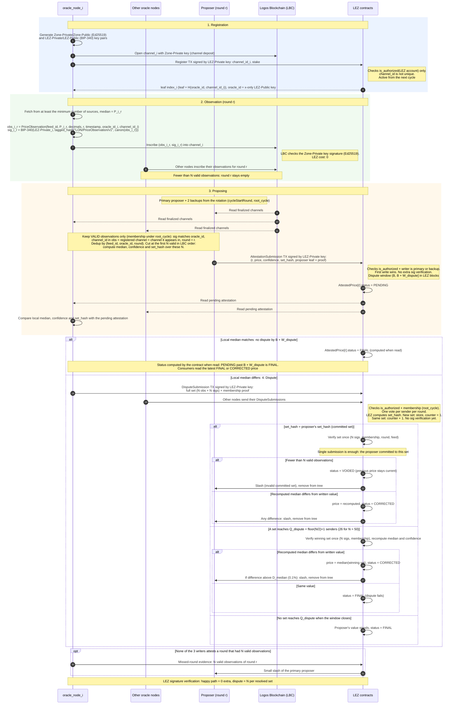

# LON-ORACLE-ZONE

| Field | Value |
| --- | --- |
| Name | Logos Oracle Network (LON) Oracle Zone |
| Slug | 244 |
| Status | raw |
| Category | Standards Track |
| Editor | Ugur Sen [ugur@status.im](mailto:ugur@status.im) |
| Contributors |  Sylvain [sylvain@status.im](mailto:sylvain@status.im) |

<!-- timeline:start -->

## Timeline

<!-- timeline:end -->

## Abstract

The following document specifies the Logos Oracle Network (LON),
a dedicated zone on the Logos Blockchain (LBC) that aggregates and attests external price data
and delivers it to consumers in the Logos ecosystem,
in particular the Logos Execution Zone (LEZ).
A set of oracle nodes fetch prices from external sources, sign their observations,
and publish them as inscriptions on LBC.
LBC totally orders and finalizes these inscriptions,
which makes the input data immutable and identical for every reader.
Because the input is immutable and the aggregation code is fixed and deterministic,
every honest indexer that reads the same finalized inscriptions computes the same attested price.

The oracle nodes double as indexers that read the finalized inscriptions and compute the attested price.
Aggregation follows an optimistic model, since an indexer can be malicious and cannot be trusted.
In each round, one indexer acts as the proposer.
It computes the attested price as the median of the first `N` valid observations and writes it to LEZ,
which opens a dispute window.
If no dispute is raised before the window closes,
the proposed price is accepted as final.
If a dispute is raised, LEZ verifies the signatures and membership of the observations,
recomputes the median itself, and compares it with the proposed value.
The faulty proposer is slashed by LEZ contracts.

The Oracle Zone deliberately holds no general-purpose execution environment.
Therefore, economic security with oracle node registration by staking and slashing is anchored in LEZ contracts.
This RFC specifies the price-fetching format, the aggregation and attestation logic,
the round and timing model, the optimistic delivery and dispute model, the incentivization bridge, and the parameters.

## Motivation

A decentralized price oracle must verify multiple independent signed observations
per update while sustaining a reasonable update frequency.
Two categorical design approaches are significant:

LEZ-native design:
- All oracle nodes and logic live in the LEZ environment.
Research shows that ECDSA signature verification exhausts the LEZ cycle budget
at a relatively small committee size which is too small for a decentralized oracle.
It is still doable, but the verification must be split across several transactions (TXs) and blocks, which breaks atomicity.
Aggregate-signature schemes relax the per-signature cost
but still couple the price-update load to the general-purpose execution layer.

Separate Oracle Zone:
- This approach removes the signature verification load from LEZ.
Prices are published as inscriptions on LBC,
and the heavy work of checking them runs off the LEZ execution path.
LEZ consumes only the final attested price on the optimistic path,
and performs signature verification only when a dispute is raised.
This raises the achievable signer count and the update frequency,
which improves both liveness, since more oracle nodes and faster rounds are possible,
and price accuracy, since more independent sources feed a robust median.

The rationale for a separate zone is therefore performance.
Feeding price data does not load the LEZ execution layer,
and the zone can be tuned for fast aggregation and high verification throughput independently of LEZ.

The trade-off introduced by this separation is that the Oracle Zone has no execution environment
in which to custody stake or run slashing logic.
This RFC resolves that by keeping all economic security
in LEZ contracts for stake and slash operations.

## Format Specification

The key words "MUST", "MUST NOT", "REQUIRED", "SHALL", "SHALL NOT",
"SHOULD", "SHOULD NOT", "RECOMMENDED", "MAY", and "OPTIONAL"
in this document are to be interpreted as described in [RFC 2119](https://www.ietf.org/rfc/rfc2119.txt).

### Terminology

- **Logos Blockchain (LBC):** the base chain of Logos, sometimes called Bedrock.
It orders and finalizes data but runs no general execution.
- **Zone:** a domain that uses LBC for ordering, for example LEZ, the Logos Execution Zone.
- **Channel:** a zone's ordered log on LBC.
It is opened with a key, and LBC accepts a message into the channel for ordering only if it is signed with that key.
- **Inscription:** a message that LBC has accepted and ordered in a channel.
- **Round:** one price update, every `R_round`.
- **Cycle:** `C_cycle` consecutive rounds that share one frozen membership root, `root_cycle`,
and one proposer rotation. `cycleStartRound` is the first round of the cycle.
- **Epoch:** the reward settlement period. It is used only for rewards and SHOULD span a whole number of cycles.
- **Active oracle set (AOS):** the registered oracle nodes under `root_cycle`; `AOS_cycle` is their number.
- **`obs_id`, `set_hash`:** the identifier of one observation and of an observation set,
defined in [Price Fetching](#price-fetching) and [Raising a dispute](#raising-a-dispute).
- **`H`:** Keccak-256, the hash of the membership tree.
Other hashes in this document are SHA-256 where stated, since BIP-340 and the rotation seed fix them.
- Parameters such as `N`, `Q_dispute`, `W_dispute`, `R_round`, `T_block`, `k`, `D_reward`, `D_slash` and `D_median`
are defined in [Parameters](#parameters).

### Assumptions

- Fewer than `Q_dispute` registered seats are malicious.
Honest nodes fetch-then-forward price data by following this protocol.
- An attacker cannot place `N / 2` or more of the first `N` valid observations of a round.
Ordering authority is delegated entirely to LBC's immutable inscription order,
but a node can influence its position by choosing when it inscribes,
so this assumption rests on the attacker controlling few seats, see [Future Work](#future-work).
- Indexers have no immutable execution logic beyond aggregation.
Stake custody and slashing enforcement are delegated entirely to LEZ contracts.
- Enough honest indexers dispute a wrong proposal before the dispute window closes,
each sending the observations and LEZ resolves the dispute by recomputing the median.
Correctness of the disputed set rests on enough honest indexers.
- The active oracle set (AOS) is large enough that the quorum `N` is reached every round.
Liveness of attestation depends on this oversizing.

## Roles

The roles used in the Oracle Zone are as follows:

- `LBC`: The Logos Blockchain ordering layer.
It totally orders and finalizes the inscriptions,
giving every indexer the same immutable input to aggregate over.
- `oracle node`: An off-chain agent run by an oracle operator.
It fetches prices from external sources, computes a local price observation,
signs and publishes it as an inscription on LBC.
Each `oracle node` holds two keys.
Its zone key pair (Ed25519), the Zone-Private key and the Zone-Public key, owns its channel on LBC,
and LBC checks it on every inscription the node writes.
Its LEZ key pair (BIP-340), the LEZ-Private key and the LEZ-Public key, is its LEZ account and its staking identity.
The `oracle id` is the 32-byte x-only LEZ-Public key,
and the node signs its observations with this key.
No third key is needed.
- `indexer`: An `oracle node` in its second role.
It reads the finalized inscription stream from LBC and computes the attested price
as the median of the first `N` valid observations.
Because the input is immutable and the aggregation code is fixed and deterministic,
every honest indexer MUST derive the same value.
- `proposer`: The one indexer that, in a given round,
writes the attested price to LEZ and opens the dispute window.
Only one proposer acts per round.
- `challenger`: Any indexer that reads the proposed price from LEZ, recomputes it from the same finalized inscriptions,
if the proposed value is wrong, disputes it before the window closes.

## Flow

This section walks through the life of an `oracle node` from key generation to dispute.
Each step points to the section that specifies it in detail.

### 1. Key generation

1. The `oracle node` generates its zone key pair (Ed25519): the Zone-Private key and the Zone-Public key.
It owns the node's channel on LBC, and LBC checks it on every inscription.
2. The `oracle node` generates its LEZ key pair (BIP-340): the LEZ-Private key and the LEZ-Public key.
It is the node's LEZ account and staking identity.
Its 32-byte x-only LEZ-Public key is the node's `oracle id`, and the node signs its observations with its LEZ-Private key.

No other key is needed.

### 2. Channel opening

1. The `oracle node` opens its own channel on LBC with its Zone-Private key and pays the channel deposit.
2. Only the holder of the Zone-Private key can write to this channel, which LBC enforces.

### 3. Registration in LEZ

1. The `oracle node` sends a registration TX to the LEZ registration contract, signed with its LEZ-Private key.
It bonds stake and names its `channel id`.
2. The contract checks that the account derived from `oracle id` authorized the TX.
It verifies no additional signature.
3. The contract inserts the leaf `H(oracle_id || channel_id)` into the membership tree and returns its index.
4. The node becomes active from the next cycle, when `root_cycle` is frozen.

Details are in [Oracle Set Membership](#oracle-set-membership).

### 4. Observation

In each round `r`:

1. The `oracle node` fetches the feed price from its sources and computes a local median,
as in [Price Fetching](#price-fetching).
2. It builds a `PriceObservation` that names the round, its `oracle id` and its `channel id`,
and signs it with its LEZ-Private key.
3. It inscribes the signed observation into its own channel.
LBC checks the Zone-Private key signature, orders and finalizes the inscription.
LEZ does nothing at this step.

### 5. Proposing

1. Every `indexer` reads the finalized inscriptions of round `r`
and keeps only valid observations, as in [Aggregation](#aggregation).
It cuts at the first `N` valid observations in LBC order,
and computes the median and the `set_hash` of these `N` observations.
If fewer than `N` valid observations exist, no price is attested for the round.
2. The designated `proposer` of the round, or one of its two backups if it does not write,
writes an `AttestationSubmission` with the round, the price, the `confidence` and the `set_hash`,
in a LEZ TX signed with its LEZ-Private key.
The contract checks that one of the three designated writers authorized the TX,
verifies no observation signature, sets the status to `PENDING`,
and opens the dispute window `(B, B + W_dispute]`,
where `B` is the LEZ block that includes the `AttestationSubmission`.
3. Every other `indexer` acts as a `challenger`.
It compares the written price and `set_hash` with its own.
4. If no dispute changes the value by `B + W_dispute`, the status becomes `FINAL`.

### 6. Dispute

1. A `challenger` whose value differs sends a `DisputeSubmission` with its full observation set,
in a LEZ TX signed with its LEZ-Private key.
The contract checks that the sender authorized the TX and is a member under `root_cycle`,
and counts one vote per sender per round for the set.
No observation signature is verified at this point.
2. If the submitted set has the same `set_hash` as the written `AttestedPrice`,
LEZ resolves immediately: it verifies the set once and recomputes the median.
If the set holds fewer than `N` valid observations, the round becomes `VOIDED` and the proposer is slashed.
A different median proves the proposer computed it wrongly from its own set.
3. Otherwise, when one set reaches `Q_dispute` votes,
LEZ verifies that set once and recomputes the median.
4. If the recomputed median differs from the written value, the price is replaced and the status becomes `CORRECTED`.
The `proposer` is slashed if the difference exceeds `D_median`,
and for any difference on the committed-set path.
If it is the same, the status becomes `FINAL`.
5. If no set reaches `Q_dispute` when the window closes, the written value stands and the status becomes `FINAL`.

Details are in [Dispute Detection](#dispute-detection) and [Slashing](#slashing).

### Sequence diagram

On the optimistic path LEZ verifies no signature beyond the TX signatures of its own runtime.
On the dispute path it verifies the `N` observation signatures of a resolved set once.



## Price Fetching

Each `oracle node` fetches the price of the feed from external sources.
The protocol is agnostic to the specific sources and to the local pre-aggregation method.
It is RECOMMENDED that a node query at least three independent sources and submit a local median,
to reduce the chance of its observation being discarded as an outlier.

A node builds its observation deterministically,
so that two honest nodes reading the same prices produce the same value. First, it reads its sources.
How it connects to each source, which endpoints or APIs it uses, is left to the operator, and the protocol does not constrain the source side.
A node MUST validate each source value before using it.
A value that is not a positive number, or that deviates grossly from the others,
MUST be dropped, so a broken or malicious source cannot enter the local median.
Second, it reduces the remaining source values to one local value by taking their median.
Sources report prices at different decimal precisions,
so the node normalizes each to the fixed `decimals` of the feed, rounding half up.
If the number of values is even, it takes the lower of the two middle values,
so the result is always one of the observed prices and never an average.
Third, it encodes that value as an integer at the fixed `decimals`.

As an example, a node reads four sources for BTC/USDT and gets `67123.1`, `67124.2071`, `67125.40215`, and `67126.0`.
Each is a valid positive number, and none is a gross outlier, so all are kept. 
The feed fixes `decimals = 6`, so the node normalizes each to six decimals rounding half up,
giving `67123.100000`, `67124.207100`, `67125.402150`, and `67126.000000`.
Since the count is even, it takes the lower of the two middle values, `67124.207100`.
It scales that to an integer at six decimals, `67124.207100 * 10^6 = 67124207100`,
and sets `price = 67124207100` and `decimals = 6`.

Each observation is encoded as a `PriceObservation`.
The price is carried as an integer `price` together with a `decimals` field,
so that no floating-point value crosses the protocol boundary.
The real value is `price * 10^(-decimals)`.
Authentication of an observation on the optimistic path comes from two layers.
An oracle node publishes to its own channel,
so LBC verifies the Zone-Private key signature at the inscription level and records the channel each observation was written to.
The observation itself is signed with the node's LEZ-Private key and names the channel it was written to in `channel_id`.
An indexer accepts an observation only if its `channel_id` equals the channel it appears in,
and that channel is the one registered for its `oracle_id`.
A copy of another node's signed observation written to a different channel is therefore ignored.
This stops a node from re-publishing other nodes' observations in its own channel
to change which observations enter a round.

The protobuf encoding below is used only to carry an observation.
Signatures and hashes are never computed over protobuf bytes,
since protobuf serialization is not canonical across implementations
and omits fields that hold their default value.
They are computed over the canonical encoding `canon(obs)` of fields 1 to 7:

```text
canon(obs) = u16(len(feed_id)) || feed_id   (UTF-8 bytes)
          || i64(price) || i32(decimals) || i64(round) || i64(timestamp)
          || oracle_id   (32 bytes)
          || channel_id  (32 bytes)
```

All integers are big-endian, that is most significant byte first.
`i32` and `i64` are signed in two's complement and `u16` is unsigned.

The `signature` field carries a [BIP-340](https://github.com/bitcoin/bips/blob/master/bip-0340.mediawiki) Schnorr signature,
made with the node's LEZ-Private key, over the 32-byte message

```text
msg(obs) = tagged_hash("LON/PriceObservation/v1", canon(obs))
tagged_hash(tag, x) = SHA-256(SHA-256(tag) || SHA-256(tag) || x)
```

The tagged hash is the construction defined in BIP-340.
It separates observation signatures from any other message the same LEZ-Private key signs,
such as LEZ TXs, so a signature from one context can never be valid in another.
The observation identifier used in [Raising a dispute](#raising-a-dispute) is
`obs_id(obs) = SHA-256(canon(obs) || signature)`, where `signature` is the 64-byte BIP-340 signature.
The indexer verifies this signature off-chain during aggregation.
On the optimistic path LEZ does not verify it.
LEZ verifies it only when a dispute is raised, without depending on LBC,
which is what lets the dispute be resolved inside LEZ.
The `membership_proof` is a separate witness and is not covered by the signature.

The `PriceObservation` is specified using [protocol buffers v3](https://protobuf.dev/):

```protobuf
syntax = "proto3";

message PriceObservation {
  string feed_id           = 1;  // asset pair identifier, e.g. "BTC/USDT"
  int64  price             = 2;  // integer-encoded price, real value = price * 10^(-decimals)
  int32  decimals          = 3;  // number of decimal places in `price`, fixed per feed
  int64  round             = 4;  // round identifier, in LBC block-height terms
  int64  timestamp         = 5;  // observation time (unix milliseconds), advisory only
  bytes  oracle_id         = 6;  // 32-byte BIP-340 x-only LEZ-Public key of the node, also its staking identity
  bytes  channel_id        = 7;  // 32-byte id of LBC channel the node registered and publishes to
  bytes  signature         = 8;  // 64-byte BIP-340 signature over msg(obs), verified off-chain by the indexer and on-chain by LEZ only on dispute
  bytes  membership_proof  = 9;  // Merkle inclusion proof of (oracle_id, channel_id) under root_cycle of the observation's cycle (outside signature scope)
}
```

## Aggregation

The `indexer` is the core logic of the Oracle Zone.
Within each round it performs the following steps deterministically over the ordered inscription stream.

1. **Deserialize.** Decode each finalized inscription from LBC into a `PriceObservation`.
2. **Verify signature.** Verify the `signature` field over `msg(obs)` against `oracle_id` as in [BIP-340](https://github.com/bitcoin/bips/blob/master/bip-0340.mediawiki).
Observations with an invalid signature are discarded.
This runs off-chain in the indexer.
3. **Check membership.** Confirm `oracle_id` is a member of the AOS by verifying
its `membership_proof` against `root_cycle` of the observation's cycle (see [Cycles and Proposer Rotation](#cycles-and-proposer-rotation)).
Observations from non-members are discarded.
4. **Check fields and channel.** Confirm that `feed_id` and `decimals` match the feed, that `price > 0`,
that `channel_id` is the channel registered for `oracle_id`,
and that it is the channel the inscription was written to.
Observations that fail any check are discarded.
Observations are deduplicated by (`feed_id`, `oracle_id`, `round`), keeping the first in LBC order.
Two observations under the same key whose `canon` bytes differ are an equivocation fault (see [Slashing](#slashing)).
Re-signing identical `canon` bytes produces a different signature but is not a fault, and only the first copy counts.
5. **Cut at `N`.** Take the first `N` valid observations of the round in LBC order and ignore the rest.
Because LBC gives every indexer the same order, every indexer cuts at the same observation.
6. **Compute median.** Sort the `N` prices in ascending order.
The `attested price` is `sorted[(N - 1) / 2]` with 0-based indexing and integer division,
which is the lower middle value when `N` is even, for example index 24 for `N = 50`.
Compute the `set_hash` of the same `N` observations (see [Raising a dispute](#raising-a-dispute)).
The median structurally tolerates up to half the observations being adversarial without moving outside the honest range.

LEZ does not verify signatures on the optimistic path.
The indexer checks them off-chain during aggregation,
and LEZ verifies them only when a dispute is raised,
over the observations behind the disputed value.
This keeps the heavy per-signature cost off LEZ.

Every honest indexer runs these steps over the same finalized inscriptions and,
because the input is immutable and the code is deterministic, derives the same `attested price`.

The proposer submits the attested price as an `AttestationSubmission`,
and the LEZ contract stores it as an `AttestedPrice`.
Fields that only the contract can know, the status, the proposer and the block that included the write,
are set by the contract and never by the proposer.

```protobuf
enum AttestationStatus {
  PENDING   = 0;  // written by the proposer, dispute window open
  FINAL     = 1;  // window passed with no successful dispute, or the winning set confirmed the written value
  CORRECTED = 2;  // replaced by the median of the set that won a dispute
  VOIDED    = 3;  // the proposer's committed set did not hold N valid observations; the round carries no price
}

message AttestationSubmission {
  int64  round                      = 1;  // round identifier
  int64  price                      = 2;  // attested median, real value = price * 10^(-decimals of the feed)
  int64  confidence                 = 3;  // dispersion of the N observations, scaled like `price`
  bytes  set_hash                   = 4;  // commitment to the N aggregated observations, see Raising a dispute
  bytes  proposer_oracle_id         = 5;  // the writer's oracle_id; its LEZ account MUST authorize the TX
  bytes  proposer_channel_id        = 6;  // the writer's registered channel, needed to rebuild its leaf
  uint64 proposer_leaf_index        = 7;  // index of the writer's leaf under root_cycle
  bytes  proposer_membership_proof  = 8;  // Merkle proof of the writer's leaf under root_cycle
}

message AttestedPrice {                    // stored by the LEZ contract
  string feed_id            = 1;  // asset pair identifier, e.g. "BTC/USDT"
  int64  price              = 2;  // attested median, replaced on CORRECTED
  int32  decimals           = 3;  // number of decimal places in `price`
  int64  round              = 4;  // round identifier
  int64  confidence         = 5;  // dispersion of the N observations, replaced if a dispute recomputes another value
  AttestationStatus status  = 6;  // set only by the contract; a new write is always PENDING
  bytes  set_hash           = 7;  // from the submission
  bytes  proposer_id        = 8;  // oracle_id of the writer, set by the contract
  int64  written_at         = 9;  // LEZ block B that included the submission, set by the contract
}
```

The proposer computes `set_hash` over the observations it aggregated,
with the same `obs_id` and ordering rules that LEZ uses in [Raising a dispute](#raising-a-dispute).
The `set_hash` commits the proposer to the exact set behind its value.
An indexer whose own set has the same `set_hash` but a different median knows the proposer computed the median wrongly,
and an indexer whose set has a different `set_hash` knows the disagreement is about the set itself.

The indexer also computes a `confidence` value
that reports how tightly the `N` observations cluster around the median.
It is the median absolute deviation (MAD) scaled to standard-deviation units, `1.4826 * MAD`,
where `MAD = median(|xᵢ - median|)` over the same `N` prices.
It is computed in integers so every indexer and LEZ derive the same value:
`MAD` uses the same lower-middle rule as the price median,
and `confidence = (14826 * MAD) / 10000` with integer division.
The constant `1.4826` is the standard factor that rescales the median absolute deviation so that,
for normally distributed data, it matches the ordinary standard deviation,
which makes the value easier to read against familiar volatility figures.
A small value means the observations agree closely,
a large value means they are dispersed.
LEZ MAY use it to widen margins or pause when dispersion is high.
Because LEZ may act on it, `confidence` is checked like the price:
an indexer that computes a different value disputes it,
and a resolved dispute recomputes it and replaces the stored value.
A difference in `confidence` alone corrects the stored value but does not slash the proposer.

## Rounds and Timing

The Logos Oracle Zone has no separate zone-level blocks,
since it runs no independent consensus.
Ordering and finality come entirely from LBC.
Every reference to block height or block time in this document is to LBC.

The Oracle Zone operates in rounds of length `R_round`.
Three rules govern the timing:

1. **Deterministic windowing.** Round boundaries MUST be defined by block height, not by wall-clock time.
A wall-clock window is non-deterministic across indexer replicas.
Defining the window as a fixed block range lets every replica derive the identical attested price.
2. **Proposer selection.** The proposer of each round is fixed by a deterministic rotation over the active set,
as specified in [Cycles and Proposer Rotation](#cycles-and-proposer-rotation).
3. **Delivery cadence.** Once per round the proposer writes the attested price to LEZ,
which opens the dispute window `W_dispute`.
An on-chain write cannot occur faster than LBC produces blocks, so `R_round >= T_block`.
With the default `T_block = 30 s`, the default round is one block, about `30 s`.

The price is not final the moment it is written.
It becomes final only after `W_dispute` passes with no successful dispute in the LEZ contract.
The contract runs no scheduler, so it computes the status itself whenever a round is read or touched:
a `PENDING` round whose window has passed, that is LEZ height greater than `B + W_dispute`, and that was not resolved, is `FINAL`.
The current price of a feed is the price of its latest round whose status is `FINAL` or `CORRECTED`.
Consumers MUST read the current price and MUST NOT act on a `PENDING` value.
A correction changes only its own round, so it never overwrites a newer final price.
The effective freshness of a price is therefore the round cadence plus `W_dispute`.
This design targets applications that tolerate this latency.
It does not offer sub-second or high-frequency updates
 and that is a deliberate limitation of the current version.

If fewer than `N` observations are finalized within a round,
no new price is attested for that round, and the last attested price remains the current value
until a round again reaches quorum.
Handling of a proposer that attests incorrectly,
or with fewer than `N` valid observations, is covered in [Slashing](#slashing).

## Cycles and Proposer Rotation

Rounds are grouped into cycles of `C_cycle` rounds.
Cycle `c` covers rounds `[c * C_cycle, (c + 1) * C_cycle)`, and `cycleStartRound = c * C_cycle`.

`root_cycle` of cycle `c` is the membership root as it stands after the last registration of cycle `c - 1`.
The LEZ registration contract records it the first time any TX touches the contract in cycle `c`,
before applying that TX.
Registrations made during cycle `c - 1` therefore become active in cycle `c`,
and registrations made during cycle `c` wait until cycle `c + 1`.
`AOS_cycle` is the number of leaves under `root_cycle`.
Indexers and the LEZ contract MUST use `root_cycle` of the observation's cycle,
both to validate observations and to check disputes.

The proposer of each round is fixed by a deterministic rotation over the leaves under `root_cycle`:

```text
seed_c      = SHA-256("permA" || cycleStartRound || root_cycle)
offset_c    = seed_c mod AOS_cycle
proposer(r) = leaf at index (offset_c + (r - cycleStartRound)) mod AOS_cycle
```

Here `"permA"` is UTF-8, `cycleStartRound` is an 8-byte big-endian integer, `root_cycle` is 32 raw bytes,
and `seed_c` is read as an unsigned big-endian integer before the `mod`.
Every indexer and the LEZ contract derive the same proposer without communication.
The `AttestationSubmission` TX carries the writer's leaf and its membership proof against `root_cycle`.
The contract checks that the leaf is at one of the three rotation indices of the round, the primary or a backup (see below),
and that the account derived from its `oracle_id` authorized the TX.

Each round has a primary proposer `proposer(r)` and two backups,
the leaves at the next two rotation indices, `(index + 1) mod AOS_cycle` and `(index + 2) mod AOS_cycle`.
The contract accepts the first `AttestationSubmission` for the round from any of the three and rejects later ones.
By convention the backups wait before writing, so the primary writes first when it is live.
This staggering is off-chain and not enforced; rewards are the incentive to follow it.

A proposer that is slashed and removed during a cycle keeps its leaf under `root_cycle` until the cycle ends,
but the contract rejects its writes, so its backups take its rounds.
If none of the three writes a round that had at least `N` valid observations,
the primary proposer is slashed for a missed round (see [Slashing](#slashing)).
A round with fewer than `N` valid observations stays empty and nobody is slashed.

## Oracle Set Membership

Membership of the AOS determines which `oracle id`s submit observations that indexers will accept.
Membership is also the basis of incentivization.
To join, an `oracle node` first opens its channel on LBC with its Zone-Private key, which requires a channel deposit.
It then sends a registration TX to the LEZ registration contract, signed with its LEZ-Private key,
that bonds stake and names its `channel_id`.
The LEZ runtime verifies the TX signature,
and the contract checks only that the account derived from `oracle_id` authorized the TX.
No additional signature is verified in the contract.
The contract inserts the leaf `H(oracle_id || channel_id)` into the membership tree and returns its index.
The membership tree is a binary Merkle tree in which `H` is Keccak-256,
for leaves and for internal nodes, `H(left || right)`.
A new member becomes active from the next cycle, when `root_cycle` is frozen.
Registration is a LEZ-only operation and does not require a cross-zone write into the Oracle Zone.

Each `oracle_id` MAY hold only one leaf, so a node cannot register twice,
and its `channel_id` cannot be changed after registration.
The LEZ account that must authorize a registration is the account derived from `oracle_id` by the LEZ rule,
currently `SHA-256(prefix || oracle_id)` with a fixed 32-byte public-account prefix.
A node leaves by sending a withdrawal TX.
It is removed from the tree at once, so it is no longer active from the next cycle,
but its stake stays locked and slashable for the unbonding period before it can be withdrawn.
LBC offers no operation that closes a channel; a node keeps its channel funded for as long as it observes.

`channel_id` is NOT required to be unique.
A node that registers another node's channel gains nothing,
since it cannot write to that channel and its own observations never appear there,
so they are discarded by the channel check in [Aggregation](#aggregation).
A uniqueness rule would instead let it front-run the channel owner's registration and block it.
Colluding nodes MAY share one channel. This gives them nothing, since every observation is still signed and counted per `oracle_id`.

An indexer does not query LEZ state live during aggregation, which would make aggregation non-deterministic across replicas.
Instead, each observation carries a `membership_proof`,
a Merkle inclusion proof of its leaf against `root_cycle` of the observation's cycle,
and the indexer verifies the proof against that root.
The indexer reads `root_cycle` once per cycle from the LEZ registration contract.
Indexers and LEZ use the same `root_cycle`, so a node that registers in the middle of a cycle
is accepted by neither until the next cycle.
Each leaf binds an `oracle id`, the node's 32-byte x-only LEZ-Public key,
to the `channel_id` it registered.

During aggregation, every indexer discards observations whose `membership_proof` does not verify,
so observations from non-members never enter the median.
On the dispute path the LEZ contract checks the same proofs against its own membership root,
so only registered nodes count toward the disputed value.

## Incentivization

The Oracle Zone has no execution environment of its own,
so it custodies no stake and runs no slashing logic.
All economic security lives in `LEZ contracts`.
Setting membership by staking, reward settlement, and slashing all happen in `LEZ contracts`.
The Oracle Zone only produces the data that these contracts act on.

### Rewards and Revenue

`oracle nodes` earn from serving the feed, and this reward stream is not just compensation but a security primitive.
An `oracle node`'s admission right (see [Oracle Set Membership](#oracle-set-membership)) is a scarce,
income-producing, transferable seat whose market value approximates the net present value of its future reward stream.
This franchise value raises the cost of acquiring a median-controlling set and
makes misbehavior economically self-defeating, since a fault forfeits that future income.
For this to hold, rewards SHOULD be fee-backed (funded by consumers of the feed) rather than pure emissions,
so that the seat's value reflects real, sustainable income rather than speculation.

Reward accounting is computed in the Oracle Zone,
since only the indexer knows which `oracle nodes` submitted valid,
within-bound observations in the epoch.
At each epoch boundary the indexer commits a reward table, for example a Merkle root of `oracle node` amounts,
to a LEZ settlement contract in a single cross-zone TX.
This keeps reward traffic off the per-round path.
The settlement contract does not run a scheduler.
Each `oracle node` claims against the committed root,
so payout is pull-based and per-epoch rather than a per-round push,
and the claimant pays its own settlement cost.

Reward eligibility is assessed against a soft deviation band around the round's attested median.
The indexer marks each observation as reward-eligible if it lies
within a small deviation `D_reward` of the attested median,
using the same integer rule as `D_slash` (`|x - m| * 10000 <= D_reward_bp * m`), and reward-ineligible otherwise.
An eligible observation earns a full, equal share regardless of its exact distance from the median (validity, not proximity),
so `oracle nodes` are not pushed to herd toward the median,
while an ineligible observation earns nothing for that round but is not slashed.
This soft band is distinct from, and much tighter than, the hard validity bound whose breach is a slashable out-of-bound fault.
The band affects reward accounting only.
Rewards are attributed to the `oracle id` that signed a valid observation, never to a channel.
The attested median is always the plain median of the first `N` valid observations, unaffected by `D_reward`.

### Slashing

Slashing MUST fire only on strict and provable conditions.
A slash is triggered by submitting fault evidence to the LEZ contract,
which verifies it and applies the penalty.
Five slashable faults are defined.
In this version only the two proposer faults, invalid committed set and wrong median, are enforced,
since both are proven through the dispute path in [Raising a dispute](#raising-a-dispute).
The evidence formats for equivocation, out-of-bound values and missed rounds are left to [Future Work](#future-work).

1. **Equivocation.** An `oracle id` signs two observations for the same (`feed_id`, `round`)
whose `canon` bytes differ.
The two BIP-340 signatures are a self-contained fraud proof,
verified in LEZ, and non-malleable signatures make this unambiguous.
Because the proof is cryptographic and false positives are effectively impossible,
this fault SHOULD carry the highest penalty.

2. **Out-of-bound value.** A signed observation lies outside the hard validity bound `D_slash` for the round.
The reference is the round's final attested price `m`, that is the price of a round whose status is `FINAL` or `CORRECTED`.
An observation `x` is out of bound if `|x - m| * 10000 > D_slash_bp * m`, with `D_slash` expressed in basis points.
Out-of-bound observations still count toward the first-`N` cut,
since the cut is made before the median is known.
The signed value plus the round context is itself the proof.
`D_slash` is an absolute sanity bound checked during slashing,
and it is much wider than the tight `D_reward` band used for reward eligibility (`D_reward < D_slash`),
so that an honest node stays well inside it and a value outside it indicates malice or gross malfunction.
Because bound-checking can still have edge cases,
a stale reference or a genuine market dislocation may make an honest value appear out of bound,
this fault SHOULD carry a capped fraction rather than the full stake,
and MAY be paired with a challenge window.

3. **Invalid committed set.** The set the proposer committed to through `set_hash`
does not hold `N` valid observations of the round.
An observation is invalid if its signature, membership, `channel_id`, `round`, `feed_id` or `decimals` check fails,
or if two observations share an `oracle_id`.
A challenger proves the fault by submitting the set whose hash equals the written `set_hash`.
The fault is objective, since the proposer itself committed to that set.
The round becomes `VOIDED`, the previous current price stays in force, and the proposer is slashed.
This also covers a proposer that attests before `N` valid observations exist,
since it can only commit to a set with fewer than `N` valid observations.

4. **Wrong median.** A proposer attests a value that is not the median of the first `N` valid observations of the round.
It is proven in a dispute, either through the committed set or through a set that reaches `Q_dispute`
(see [Raising a dispute](#raising-a-dispute)).
LEZ replaces the written value with the recomputed median.
On the committed-set path the proposer computed from its own set, so any difference slashes it.
On the vote path the proposer is slashed only if `|written - recomputed| * 10000 > D_median_bp * recomputed`,
so a small difference, for example from a set seen slightly differently, corrects the price without a penalty.
A failed round is not re-proposed.
The feed continues from the next round,
so a proposer that forces a failed round pays a slash for each attempt,
which makes stalling the feed economically unsustainable.

5. **Missed round.** None of the primary proposer and its two backups writes a round
that had at least `N` valid observations.
The primary proposer is slashed with a small fraction of its stake.
The evidence is `N` valid observations of the round, which shows the round was not empty,
since LEZ cannot see LBC and cannot otherwise tell a missed round from an empty one.

Slashed stake MAY be burnt or split between a bounty to the party that submitted the fault evidence,
which funds a permissionless watchdog economy, and burn or treasury for the remainder.
Apart from a missed round, liveness and non-participation are NOT slashed.
Missing `oracle nodes` are tolerated by a sufficiently large active set
and are handled through reward eligibility rather than penalties.
Falling outside the `D_reward` band is likewise NOT a slashable fault.
It only forfeits that round's reward.
Subjective incorrect price and within-bound majority bias are also deliberately excluded,
since no trust-minimized programmatic predicate for them exists.
These are addressed economically rather than by slashing,
through the franchise value of the reward stream above,
the unbonding period below, and randomized selection,
as discussed in [Security Considerations](#security-considerations).

## Parameters

The parameters below are drawn from values used by comparable oracle systems and adjusted for this design.
Block-time and finality parameters are properties of the LEZ and are listed for reference.

| Parameter | Symbol | Default | Notes |
| --- | --- | --- | --- |
| Feed |  | `BTC/USDT` | Single feed, more added later. |
| Feed decimals |  | 6 | Fixed integer scale for the feed. Every observation uses it, so the indexer needs no rescaling. |
| Quorum threshold | `N` | 50 | Number of observations aggregated per round: the first `N` valid ones in LBC order. |
| Honest-majority assumption |  | majority of the aggregated observations | Over the observations aggregated per attestation, not the total pool. |
| Heartbeat / round cadence | `R_round` | 1 LBC block (`~30 s`) | Time between two price updates; defined in block-height terms; must be `>= T_block`. |
| Dispute window | `W_dispute` | 90 LEZ blocks (`~90 s`) | Time a proposed price waits for a dispute before it finalizes. 
Counted in LEZ blocks (~1 s each), since the LEZ contract checks it against its own height. |
| LEZ block time |  | `~1 s` | Consumer zone block time, faster than LBC block. |
| Aggregation function |  | median | Plain median of the first `N` valid observations; lower middle value for even `N`. |
| Reward band | `D_reward` | 0.5%* | Tight band around the median for reward eligibility; `D_reward < D_slash`.  |
| Hard validity bound | `D_slash` | 2.5%* | Wide sanity bound; a signed value outside it is a slashable out-of-bound fault.  |
| Signature scheme | | BIP-340 Schnorr (LEZ key pair), Ed25519 (zone key pair) | `oracle_id` is the 32-byte x-only LEZ-Public key. The zone key pair only owns LBC channel. |
| Dispute threshold | `Q_dispute` | `floor(N / 2) + 1` = 26 | Distinct registered senders voting for the same set; one vote per sender per round. |
| Median tolerance | `D_median` | 0.1% (10 bp)* | On the vote path, the deviation between the written and recomputed median above which the proposer is slashed. On the committed-set path any difference slashes. |
| Cycle length | `C_cycle` | TBD* | Rounds per cycle; `root_cycle` and the proposer rotation are fixed per cycle. |
| Resolution window | `W_resolve` | TBD* | LEZ blocks after `B + W_dispute` during which `resolve_dispute` may still be called. |
| Active oracle set size | `AOS` | 500* | Scarce, transferable seats (~10x `N`) so a random per-round subset resists majority capture|
| Stake requirement |  | fixed floor, greater of token amount or USD value* | Hybrid floor to resist token-price drawdown; magnitude set with tokenomics. |
| Slash fraction (equivocation) |  | up to 100%* | Cryptographic proof, effectively zero false positives, so the highest tier is justified. |
| Slash fraction (out-of-bound) |  | 5% cap* | Capped due to edge-case risk; MAY use a challenge window. |
| Slash fraction (invalid committed set) |  | up to 100%* | Proven by the proposer's own committed set, effectively zero false positives. |
| Slash fraction (wrong median) |  | capped* | Proposer attested a value a successful dispute proved wrong. |
| Slash fraction (missed round) |  | small, TBD* | Primary proposer when none of the three writers attests a round that had `N` valid observations. |
| Unbonding / cooldown period |  | 21 days* | Cosmos/Band anchor; must exceed fault-proving window plus deep-finality horizon. |
| Reward settlement |  | per epoch, pull-based | Claim against a committed Merkle root|
| Epoch length |  | 7 days* | Weekly settlement. |
| Reward backing |  | fee-backed preferred* | Fees over pure emissions for sustainable franchise value. |
| LBC block time | `T_block` | 30 s | Average time between two LBC blocks; Logos default assumed here. |
| LBC finality depth | `k` | immutable bound (reference) | Number of LBC blocks after which an inscription cannot be reverted; practical confirmation depth is much shallower. |

## Security Considerations

Two properties matter most for a price oracle network.
One is liveness, meaning a fresh price is attested every round.
The other is accuracy, meaning the attested price tracks the real market.
Running as a separate zone serves both.
It lifts the per-round signature-verification load off LEZ,
so the zone can aggregate many more observations per round than an LEZ-native design.
More observations per round improves liveness,
since the quorum `N` is easily reached even when many `oracle nodes` are absent,
and improves accuracy, since more independent observations feed the median.
Accuracy is further backed by the median itself
and by the slashing conditions in [Incentivization](#incentivization).
The points below expand on the assumptions this relies on.

1. **Quorum and honest majority.** The quorum `N` is the minimum number
of valid observations needed before a price is attested.
Exactly the first `N` valid observations in LBC order are aggregated, and later ones are ignored.
The security assumption is that a majority of the aggregated observations are honest,
which keeps the median within the honest range.
A large active set makes it unlikely that a whole round is majority-malicious,
since an attacker would need to control more than half of many independent observations.

2. **Indexer liveness is not oracle node liveness.** Replicating the indexer keeps the indexer layer live.
It does not ensure that enough `oracle nodes` submit each round.
`Oracle node` liveness is handled by keeping the active set large and by rewards,
not by replication or by slashing non-participation.

3. **The optimistic path rests on honest indexers.** On the optimistic path LEZ accepts
the proposer's value without checking it.
A wrong value is caught only if honest indexers,
having recomputed the median offchain from the same finalized inscriptions,
see the mismatch and raise a dispute.
To dispute, the indexer sends the set it computed, which counts as its vote for that set.
LEZ resolves the dispute once one set reaches `Q_dispute` votes,
by verifying signatures and membership and recomputing the median over that set.
One honest indexer is enough to open a dispute,
and it is also enough to correct a proposer that computed a wrong median from the set it committed to through `set_hash`.
Correcting a wrong set needs `Q_dispute` honest indexers to vote for the same set.
In return, a group smaller than `Q_dispute` cannot overturn a correct value, however many disputes it raises.

4. **Cross-zone boundary.** The attested price and the slashing evidence
both cross into LEZ over a cross-zone TX.
LBC guarantees that an inscription is validly ordered and finalized,
but not that the sending side computed correctly,
so the correctness of what LEZ consumes is re-established inside LEZ.
On a dispute LEZ verifies the BIP-340 signatures and membership of the observations itself
and recomputes the median, so a slash rests on evidence LEZ checks directly,
not on trusting the party that delivered it.

5. **Completeness of the observation set.** A proposer could pick a set other than the first `N` valid observations
to shift the median.
LEZ cannot see LBC order, so it cannot tell on its own which set is the right one.
Completeness rests on `Q_dispute` honest indexers that read the same finalized inscriptions,
derive the same first-`N` set, and vote for it.
An observation inscribed after the `N`-th valid one is correctly excluded.

6. **What LEZ verifies.** LEZ verifies observation signatures and membership.
The membership proof binds `channel_id` to the registered channel through the leaf.
LEZ does not verify LBC order, the first-`N` cut, or the channel an inscription was written to.
These rest on `Q_dispute` honest indexers, who check them off-chain.

## Dispute Detection

Every indexer runs a per-round dispute loop to detect potential wrong attestations
by comparing the written value against the one it computes locally.

Correctness of the feed is guaranteed by the dispute detection mechanism.
On the optimistic path the LEZ contract only stores what the proposer wrote, without any verification.
A wrong value is caught only if enough honest indexers run the loop and raise a dispute within the window.

### The loop

After each round closes, every indexer runs these steps.

1. **Read.** An indexer follows every new LBC block
and caches its `PriceObservation` inscriptions in canonical order,
so once a round closes the cache already holds every observation for it.
2. **Recompute.** Run the aggregation over the cached observations and produce the indexer's own attested price.
This is the deterministic median logic described in [Aggregation](#aggregation).
3. **Fetch.** Once the `round` closes in LBC, poll the LEZ contract for the accepted attestation.
Polling every few seconds through `W_dispute` is enough.
4. **Compare.** If the fetched price, `confidence` and `set_hash` equal the recomputed ones, do nothing.
If they differ, raise a dispute before `W_dispute` closes.
The next section defines raising a dispute formally.

### Raising a dispute

Formally, a dispute is a vote among registered indexers on the observation set of a round.
Each indexer that disagrees with the written `AttestedPrice` sends one `DisputeSubmission`
that carries the full set it computed.
LEZ identifies each set by a hash it computes itself and counts one vote per indexer for that set.
It shifts a round from the optimistic path into the verification path,
where the written `AttestedPrice` is checked against the set that reaches `Q_dispute` votes.

Each dispute TX carries the following payload.

```protobuf
syntax = "proto3";

// A dispute consists of one or more of these, sent by indexers inside W_dispute.
message DisputeSubmission {
  int64 disputed_round                   = 1;  // the round whose AttestedPrice is disputed
  bytes sender_oracle_id                 = 2;  // the submitter's oracle_id; its LEZ account MUST authorize the TX
  bytes sender_membership_proof          = 3;  // Merkle proof of sender_oracle_id in root_cycle of the disputed round's cycle
  repeated PriceObservation observations = 4;  // signed observations from LBC, in LBC order

}
```

LEZ identifies each delivered set by its `set_hash`, which it always computes itself from the observations.
For each observation, `obs_id = SHA-256(canon(obs) || signature)` as defined in [Price Fetching](#price-fetching).
The `obs_id`s are sorted by `oracle_id` in ascending byte order, and
`set_hash = SHA-256(disputed_round as 8-byte big-endian || obs_id_1 || ... || obs_id_k)`.
The `membership_proof` is excluded, since it is a witness and not part of the observation.
Two honest indexers that computed the same set therefore produce the same `set_hash`.

The indexer sends the submission in a LEZ TX signed with its LEZ-Private key,
and includes its `sender_oracle_id` and membership proof.
The LEZ contract checks that the account derived from `sender_oracle_id` authorized the TX,
and verifies that `sender_oracle_id` is in the `root_cycle` of the disputed round's cycle.
Only a registered indexer can satisfy both,
so a non-member cannot flood the contract with disputes.
The LEZ runtime already verifies the TX signature,
so this adds no signature verification inside the contract.

The `PriceObservation` type is defined in [Price Fetching](#price-fetching).
Each `PriceObservation` carries the same `signature` and `membership_proof` it had on LBC.
LEZ verifies these against the `root_cycle` frozen for the disputed round's cycle, not against the current live root.

Each `DisputeSubmission` carries the full set in a single TX,
so a set is never split or reassembled across TXs,
and a submission needs no `total`, `offset` or `length` fields.
LEZ keeps, per disputed round, one entry per distinct `set_hash` with a vote counter,
together with the set of senders that have already voted.
On each submission LEZ checks `sender_membership_proof` against `root_cycle`,
and rejects the submission if the sender has already voted in this round.
Each sender has exactly one vote per round.
LEZ computes the `set_hash` of the delivered observations.
If no set with that hash is stored yet, LEZ stores the observations without their membership proofs.
LEZ then increments the counter of that `set_hash`.
A partial or altered set yields a different `set_hash` and only ever counts for itself.
Sets are never merged, so observations delivered for one `set_hash` never enter another.
No observation signatures are verified during collection.

As an OPTIONAL optimization, an implementation MAY accept a `DisputeVote`
that carries only the `set_hash` of a set already stored for the round, instead of the full observations.
It counts as a vote for that stored set under the same rules as a `DisputeSubmission`,
and it is rejected if the hash is not stored.
This saves re-delivering an identical set, about 32 bytes instead of `N` observations.

```protobuf
message DisputeVote {
  int64 disputed_round          = 1;  // the round whose AttestedPrice is disputed
  bytes sender_oracle_id        = 2;  // the voter's oracle_id; its LEZ account MUST authorize the TX
  bytes sender_membership_proof = 3;  // Merkle proof of sender_oracle_id in root_cycle of the disputed round's cycle
  bytes set_hash                = 4;  // a set already stored for disputed_round
}
```

`W_dispute` opens at the LEZ block that includes the proposer's `AttestationSubmission`.
If that block is `B` and the window is `W_dispute` blocks,
disputes are accepted while the current LEZ height is in `(B, B + W_dispute]`.
LEZ checks this on each submission using its own block height.

When the counter of a set reaches `Q_dispute = floor(N / 2) + 1`, resolution is triggered for that set.
If the resolution work fits the LEZ cycle budget,
it MAY run in the same TX that reaches `Q_dispute`.
Otherwise any registered indexer invokes it as a separate `resolve_dispute(disputed_round)` call.

On resolution, LEZ verifies each observation of that set once,
checking its `signature` against `oracle_id`,
and its `membership_proof` against the `root_cycle` of the disputed round's cycle, dropping any that fail.
If fewer than `N` valid observations remain, the dispute is invalid and the written `AttestedPrice` stands.
Otherwise LEZ computes the median over the valid set with the same rules as [Aggregation](#aggregation)
and compares it to the written value.
If they match, the dispute fails, the written value stands, and its status becomes `FINAL`.
If they differ, the written `AttestedPrice` is replaced with the recomputed median, its status becomes `CORRECTED`,
and the proposer is handled per [Slashing](#slashing).
If `W_dispute` closes before any set reaches `Q_dispute`, the written value stands and its status becomes `FINAL`.

**Committed set.** If the `set_hash` of a submitted set equals the `set_hash` in the written `AttestedPrice`,
the set is the one the proposer committed to.
LEZ MUST resolve it immediately, without waiting for `Q_dispute`.
It checks every observation of the set as above, and also that `round`, `feed_id` and `decimals` match
and that no `oracle_id` repeats.
If fewer than `N` observations pass, the round becomes `VOIDED` and the proposer is slashed for an invalid committed set.
Otherwise LEZ recomputes the median.
If the result differs from the written value,
the proposer computed a wrong median from its own set, which is objective,
so LEZ corrects the price and handles the proposer per [Slashing](#slashing).
This path does not catch a proposer that chose a wrong set,
which still needs `Q_dispute` votes for the correct set.

**Terminal rules.** Resolution is final.
Once a round is resolved, through the committed set or through a set that reaches `Q_dispute`,
LEZ rejects every further submission for that round.
`resolve_dispute` MAY be called until LEZ height `B + W_dispute + W_resolve`.
A set that fails resolution because fewer than `N` of its observations are valid is marked invalid
and cannot be resolved again, while other sets of the round keep counting.
The proposer of a round MUST NOT vote in its own round.

How the dispute set is stored and deduplicated,
and whether resolution runs in one TX or several, are left to implementation,
since both depend on the LEZ storage model and cycle budget.

## Future Work

This section records design directions deferred beyond this version.

- **Randomized selection.** This version accepts observations in inscription order and selects the proposer by a deterministic rotation,
so both are currently predictable.
Two selections are left to future work, and both need a shared randomness source with a specified construction.
First, the attesting set.
Accepting observations in inscription order until quorum is adequate
while the set is small and curated, but as it grows an attacker holding many seats could place a majority
into a round and bias the median.
Selecting each round's attesting set at random from the larger registered set
forces an attacker to control a large fraction of the whole set rather than a bare majority.
Second, the proposer. The deterministic rotation is the starting point,
but a proposer that is unpredictable in advance stops an attacker from targeting the known next writer.

- **Cooldown and unbonding period.** The unbonding period must be long enough that stake stays locked
until any fault can be detected, proven, and settled in LEZ, plus LBC deep-finality margin.
The exact duration is left to tokenomics and should be set well above the deep-finality bound.
The LEZ contracts that hold stake and enforce the cooldown and unbonding are also left to be specified,
since this version covers only the Oracle Zone side.

- **Volatility handling.** In fast markets, honest prices spread out.
A fixed `D_reward` band can then mark many honest observations ineligible for reward exactly when fresh prices matter most.
A mechanism to widen the band or grow the attesting set during high volatility is left to future work.

- **Slash evidence format.** The slashing flow for equivocation and out-of-bound values is not yet specified formally.
Who submits the fault evidence is one, and this is an open watcher role paid by the bounty.
What the evidence holds is another.
For equivocation it is the two conflicting signed observations.
For an out-of-bound value it is the signed observation and the round context.
For a missed round it is `N` valid observations of the round, and the window in which they may be submitted is open.
Invalid committed sets and wrong medians are already proven through the dispute path.
How the LEZ contract checks each kind of evidence, and the challenge window for the faults that need one, are open.
Slashing is never automatic. An oracle node or watcher always starts it by sending evidence to the LEZ contract.

- **Reward and slash amount analysis.** This version fixes the reward and slashing mechanisms
but not their exact economic parameters.
Several values are left to future work.
These are the concrete stake requirement, the four slash fractions,
the reward rate and its fee backing, the epoch length, and the unbonding duration.
Each must be sized against the value the feed secures.
The goal is to keep the cost of corruption above the profit from corruption.
This work also covers how the reward table is committed.
It covers whether that commitment needs the same optimistic-proposer-and-dispute protection as the attested price.

- **LEZ contract specification.** This version defines what the LEZ contracts must achieve but not their implementation.
On the optimistic path a contract only stores the proposed price, opens the dispute window,
and finalizes if the window closes clean, so this path does no computation and must be cheap.
On the dispute path the contract does real work.
It verifies signatures, checks membership, recomputes the median, and applies the slash.
This is the heavy path that a separate zone was meant to keep rare.
Left to future work are the concrete contracts for registration and staking, price finalization,
dispute resolution, and reward settlement, and a check that the dispute-path computation fits within the LEZ cycle budget.

- **Confidence threshold.** The `confidence` value reports how tightly observations cluster around the median,
but this version does not fix what counts as an acceptable value.
A normal spread in a fast market can look too wide in a calm one.
Defining this threshold, or a rule that adapts it, is left to future work together with the volatility handling above.

- **Dispute voter set.** This version lets any registered indexer vote in a dispute,
and resolves at `Q_dispute = floor(N / 2) + 1` votes.
Since the active set is much larger than `N`, a group holding `Q_dispute` seats can push its own set past the threshold,
and two different sets can both reach it.
Two directions are open.
One raises the threshold to a majority of the active set, `floor(AOS_cycle / 2) + 1`, so at most one set can reach it,
at the cost of many more votes per dispute and a longer `W_dispute`.
The other keeps `Q_dispute` small but restricts voting to a committee of `N` indexers per round,
chosen independently of the disputed sets, for example from the cycle permutation used for proposer selection.
Such a committee is predictable when derived from `root_cycle`, so its strength depends on a randomness source this version does not have.

## Copyright

Copyright and related rights waived via [CC0](https://creativecommons.org/publicdomain/zero/1.0/)

### References

- Logos Improvement Proposals (LIPs) index: [https://lip.logos.co/](https://lip.logos.co/)
- Cryptarchia and Bedrock (Logos): [https://lip.logos.co/blockchain/raw/bedrock-architecture-overview.html?highlight=Cryptarchia#cryptarchia](https://lip.logos.co/blockchain/raw/bedrock-architecture-overview.html?highlight=Cryptarchia#cryptarchia)
- [BIP-340: Schnorr Signatures for secp256k1](https://github.com/bitcoin/bips/blob/master/bip-0340.mediawiki)
- [RFC 2119: Key words for use in RFCs](https://www.ietf.org/rfc/rfc2119.txt)
- [protocol buffers v3](https://protobuf.dev/)
- Flare Time Series Oracle (FTSO): [https://docs.flare.network/tech/ftso/](https://docs.flare.network/tech/ftso/)
- Supra DORA (Distributed Oracle Agreement): [https://docs.supra.com/oracles/dora-price-feeds](https://docs.supra.com/oracles/dora-price-feeds)
- LON proof-of-concept 1: [https://github.com/sydhds/lon_poc](https://github.com/sydhds/lon_poc)
- LON proof-of-concept 2: [https://github.com/seugu/lon_oracle_zone_bench](https://github.com/seugu/lon_oracle_zone_bench)
- LON proof-of-concept 3, mocked zone: [https://github.com/seugu/lon_oracle_zone_bench/tree/mocked-zone](https://github.com/seugu/lon_oracle_zone_bench/tree/mocked-zone)
