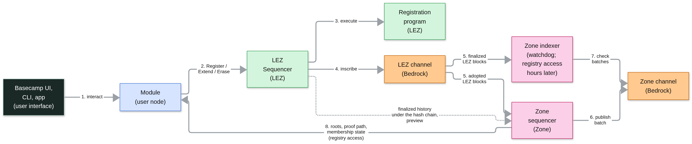
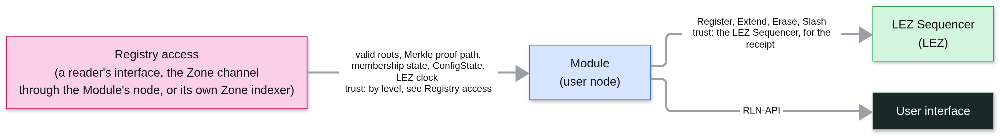

# RLN-MEMBERSHIP-ZONE

| Field | Value |
| --- | --- |
| Name | RLN Membership Zone |
| Status | raw |
| Category | Standards Track |
| Tags | rln, membership, registry, zone |
| Editor | Vinh Trinh [vinh@status.im](mailto:vinh@status.im) |
| Contributors | |

<!-- timeline:start -->
<!-- timeline:end -->

## Abstract

This document specifies the RLN Membership Zone:
a registry, in the sense of the
[RLN-API](https://lip.logos.co/anoncomms/raw/rln-api.html),
for RLN memberships on the Logos Blockchain.
A membership is bought with a deposit through a registration program
on the Logos Execution Zone (LEZ), which also handles refunds and slashing,
so LEZ holds the current state of every membership.

The membership set is a Merkle tree, and no one stores it on chain.
Fixed rules derive it from the registration program's transactions,
so any node that reads LEZ computes the same tree.
The Zone sequencer computes it and publishes its roots on Bedrock.
Zone indexers compute it too, check every published root,
and serve the registry to the RLN Module that RLN-API specifies ("the Module" for short), one in every user's node.
A Module holds no tree: it proves and validates against the published roots,
and reads its Merkle proof path and its membership state from a reader, the Zone sequencer or a Zone indexer;
the roots from Bedrock through its own Logos Blockchain node when it wants to check them;
and everything from a Zone indexer of its own when it wants to trust nobody.

RLN-API itself does not change; its `logos` namespace binding is filled in as [Module Requirements](#module-requirements) states.

The Zone holds no user funds and has no general-purpose execution environment;
all deposits stay in the registration program.

## Motivation

Testnet v0.3 ran the `logos` registry as [logos-lez-rln](https://github.com/logos-co/logos-lez-rln):
the membership set in LEZ accounts, every level of the Merkle tree recomputed inside the RISC Zero zkVM
at each registration.
That costs about 9.09M of the 10M execution gas a LEZ block holds,
so a LEZ block carries one registration, each one raises the next block's base fee for every LEZ user,
and the tree is limited to depth 9 (512 leaves over its lifetime), with a non-standard depth-10 circuit.
None of it is intrinsic to RLN: a registry needs ordered, available, verifiable changes to its membership set,
which LEZ already provides to anyone who reads it, and the hashing can run outside the zkVM.
Deriving the membership set from LEZ removes the hashing from the zkVM,
raises the tree depth to 20 (the default depth Zerokit ships),
keeps only the deposit logic on LEZ,
and makes the registry a public record on Bedrock that any node can recompute and check.

## Semantic

The key words "MUST", "MUST NOT", "REQUIRED", "SHALL", "SHALL NOT",
"SHOULD", "SHOULD NOT", "RECOMMENDED", "MAY", and "OPTIONAL" in this document
are to be interpreted as described in [RFC 2119](https://www.ietf.org/rfc/rfc2119.txt).

## Terminology

Every term not listed here keeps the meaning and spelling of its source:
RLN-API first, then RLN Membership Allocation, RLN-V1 and RLN-V2, the Zerokit-API,
and the Logos Blockchain specifications and code ([References](#references)).

"Epoch" is always the RLN epoch, never the Cryptarchia epoch.

This document adds:

| Term | Meaning |
| --- | --- |
| The Module | The RLN Module that RLN-API specifies, one instance in every user's node: it registers, generates and validates proofs, and holds no tree. |
| The Zone | The RLN Membership Zone specified here; "a Zone" or "Zones" means any Logos Zone (glossary), LEZ included. |
| Batch | The payload of one `CHANNEL_INSCRIBE` in the Zone channel, carrying the membership-set changes of a contiguous range of LEZ blocks `[from_lez_block_id, to_lez_block_id]`. |
| Reader | A Zone sequencer or a Zone indexer: the same program, with or without an accredited key. It applies the Derivation Rules to the LEZ blocks on Bedrock, holds the tree, follows the Zone channel and serves the registry ([Reader](#reader)). Anything else that applies the rules to the same blocks computes the same tree. |
| Zone sequencer | A reader holding an accredited key of the Zone channel: it publishes the batches, from the LEZ blocks adopted on Bedrock, and serves the registry ([Zone Sequencer](#zone-sequencer)). |
| Zone indexer | A reader without an accredited key: it derives the tree from the LEZ blocks finalized on Bedrock, judges every batch of the Zone channel against it, and serves the registry to Modules; it runs in any node, as the Module's own node or as a service, and holds no identity. Distinct from the LEZ Indexer ([Zone Indexer](#zone-indexer)). |
| Registry access | What a Module reads the registry through, the "registry access" of RLN-API: a reader's interface (the Zone sequencer's or a Zone indexer's), the Zone channel on Bedrock through the Module's own node, or a Zone indexer of its own ([Module Requirements](#module-requirements)). |
| Zone operator | The party that holds the accredited keys of the Zone channel, runs the Zone sequencers, pays their Mantle Transaction fees and receives `registration_fee` at `operator_account_id` ([LEZ Requirements](#lez-requirements)); one party at first ([Funding](#funding)). |

## Overview

This section shows who takes part and how a membership moves through the system;
the following sections specify each part.

### Assumptions

What the design relies on from Bedrock, LEZ and Mantle.

- Bedrock totally orders and finalizes channel inscriptions and keeps them available;
  only accredited keys write to a channel
  ([Mantle channel operations](https://lip.logos.co/blockchain/raw/bedrock-v1.1-mantle-specification.html)),
  anyone reads it.
- LEZ blocks are inscribed on Bedrock in the LEZ channel, one block per inscription.
  A LEZ block has no finality of its own: it is on Bedrock once the Bedrock block holding its
  inscription is adopted on the current branch, and final once that block is finalized.
  A block the LEZ Sequencer has closed but not inscribed yet is its own statement:
  a restart produces it again, possibly with other contents under the same `block_id`.
  Every reader therefore takes LEZ blocks from the LEZ channel on Bedrock, never from the LEZ
  Sequencer's word.
- A LEZ block holds its transactions only; the events a program emits come from executing them,
  are not covered by the block hash nor inscribed on Bedrock, and are served by whoever executed the block.
- Each LEZ block carries a `timestamp` in Unix-epoch milliseconds,
  which the clock program writes to the clock accounts.
  This is the registry's time base, as the `logos` namespace binding that RLN-API requires;
  the registry takes LEZ time as it comes, since the program and every reader expire a membership on the same clock.

### Components

| Component | Runs where | Holds | Interacts with |
| --- | --- | --- | --- |
| User interface | the user's node: the Basecamp RLN membership UI, a CLI, or an app such as a Logos Delivery node | nothing RLN-specific | calls its Module through RLN-API (`register`, `generate_proof`, `validate_proof`) |
| Module | inside the user's node | keystore, membership records, its registry view (valid-root window, Merkle proof path, status), nullifier log, message-id allocation, a funded account on LEZ (or a membership provider registers on its behalf) | sends `Register`, `Extend` and `Erase` to LEZ; reads roots, its Merkle proof path, its membership state and the LEZ clock from its registry access: a reader's interface, the Zone channel through its own node, or its own Zone indexer ([Module Requirements](#module-requirements)) |
| LEZ Sequencer | LEZ | LEZ state and mempool | receives transactions from the Module and the slasher; inscribes each LEZ block it closes in the LEZ channel on Bedrock; serves readers the finalized history under the hash chain, and a block it has closed but not inscribed yet as a preview; which blocks are on Bedrock, and where, the readers take from the LEZ channel itself |
| LEZ Indexer | any host | the LEZ blocks, events and accounts, re-executed from the LEZ channel on Bedrock | not in the registry's path today: readers take the LEZ blocks from the LEZ channel on Bedrock themselves; the event source once LEZ serves events (`getEvents`, [Derivation Rules](#derivation-rules)) |
| Registration program | LEZ | configuration account, escrow, membership accounts | runs when the LEZ Sequencer executes a transaction that calls it, directly or through a chained call |
| Bedrock | Logos Blockchain nodes | the LEZ channel (LEZ blocks) and the Zone channel (batches), totally ordered and finalized up to the latest immutable block (LIB); the notes that pay Mantle Transaction fees | lets anyone read every channel; lets only accredited keys write to their channel |
| Zone sequencer | the Zone operator's hosts, one per accredited key | the tree of the finalized LEZ blocks, the adopted ones folded over it, node wallet notes, the batch in flight | reads the LEZ blocks adopted on Bedrock from the LEZ channel; publishes batches to the Zone channel on Bedrock; takes no input from any Module |
| Zone indexer | any node, local to a Module or as a service; holds no accredited key | the tree, the channel as a final tier and a view with the root `(root_after, to_lez_block_id)` of every applied batch, the parked batches and the first one that froze its final tier as evidence | reads the finalized LEZ blocks from the LEZ channel on Bedrock; follows the Zone channel on Bedrock and judges each batch against what it derived; serves roots, Merkle proof paths, membership state and the stall to Modules, hours after the Zone sequencer since it judges at the finalized LEZ blocks ([Zone Indexer](#zone-indexer)) |
| Slasher | any host | a funded account on LEZ | gets `recovered_secret` from its Module; sends `Slash` to LEZ |

The Module acts as proof generator when it calls `generate_proof`
and as validator when it calls `validate_proof`, as RLN-API calls these roles;
the same Module plays both.
LEZ never reads the Zone and the Zone never writes to LEZ.
A Module needs a registry access; a node that runs its own Zone indexer needs nothing else.
Reading LEZ costs no gas, so the registry adds no LEZ load beyond its own transactions.

### A membership's life

The Module generates an identity credential and sends `Register` from its funded account.
The registration program moves the deposit to the escrow
and assigns the next leaf index.
Once the LEZ block holding the `Register` is on Bedrock,
every reader inserts the leaf into its tree
(the Zone sequencer when the block's inscription is adopted, a Zone indexer when it is finalized),
and the Module reports `MEMBERSHIP_PENDING`; until then the block is a preview.
The Zone sequencer publishes the `Insert` in a batch on Bedrock;
every Zone indexer checks the batch against what it derived,
and once the batch is deep enough its root is a valid root at every validator:
the membership is `MEMBERSHIP_ACTIVE`.
The holder MAY send `Extend` during the grace period.
At expiry every reader removes the leaf, and the next batch carries the removal to every validator.
After the withdrawal delay the holder sends `Erase` and gets the deposit back.
If the member double-signals, a validator recovers the identity secret
and a slasher sends `Slash`:
the deposit is slashed to the treasury, every reader removes the leaf once the LEZ block holding the `Slash` is on Bedrock,
and validators stop accepting the leaf once the batch with that removal is deep enough.

### Flow

Registration (steps 1-9): a user action reaches the registration program on LEZ; every reader derives the new root from the LEZ block, the Zone's batch publishes it, and validators accept it once the batch is deep enough on Bedrock.



Messaging and slashing (steps 10-15): a double-signal reveals the identity secret, a slasher slashes the deposit, every reader removes the leaf, and the Zone's batch carries the removal to every validator.


| Step | Action | When |
| --- | --- | --- |
| 1 | The user interface (Basecamp UI, CLI or an app) calls the Module through RLN-API. | Whenever the user acts: registers, renews or withdraws a membership. |
| 2 | The Module sends `Register`, `Extend` or `Erase` to the LEZ Sequencer, signed by the funded account (`Register`) or the `holder` (`Extend`, `Erase`). | `Register` once per membership; `Extend` in the grace period; `Erase` after the withdrawal delay. |
| 3 | The LEZ Sequencer executes it with the registration program; for `Register`: the checks, the deposit to the escrow, `registration_fee` to the Zone operator, a new `leaf_index`, and a `Registered` event. | In the same LEZ block. |
| 4 | The LEZ Sequencer inscribes the LEZ block in the LEZ channel on Bedrock. | Every LEZ block. |
| 5 | Every reader (the Zone sequencer, every Zone indexer) reads the LEZ block from the LEZ channel on Bedrock, derives the registration program's events from its transactions and applies the derivation rules. | The Zone sequencer once the block's inscription is adopted on Bedrock; a Zone indexer once it is finalized. |
| 6 | The Zone sequencer publishes a batch with the changes and the root to the Zone channel. | On its turn to write, covering every LEZ block not yet covered. |
| 7 | The Zone indexer reads the batch from the Zone channel, compares it with the changes and the root it derived at step 5, and applies it or parks it. | Once the batch is in a Bedrock block it is in the Zone indexer's view; it is judged once the finalized LEZ blocks reach its `to_lez_block_id`, and finality moves it to the final tier. |
| 8 | The Module reads from its registry access the newest valid root (a batch root deep enough on Bedrock), its Merkle proof path at that root and its membership state; the membership is `MEMBERSHIP_ACTIVE` from here. The registry access is a reader's interface as a rule, the Zone sequencer's today (a Zone indexer serves the same hours later, once the LEZ blocks are finalized), or the Zone channel through the Module's own node, or a Zone indexer of its own ([Registry access](#registry-access)). | Once the batch is at the reference depth. |
| 9 | A Module that starts, or lost its registry access, answers `RLN_ERR_NOT_READY` until its registry access serves a root recent enough. | At start, or after a disconnection. |
| 10 | The sender's Module, as proof generator, sends a message with its RLN proof; another node's Module, as validator, checks it. | Every message. |
| 11 | The validator detects a double-signal and hands `recovered_secret`, the identity secret, to a slasher, or sends the `Slash` itself. | When a nullifier repeats with a different `share_x`. |
| 12 | The slasher sends `Slash{identity_secret}`; the registration program slashes the deposit to the treasury and emits `Slashed`. | As soon as the slasher has the identity secret. |
| 13 | Every reader applies the LEZ block holding the `Slash` and removes the leaf. | The Zone sequencer once that block is adopted on Bedrock; a Zone indexer once it is finalized. |
| 14 | Steps 5-7 run again: the next batch carries `Remove{leaf_index}` for the slashed leaf. | In the next batch. |
| 15 | Zone indexers check the batch; once it is deep enough, every validator drops the roots from before the removal and stops accepting the slashed leaf. The violator's Module reports `MEMBERSHIP_SLASHED` from its membership state since step 12. | Once that batch is at the reference depth. |

The following sections specify the [Derivation Rules](#derivation-rules) every reader applies (steps 5 and 13);
the [Reader](#reader), how a Zone sequencer or indexer keeps the two chains and checks a batch (step 7);
the [Zone Sequencer](#zone-sequencer) (steps 6 and 14) and the [Zone Indexer](#zone-indexer) (steps 8 and 15);
[Failure Handling](#failure-handling): where the registry runs ahead of Bedrock finality,
the four responses, and every case that can break it, by layer;
then what the registry requires from LEZ ([LEZ Requirements](#lez-requirements), steps 2-4 and 12)
and from the Module ([Module Requirements](#module-requirements), steps 1, 8-11 and 15).

## Derivation Rules

These rules turn the registration program's events into the membership set.
The Zone sequencer and every Zone indexer apply the same rules to the same LEZ blocks,
so they hold the same tree and the same roots.
The input is the events the program emits, one per successful action ([LEZ Requirements](#lez-requirements)),
whatever program the transaction called first: a `Register` reached through a chained call
emits the same `Registered` as one called directly, so every reader finds the same actions.
Until the LEZ Sequencer serves events, readers derive them from the program's public transactions in each LEZ block
(the instruction carries every value the event does, as the chain asserts it);
a chained call and a transaction the program reverted are then out of a reader's sight
(LEZ v0.3.2 keeps a reverted transaction in the block without a marker, so it reads as a success),
which the events settle.
A change is an `Insert{leaf_index, rate_commitment}` or a `Remove{leaf_index}`,
the two operations a membership set needs.
The membership set is a Merkle tree of depth 20, append-only in leaf indices
(a removed leaf is set to the empty value and its index is never reused, [Leaf capacity](#lez-requirements));
a rate commitment is `poseidon(id_commitment, rate_limit)`, Poseidon or Poseidon2 over BN254 as in the Zerokit-API,
the hash being a parameter of the registry, Poseidon on the testnet.

Every event carries the `tree_id` of its registry; a reader takes the events of its registry only.
For every LEZ block, in order,
and every event of the registration program in that LEZ block, in emission order:

- `Registered` produces `Insert{leaf_index, rate_commitment}`,
  with the event's `leaf_index` and `poseidon(id_commitment, rate_limit)`.
  A `Registered` for an identity commitment whose membership is not closed, which the registration program must never allow,
  replaces it: the old leaf produces `Remove{leaf_index}` first, and readers keep the latest membership per commitment.
- `Slashed` produces `Remove{leaf_index}`, if the leaf is live.
  A `Slashed` after the leaf expired produces no change,
  but the Module still reports `MEMBERSHIP_SLASHED` ([Membership status](#membership-status)).
- `Extended` produces no change; the reader takes the new `expiry_timestamp_ms` from the event
  and keeps it for the expiry step below.
  An `Extended` whose leaf the expiry step already removed
  (the program accepts a clock claim a little behind the LEZ clock, so an `Extend` can land after the reader expired the leaf)
  produces `Insert{leaf_index, rate_commitment}` again: the leaf is back, with the new expiry.
- `Erased` produces no change, since `Erase` needs `now >= expiry_timestamp_ms + withdrawal_delay_ms`
  and the expiry step of an earlier LEZ block has already removed the leaf.
  If the leaf is still live, which the registration program must never allow,
  it produces `Remove{leaf_index}`.

After the transactions of a LEZ block, every live leaf whose `expiry_timestamp_ms` is at or below
that LEZ block's `timestamp` produces `Remove{leaf_index}`, in increasing leaf index.
A leaf expires once per expiry it carries.
Why a leaf was removed is not part of the tree; readers that need it take it from LEZ.


| Leaf before | Event | Change | Leaf after |
| --- | --- | --- | --- |
| not in the tree | `Registered` | `Insert` | live |
| live | `Extended` | none | live |
| live | `Slashed`, or expiry | `Remove` | removed (index never reused) |
| removed | `Extended` after expiry | `Insert` | live |
| removed | `Erased` | none | removed |

A reader applies a LEZ block, with its events, once its inscription is on Bedrock:
adopted for the Zone sequencer, finalized for a Zone indexer ([Zone Indexer](#zone-indexer));
a block the LEZ Sequencer has only produced is a preview, never an input.
A LEZ block that leaves Bedrock in a reorg leaves the reader's tree with it ([Failure Handling](#failure-handling)).

## Reader

A reader is a Zone sequencer or a Zone indexer: the same program, with or without an accredited key.
It keeps two chains the way LEZ keeps its own (`chain_state`): a final tier, what Bedrock finalized,
irreversible; a view, the unfinalized lineage the Zone SDK reports on top of it, which a reorg rewrites;
and the head, the final tier folded over the view. One pair for the LEZ channel, one for the Zone channel.
Everything a node holds is derived from the two channels, so any of it can be dropped and read again.

### The LEZ chain

The final tier is the tree of the LEZ blocks finalized on Bedrock, in a store on disk.
The view is the LEZ blocks adopted since, folded over it in memory: the head.
A LEZ block enters the view once its inscription is in a Bedrock block on the current branch
and it chains on the block before it (the hash chain); a block that does not chain is refused.
A reorg (`Conflict`) refolds the view from the canonical lineage; finality moves a block into the store.
A block the LEZ Sequencer has only produced is a preview, never folded.
The Zone sequencer batches from the head, minutes behind LEZ;
a Zone indexer judges with the final tier only, hours behind, so nothing it judged with can be rewritten under it.

### The Zone channel

The final tier holds the batches Bedrock finalized, the view the batches in Bedrock blocks since,
each with where it stands (`pending`, `adopted`, `finalized`, the Zone SDK's words).
Folding a batch onto a tip runs three checks, in order:

1. **Range.** `from_lez_block_id` is the tip's `to_lez_block_id` + 1; the first batch of a channel starts at
   `first_lez_block_id`, the LEZ block the registration program was deployed in or any block before its first event,
   a parameter of the registry like `zone_channel_id`.
   A batch that starts at `first_lez_block_id` again while the channel has a tip, and ends at or after it,
   is a correction ([Failure Handling](#failure-handling)) and passes too.
2. **Replay.** `changes` replay to `root_after` on the tip's tree; a correction replays on the empty tree.
3. **Judge.** `root_after` equals the node's own root at `to_lez_block_id`:
   the head's for a Zone sequencer, the final tier's for a Zone indexer.
   A `to_lez_block_id` the node has not read LEZ up to yet decides nothing: the batch **waits**,
   and every batch after it, until the LEZ chain reaches it.

A batch that passes is **applied**: it becomes the tip and `(root_after, to_lez_block_id)` joins the valid roots;
a correction also supersedes every batch before it, whose roots leave the valid roots.
A batch that fails is **parked**: the tip freezes, every later batch parks after it,
and the first parked batch of the final tier is kept with its cause as the stall (LEZ's `StallReason`),
until a batch applies on the frozen tip, a correction as a rule.
A parked batch, signed by an accredited key, is public evidence against the Zone operator;
its root is never a valid root. What follows from the evidence is outside this document.
The view follows Bedrock: a batch a reorg drops leaves the view with its root,
a batch finality holds moves into the final tier, and the folds are redone from the change.

### Valid roots

The `root_after` and `to_lez_block_id` of every applied batch no correction superseded,
within the valid-root window ([Module Requirements](#module-requirements)),
each with where its batch stands on Bedrock, so a Module picks its reference depth ([Module Requirements](#module-requirements)).
A Zone sequencer holds them minutes after a LEZ block is adopted, a Zone indexer once the LEZ blocks are finalized.

## Zone Sequencer

A Zone sequencer publishes what its head says, so that every Zone indexer has a reference to check,
every Module has roots to prove and validate against, and anyone can audit the registry from public data.

### Batch format

```protobuf
syntax = "proto3";

message Batch {
  uint64          from_lez_block_id = 1;  // first LEZ block_id covered, inclusive
  uint64          to_lez_block_id   = 2;  // last LEZ block_id covered, inclusive
  repeated Change changes           = 3;  // in derivation-rule order
  bytes           root_after        = 4;  // 32 bytes, little-endian, membership-set root after the changes
}

message Change {
  oneof kind {
    Insert insert = 1;
    Remove remove = 2;
  }
}
message Insert { uint64 leaf_index = 1; bytes rate_commitment = 2; }  // 32 bytes, little-endian
message Remove { uint64 leaf_index = 1; }
```

One batch per `CHANNEL_INSCRIBE`, carried by one Mantle Transaction.
A batch carries only what changes the tree; each leaf's expiry and the reason for a removal are read from LEZ.

### Publishing

- Only accredited keys write to the Zone channel; the Zone sequencers, one per key, take turns in Mantle's round-robin,
  `posting_timeout` passing a missed turn to the next one. One Zone sequencer runs at first ([Funding](#funding)).
- At every poll, on its turn, a Zone sequencer publishes one batch covering every LEZ block adopted on Bedrock
  that no applied or in-flight batch has covered: when there are changes,
  and an empty batch over the blocks adopted since once the heartbeat interval has passed without a batch
  (Zone sequencer configuration, like the poll interval and the fee cap of its node wallet).
  A slow Zone sequencer shows publicly in how far the batches trail LEZ; nothing else enforces it.
- A batch covers whole LEZ blocks. When their changes would exceed one inscription
  (1,835,008 bytes, the node's limit: the 2 MiB Bedrock block less 1/8 for the rest of the Mantle Transaction),
  the batch stops at the last LEZ block whose changes still fit and the next batch continues from there.
  A single LEZ block whose changes do not fit is not handled yet.
- An empty batch is valid: it states that the LEZ blocks in its range left the tree unchanged
  and moves `to_lez_block_id` forward, so anyone can tell how far the Zone has followed LEZ.
  The first batch of a channel MAY be empty: it creates the channel.
- A batch is in flight (queued or in the mempool) until its Mantle Transaction is in a Bedrock block,
  and the node wallet holds one whole note for it until then.
  One batch in flight is the rule: it needs no note management and loses no throughput,
  since the next batch covers every LEZ block adopted in the meantime.
- Before publishing, a Zone sequencer folds the batch on its own head ([Reader](#reader))
  and publishes nothing it would park itself. It records its own publishes in its view at once,
  so it sees them orphaned, finalized or parked like any reader.
- At every poll it also compares the channel's tip root with its own tree at the tip's `to_lez_block_id`;
  a difference means LEZ contradicts a batch already on Bedrock, and the answer is a correction
  ([Failure Handling](#failure-handling)).
  A Zone sequencer MAY wait a Bedrock depth before batching a LEZ block, which makes corrections rarer and roots later;
  the testnet batches at adoption.

### Funding

Every batch is a Mantle Transaction, and only the Zone operator's accredited keys can send one,
so the Zone operator pays for the Zone out of its node wallets on Bedrock:
about `(59 + 590) × execution_gas_base_price + (632 + 45 × N) × permanent_storage_gas_price` per batch of `N` insertions
([Execution Market](https://lip.logos.co/blockchain/raw/execution-market.html),
[Storage Markets](https://lip.logos.co/blockchain/raw/storage-markets.html)),
about 58 Bedrock fee units per membership with both prices at 1 and `N = 100`.
Users pay on LEZ, not on Bedrock: every `Register` pays the non-refundable `registration_fee`,
credited to `operator_account_id` on LEZ, and slashed deposits go to `treasury_account_id`.
At first Logos funds the node wallet and runs the one Zone sequencer, and the fee accrues on LEZ.
Once the bridge `Withdraw` from LEZ works, the fee (and the treasury, as the operator decides) tops up the wallets,
as in the [Logos Oracle Zone](https://lip.logos.co/anoncomms/raw/logos-oracle-zone.html),
and funds the Zone sequencers that come later.
This was chosen over no fee, the operator funding the Zone for good as a cost of running the network,
which would leave the leaf capacity to the tree alone ([LEZ Requirements](#lez-requirements)).
Noted, not changed: the fee is a fixed amount on LEZ while Bedrock gas moves,
removals cost Bedrock bytes nobody pays for separately, and a fee above the Zone sequencer's cap stops the batches;
`ConfigState` and the cap are the operator's to adjust.
There is no slasher reward: slashers would race each other, and the LEZ Sequencer could copy a pending `Slash` and send it first.

With several Zone sequencers comes the governance of `ConfigState`: who sets prices and bounds,
holds `treasury_account_id` and `operator_account_id`, splits the income,
and replaces `zone_channel_id` when the accredited keys are lost or the Zone operator misbehaves
(a change reaches open memberships only through `Extend`, since each keeps its own grace period and withdrawal delay;
prices and rate-limit bounds never touch an open membership). It is not specified here.

## Zone Indexer

A Zone indexer is a reader without an accredited key: it folds the same two channels,
judges every batch with the final tier of its LEZ chain ([Reader](#reader)), and publishes nothing.
The Zone sequencers are not trusted: every Zone indexer derives the tree itself and checks each batch by recomputation
once it is in a Bedrock block, and Bedrock finality later confirms it;
a dishonest Zone sequencer is caught by any Zone indexer, not prevented.
It runs in any node, local to a Module or as a service, and can run on and off:
everything it decides is re-derived from the channels at start.

### Serving

A reader is the registry access of Modules ([Module Requirements](#module-requirements)):
the Zone sequencer and a Zone indexer serve the same interface,
the Zone sequencer minutes after a LEZ block is adopted, a Zone indexer once the LEZ blocks are finalized, hours later;
at the second level a reader serves the path and the state only.
It serves:

- the valid roots, each with where its batch stands on Bedrock, and the stall, as evidence;
- for a leaf, its Merkle proof path at the newest valid root, with that root;
- for an identity commitment, the membership state as the events give it
  (live or removed, and how it was removed, `leaf_index`, `rate_limit`, `expiry_timestamp_ms`,
  the LEZ blocks and transactions of its registration and removal)
  and the latest LEZ `timestamp`;
  `holder` and `ConfigState` live in LEZ accounts and are served by a reader with account access.

A request for a path or a state names a leaf; a Module that must not reveal its leaf runs its own Zone indexer.
A Zone indexer that starts either replays the registration program's events from `first_lez_block_id`
or takes a snapshot from another Zone indexer and checks it before use:
the snapshot's root against the batch on Bedrock for the same `to_lez_block_id`,
and every non-empty leaf of that tree against the membership account of the identity commitment the snapshot names for it
(`poseidon(id_commitment, rate_limit)` equals the leaf, and `expiry_timestamp_ms` is taken from the account,
since the root commits the leaves but neither whose they are nor when they expire);
then it applies the LEZ blocks since. The serving interface is the HTTP API of the reader;
the snapshot format is not specified yet.

## Failure Handling

The registry does not wait for Bedrock finality at three points, and each is taken back later by what finality shows:
the Zone sequencer batches LEZ blocks adopted on Bedrock, not finalized ones;
every reader folds a batch into its view once the batch is in a Bedrock block, before finality,
a Zone indexer applying it only once its final tier reaches the batch;
and a Module takes a root at its reference depth, not at finality.
Everything a failure can touch is derived from the two channels, so no case below loses data or funds;
what a failure costs is time, during which the roots trail LEZ,
new memberships stay `MEMBERSHIP_PENDING` and removals wait at the validators.

### The four responses

Every case ends in one of these, each a move of the views of [Reader](#reader);
cases compose, and the Zone sequencer takes every decision again at every poll against the channel's current tip.

- **Wait.** Nothing new is on Bedrock, or the node cannot judge yet: nothing is folded, nothing is published,
  a batch past the node's LEZ chain waits with every batch after it. The flow resumes from the head when Bedrock, LEZ or the node moves again.
  A node that restarts resumes the same way: the final tier from Bedrock, the view it persisted, its checkpoint.
- **Refold.** A Bedrock reorg changed the adopted LEZ blocks under the reader before any batch covered them:
  the view of the LEZ chain is folded again from the canonical lineage over the final tier, and the next batch covers the blocks adopted now.
- **Republish.** A batch of the Zone's left the view, or never entered it (a reorg orphaned its Bedrock block,
  the mempool dropped it, finality landed on a lineage without it, or the node was down through a reorg):
  the Zone sequencer publishes it again unchanged, in order, on the new tip
  (a message id commits to the payload, the parent and the signer, so the same batch on the same parent is the same message),
  and keeps it until it is back; one whose publish fails is queued and goes out first at the next poll.
  A Zone indexer's view follows the reorg; nothing parks.
- **Correction.** A batch on the channel claims a root the LEZ chain contradicts:
  a Bedrock reorg orphaned a LEZ inscription the batch covered and the LEZ Sequencer produced that block again with other contents
  (its transactions went back to the mempool), or an accredited key published a wrong batch.
  Every Zone indexer parks it at the judge check once its final tier reaches it, and the tip freezes;
  the Zone sequencer sees the channel's tip root differ from its own tree and publishes a batch from `first_lez_block_id` to its head
  whose changes are every leaf set: it replays on the empty tree, passes the range check as a correction,
  applies on the frozen tip, and supersedes every batch before it. The roots before it leave the valid roots,
  and a proof made against one is refused until it is made again at the newest valid root.

### The cases, by layer

LEZ: what the LEZ Sequencer does or fails to do; readers take LEZ blocks from the LEZ channel on Bedrock only.

| Case | The node sees | Response | A Module meanwhile |
| --- | --- | --- | --- |
| The LEZ Sequencer closed a block it has not inscribed yet. | A preview only ([Assumptions](#assumptions)). | Wait | `MEMBERSHIP_PENDING`; the preview MAY be shown as such. |
| The LEZ Sequencer restarts and produces an uninscribed block again, other contents, same `block_id`. | Nothing: it was never an input. | none | Nothing. |
| LEZ stops inscribing. | No LEZ block adopted; the registrations made meanwhile are previews. | Wait: no batch, not even a heartbeat. | `MEMBERSHIP_PENDING`; no expiry either, since expiry runs on the LEZ blocks' `timestamp`. |
| The LEZ Sequencer's RPC serves history off the hash chain, or too large or too short an answer. | The fill of the final tier is refused. | Wait: asked again over a smaller range; only the hash chain is trusted. | Nothing. |
| A reverted or privacy-preserving transaction (LEZ v0.3.2: no events, no reverted marker). | A reverted `Register` reads as a success, a private transaction is skipped. | none: every reader applies the same rule, so the trees agree; events settle it ([LEZ Requirements](#lez-requirements)). | A leaf the program refused can be live until events exist. |

Bedrock, the LEZ channel: a reorg moves or drops LEZ inscriptions a reader already folded.

| Case | The node sees | Response | A Module meanwhile |
| --- | --- | --- | --- |
| A reorg orphans a LEZ inscription no batch covers. | `Conflict` on the LEZ channel. | Refold | Nothing; the root comes a little later. |
| A reorg orphans a LEZ inscription a batch covers, and the LEZ Sequencer produces that block again with other contents. | The channel's tip root is not the tree's at the tip's `to_lez_block_id`; a Zone indexer parks the batch at the judge check. | Correction | The roots before the correction leave the window; proofs are made again. |

Bedrock, the Zone channel: what happens to the batches on their way to and on Bedrock; the tree is untouched by all of it.

| Case | The node sees | Response | A Module meanwhile |
| --- | --- | --- | --- |
| The mempool drops a batch before any Bedrock block holds it. | The batch never enters the view. | Republish (built again at the next poll) | Roots trail. |
| A reorg orphans the Zone's batches. | `Conflict` on the Zone channel: the view is cut short. | Republish | Roots trail; the orphaned roots are out of the window until the batches are back. |
| Finality lands on a lineage without the Zone's recent batches. | The finalized entries do not hold publishes the view held. | Republish | As above. |
| A reorg orphaned the Zone's batches while the Zone sequencer was down. | At start, the channel's tip on Bedrock is before batches the node holds as adopted. | Republish: those batches are orphaned and queued, the checkpoint moves back to the tip. | As above. |
| An accredited key publishes a batch the derivation refutes: a change omitted, invented or misordered, a wrong root. | Every Zone indexer parks it at the replay or judge check, the evidence; an honest Zone sequencer folds it and sees it parked. | Correction, by an honest Zone sequencer | The parked root is never valid; the roots before the correction leave the window. |
| The changes of the adopted LEZ blocks exceed one inscription. | The batch would not fit a Mantle Transaction. | none: the batch stops at the last LEZ block that fits ([Publishing](#publishing)). | Roots arrive in more than one batch. |

reader: a Zone sequencer or a Zone indexer, and the Bedrock node it reads.

| Case | The node sees | Response | A Module meanwhile |
| --- | --- | --- | --- |
| The Zone sequencer restarts, or crashes between two writes of its state. | Its state files, written in a fixed order so a crash between two writes loses nothing and a torn line heals. | Wait: it resumes from the final tier, the view it persisted and its checkpoint. | Roots trail during the outage. |
| A Zone indexer restarts or rebuilds its tree. | The tree derived again from the finalized LEZ blocks; the channel kept. | Wait: the batches it had parked are judged again. | `RLN_ERR_NOT_READY` from that access until it serves. |
| A batch's `to_lez_block_id` is past the LEZ blocks the Zone indexer has finalized. | The judge check cannot decide. | Wait: the normal flow at a Zone indexer. | That access serves the root hours after a Zone sequencer. |
| The Bedrock node a reader reads stands still, or is catching up after a restart. | No block from the Zone SDK; the node's own height does not move, or its phase says so. | Wait: the Zone does not start while the node catches up, and warns when no block has come for long, with the node's height, so a still node is told from a dead stream. | Roots trail at the Modules that read this node. |
| Every Zone sequencer is down for long, or every accredited key is lost. | The channel's tip ages while LEZ moves. | Wait: a long outage is a restart that comes late; the loss of the keys is a governance case ([Funding](#funding)). | `MEMBERSHIP_PENDING`; a slashed or expired leaf stays accepted until a batch carries its removal. |

Module: nothing for the Zone to do; what the Module does is in [Module Requirements](#module-requirements).

| Case | The Module sees | Response |
| --- | --- | --- |
| The Module's registry access is down. | No answer. | `RLN_ERR_NOT_READY`. |
| A proof is made against a root no longer in the window: cut by a removal, superseded by a correction, or orphaned. | The validator refuses it. | The prover makes it again at the newest valid root. |
| The Module's registry accesses disagree. | Two answers for the same root or state: evidence. | MUST stop ([Registry access](#registry-access)). |

## LEZ Requirements

The registry depends on a registration program on LEZ.
This document does not specify that program; it requires the following.

- **Clock.** The program reads `now` from the clock account `CLOCK_01`,
  the `timestamp` of the previous LEZ block.
- **Custody.** Every deposit sits in an escrow that only the program can spend;
  the program keeps no Merkle tree.
- **Accounts.** `ConfigState` is the anchor of the registry; one `MembershipState` exists per identity commitment:

  ```rust
  struct ConfigState {
      zone_channel_id: [u8; 32],      // Zone channel on Bedrock that carries the batches
      operator_account_id: [u8; 32],  // receives registration_fee
      registration_fee: u128,         // non-refundable, paid with every Register
      epoch_size_sec: u64,            // declared for the RLN-API registry parameters read
      min_rate_limit: u64,            // lowest rate_limit a Register may take
      max_rate_limit: u64,            // highest rate_limit a Register may take; below 2^16, the circuits' bound
      min_active_duration_ms: u64,    // shortest active duration at Register and Extend
      max_active_duration_ms: u64,    // longest active duration at Register and Extend
      tree_id: [u8; 32],              // the registry this configuration belongs to; in every event
      next_index: u64,                // leaf index the next Register takes; never goes back
      price_per_unit: u128,           // deposit = rate_limit * price_per_unit
      treasury_account_id: [u8; 32],  // receives slashed deposits
      grace_period_duration_ms: u64,  // Extend allowed in [expiry - grace, expiry), for new memberships
      withdrawal_delay_ms: u64,       // Erase allowed from expiry + delay, for new memberships
  }

  struct MembershipState {
      expiry_timestamp_ms: u64,       // set by Register, raised by Extend
      withdrawal_delay_ms: u64,       // Erase allowed from expiry + delay; fixed at Register
      leaf_index: u64,                // position in the tree, fixed at Register
      rate_limit: u64,                // messages per epoch; part of the rate commitment
      grace_period_duration_ms: u64,  // Extend allowed in [expiry - grace, expiry); fixed at Register
      holder: [u8; 32],               // signs Extend and Erase; Erase refunds here
      deposit_amount: u128,           // rate_limit * price_per_unit, held in the escrow
  }
  ```

- **Withdrawal delay.** `withdrawal_delay_ms` SHOULD cover the time a removal takes to reach every validator
  (the batch that carries it, its inclusion on Bedrock and the reference depth, plus the window length)
  plus the time to detect a double-signal and include the `Slash`,
  so that every validator has stopped accepting the leaf, and any slash has landed, before the deposit can leave the escrow.
  The number is set per deployment from what the running network shows: the removal latency
  (batch publishing, Bedrock inclusion, the reference depth and the window length) plus the slash latency, plus a margin.
  Testnet: the deployed program's value, raised once the removal latency is measured.
- **Rate limit bound.** `max_rate_limit` MUST be below 2^16: the RLN circuits bound `messageId` to 16 bits
  and do not range-check `userMessageLimit`, so a limit at or above 2^16 cannot be fully used
  (yAcademy 2023 Low-1, RLN-01 of the internal circuit review); the registry is where the bound is enforced.
- **Leaf indices.** `Register` assigns them in order, never reuses one, and fails at 2^20.
  Indices are never reused (`next_index` never goes back), so the registry holds 2^20 memberships over its lifetime,
  and deposits come back: register at the minimum `rate_limit`, wait out the active duration and the withdrawal delay,
  `Erase`, and register again with a new identity credential; each round costs `registration_fee` plus the LEZ transaction fee,
  so 2^20 rounds use up a tree at about `2^20 × registration_fee` ([Funding](#funding)).
  When a depth-20 tree is full, every reader opens the next one: leaf index `i` lives in tree `i / 2^20` at position `i mod 2^20`,
  so nothing changes on LEZ or in the batches; each tree has its own root, a proof is made against the root of the member's tree,
  and validators keep one valid-root window per tree that still has live leaves.
  No circuit change and no hard capacity, at the cost of several roots in the registry view;
  the readers, the batches' consumers and the Module grow this once a tree fills.
  Chosen over a deeper tree (Zerokit ships depth-20 circuits; another depth needs its own circuit and proving key, and proofs grow with the depth)
  and over index reuse by the readers ("lowest free index" after `Erase` or `Slash`):
  the free set would no longer be derivable from the tree
  (an expired membership nobody erased has an empty leaf yet still owns its index, since an `Extend` can bring it back),
  every reader and every snapshot would carry it as extra state, "free" would become a rule the program and every reader mirror exactly,
  an expired membership would block its slot until someone erases it, and the on-chain `leaf_index` would be gone.
  The monotonic index keeps the registry's state at the tree plus one on-chain counter and makes the scaling tree a pure function of the index.
- **One registration per identity commitment.** A closed membership account never opens again.
- **Events.** The program emits one `ProgramEvent` per successful action, whatever the call depth,
  with the fields the derivation rules use:

  ```rust
  struct Registered { tree_id: [u8; 32], id_commitment: [u8; 32], rate_limit: u64, expiry_timestamp_ms: u64, leaf_index: u64 }
  struct Extended   { tree_id: [u8; 32], id_commitment: [u8; 32], expiry_timestamp_ms: u64 }
  struct Erased     { tree_id: [u8; 32], id_commitment: [u8; 32] }
  struct Slashed    { tree_id: [u8; 32], id_commitment: [u8; 32] }
  ```

  `tree_id` names the registry within the program: one deployed program hosts several registries,
  each with its own `ConfigState`, membership accounts and escrow under that id;
  readers take the events of their own `tree_id` only.
  Data is borsh-encoded; the selector is the first 8 bytes of `sha256("<program>::<Event>")`,
  as the bridge program's `bridge::Deposit`.
  These events are the only input of the derivation rules.
  A transaction the program reverted emits nothing;
  LEZ v0.3.2 keeps it in the block without a marker, which is why readers deriving events from transactions
  need the events, or the marker LEZ v0.4 adds, to see it.
- **Public transactions.** The four actions MUST be sent as public transactions:
  LEZ records no event from private execution.
- **Events with the block.** The LEZ Sequencer MUST serve the events of a closed block as soon as it serves the block;
  a reader that gets them only once the block is final trails LEZ by Bedrock finality.


| Account before | Action | Account after |
| --- | --- | --- |
| default | `Register` | open |
| open | `Extend`, in the grace period | open, later expiry |
| open | `Erase`, after expiry + withdrawal delay | closed, deposit refunded |
| open | `Slash`, with the identity secret | closed, deposit slashed |

The program's instructions (`tree_id` first; ids 32 bytes, amounts `u128`,
counts `u64`, timestamps and durations in milliseconds as RLN-API requires):

```rust
enum Instruction {
    Register { tree_id: [u8; 32], id_commitment: [u8; 32], rate_limit: u64, expiry_timestamp_ms: u64 },
    Extend   { tree_id: [u8; 32], id_commitment: [u8; 32], expiry_timestamp_ms: u64 },
    Erase    { tree_id: [u8; 32], id_commitment: [u8; 32] },
    Slash    { tree_id: [u8; 32], identity_secret: [u8; 32] },
}
```

| Action | Signer | Allowed when | Effect |
| --- | --- | --- | --- |
| `Register{id_commitment, rate_limit, expiry_timestamp_ms}` | funded account | within the `ConfigState` bounds; membership account default; leaf capacity left | deposit `rate_limit × price_per_unit` to the escrow, `registration_fee` to `operator_account_id`; `holder` = signer; next leaf index; `Registered` |
| `Extend{id_commitment, expiry_timestamp_ms}` | `holder` | open; `now` in the membership's grace period; new expiry later than the old one and within the active-duration bounds of the current `ConfigState` from `now` | new expiry; `Extended` |
| `Erase{id_commitment}` | `holder` | open; `now >= expiry_timestamp_ms + withdrawal_delay_ms` of the membership | deposit refunded to `holder`; closed; `Erased` |
| `Slash{identity_secret}` | anyone | membership account for `poseidon(identity_secret)` open | deposit to `treasury_account_id`; closed; `Slashed` |

There is no early exit: a membership lasts until its expiry,
and a holder who wants a shorter term chooses a shorter `active_duration_ms`.

## Module Requirements

The Module uses this registry through RLN-API, under the `logos` namespace binding of RLN-API Appendix A.
Everything not stated here is as in RLN-API; this document requires the following.



| From | To | What | Trust |
| --- | --- | --- | --- |
| Registry access (a reader's interface, the Zone channel through the Module's node, or its own Zone indexer) | Module | valid roots, Merkle proof path, membership state, `ConfigState`, LEZ clock | by level, see Registry access |
| Module | LEZ Sequencer | `Register`, `Extend`, `Erase`, `Slash` | the LEZ Sequencer, for the receipt |
| Module | User interface | RLN-API | |

### Registry access

The Module holds no tree.
It reads the registry through one interface, the reader's ([Serving](#serving)):
the valid roots, its Merkle proof path at the newest valid root, its membership state, `ConfigState` and the LEZ clock.
A wrong answer can make it generate proofs that fail, stop it generating, make it miss the grace period
or report a wrong status; it cannot move funds, since `Erase` is signed by `holder` and refunds `holder`.
Of what it reads, only the roots need trust: a wrong path fails to reproduce the root at the Module itself,
before any proof leaves it, and a wrong state only misreports.
Three levels of registry access exist; which one a Module uses is its deployment choice:
1. **A reader's interface.** The Module reads everything from a Zone sequencer or a Zone indexer it is configured with,
   and trusts its operator for the roots; the Zone sequencer answers minutes after a LEZ block is adopted,
   a Zone indexer hours later, at the finalized LEZ blocks. The simplest; the choice for a Module whose operator runs the Zone, or trusts who does.
2. **Roots from Bedrock.** The Module's own node is a Bedrock node, so the Module reads the Zone channel itself
   and folds the batches as a Zone indexer does without the tree (the replay of the changes, signed by the accredited key):
   the valid roots come from Bedrock, a reader serves only the path and the state, and the path is checked against those roots.
   This trusts the Zone operator's key as every reader does, and nobody for the roots it holds.
3. **A Zone indexer of its own.** The node runs a Zone indexer, derives the tree from LEZ and judges every batch:
   it trusts nobody, holds the registry at the finalized LEZ blocks (hours behind), and can take part in watching the Zone.
   The most costly (a few megabytes of tree at the testnet's membership counts, about 64 MB at the leaf capacity);
   the choice for a Module that must not reveal which leaf is its own, or that audits.

Only the roots need trust, and the roots are on Bedrock: level 2 checks them at no more cost than reading its own chain,
level 1 trusts the Zone operator for them, level 3 trusts nobody and is also how anyone watches the Zone.
A Module configured with several accesses that disagree (a root for the same `to_lez_block_id`, a path, a state;
one misread LEZ or Bedrock, or lies) MUST stop generating and validating and report, rather than follow a majority:
a majority can be wrong against Bedrock.

### Writes, roots and status

- **Writes to LEZ.** The Module sends `Register` from the funded account, `Extend` and `Erase` from `holder`,
  and `Slash` from any funded account, to the LEZ Sequencer, and reads back only the receipt.
- **Reference depth.** Validators take their roots from the batches, and a shallow Bedrock reorg can orphan a batch
  for a while ([Failure Handling](#failure-handling)): a batch should be some Bedrock blocks deep before its root is valid.
  Every Bedrock block of depth adds to the time a registration takes to become `MEMBERSHIP_ACTIVE` and a removal to take effect;
  Bedrock finality settles it but takes hours (8 to 10 on the testnet, about 18 at the protocol default of 2160 blocks).
  Set per deployment from the reorg depths the running network shows.
  Testnet: a batch in a Bedrock block counts (`adopted`); a deployment that wants finality takes `finalized` only.
- **Valid-root window.** A validator accepts a proof against any root in its window:
  the `root_after` of the batches at the reference depth on Bedrock,
  from the last such batch whose `changes` hold a `Remove` on,
  bounded by a length measured in LEZ blocks through `to_lez_block_id`.
  An insertion leaves every earlier root sound, since the leaves in it are still in the tree;
  a removal makes every earlier root unsound, since the removed leaf still proves against them;
  so the window resets at each batch with a removal.
  Every validator reads the same batches in the same order, so all hold the same window
  up to how far each has read Bedrock.
  Honest proofs made against a root before the removal fail and are generated again, partial proofs included.
  The window's length: validators read Bedrock at slightly different times, and a validator ahead of a proof generator
  holds the generator's root only while it is in its window, so the window must hold enough roots to cover that lead
  (a validator behind reads on instead). The same length bounds how stale a root a Module may still use before it answers
  `RLN_ERR_NOT_READY`, and therefore how long a removed leaf, whose identity secret is public after a `Slash`,
  can still be used at a validator that is behind, up to `rate_limit` messages per epoch:
  longer covers more skew, shorter bounds the exposure. Set per deployment.
  Testnet: the newest five roots a batch carries.
- **Roots for proofs.** A proof generator SHOULD prove against the newest valid root its registry access serves.
  A validator that receives a proof against a root it does not hold first reads the batches
  its registry access has served since, and checks its window again; a root it still does not hold is invalid.
  It runs this at most once per Bedrock block interval, so unknown roots cannot make it poll.
- **Ready.** A Module is ready while its registry access answers
  and the newest valid root trails the latest LEZ block that access has read by no more than the window length;
  otherwise it answers `RLN_ERR_NOT_READY` rather than validating on stale roots.
- **Binding.** The anchor account is `ConfigState`, and there are no tree accounts.
  `funding_holding_account_id` pays the deposit and `registration_fee`;
  it SHOULD be a public account, since `Erase` refunds `holder` and a refund to a private account id
  lands in an account no key can spend.
  The registry-specific option `active_duration_ms` is the requested active duration,
  defaulting to `max_active_duration_ms`.
  The Module configuration names LEZ access and its registry access: the level above and,
  for levels 1 and 2, the reader endpoints, its own Zone indexer's first when it runs one.
- **Registration.** The Module sends `Register` with `expiry_timestamp_ms` = the latest LEZ `timestamp` its registry access serves + `active_duration_ms`.
  The program measures the active duration from the later clock of the block that includes the transaction,
  so the duration shrinks by the inclusion delay:
  the Module adds a margin for it, keeping the result within `max_active_duration_ms`;
  otherwise a request near the minimum would be rejected.
  Under delegated registration the membership provider sends that same `Register` from its own funded account
  and therefore becomes `holder`; nothing on LEZ or in the registry tells the two apart,
  and the client acts through its membership provider for `Extend` and `Erase`.
- **Usability.** The Module generates proofs only while its membership state is open,
  the LEZ clock is before `expiry_timestamp_ms`, and its leaf is live in a root of the valid-root window,
  and stops as soon as any of them says otherwise.
  This protects an honest Module only.

### Membership status

`MembershipStatus` follows RLN-API, read from the membership state and the valid roots the registry access serves.
A leaf is usable only from the first valid root that holds it, a batch at the reference depth,
and LEZ moves ahead of that, so the cases below state what the Module reports in between:

- **Registered on LEZ, no valid root holds the leaf yet**: `MEMBERSHIP_PENDING`, never `MEMBERSHIP_FAILED`.
  The confirmation window covers LEZ inclusion, the batch and the reference depth.
- **Expired on the LEZ clock, removal not yet in a valid root**: `MEMBERSHIP_EXPIRED` at once.
- **Past the withdrawal delay on the latest LEZ `timestamp` served**: `MEMBERSHIP_ERASED_AWAITS_WITHDRAWAL`, not before.
- **Closed by `Slash` on LEZ, removal not yet in a valid root**: `MEMBERSHIP_SLASHED` at once.
- **Closed by `Erase` or `Slash`, leaf removed**: `MEMBERSHIP_ERASED` or `MEMBERSHIP_SLASHED`
  by the LEZ transaction that closed the account; batches do not carry it.
- **Membership account held by someone else** (`holder` is neither the Module's funded account
  nor its membership provider's): counts as absent, `MEMBERSHIP_FAILED` after the confirmation window;
  the Module registers again with a new identity credential.

## Copyright

Copyright and related rights waived via [CC0](https://creativecommons.org/publicdomain/zero/1.0/).

### References

- [RLN-API](https://lip.logos.co/anoncomms/raw/rln-api.html)
- [RLN Membership Allocation](https://lip.logos.co/anoncomms/raw/rln-membership-service.html)
- [32/RLN-V1](https://github.com/logos-co/logos-lips/blob/master/docs/anoncomms/draft/32/rln-v1.md)
- [RLN-V2](https://lip.logos.co/anoncomms/raw/rln-v2.html)
- [Zerokit-API](https://lip.logos.co/anoncomms/raw/zerokit-api.html)
- [Logos Oracle Zone](https://lip.logos.co/anoncomms/raw/logos-oracle-zone.html)
- [Logos glossary](https://docs.logos.co/get-started/glossary)
- [Bedrock v1.1 Mantle specification](https://lip.logos.co/blockchain/raw/bedrock-v1.1-mantle-specification.html)
- [Cryptarchia v1](https://lip.logos.co/blockchain/raw/cryptarchia-v1-protocol.html)
- [Storage Markets](https://lip.logos.co/blockchain/raw/storage-markets.html)
- [Execution Market](https://lip.logos.co/blockchain/raw/execution-market.html)
- [LEE v0.3 specification](https://lip.logos.co/blockchain/raw/lez/lee-v0.3-specifications.html)
- [Zone SDK](https://github.com/logos-blockchain/logos-blockchain/tree/0.3.2/zone-sdk)
- [LEZ](https://github.com/logos-blockchain/logos-execution-zone/tree/v0.3.2): `ProgramEvent`, the sequencer and indexer RPCs
- [logos-lez-rln](https://github.com/logos-co/logos-lez-rln): the current `logos` registry
