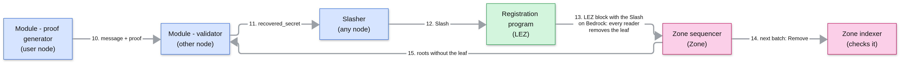
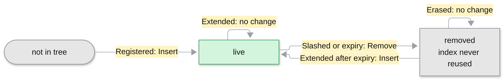
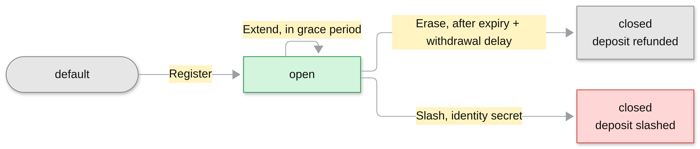

# RLN-MEMBERSHIP-ZONE

| Field | Value |
| --- | --- |
| Name | RLN Membership Zone |
| Status | raw |
| Category | Standards Track |
| Tags | rln, membership, registry, zone |
| Editor | Vinh Trinh [vinh@status.im](mailto:vinh@status.im) |
| Contributors | |

<!-- timeline:start -->
<!-- timeline:end -->

## Abstract

This document specifies the RLN Membership Zone:
a registry, in the sense of the
[RLN-API](https://lip.logos.co/anoncomms/raw/rln-api.html),
for RLN memberships on the Logos Blockchain.

A membership is bought with a deposit through a registration program on the Logos Execution Zone (LEZ).
The program also handles refunds and slashing, so LEZ holds the current state of every membership.

The membership set is a Merkle tree, and no one stores it on chain.
Fixed rules derive it from the registration program's transactions, so anyone who reads LEZ computes the same tree.
The Zone Sequencer computes it and publishes its roots on Bedrock; Zone Indexers compute it too and check every published root.

The RLN Module that RLN-API specifies ("the Module" for short), one in every user's node, holds no tree.
It proves and validates against the published roots, and reads the rest from a registry access it chooses:

- its Merkle proof path and its membership state from a reader, the Zone Sequencer or a Zone Indexer;
- the roots from Bedrock through its own Bedrock node, when it wants to check them;
- everything from a Zone Indexer of its own, when it wants to trust nobody.

RLN-API itself does not change; its `logos` namespace binding is filled in as [Module Requirements](#module-requirements) states.

The Zone holds no user funds and has no general-purpose execution environment;
all deposits stay in the registration program.

## Motivation

Testnet v0.3 ran the `logos` registry as [logos-lez-rln](https://github.com/logos-co/logos-lez-rln):
it kept the membership set in LEZ accounts and recomputed every level of the Merkle tree inside the RISC Zero zkVM
at each registration. That costs:

- about 9.09M of the 10M execution gas a LEZ block holds, so a LEZ block carries one registration
  and the next block's base fee rises for every LEZ user;
- a tree limited to depth 9 (512 leaves over its lifetime), with a non-standard depth-10 circuit.

None of it is intrinsic to RLN. A registry needs ordered, available, verifiable changes to its membership set.
LEZ already provides them to anyone who reads it, and the hashing can run outside the zkVM.

Deriving the membership set from LEZ:

- keeps only the deposit logic on LEZ: the hashing leaves the zkVM, and with it the gas;
  reading LEZ costs nothing, so the registry adds no LEZ load beyond its own transactions;
- raises the tree depth to 20, the default depth Zerokit ships;
- makes the registry a public record on Bedrock that anyone can recompute and check.

## Semantic

The key words "MUST", "MUST NOT", "REQUIRED", "SHALL", "SHALL NOT",
"SHOULD", "SHOULD NOT", "RECOMMENDED", "MAY", and "OPTIONAL" in this document
are to be interpreted as described in [RFC 2119](https://www.ietf.org/rfc/rfc2119.txt).

## Terminology

Every term not listed here keeps the meaning and spelling of its source:
RLN-API first, then RLN Membership Allocation, RLN-V1 and RLN-V2, the Zerokit-API,
and the Logos Blockchain specifications and code ([References](#references)).

"Epoch" is always the RLN epoch, never the Cryptarchia epoch.

This document adds:

| Term | Meaning |
| --- | --- |
| The Module | The RLN Module that RLN-API specifies, one instance in every user's node: it registers, generates and validates proofs, and holds no tree. RLN-API calls it the proof generator at `generate_proof` and the validator at `validate_proof`; the same Module plays both. |
| The Zone | The RLN Membership Zone specified here; "a Zone" or "Zones" means any Logos Zone (Logos glossary), LEZ included. The Zone never writes to LEZ, and LEZ never reads the Zone. |
| Batch | The payload of one `CHANNEL_INSCRIBE` in the Zone channel, carrying the membership-set changes of a contiguous range of LEZ blocks `[from_lez_block_id, to_lez_block_id]`. |
| Reader | A Zone Sequencer or a Zone Indexer: it applies the derivation rules to the LEZ blocks on Bedrock, holds the tree, follows the Zone channel and serves the registry ([Reader](#reader)). |
| Zone Sequencer | A reader holding an accredited key of the Zone channel: it publishes the batches, from the LEZ blocks adopted on Bedrock ([Zone Sequencer](#zone-sequencer)). |
| Zone Indexer | A reader without an accredited key: it derives the tree from the LEZ blocks finalized on Bedrock, and judges every batch of the Zone channel against it. Not the indexer LEZ ships ([Zone Indexer](#zone-indexer)). |
| Zone operator | The party that holds the accredited keys of the Zone channel, runs the Zone Sequencers and pays their fees; one party at first ([Funding](#funding)). |
| Finalized state | What Bedrock finalized of a channel, as a reader keeps it; irreversible. For the LEZ channel the tree of the finalized LEZ blocks, for the Zone channel the finalized batches ([Reader](#reader)). |
| Unfinalized lineage | The entries of a channel in Bedrock blocks not finalized yet, on top of the finalized state; a reorg rewrites it. For the LEZ channel the adopted LEZ blocks, for the Zone channel the batches adopted or in flight ([Reader](#reader)). |
| Current state | The finalized state with the unfinalized lineage applied on top, where a reader works: the tree at the newest adopted LEZ block, the channel at its tip ([Reader](#reader)). |
| Parked | A batch that failed a check. It is never applied and is held with its cause; the tip freezes before it and every later batch parks after it, until a batch applies on that tip ([Reader](#reader)). |
| Registry access | What a Module reads the registry through, the "registry access" of RLN-API: a reader's interface, the Zone channel through the Module's own node, or a Zone Indexer of its own ([Module Requirements](#module-requirements)). |

## Overview

### Assumptions

- Bedrock orders and finalizes channel inscriptions and keeps them available;
  only accredited keys write to a channel, anyone reads it
  ([Mantle channel operations](https://lip.logos.co/blockchain/raw/bedrock-v1.1-mantle-specification.html)).
- A LEZ block is one inscription in the LEZ channel. It is on Bedrock once that inscription is adopted,
  final once it is finalized, and nothing before. A block the LEZ Sequencer has closed but not inscribed
  can come back with other contents after a restart, so readers take LEZ blocks from Bedrock only.
- A LEZ block holds transactions, not events: events come from executing it and are served by whoever did.
- A LEZ block's timestamp (Unix milliseconds, from the clock program) is the registry's clock,
  the `logos` time base RLN-API requires; the program and every reader expire a membership on it.

### Components

| Component | Runs where | Holds | Interacts with |
| --- | --- | --- | --- |
| User interface | the user's node: the Basecamp RLN membership UI, a CLI, or an app such as a Logos Delivery node | nothing RLN-specific | calls its Module through RLN-API (`register`, `generate_proof`, `validate_proof`) |
| Module | inside the user's node | its RLN-API state (keystore, membership records, nullifier log, message-id allocation), what it reads from the registry, a funded account on LEZ | sends `Register`, `Extend`, `Erase` and `Slash` to LEZ; reads roots, its Merkle proof path, its membership state and the LEZ clock from its registry access |
| LEZ Sequencer | LEZ | LEZ state and mempool | receives transactions from the Module and the slasher; inscribes each LEZ block it closes in the LEZ channel on Bedrock; serves readers a history fill and a preview of its closed blocks |
| Registration program | LEZ | configuration account, escrow, membership accounts | runs when the LEZ Sequencer executes a transaction that calls it, directly or through a chained call |
| Bedrock | Bedrock nodes | the LEZ channel (LEZ blocks) and the Zone channel (batches), totally ordered and finalized up to the latest immutable block (LIB); the notes that pay Mantle Transaction fees | orders and finalizes both channels |
| Zone Sequencer | the Zone operator's hosts | a reader's copies of the two channels ([Reader](#reader)), the accredited key, node wallet notes, the batch in flight | reads the LEZ blocks adopted on Bedrock; publishes batches to the Zone channel; serves Modules; takes no input from any Module |
| Zone Indexer | any node, local to a Module or as a service; holds no accredited key | a reader's copies of the two channels, the parked batches and the stall | reads the LEZ blocks finalized on Bedrock; judges every batch; serves Modules once the LEZ blocks are finalized |
| Slasher | any host | a funded account on LEZ | gets `recovered_secret` from its Module; sends `Slash` to LEZ |

### Membership lifetime

1. **Register.** The Module generates an identity credential and sends `Register` from its funded account.
   The registration program moves the deposit to the escrow and assigns the next leaf index.
2. **Pending.** Once the LEZ block holding the `Register` is on Bedrock, every reader inserts the leaf into its tree.
   The Module reports `MEMBERSHIP_PENDING`; until then the block is a preview.
3. **Active.** The Zone Sequencer publishes the `Insert` in a batch on Bedrock and every Zone Indexer checks it
   against what it derived. Once the batch is deep enough, its root is a valid root at every validator
   whose registry access serves it: the membership is `MEMBERSHIP_ACTIVE`.
4. **Extend.** The holder can send `Extend` during the grace period.
5. **Expiry.** At expiry every reader removes the leaf, and the next batch carries the removal to every validator.
6. **Erase.** After the withdrawal delay the holder sends `Erase` and gets the deposit back.

If the member double-signals, a validator recovers the identity secret and a slasher sends `Slash`:
the deposit goes to the treasury, every reader removes the leaf once the LEZ block holding the `Slash` is on Bedrock,
and validators stop accepting the leaf once the batch with that removal is deep enough.

### End-to-end flow

Registration (steps 1-9). A user action reaches the registration program on LEZ. Every reader derives the new root from the LEZ block,
the Zone's batch publishes it, and validators accept it once the batch is deep enough on Bedrock.


Messaging and slashing (steps 10-15). A double-signal reveals the identity secret and a slasher slashes the deposit.
Every reader removes the leaf, and the Zone's batch carries the removal to every validator.



| Step | Action | When |
| --- | --- | --- |
| 1 | The user interface calls the Module through RLN-API. | Whenever the user acts: registers, extends or erases a membership. |
| 2 | The Module sends `Register`, `Extend` or `Erase` to the LEZ Sequencer. | `Register` once per membership; `Extend` in the grace period; `Erase` after the withdrawal delay. |
| 3 | The LEZ Sequencer executes it with the registration program, which checks it against `ConfigState` and the membership account, and emits `Registered`, `Extended` or `Erased`. | In the same LEZ block. |
| 4 | The LEZ Sequencer inscribes the LEZ block in the LEZ channel on Bedrock. | Every LEZ block. |
| 5 | Every reader (the Zone Sequencer, every Zone Indexer) reads the LEZ block from the LEZ channel on Bedrock, derives the registration program's events from its transactions and applies the derivation rules. A reader that starts empty, or missed blocks while stopped, fills them from the LEZ Sequencer's RPC. It checks each block by hash against the block Bedrock holds, so the RPC is fast but never trusted. A block the LEZ Sequencer has closed but not inscribed yet is a preview, never applied. | The Zone Sequencer once the block's inscription is adopted on Bedrock; a Zone Indexer once it is finalized. |
| 6 | The Zone Sequencer publishes a batch with the changes and the root to the Zone channel. | On its turn to write, covering every LEZ block not yet covered. |
| 7 | Every reader reads the batch from the Zone channel, replays its changes on its tip and compares `root_after` with the root it derived at step 5; a Zone Indexer judges it with its finalized state, and applies it or parks it. | Once the batch is in a Bedrock block; a Zone Indexer judges it once its finalized LEZ blocks reach the batch's `to_lez_block_id`. |
| 8 | The Module reads from its registry access ([Registry access](#registry-access)) the newest valid root, its Merkle proof path at that root and its membership state; the membership is `MEMBERSHIP_ACTIVE` from here. | Once the batch is at the reference depth. |
| 9 | A Module that starts, or lost its registry access, answers `RLN_ERR_NOT_READY` until its registry access serves a root recent enough. | At start, or after a disconnection. |
| 10 | The sender's Module, as proof generator, sends a message with its RLN proof; another node's Module, as validator, checks it. | Every message. |
| 11 | The validator detects a double-signal and hands `recovered_secret`, the identity secret, to a slasher, or sends the `Slash` itself. | When a nullifier repeats with a different `share_x`. |
| 12 | The slasher sends `Slash{identity_secret}`; the registration program slashes the deposit to the treasury and emits `Slashed`. | As soon as the slasher has the identity secret. |
| 13 | Every reader applies the LEZ block holding the `Slash` and removes the leaf. | The Zone Sequencer once that block is adopted on Bedrock; a Zone Indexer once it is finalized. |
| 14 | Steps 6-7 run again: the next batch carries `Remove{leaf_index}` for the slashed leaf. | In the next batch. |
| 15 | Every reader checks the batch; once it is deep enough, validators drop the roots from before the removal and stop accepting the slashed leaf. | Once that batch is at the reference depth. |

The sections that follow specify each part, with the steps above they cover:

- [Derivation Rules](#derivation-rules): the rules every reader applies (steps 5 and 13);
- [Reader](#reader): how a Zone Sequencer or a Zone Indexer keeps its copies of the two channels and checks a batch (step 7);
- [Zone Sequencer](#zone-sequencer) (steps 6 and 14) and [Zone Indexer](#zone-indexer) (step 7, and the serving side of step 8);
- [Failure Handling](#failure-handling): where the registry runs ahead of Bedrock finality, the four responses and the cases;
- [LEZ Requirements](#lez-requirements) (steps 3 and 12) and [Module Requirements](#module-requirements) (steps 1-2, 8-11 and 15).

## Derivation Rules

These rules turn the registration program's events into the membership set.
The Zone Sequencer and every Zone Indexer apply the same rules to the same LEZ blocks, so they hold the same tree and the same roots.

- **Input.** The events the program emits, one per successful action ([LEZ Requirements](#lez-requirements)).
  The call depth does not matter: a `Register` reached through a chained call emits the same `Registered` as a direct one.
  - Until the LEZ Sequencer serves events, readers derive them from the program's public transactions in each LEZ block:
    the instruction carries every value the event does except `leaf_index`, which the reader assigns by counting in block order.
  - Two things are then out of a reader's sight: a chained call, and a transaction the program reverted.
    LEZ v0.3.2 keeps a reverted transaction in the block without a marker, so it reads as a success. The events settle both.
- **Output.** A change is an `Insert{leaf_index, rate_commitment}` or a `Remove{leaf_index}`.
- **The tree.** A Merkle tree of depth 20, append-only in leaf indices: a removed leaf is set to the empty value and its index
  is never reused. A leaf is the rate commitment `poseidon(id_commitment, rate_limit)`,
  Poseidon or Poseidon2 over BN254 as in the Zerokit-API; the hash is a parameter of the registry, Poseidon on the testnet.

Every event carries the `tree_id` of its registry; a reader takes the events of its registry only.
For every LEZ block, in order,
and every event of the registration program in that LEZ block, in emission order:

- `Registered` produces `Insert{leaf_index, rate_commitment}` from the event's fields.
  The registration program never allows a `Registered` for an identity commitment whose membership is open.
  If one appears, it replaces the membership: the old leaf produces `Remove{leaf_index}` first,
  and readers keep the latest membership per commitment. One for a closed commitment, which the program never allows either,
  is a new leaf.
- `Slashed` produces `Remove{leaf_index}`, if the leaf is live.
  A `Slashed` after the leaf expired produces no change,
  but the Module still reports `MEMBERSHIP_SLASHED` ([Membership status](#membership-status)).
- `Extended` produces no change; the reader takes the new `expiry_timestamp_ms` from the event
  and keeps it for the expiry step below.
  An `Extended` whose leaf the expiry step already removed, should the program ever accept one,
  produces `Insert{leaf_index, rate_commitment}` again: the leaf is back, with the new expiry.
- `Erased` produces no change, since `Erase` needs the clock at or past `expiry_timestamp_ms + withdrawal_delay_ms`
  and the expiry step of an earlier LEZ block has already removed the leaf.
  If the leaf is still live, which the registration program never allows,
  it produces `Remove{leaf_index}`.

After the transactions of a LEZ block, every live leaf whose `expiry_timestamp_ms` is at or below
that LEZ block's timestamp produces `Remove{leaf_index}`, in increasing leaf index.
A leaf expires once per expiry it carries.



| Leaf before | Event | Change | Leaf after |
| --- | --- | --- | --- |
| not in the tree | `Registered` | `Insert` | live |
| live | `Extended` | none | live |
| live | `Slashed`, or expiry | `Remove` | removed |
| removed | `Extended` after expiry | `Insert` | live |
| removed | `Erased` | none | removed |

## Reader

A reader is a Zone Sequencer or a Zone Indexer: the same program, with or without an accredited key.
It keeps a copy of each of the two channels, the LEZ channel and the Zone channel, the way LEZ keeps its own (`chain_state`).
Each copy is a hash-chained lineage of inscriptions, in memory and on disk, in three parts:

- **Finalized state.** What Bedrock finalized, irreversible.
- **Unfinalized lineage.** The entries in Bedrock blocks not finalized yet, as the Zone SDK reports them,
  on top of the finalized state; a reorg rewrites it.
- **Current state.** The finalized state with the unfinalized lineage applied on top, where the reader works.

Everything a reader holds is derived from the two channels, so any of it can be dropped and read again.

### The LEZ channel

What the reader keeps of the LEZ channel is the membership tree:

- The finalized state is the tree of the LEZ blocks finalized on Bedrock, in a store on disk.
- The unfinalized lineage is the LEZ blocks adopted since, each applied in memory on top of the tree before it;
  the tree after the last one is the current state.

- A LEZ block enters the unfinalized lineage when its inscription is in a Bedrock block on the current branch
  and its header chains by hash to the previous block; otherwise it is refused.
- A Bedrock reorg (`Conflict`) rebuilds the unfinalized lineage from the branch Bedrock now holds;
  finality moves a block from the lineage into the store.
- A block the LEZ Sequencer has produced but not inscribed is a preview, never applied.

The Zone Sequencer batches from the current state, minutes behind LEZ.
A Zone Indexer judges with the finalized state only, hours behind, so what it judged with is never rewritten.

### The Zone channel

What the reader keeps of the Zone channel is the batches, and the tree each one leads to:

- The finalized state holds the batches Bedrock finalized.
- The unfinalized lineage holds the batches in Bedrock blocks since, and the Zone Sequencer's own batches not in a block yet,
  each with where it stands (`pending`, `adopted` or `finalized`, the Zone SDK's words).

The tip is the last batch the reader applied. A new batch is applied on the tip when it passes three checks:

1. **Range.** The batch continues the tip: its `from_lez_block_id` is the tip's `to_lez_block_id` plus one.
   The first batch of a channel starts at `first_lez_block_id`, the LEZ block the registration program was deployed in
   or any earlier block; readers and Modules are configured with it, as with `zone_channel_id`.
   The one exception is a correction ([Failure Handling](#failure-handling)): a batch that starts at or before
   the tip's `to_lez_block_id` and ends at or after it. It starts right after an applied batch that no correction superseded,
   the one whose `to_lez_block_id` is the correction's `from_lez_block_id` minus one, or at `first_lez_block_id`.
2. **Replay.** Replaying the batch's `changes` on the tree at the tip gives exactly `root_after`.
   A correction is replayed on the tree after the batch it starts after, the empty tree for one from `first_lez_block_id`.
3. **Judge.** `root_after` is also the root the reader itself derived from LEZ at `to_lez_block_id`.
   A Zone Indexer judges with its finalized state; while it has not read LEZ that far, this check has no answer yet.
   A Zone Sequencer applies a batch on the first two checks and judges it afterwards: at every poll it compares
   the applied roots with its current state, and answers a difference with a correction ([Zone Sequencer](#zone-sequencer)).

The outcomes:

- **Applied.** The batch becomes the tip, and `(root_after, to_lez_block_id)` joins the valid roots.
  A correction also supersedes every applied batch whose span it re-covers: their roots leave the valid roots.
- **Parked.** The batch failed a check. The tip freezes before it and every later batch parks after it,
  until a batch applies on the frozen tip, a correction as a rule; the batches parked meanwhile stay parked.
  The first parked batch of the finalized state is kept with its cause as the stall (LEZ's `StallReason`).
  A parked batch is public evidence against the key that signed it, unless a Bedrock reorg of the LEZ channel explains it;
  its root is never a valid root, and what follows is outside this document.
- **Waiting.** The judge check could not decide yet: the batch, and every batch after it, is applied or parked
  once the LEZ channel copy reaches it.

The unfinalized lineage follows Bedrock. A batch that a reorg drops leaves the lineage, and its root leaves the valid roots.
A batch that finality holds moves into the finalized state. After either, the reader applies the batches from the change on again.

### Valid roots

The valid roots are the `root_after` and `to_lez_block_id` of every applied batch that no correction superseded.
Each carries where its batch stands on Bedrock; the Module applies its reference depth and its valid-root window to them
([Module Requirements](#module-requirements)).

## Zone Sequencer

A Zone Sequencer publishes what its current state says, so that every Zone Indexer has a reference to check,
every Module has roots to prove and validate against, and anyone can audit the registry from public data.

### Batch format

```protobuf
syntax = "proto3";

message Batch {
  uint64          from_lez_block_id = 1;  // first LEZ block_id covered, inclusive
  uint64          to_lez_block_id   = 2;  // last LEZ block_id covered, inclusive
  repeated Change changes           = 3;  // in derivation-rule order
  bytes           root_after        = 4;  // 32 bytes, little-endian, membership-set root after the changes
}

message Change {
  oneof kind {
    Insert insert = 1;
    Remove remove = 2;
  }
}
message Insert { uint64 leaf_index = 1; bytes rate_commitment = 2; }  // 32 bytes, little-endian
message Remove { uint64 leaf_index = 1; }
```

One batch per `CHANNEL_INSCRIBE`, carried by one Mantle Transaction.
A batch carries only what changes the tree; each leaf's expiry and the reason for a removal are read from LEZ.

### Publishing

- The Zone Sequencers, one per accredited key, take turns in Mantle's round-robin,
  `posting_timeout` passing a missed turn to the next one.
- At every poll, on its turn, a Zone Sequencer publishes one batch when there are changes.
  It covers every LEZ block adopted on Bedrock that no applied or in-flight batch covers.
  Without changes, it publishes an empty batch over the blocks adopted since once the heartbeat interval has passed.
  The heartbeat interval, the poll interval and the fee cap of its node wallet are Zone Sequencer configuration.
  Nothing else enforces the pace.
- A batch covers whole LEZ blocks. One inscription holds at most 1,835,008 bytes, the Bedrock node's limit:
  the 2 MiB Bedrock block less 1/8 for the rest of the Mantle Transaction.
  When the changes would exceed it, the batch stops at the last LEZ block whose changes still fit
  and the next batch continues from there ([Failure Handling](#failure-handling) for a block that does not fit).
- An empty batch is valid: it states that the LEZ blocks in its range left the tree unchanged
  and moves `to_lez_block_id` forward, so anyone can tell how far the Zone has followed LEZ.
  The first batch of a channel MAY be empty: it creates the channel.
- A batch is in flight (queued or in the mempool) until its Mantle Transaction is in a Bedrock block,
  and the node wallet holds one whole note for it until then.
  One batch in flight is the rule: it needs no note management and loses no throughput,
  since the next batch covers every LEZ block adopted in the meantime.
- Before publishing, a Zone Sequencer applies the batch on its own current state
  and publishes nothing it would park itself. It records its own publishes in its unfinalized lineage at once,
  so it sees them orphaned, finalized or parked like any reader.
- At every poll it also compares the channel's tip root with its own tree at the tip's `to_lez_block_id`.
  A difference means LEZ contradicts a batch already on Bedrock, or a key published a wrong root;
  the answer is a correction from the first applied batch whose root differs ([Failure Handling](#failure-handling)).
  A Zone Sequencer MAY wait a Bedrock depth before batching a LEZ block, which makes corrections rarer and roots later;
  the testnet batches at adoption.

### Funding

- The Zone operator pays for the batches, each a Mantle Transaction, from its node wallets on Bedrock. A batch of `N` insertions costs about
  `(59 + 590) × execution_gas_base_price + (632 + 45 × N) × permanent_storage_gas_price`
  ([Execution Market](https://lip.logos.co/blockchain/raw/execution-market.html),
  [Storage Markets](https://lip.logos.co/blockchain/raw/storage-markets.html)):
  about 58 Bedrock fee units per membership with both prices at 1 and `N = 100`.
- Users pay on LEZ, not on Bedrock: every `Register` pays the non-refundable `registration_fee` to `operator_account_id`,
  and a slashed deposit goes to `treasury_account_id`.
  There is no slasher reward: slashers would race each other, and the LEZ Sequencer could copy a pending `Slash`
  and send it first.
- At first Logos funds the node wallet and runs the one Zone Sequencer; the fee accrues on LEZ.
  Once the bridge `Withdraw` from LEZ works, the fee tops up the node wallets,
  as in the [Logos Oracle Zone](https://lip.logos.co/anoncomms/raw/logos-oracle-zone.html),
  and funds the Zone Sequencers that come later; the Zone operator decides whether the treasury does too.
  The fee was chosen over the Zone operator funding the Zone for good, as a cost of running the network,
  because the fee also bounds the leaf capacity ([LEZ Requirements](#lez-requirements)).
- A batch's transaction pays the storage price of the epoch that mines it, and Bedrock re-prices storage at every epoch rotation,
  so a batch still pending across a rotation is dropped by the block builders, not delayed.
  The Zone Sequencer re-funds a batch unmined for a window of Bedrock slots (300, the LEZ Sequencer's) under a new transaction,
  same message; a slow batch re-funded by mistake is harmless, the first of the two to land wins.
- Three limits are known and left as they are; `ConfigState` and the cap are the Zone operator's to adjust.
  - The fee is a fixed amount on LEZ while Bedrock gas moves.
  - Removals cost Bedrock bytes nobody pays for separately.
  - A fee above the Zone Sequencer's cap stops the batches.
- Governance is not specified here. With several Zone Sequencers comes the governance of `ConfigState`:
  who sets prices and bounds, holds `treasury_account_id` and `operator_account_id`, splits the income,
  and replaces `zone_channel_id` when the accredited keys are lost or the Zone operator misbehaves.
  A change reaches open memberships only through `Extend`, since each keeps its own grace period and withdrawal delay;
  prices and rate-limit bounds never touch an open membership.

## Zone Indexer

A Zone Indexer is a reader without an accredited key: it keeps the same two channel copies,
judges every batch with the finalized state of its LEZ channel copy, and publishes nothing.

- The Zone Sequencers are not trusted: every Zone Indexer derives the tree itself, runs the range and replay checks
  once the batch is in a Bedrock block, and judges it once the finalized LEZ blocks reach its `to_lez_block_id`.
  A dishonest Zone Sequencer is caught by any reader, not prevented.
- It runs in any node, local to a Module or as a service, and can run on and off.

### Serving

The Zone Sequencer and a Zone Indexer serve the same interface, the Zone Sequencer minutes after a LEZ block is adopted,
a Zone Indexer once the LEZ blocks are finalized. It serves:

- the valid roots, each with where its batch stands on Bedrock, and the stall;
- for a leaf, its Merkle proof path at the newest valid root, with that root;
- for an identity commitment, the membership state as the events give it
  (live or removed, and how it was removed, `leaf_index`, `rate_limit`, `expiry_timestamp_ms`,
  the LEZ blocks and transactions of its registration and removal) and the LEZ clock;
- the holder and `ConfigState`, which live in LEZ accounts, when the reader has account access.

A request for a path or a state names a leaf, so the reader learns which leaf the Module holds.
The serving interface is the HTTP API of the reader.

A Zone Indexer that starts either replays the registration program's events from `first_lez_block_id`,
or takes a snapshot from another Zone Indexer, checks it, and applies the LEZ blocks since. The checks:

- the snapshot's root equals the `root_after` of an applied batch no correction superseded, at or past the reference depth, with the same `to_lez_block_id`;
- every non-empty leaf equals the rate commitment of the membership account the snapshot names for it,
  and `expiry_timestamp_ms` is taken from that account, since the root commits the leaves
  but neither whose they are nor when they expire.

The snapshot format is not specified yet.

## Failure Handling

The registry runs ahead of Bedrock finality in three places. Finality later confirms each one, or shows it was wrong:

- The Zone Sequencer batches LEZ blocks as soon as they are adopted on Bedrock, not once they are finalized.
- Every reader takes a batch into its unfinalized lineage as soon as the batch is in a Bedrock block.
  A Zone Indexer applies it only once its finalized state reaches the batch; a Zone Sequencer applies it at once.
- A Module takes a root once its batch is at the reference depth, not at finality.

Everything a failure can touch is derived, so no case below loses data or funds. What a failure costs is time:
while it lasts the roots trail LEZ, new memberships stay `MEMBERSHIP_PENDING`, and removals wait at the validators.

### The four responses

Every case below ends in one of four responses, needs none, or is not handled yet.
Each response moves a reader's finalized state or unfinalized lineage, nothing else.
Several cases can hit at once, and a Zone Sequencer remembers no verdict: at every poll it judges again
from the channel's current tip, keeping only the batches it published and has not seen on Bedrock yet.

- **Wait.** Nothing new is on Bedrock, or the reader cannot judge a batch yet.
  Nothing is applied or published; the batch waits, with every batch after it, until Bedrock, LEZ or the reader moves again.
  A restart is a Wait too: the reader resumes from the finalized state, the unfinalized lineage it persisted and its checkpoint.
- **Rebuild.** A Bedrock reorg replaced adopted LEZ blocks that no batch covered yet.
  The reader rebuilds the unfinalized lineage of its LEZ channel copy from the branch Bedrock holds now;
  the next batch covers the blocks adopted now.
- **Republish.** A batch of the Zone's fell out of Bedrock: a reorg orphaned its block, the mempool dropped it,
  finality landed on a lineage without it, or the reader was down through a reorg.
  The Zone Sequencer publishes it again, unchanged and in order, on the new tip, and keeps it until it is back.
  The same batch on the same parent is the same message, since a message id commits to the payload, the parent and the signer.
  A publish that fails is queued and goes out first at the next poll. A Zone Indexer only follows the reorg; nothing parks.
- **Correction.** A batch already on Bedrock carries a root, and the tree derived from LEZ no longer matches it.
  - Two causes: a reorg dropped a LEZ block that a batch covered and the LEZ Sequencer produced that block again
    with other contents, or an accredited key published a wrong batch.
  - Every Zone Indexer parks the first such batch at the judge check, and its tip freezes before it.
  - The Zone Sequencer sees the tip root differ from its own tree and publishes a correction:
    a batch that starts at the first wrong batch's `from_lez_block_id`, ends at its current state,
    and carries the changes that take the tree before that batch to the current tree.
    Its size is what changed since the wrong batch, not the whole tree.
  - The correction replays on the tree before the wrong batch and supersedes every batch it re-covers.
    To a reader whose tip froze before the wrong batch it is the next batch; the wrong batch stays parked there,
    the evidence, while a reader that applied it unjudged counts it superseded. Neither lists its root.
    A Zone Sequencer that parked the wrong batch itself, at the range or replay check, corrects the same way:
    its next batch starts at its frozen tip.
  - The roots the correction re-covers leave the valid roots; a proof made against one is made again at the newest valid root.

### The cases

The cases, from LEZ down to the reader:

| Case | Response | A Module meanwhile |
| --- | --- | --- |
| LEZ stops inscribing. | Wait: no LEZ block is adopted, so no batch, not even a heartbeat. | `MEMBERSHIP_PENDING`; no expiry either, since the clock is the LEZ blocks'. The LEZ Sequencer's uninscribed blocks are a preview, which MAY be shown as such. |
| A reverted or privacy-preserving transaction, which a reader without events reads as a success or skips. | None: every reader applies the same rule, so the trees agree; events settle it ([LEZ Requirements](#lez-requirements)). | A leaf the program refused can be live, and the leaf indices after it differ from the on-chain `leaf_index`, until events exist. |
| A Bedrock reorg orphans a LEZ inscription no batch covers. | Rebuild. | Nothing; the root comes a little later. |
| A Bedrock reorg orphans a LEZ inscription a batch covers, on Bedrock or in flight, and the LEZ Sequencer produces that block again with other contents. | Correction. | The roots from the wrong batch on leave the valid roots; proofs are made again. |
| A batch of the Zone's leaves Bedrock or never reaches it. | Republish. | Roots trail; the orphaned roots leave the valid roots until the batches are back. |
| An accredited key publishes a batch the derivation refutes: a change omitted or invented, a wrong root. | Correction, by an honest Zone Sequencer, from the wrong batch's block; every Zone Indexer parks the wrong batch, the evidence. | Roots trail; proofs are made again. |
| The changes of one LEZ block, or of a correction, exceed one inscription. | Not handled; a correction covers minutes of LEZ blocks as a rule, so this takes a wrong batch unnoticed for days. | Roots trail until the Zone operator intervenes. |
| A reader restarts, or rebuilds its tree. | Wait; a rebuilt tree judges the parked batches again. | Roots trail; `RLN_ERR_NOT_READY` from that registry access until it serves. |
| The Bedrock node a reader reads stands still, or is catching up after a restart. | Wait: the reader does not start while the node catches up, and warns when no block has come for long. | Roots trail at the Modules that read this node. |
| Every Zone Sequencer is down for long, or every accredited key is lost. | Wait: a long outage is a late restart; lost keys are a governance case. | `MEMBERSHIP_PENDING`; a slashed or expired leaf stays accepted until a batch carries its removal. |

## LEZ Requirements

The registry depends on a registration program on LEZ.
This document does not specify that program; it requires the following.

- **Clock.** The program reads the current time from the clock account `CLOCK_01`:
  the timestamp of the previous LEZ block.
- **Custody.** Every deposit sits in an escrow that only the program can spend;
  the program keeps no Merkle tree.
- **Accounts.** `ConfigState` is the anchor of the registry; one `MembershipState` exists per identity commitment:

  ```rust
  struct ConfigState {
      zone_channel_id: [u8; 32],      // Zone channel on Bedrock that carries the batches
      operator_account_id: [u8; 32],  // receives registration_fee
      registration_fee: u128,         // non-refundable, paid with every Register
      epoch_size_sec: u64,            // declared for the RLN-API registry parameters read
      min_rate_limit: u64,            // lowest rate_limit a Register may take
      max_rate_limit: u64,            // highest rate_limit a Register may take; below 2^16, the circuits' bound
      min_active_duration_ms: u64,    // shortest active duration at Register and Extend
      max_active_duration_ms: u64,    // longest active duration at Register and Extend
      tree_id: [u8; 32],              // the registry this configuration belongs to; in every event
      next_index: u64,                // leaf index the next Register takes; never goes back
      price_per_unit: u128,           // deposit = rate_limit * price_per_unit
      treasury_account_id: [u8; 32],  // receives slashed deposits
      grace_period_duration_ms: u64,  // Extend allowed in [expiry - grace, expiry), for new memberships
      withdrawal_delay_ms: u64,       // Erase allowed from expiry + delay, for new memberships
  }

  struct MembershipState {
      expiry_timestamp_ms: u64,       // set by Register, raised by Extend
      withdrawal_delay_ms: u64,       // Erase allowed from expiry + delay; fixed at Register
      leaf_index: u64,                // position in the tree, fixed at Register
      rate_limit: u64,                // messages per epoch; part of the rate commitment
      grace_period_duration_ms: u64,  // Extend allowed in [expiry - grace, expiry); fixed at Register
      holder: [u8; 32],               // signs Extend and Erase; Erase refunds here
      deposit_amount: u128,           // rate_limit * price_per_unit, held in the escrow
  }
  ```

- **Withdrawal delay.** `withdrawal_delay_ms` SHOULD cover the time a removal takes to reach every validator
  plus the time to detect a double-signal and include the `Slash`. Then every validator has stopped accepting the leaf,
  and any slash has landed, before the deposit can leave the escrow.
  - The number is set per deployment from what the running network shows: the removal latency
    (batch publishing, Bedrock inclusion, the reference depth and the window length) plus the slash latency, plus a margin.
  - Testnet: the deployed program's value, raised once the removal latency is measured.
- **Rate limit bound.** `max_rate_limit` MUST be below 2^16: the RLN circuits bound `messageId` to 16 bits
  and do not range-check `userMessageLimit`, so a limit at or above 2^16 cannot be fully used.
  The registry is where the bound is enforced (yAcademy 2023 Low-1, RLN-01 of the internal circuit review).
- **Leaf indices.** `Register` assigns them in order and never reuses one; the testnet program fails at 2^20,
  a cap the scaling below lifts.
  - Capacity: a tree holds 2^20 memberships over its lifetime. Deposits come back: a round is register at the minimum `rate_limit`,
    wait out the active duration and the withdrawal delay, `Erase`, register again with a new credential.
    A round costs `registration_fee` plus the LEZ transaction fee, so 2^20 rounds use up a tree
    at about `2^20 × registration_fee`.
  - Scaling: when a depth-20 tree is full, every reader opens the next one. Leaf index `i` lives in tree `i / 2^20`
    at position `i mod 2^20`, so nothing changes on LEZ or in the batches. Each tree has its own root, a proof is made
    against the root of the member's tree, and validators keep one valid-root window per tree that still has live leaves.
    No circuit change and no hard capacity, at the cost of several roots in what the Module reads;
    readers and Modules grow this once a tree fills.
  - Chosen over a deeper tree: another depth needs its own circuit and proving key,
    and proofs grow with the depth.
  - Chosen over index reuse ("lowest free index" after `Erase` or `Slash`), for three reasons.
    The monotonic index keeps the registry's state at the tree plus one on-chain counter,
    and makes the scaling tree a pure function of the index.
    - The free set is not derivable from the tree: an expired membership nobody erased has an empty leaf
      yet still owns its index, since an `Extend` can bring it back.
    - Every reader and every snapshot would carry the free set as extra state, a rule the program and every reader
      mirror exactly.
    - The on-chain `leaf_index` would be gone.
- **One registration per identity commitment.** A closed membership account never opens again.
- **Events.** The program emits one `ProgramEvent` per successful action, whatever the call depth,
  with the fields the derivation rules use:

  ```rust
  struct Registered { tree_id: [u8; 32], id_commitment: [u8; 32], rate_limit: u64, expiry_timestamp_ms: u64, leaf_index: u64 }
  struct Extended   { tree_id: [u8; 32], id_commitment: [u8; 32], expiry_timestamp_ms: u64 }
  struct Erased     { tree_id: [u8; 32], id_commitment: [u8; 32] }
  struct Slashed    { tree_id: [u8; 32], id_commitment: [u8; 32] }
  ```

  - `tree_id` names the registry within the program: one deployed program hosts several registries,
    each with its own `ConfigState`, membership accounts and escrow under that id.
  - Data is borsh-encoded; the selector is the first 8 bytes of `sha256("<program>::<Event>")`, as the bridge program's `bridge::Deposit`.
  - These events are the only input of the derivation rules. Readers take them from the LEZ Sequencer with the block
    and trust them as they trust its execution. A transaction the program reverted emits nothing.
    LEZ v0.3.2 keeps it in the block without a marker, so readers that derive events from transactions
    need the events, or the marker LEZ v0.4 adds, to see it.
- **Public transactions.** The four actions MUST be sent as public transactions:
  LEZ records no event from private execution.
- **Events with the block.** The LEZ Sequencer MUST serve the events of a closed block as soon as it serves the block;
  a reader that gets them only once the block is final trails LEZ by Bedrock finality.



| Account before | Action | Account after |
| --- | --- | --- |
| default | `Register` | open |
| open | `Extend`, in the grace period | open, later expiry |
| open | `Erase`, after expiry + withdrawal delay | closed, deposit refunded |
| open | `Slash`, with the identity secret | closed, deposit slashed |

The program's instructions (timestamps and durations in milliseconds, as RLN-API requires):

```rust
enum Instruction {
    Register { tree_id: [u8; 32], id_commitment: [u8; 32], rate_limit: u64, expiry_timestamp_ms: u64 },
    Extend   { tree_id: [u8; 32], id_commitment: [u8; 32], expiry_timestamp_ms: u64 },
    Erase    { tree_id: [u8; 32], id_commitment: [u8; 32] },
    Slash    { tree_id: [u8; 32], identity_secret: [u8; 32] },
}
```

| Action | Signer | Allowed when | Effect |
| --- | --- | --- | --- |
| `Register{id_commitment, rate_limit, expiry_timestamp_ms}` | funded account | within the `ConfigState` bounds; membership account default; leaf capacity left | deposit `rate_limit × price_per_unit` to the escrow, `registration_fee` to `operator_account_id`; the signer becomes the holder; next leaf index; `Registered` |
| `Extend{id_commitment, expiry_timestamp_ms}` | the holder | open; the clock in the membership's grace period; new expiry later than the old one and within the active-duration bounds of the current `ConfigState` from the clock | new expiry; `Extended` |
| `Erase{id_commitment}` | the holder | open; the clock at or past `expiry_timestamp_ms + withdrawal_delay_ms` of the membership | deposit refunded to the holder; closed; `Erased` |
| `Slash{identity_secret}` | anyone | membership account for `poseidon(identity_secret)` open | deposit to `treasury_account_id`; closed; `Slashed` |

There is no early exit: a membership lasts until its expiry,
and a holder who wants a shorter term chooses a shorter `active_duration_ms`.

## Module Requirements

The Module uses this registry through RLN-API, under the `logos` namespace binding of RLN-API Appendix A.
Everything not stated here is as in RLN-API; this document requires the following.


| From | To | What | Trust |
| --- | --- | --- | --- |
| Registry access | Module | valid roots, Merkle proof path, membership state, `ConfigState`, LEZ clock | by level ([Registry access](#registry-access)) |
| Module | LEZ Sequencer | `Register`, `Extend`, `Erase`, `Slash` | the LEZ Sequencer, for the receipt |
| Module | User interface | RLN-API | |

### Registry access

The Module reads the registry through one interface, the reader's:
the valid roots, its Merkle proof path at the newest valid root, its membership state, `ConfigState` and the LEZ clock.

- A wrong answer can make it generate proofs that fail, stop it generating, make it miss the grace period or report a wrong status.
  It cannot move funds: `Erase` is signed by the holder and refunds the holder.
- Only the roots need trust. A wrong path fails to reproduce the root at the Module itself, before any proof leaves it;
  a wrong state only misreports.

Three levels of registry access exist; which one a Module uses is its deployment choice:

1. **A reader's interface.** The Module reads everything from a Zone Sequencer or a Zone Indexer it is configured with,
   and trusts its operator for the roots. This is the simplest level,
   for a Module whose operator runs the Zone or trusts who does.
2. **Roots from Bedrock.** The Module's own node is a Bedrock node, so the Module reads the Zone channel itself.
   Without a tree it cannot replay a batch: it checks the range and the accredited signature of every batch
   and takes `root_after` from it. The valid roots come from Bedrock, a reader serves only the path and the state,
   and the path is checked against those roots.
   This trusts the Zone operator's key, as every reader does, and nobody else for the roots.
3. **A Zone Indexer of its own.** The Module's node runs a Zone Indexer, derives the tree from LEZ and judges every batch:
   it trusts nobody, holds the registry at the finalized LEZ blocks, and can take part in watching the Zone.
   This is the most costly level: a few megabytes of tree at the testnet's membership counts, about 64 MB at the leaf capacity.
   It is the choice for a Module that keeps its leaf private, or that audits.

A Module configured with several registry accesses that disagree on a root for the same `to_lez_block_id`, a path or a state
MUST stop generating and validating and report, rather than follow a majority:
one of them misread LEZ or Bedrock, or lies, and a majority can be wrong against Bedrock.

### Writes, roots and status

- **Writes to LEZ.** The Module sends `Register` from the funded account, `Extend` and `Erase` from the holder,
  and `Slash` from any funded account, to the LEZ Sequencer, and reads back only the receipt.
- **Reference depth.** Validators take their roots from the batches, and a shallow Bedrock reorg can orphan a batch
  for a while: a batch SHOULD be some Bedrock blocks deep before its root is valid.
  For a Module served by a Zone Indexer the depth is finality, whatever is set.
  - Every Bedrock block of depth adds to the time a registration takes to become `MEMBERSHIP_ACTIVE` and a removal to take effect;
    Bedrock finality settles it but takes hours: 8 to 10 on the testnet, about 18 at the protocol default of 2160 blocks.
  - Set per deployment from the reorg depths the running network shows.
    Testnet: a batch in a Bedrock block counts (`adopted`); a deployment that wants finality takes `finalized` only.
- **Valid-root window.** A validator accepts a proof against any root in its window:
  the `root_after` of every batch at the reference depth on Bedrock, starting at the last such batch whose `changes` hold a `Remove`.
  The window length is measured in LEZ blocks through `to_lez_block_id`.
  - Why it resets at a removal: an insertion leaves every earlier root sound, since the leaves in it are still in the tree;
    a removal makes every earlier root unsound, since the removed leaf still proves against them.
    Honest proofs made against a root before the removal fail and are generated again, partial proofs included.
  - Every validator reads the same batches in the same order, so all hold the same window up to how far each has read Bedrock.
  - The length: validators read Bedrock at slightly different times, so the window has to hold enough roots for a validator
    ahead of a proof generator to still hold the generator's root.
    The same length bounds how stale a root a Module may still use before it answers `RLN_ERR_NOT_READY`.
    It therefore bounds how long a removed leaf, whose identity secret is public after a `Slash`, can still be used
    at a validator that is behind: up to `rate_limit` messages per epoch. Longer covers more skew, shorter bounds the exposure.
    Set per deployment. Testnet: the newest five roots.
- **Roots for proofs.** A proof generator SHOULD prove against the newest valid root its registry access serves.
  A validator that receives a proof against a root it does not hold first reads the batches
  its registry access has served since, and checks its window again; a root it still does not hold is invalid.
  It runs this at most once per Bedrock block interval, so unknown roots cannot make it poll.
- **Ready.** A Module is ready while its registry access answers
  and the newest valid root trails the latest LEZ block that registry access has read by no more than the window length;
  otherwise it answers `RLN_ERR_NOT_READY` rather than validating on stale roots.
- **Binding.** The anchor account is `ConfigState`.
  - `funding_holding_account_id` pays the deposit and `registration_fee`. It SHOULD be a public account:
    `Erase` refunds the holder, and a refund to a private account id lands in an account no key can spend.
  - The registry-specific option `active_duration_ms` is the requested active duration, defaulting to `max_active_duration_ms`.
  - The Module configuration names its LEZ access and its registry access: the level above and,
    for levels 1 and 2, the reader endpoints. A Module that runs its own Zone Indexer lists it first.
- **Registration.** The Module sends `Register` with `expiry_timestamp_ms` set to the LEZ clock its registry access serves
  plus `active_duration_ms`.
  - The program measures the active duration from the clock it reads at inclusion, the previous LEZ block's timestamp,
    so the duration shrinks by the inclusion delay. The Module adds a margin for it, keeping the result within
    `max_active_duration_ms`; otherwise a request near the minimum would be rejected.
  - Under delegated registration the membership provider sends that same `Register` from its own funded account
    and therefore becomes the holder. Nothing on LEZ or in the registry tells the two apart,
    and the client acts through its membership provider for `Extend` and `Erase`.
- **Usability.** The Module generates proofs only while three things hold: its membership state is open,
  the LEZ clock is before `expiry_timestamp_ms`, and its leaf is live in a root of the valid-root window.
  It stops as soon as one of them fails. This protects an honest Module only.

### Membership status

`MembershipStatus` follows RLN-API, read from the membership state and the valid roots the registry access serves.
A leaf is usable only from the first valid root that holds it, and LEZ moves ahead of that;
the cases below state what the Module reports in between:

- **Registered on LEZ, no valid root holds the leaf yet**: `MEMBERSHIP_PENDING`, never `MEMBERSHIP_FAILED`.
  The confirmation window covers LEZ inclusion, the batch and the reference depth.
- **Expired on the LEZ clock, removal not yet in a valid root**: `MEMBERSHIP_EXPIRED` at once.
- **Past the withdrawal delay on the LEZ clock its registry access serves**: `MEMBERSHIP_ERASED_AWAITS_WITHDRAWAL`, not before.
- **Closed by `Erase` or `Slash` on LEZ**: `MEMBERSHIP_ERASED` or `MEMBERSHIP_SLASHED` at once,
  from the LEZ transaction that closed the account, whether or not a valid root carries the removal yet; batches do not carry the reason.
- **Membership account held by someone else**, neither the Module's funded account nor its membership provider's: counts as absent, `MEMBERSHIP_FAILED` after the confirmation window;
  the Module registers again with a new identity credential.

## Copyright

Copyright and related rights waived via [CC0](https://creativecommons.org/publicdomain/zero/1.0/).

## References

- [RLN-API](https://lip.logos.co/anoncomms/raw/rln-api.html)
- [RLN Membership Allocation](https://lip.logos.co/anoncomms/raw/rln-membership-service.html)
- [32/RLN-V1](https://github.com/logos-co/logos-lips/blob/master/docs/anoncomms/draft/32/rln-v1.md)
- [RLN-V2](https://lip.logos.co/anoncomms/raw/rln-v2.html)
- [Zerokit-API](https://lip.logos.co/anoncomms/raw/zerokit-api.html)
- [Logos Oracle Zone](https://lip.logos.co/anoncomms/raw/logos-oracle-zone.html)
- [Logos glossary](https://docs.logos.co/get-started/glossary)
- [Bedrock v1.1 Mantle specification](https://lip.logos.co/blockchain/raw/bedrock-v1.1-mantle-specification.html)
- [Cryptarchia v1](https://lip.logos.co/blockchain/raw/cryptarchia-v1-protocol.html)
- [Storage Markets](https://lip.logos.co/blockchain/raw/storage-markets.html)
- [Execution Market](https://lip.logos.co/blockchain/raw/execution-market.html)
- [LEE v0.3 specification](https://lip.logos.co/blockchain/raw/lez/lee-v0.3-specifications.html)
- [Zone SDK](https://github.com/logos-blockchain/logos-blockchain/tree/0.3.2/zone-sdk)
- [LEZ](https://github.com/logos-blockchain/logos-execution-zone/tree/v0.3.2): `ProgramEvent`, the LEZ Sequencer and LEZ indexer RPCs
- [logos-lez-rln](https://github.com/logos-co/logos-lez-rln): the current `logos` registry
