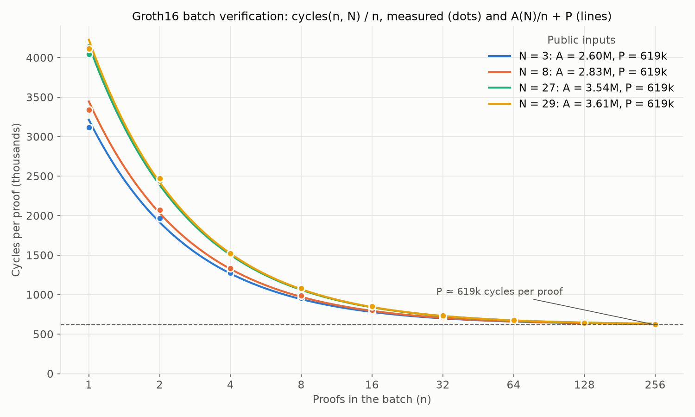

# ANALYSIS-GAS-COST-DETERMINATION

| Field | Value |
| --- | --- |
| Name | [Analysis] Gas Cost Determination |
| Slug | 191 |
| Status | raw |
| Category | Informational |
| Editor | Thomas Lavaur <thomaslavaur@logos.co> |
| Contributors | Filip Dimitrijevic <filip@logos.co> |

<!-- timeline:start -->

## Timeline

- **2026-05-27** — [`b7602ed`](https://github.com/logos-co/logos-lips/blob/b7602ed8a225d41ca0bfaaa432524dc84d2ded7e/docs/blockchain/raw/analysis-gas-cost-determination.md) — chore: move blockchain specs from notion to github

<!-- timeline:end -->

# Revisions History

| Version | Changes | Date |
| --- | --- | --- |
| 1.0.0 | Initial revision. | N/A |
| 1.2.0 | Removed DA, included Execution Gas determination for channel deposits and withdraws. Updated the Execution Gas of the Channel config. | N/A |
| 1.3.0 | [\[RFC\] Make Ledger Transaction an Operation](mantle-transaction-encoding/appendices/rfc-make-ledger-transaction-an-operation.md). Updated project references to Logos Blockchain | N/A |
| 1.4.0 | [\[RFC\] Enforce NoteId uniqueness](mantle-transaction-encoding/appendices/rfc-enforce-noteid-uniqueness.md)​ | N/A |
| 1.4.1 | [\[RFC\] Simplify Mantle Transaction and Refactor Ledger Operations](mantle-transaction-encoding/appendices/rfc-simplify-mantle-transaction-and-refactor-ledger-operations.md) | N/A |
| 1.5.0 | Introduce the new Operation `CHANNEL_STAKE_ASSIGNATION` and update of the channel operations to reflect changes in Mantle | 2026-06-24 |
| 1.5.1 | Reflect Channel Deposit execution modification. It now consumes inputs to update their NoteId | 2026-07-27 |
| 1.5.2 | Renamed locked notes into service notes and stated that the Input Gas covers the check that a note is neither a service nor a channel note | 2026-08-27 |
| 1.5.3 | Adopted "active message" as the single name for the message | 2026-09-02 |
| 1.5.4 | Renamed the `stake_manipulation_threshold` of the channel gas derivations into `transfer_threshold` and the Channel Stake Assignation section into Channel Transfer, following Mantle | 2026-08-31 |
| 1.6.0 | Add the Execution Gas derivation for the `CLAIM_POW_REWARD` Operation | 2026-09-04 |
| 1.7.0 | Per-signature Ed25519 cost re-measured with strict verification ([Common Cryptographic Components](common-cryptographic-components.md) 1.2.0): 56 → 59 Execution Gas, `SDP_DECLARE_GAS` 646 → 649 | 2026-09-24 |
| 1.8.0 | Follow the private ledger of Mantle: the notes are proven with a ZkTransfer and spent by nullifier, channel inscriptions carry the ZkTransfer of their steps, channel withdrawals and SDP withdrawals carry a ZkTransfer, the proof of work claim carries no proof, and the `CHANNEL_TRANSFER` and `LEADER_CLAIM` Operations are removed. The ZkTransfer is priced from the measured batch verification of Groth16 proofs, a fixed part per block and 619 Execution Gas per proof | 2026-10-07 |
| 1.9.0 | Add the Execution Gas of program steps and of the `PROGRAM_REGISTER` Operation, priced from the measured batch verification of the ZkProgramSpend, the verification of a program proof alone with the line coefficients of its key, and the subgroup checks and the pairing `e(α, β)` of a verification key | 2026-10-12 |
| 2.0.0 | Execution Gas measured in core cycles on the node, end to end, over note sets of a million notes, every step of the validation and execution priced. The Execution Gas of a Mantle Transaction sums a term per byte of the signed transaction, a term per note set it changes, and the Execution Gas of its Operations, each built from per-component constants: proofs, root extensions, nullifiers, commitments, signatures, steps, payments, openings and program proofs. The fixed costs of a block are deducted from its Execution Gas limit | 2026-10-27 |

# Introduction

In Mantle, each Mantle Transaction contains one or more Operations. These components consume gas, measured through fixed gas units that reflect their execution or storage impact. Logos Blockchain introduces two independent gas markets:

- Execution Gas: measuring computational workload.
- Permanent Storage Gas: measuring cost of fully replicated storage.

Gas constants are calibrated to reflect the computational and storage requirements of the validation and execution of Mantle Transactions. By standardizing gas measurements, the system can charge fees proportional to resource usage, preventing network abuse and incentivizing efficient transaction design.

# Overview

The Execution Gas is derived from measurements of the [Rust implementation of the node](https://github.com/logos-blockchain/logos-blockchain), taken on the functions the node runs when it validates and executes a block, on a ledger whose note sets hold a million notes each. Every step of the validation and execution is measured, either within the Mantle Transaction that causes it, or as the fixed work of a block:

- the decoding of the transaction, its hash and the identifiers of its Operations;
- the signatures;
- the decompression and the batch verification of the zero-knowledge proofs, and the verification of program proofs;
- the root each proof is verified against;
- the insertion of nullifiers and the appending of commitments to the note sets, and the hashing of the trees of every changed note set at the end of the block;
- the checks and the state updates of each Operation.

The Execution Gas of a Mantle Transaction is a sum of per-component constants, each fitted on these measurements ([Gas determination from measures](#gas-determination-from-measures)). A full block of mixed transactions, measured whole, costs 14.8% less than the constants predict when the end of block work of each note set is counted once ([Fit and cross-check](#fit-and-cross-check)).

Gas can also be adjusted to incentivize or disincentivize the usage of certain Operations compared to others.

## Permanent Storage Gas

Permanent Storage is paid directly for the entire signed Mantle Transaction. The Permanent Storage Gas price is derived from [Storage Markets](storage-markets.md) and is used to determine the Permanent Storage fee. 1 Permanent Storage Gas corresponds to 1 byte.

```python
permanent_storage_fee = len(encode(tx_signed)) * permanent_storage_gas_price
```

## Execution Gas

Execution is a second general market that represents how costly a Mantle Transaction is to validate and execute. The Execution Gas base price is derived from [Execution Market](execution-market.md). 1 Execution Gas corresponds to 1,000 core cycles of the reference machine ([Method](#method)).

```python
execution_base_fee = tx_execution_gas(tx_signed) * execution_gas_base_price
```

The Execution Gas of a Mantle Transaction is:

```python
def tx_execution_gas(tx_signed) -> int:
    # note_sets_changed_by(op): the channel and SDP note sets the Operation creates,
    # spends from or adds to, at its execution or at the release of its withdrawal
    tx_note_sets = set().union(*(note_sets_changed_by(op) for op in tx_signed.ops))
    return (len(encode(tx_signed)) * EXECUTION_KB_GAS // 1000
            + EXECUTION_NOTE_SET_GAS * len(tx_note_sets)
            + sum(execution_gas(op) for op in tx_signed.ops))

# The extension of the root a proof is verified against by the commitments
# buffered before it in the transaction: none for a proof over notes of earlier
# blocks, `buffered` for a user step or a payment, the whole buffer of the set
# for the other proofs.
def root_gas(buffered: int) -> int:
    return 0 if buffered == 0 else EXECUTION_ROOT_GAS + EXECUTION_BUFFERED_GAS * buffered

# A ZkTransfer or a ZkProgramSpend, with the notes it spends and creates.
def spend_gas(inputs, outputs, buffered) -> int:
    return (EXECUTION_PROOF_GAS + root_gas(buffered)
            + EXECUTION_NULLIFIER_GAS * len(inputs)
            + EXECUTION_COMMITMENT_GAS * len(outputs))

# A program step of a Channel Inscribe, with its proofs, its openings and its payments.
def program_step_gas(step, step_proof, buffered) -> int:
    return (EXECUTION_PROGRAM_STEP_GAS + EXECUTION_PROGRAM_PROOF_GAS
            + spend_gas(step.inputs, step.outputs, buffered)
            + EXECUTION_OPENING_GAS * len(step_proof.program_notes)
            + sum(EXECUTION_PAYMENT_GAS + spend_gas(p.inputs, p.outputs, p.buffered)
                  for p in step.payments))
```

and the Execution Gas of each Operation is:

```python
TRANSFER          = EXECUTION_TRANSFER_GAS + spend_gas(inputs, outputs, buffered)
CHANNEL_INSCRIBE  = EXECUTION_CHANNEL_INSCRIBE_GAS + EXECUTION_SIGNATURE_GAS
                    + sum(EXECUTION_USER_STEP_GAS + spend_gas(step.inputs, step.outputs, step.buffered)
                          for step in user_steps)
                    + sum(program_step_gas(step, step_proof, buffered)
                          for step, step_proof in program_steps)
CHANNEL_CONFIG    = EXECUTION_CHANNEL_CONFIG_GAS + EXECUTION_SIGNATURE_GAS * configuration_threshold
CHANNEL_DEPOSIT   = EXECUTION_CHANNEL_DEPOSIT_GAS + spend_gas(inputs, outputs, buffered)
CHANNEL_WITHDRAW  = EXECUTION_CHANNEL_WITHDRAW_GAS + spend_gas(inputs, outputs, buffered)
SDP_DECLARE       = EXECUTION_SDP_DECLARE_GAS + EXECUTION_SIGNATURE_GAS
                    + spend_gas(inputs, [service_note], buffered)
SDP_WITHDRAW      = EXECUTION_SDP_WITHDRAW_GAS + EXECUTION_SIGNATURE_GAS
                    + spend_gas([service_note], outputs, buffered)
SDP_ACTIVE        = EXECUTION_SDP_ACTIVE_GAS + EXECUTION_SIGNATURE_GAS
CLAIM_POW_REWARD  = EXECUTION_CLAIM_POW_REWARD_GAS
PROGRAM_REGISTER  = EXECUTION_PROGRAM_REGISTER_GAS
```

with the constants of the Operations:

| Constant | Execution Gas | Measure |
| --- | --- | --- |
| `EXECUTION_TRANSFER_GAS` | 30 | [Transfer](#transfer) |
| `EXECUTION_CHANNEL_INSCRIBE_GAS` | 13 | [Channel Inscription](#channel-inscription) |
| `EXECUTION_CHANNEL_CONFIG_GAS` | 18 | [Channel Config](#channel-config) |
| `EXECUTION_CHANNEL_DEPOSIT_GAS` | 16 | [Channel Deposit](#channel-deposit) |
| `EXECUTION_CHANNEL_WITHDRAW_GAS` | 13 | [Channel Withdraw](#channel-withdraw) |
| `EXECUTION_SDP_DECLARE_GAS` | 669 | [SDP Declaration](#sdp-declaration) |
| `EXECUTION_SDP_WITHDRAW_GAS` | 889 | [SDP Withdraw](#sdp-withdraw) |
| `EXECUTION_SDP_ACTIVE_GAS` | 6975 | [SDP Activation](#sdp-activation) |
| `EXECUTION_CLAIM_POW_REWARD_GAS` | 569 | [Claim PoW Reward](#claim-pow-reward) |
| `EXECUTION_PROGRAM_REGISTER_GAS` | 6843 | [Program Register](#program-register) |

and the constants of the components:

| Constant | Execution Gas | Measure |
| --- | --- | --- |
| `EXECUTION_KB_GAS` | 26 per 1,000 bytes | 26.0 cycles per byte of the signed transaction |
| `EXECUTION_NOTE_SET_GAS` | 4285 | end of block of a changed note set, with its first nullifier, at most 4,284,489 cycles |
| `EXECUTION_PROOF_GAS` | 1946 | decompression and batch verification of a ZkTransfer or a ZkProgramSpend, 1,945,084 cycles |
| `EXECUTION_ROOT_GAS` | 887 | root of a recent commitment MMR extended by buffered commitments, 886,479 cycles |
| `EXECUTION_BUFFERED_GAS` | 23 | append of a buffered commitment to that MMR, 22,715 cycles |
| `EXECUTION_NULLIFIER_GAS` | 838 | insertion of a nullifier and its share of the hashing of the nullifier tree, 837,443 cycles |
| `EXECUTION_COMMITMENT_GAS` | 25 | append of a commitment, 24,598 cycles |
| `EXECUTION_SIGNATURE_GAS` | 167 | Ed25519 signature, 166,641 cycles |
| `EXECUTION_USER_STEP_GAS` | 137 | a user step beyond its spend, 136,096 cycles |
| `EXECUTION_PAYMENT_GAS` | 211 | a payment beyond its spend and the append of its commitments to the root of its program spend, 210,789 cycles |
| `EXECUTION_PROGRAM_STEP_GAS` | 60 | a program step beyond its spend, its proof, its payments and its openings, 59,438 cycles |
| `EXECUTION_OPENING_GAS` | 157 | the commitment of an opened program note, 156,367 cycles |
| `EXECUTION_PROGRAM_PROOF_GAS` | 6305 | verification of a program proof under its registered key, 6,304,980 cycles |

The constants of each Operation are what remains of its measure once its components are counted: the decoding and the checks of its fields, and the updates of the ledger state proper to the Operation. Each section below lists the steps behind them.

The fixed costs of a block, paid once whatever its transactions, are deducted from the Execution Gas limit of the block ([Execution Fee Market](overview-cryptoeconomics.md#execution-fee-market)): 27,758,938 cycles, or 27,759 Execution Gas ([Fixed costs of a block](#fixed-costs-of-a-block)).

# Components

## Transaction bytes

Decoding a transaction, hashing it into its `mantle_txhash` and deriving the identifier of each of its Operations each read every byte of it. Measured on inscriptions whose payload goes from 0 to 16,384 bytes, a transaction costs 26.0 cycles per byte beyond its fixed parts. Alone, decoding costs 2.4 cycles per byte and each Blake2b pass 3.5.

The note ciphertexts of [Note Delivery](bedrock-v1.1-mantle-specification.md#note-delivery) are paid through this term: the ledger only checks their count and their size, and their bytes are decoded and hashed with the rest of the transaction.

## Proofs

The ZkTransfer proofs of a block are verified in one batch, and so are its ZkProgramSpend proofs ([Batch verification of ZK proofs](bedrock-v1.1-block-construction.md#batch-verification-of-zk-proofs)). A batch of `n` proofs costs a fixed part `A(N)`, which grows with the number `N` of public inputs of the key, and a part `P` per proof:

| Proof | Public inputs | `A(N)` | `P` |
| --- | --- | --- | --- |
| ZkTransfer | 27 | 7,602,306 | 1,945,084 |
| ZkProgramSpend | 37 | 8,574,612 | 1,946,009 |

`P` includes the decompression and the validation of the points of the proof, 542,443 cycles of it: 22,616 for each G1 point and 497,211 for the G2 point, whose subgroup check takes 497,538. The fixed parts are deducted from the limit of the block, and each proof pays `EXECUTION_PROOF_GAS = 1946`.

A program proof is verified alone under the key of its program, which no other program shares. The verification, 6,304,980 cycles, decompresses the proof, computes the line coefficients of `-γ` and `-δ` of the key (657,383 cycles), and runs a Groth16 verification against the pairing `e(α, β)` stored at the registration of the program.

## Roots

A proof is verified against a root of a recent commitment MMR of its note set, extended by the commitments buffered before it in the transaction ([Validation](bedrock-v1.1-mantle-specification.md#validation)). Without any buffered commitment, the root is the referenced root itself, checked to be recent, 1,323 cycles. With `b` buffered commitments, the commitments are appended to a copy of the peaks of the referenced MMR and its root is computed, 886,479 cycles for the root and 22,715 per commitment.

## Nullifiers

A nullifier is inserted in the nullifier IMT of its set (depth 40) in two parts:

- In the Operation: the check that it is absent (3,449 cycles), the update of the low leaf and of the sorted index, and the append of its leaf, 37,824 cycles alone and at most 64,298 for each further input of an Operation.
- At the end of the block: the hashing of the leaves the block wrote and of every node above them, each node once. The first nullifier of a set in a block costs 1,470,411 cycles, the hashing of two paths of the tree. Every further one costs at most 773,145 cycles: its leaf lands next to the leaves appended before it, but its low leaf is anywhere in the tree, and the path of the low leaf shares only its upper levels with the other paths of the block. Over 256 nullifiers of a set, each further one costs 506,686 cycles.

`EXECUTION_NULLIFIER_GAS = 838` prices the largest cost of each part, 837,443 cycles. The first nullifier of a set is paid by `EXECUTION_NOTE_SET_GAS` for the channel and SDP sets, and by the fixed costs of a block for the ledger set.

## Commitments

Appending a commitment to the commitment MMR of its set merges one peak per trailing one bit of the length of the MMR, 23,673 cycles per merge, and costs 24,598 cycles on average over the outputs of an Operation. `EXECUTION_COMMITMENT_GAS = 25`.

## Note sets

At the end of a block, each note set the block changed records its commitment root among its recent roots, expires the roots older than 1024 blocks, and updates its leaf in the eligible tree (depth 40). For a set holding a full window of recent roots, this costs 2,687,667 cycles, among which the commitment root (886,479), the eligible leaf (89,939) and the path of the eligible tree, and 4,234,282 to 4,284,489 cycles with the first nullifier and a commitment the block added to the set, among 1 to 1,024 recent roots.

A Mantle Transaction pays `EXECUTION_NOTE_SET_GAS = 4285`, the largest of these measures, once for each channel or SDP note set it changes, whatever the number of its Operations changing that set. A set created by the transaction counts as changed: its creation inserts its leaf in the eligible tree, a path of 40 compressions of 23,856 cycles, below the cost of a changed set. The ledger set changes in every block with the leader note, and its cost is part of the fixed costs of the block.

## Signatures

An Ed25519 signature is verified with strict verification (small-order checks on the public key and on `R`, see [Common Cryptographic Components](common-cryptographic-components.md#eddsa)) over the 32-byte `mantle_txhash`, 149,291 cycles. In a Channel Config, each further signature costs 166,641 cycles with the lookup of its key, the value of `EXECUTION_SIGNATURE_GAS = 167`.

# Operations

The measures below are the cycles of the whole Operation in a Mantle Transaction holding it alone, from its encoded bytes to the updated state, proofs deferred to the batch of the block.

## Transfer

| Step | Cycles |
| --- | --- |
| Transfer of 1 input and 1 output | 84,686 |
| each further input | 40,362 |
| each further output | 24,598 |
| decompression and batch verification of the ZkTransfer | 1,945,084 |
| hashing of each nullifier at the end of the block, beyond the first of the set | at most 773,145 |

The 30 Execution Gas of the Transfer cover the decoding of its fields, the check of its balance and the check that its referenced root is recent.

## Channel Inscription

The validation verifies the Ed25519 signature of the sequencer, its accreditation, the chaining of the inscription to the tip of the channel, and each step. The execution applies the steps to the note set of the channel and updates its tip.

| Step | Cycles |
| --- | --- |
| Inscription without steps | 178,826 |
| of which the signature | 149,291 |
| each user step of 1 input and 1 output, beyond its proof | 191,341 |
| first payment of a program step, with the extension of the root of the program spend by its commitment | 1,215,676 |
| each further payment of 1 input and 1 output, beyond its proof | 288,750 |
| program step without input nor payment, 1 output | 262,862 |
| each input of the program spend | 57,599 |
| each output of the program spend | 25,068 |
| each opening of a program note | 156,367 |
| program proof | 6,304,980 |

A user step derives its `step_msg` and checks its inputs and outputs, 136,096 cycles beyond its nullifier and its commitment. A payment derives its `payment_msg` and enters the hash of the payments of its step, 210,789 cycles beyond its nullifier, its commitment and the append of that commitment to the root of the program spend, whose extension the first payment of a step causes (`EXECUTION_ROOT_GAS`). A program step checks that its program is registered, checks the flags of its outputs and derives the public inputs of its proofs, 59,438 cycles beyond the inscription without steps and its commitment. An opening recomputes the commitment of the opened note and compares it to the output.

## Channel Config

| Step | Cycles |
| --- | --- |
| Channel Config with a threshold of 1 | 183,774 |
| each further signature | 166,641 |

The 18 Execution Gas cover the checks of the configuration and the update of the channel state.

## Channel Deposit

| Step | Cycles |
| --- | --- |
| Deposit of 1 input and 1 output | 70,806 |
| each further input | 64,298 |
| each further output | 23,128 |
| decompression and batch verification of the ZkTransfer | 1,945,084 |

The deposit spends notes of the ledger set and appends its outputs to the note set of the channel.

## Channel Withdraw

| Step | Cycles |
| --- | --- |
| Withdraw of 1 input and 1 output, recorded as pending | 20,861 |
| release at its slot: insertion of 1 nullifier in the channel set and append of 1 commitment to the ledger set | 46,894 |
| each further input released | 57,590 |
| each further output released | 21,503 |
| decompression and batch verification of the ZkTransfer | 1,945,084 |

The release runs in the header of the block at the slot of the withdrawal, and the Operation pays it in advance.

## SDP Declaration

| Step | Cycles |
| --- | --- |
| Declaration with 1 input, among 1,024 declarations of the service | 890,885 |
| of which the signature | 149,291 |
| decompression and batch verification of the ZkTransfer | 1,945,084 |

The validation checks the format of the declaration, the length of its locators, the amount, and that its `provider_id` and `zk_id` are not declared in the service, through keys of the declarations of each service: 812,189 cycles among no declaration, 890,885 among 1,024. The execution inserts the nullifiers, creates the declaration and appends the service note to the SDP note set.

## SDP Withdraw

| Step | Cycles |
| --- | --- |
| Withdrawal | 1,092,618 |
| of which the signature | 149,291 |
| release at the end of the epoch | 18,128 |
| decompression and batch verification of the ZkTransfer | 1,945,084 |

The validation checks that the declaration exists and is not withdrawn, the nonce, and the ZkTransfer consuming the service note. The execution records the withdrawal, inserts the nullifier of the service note in the SDP note set, and releases the output at the end of the epoch.

## SDP Activation

| Step | Cycles |
| --- | --- |
| Active message | 7,141,157 |
| of which the signature | 149,291 |

The validation checks that the declaration exists, the nonce, the signature of the `provider_id`, and the activity proof of the service, the [Proof of Quota](proof-of-quota.md) for the Blend Network, which takes most of the cost.

## Claim PoW Reward

| Step | Cycles |
| --- | --- |
| Claim | 568,305 |
| of which the re-derivation of the puzzle ticket, one `zkhash` over four field elements | 111,833 |

The validation re-derives the ticket, compares it to the reward difficulty, checks that the referenced block is canonical and within the acceptance window, that the ticket is not in the nullifier set and that the pool covers a reward. The execution inserts the nullifier, derives the note and appends its commitment, and decrements the pool. A claim pays its fee out of the reward it creates, so the per-claim reward clears the Permanent Storage fee of the transaction, these 569 Execution Gas and the Execution Gas of its bytes, and the Execution Gas of the Transfer spending the reward note.

## Program Register

| Step | Cycles |
| --- | --- |
| Registration | 6,842,879 |
| of which the decompression of the 5 G1 and 3 G2 points of the key, with their subgroup checks | 1,898,417 |
| of which the pairing `e(α, β)` | 2,999,720 |

The execution derives the program identifier and stores the key with `e(α, β)`, 384 bytes. The line coefficients of `-γ` and `-δ` would take tens of kilobytes of ledger state per program, so each program proof computes them.

# Fixed costs of a block

| Step | Cycles |
| --- | --- |
| Header, without its Proof of Leadership | 105,594 |
| Proof of Leadership | 7,123,958 |
| Leader note and end of block of the ledger set | 2,882,057 |
| First nullifier of the ledger set | 1,470,411 |
| Fixed part of the ZkTransfer batch, `A(27)` | 7,602,306 |
| Fixed part of the ZkProgramSpend batch, `A(37)` | 8,574,612 |
| Total | 27,758,938 |

The total, 27,759 Execution Gas, is deducted from the Execution Gas limit of the block.

The releases of the withdrawals due at a block, paid in advance by their Operations, are not deducted: they run in the headroom between the Execution Gas target and the limit, the target being half the limit. The SDP withdrawals of an epoch are all released at its end, 18,128 cycles each, so 10,000 of them take 5.7% of the limit.

# Annex

## Gas determination from measures

### Method

- The measured code is the [gas benchmark of the node](https://github.com/logos-blockchain/logos-blockchain/tree/1b9cc8b4b77f7be6de4301bdbf4f50469b651b47/ledger/benches/gas), which runs the functions of the ledger the node runs: decoding, preverification, `try_apply_transaction`, `try_apply_header`, `try_apply_block_contents`, the batch verifiers and the end of the block.
- Cycles are core cycles counted by the hardware performance counters of the CPU (`perf_event`, user and kernel), for the measured function only, its inputs being prepared outside the count.
- The node is built with its release profile (`lto = "fat"`, `codegen-units = 1`, `opt-level = 3`), single threaded, pinned to one performance core whose sibling thread stays idle.
- The ledger note set and the note set of the channel of the measures each hold 1,000,000 nullifiers and 1,000,000 commitments. The nullifiers an Operation spends are drawn like the filled ones, so the low leaf of each is anywhere in the tree. One dimension of each Operation varies at a time.
- Each value is the minimum over 15 rounds, each round visiting every case once in a new random order.
- The proofs of the Operations are made of valid curve points and decompress as real proofs do. A batch whose proofs do not verify costs what a verified one does: it decompresses every proof and runs every multi-scalar multiplication and the multi-pairing before it compares.

The machine:

- CPU       : 13th Gen Intel(R) Core(TM) i9-13980HX (24 cores / 32 threads)
- RAM       : 32GB - Speed: 5600 MT/s
- Motherboard: Micro-Star International Co., Ltd. MS-17S1
- OS        : Ubuntu 24.04.5 LTS
- Kernel    : 6.8.0-138-generic

### Fit and cross-check

Each constant is the slope of the measures of the Operation along one dimension, or the measure of a component alone where the Operation cannot isolate it, rounded up to the next 1,000 cycles.

A block of 64 transactions on one channel, measured whole (40 Transfers of 2 inputs and 2 outputs, 16 inscriptions of one user step, 7 inscriptions of one program step with one payment, one input, two outputs and one opening, and one deposit; 111 nullifiers, 118 commitments, 27,047 bytes), costs 285.7 million cycles with its header, its Proof of Leadership and the verification of its proofs. The constants, with the end of block work of the channel set counted once and the fixed costs of the block, come to 327.9 million cycles, 14.8% above. The 24 transactions changing the channel set each pay that work, as every transaction changing a set does, and the Execution Gas of the block comes to 426.5 million cycles, 49.3% above: the end of block work of a set is paid by each transaction changing it, so that the price of a transaction does not depend on the other transactions of its block.

### Groth16 Proof Batch Verification

For `n` proofs under one verification key with `N` public inputs, the batch verifier of the node does the following work:

- Once per batch, whatever `n`: it folds the public inputs of all the proofs with random coefficients `r_i`, computes one multi-scalar multiplication over the `N + 1` input points of the key, runs the Miller loops of the three terms of the key (`α`, the folded inputs and `π_C`), and one final exponentiation.
- Once per proof: it decompresses and validates the points of the proof, multiplies `π_A` by `r_i`, runs the Miller loop of `(r_i π_A, π_B)`, and adds `π_C` to a multi-scalar multiplication over the `n` proofs.

Its cost is therefore a fixed part `A(N)` plus a part `P` per proof:

```text
cycles(n, N) = A(N) + n * P
```

Measured cycles of one batch verification of `n` proofs. `N = 3` runs the generic verifier on proofs decompressed beforehand, the trend of a key with few inputs; `N = 27` and `N = 37` run the verifiers of the ZkTransfer and of the ZkProgramSpend on compressed proofs:

| Proofs `n` | N = 3 | N = 27 | N = 37 |
| --- | --- | --- | --- |
| 1 | 6,715,117 | 9,325,898 | 10,278,876 |
| 2 | 8,464,988 | 11,680,397 | 12,646,992 |
| 4 | 10,990,399 | 15,525,494 | 16,515,547 |
| 8 | 16,323,543 | 23,389,023 | 24,375,769 |
| 16 | 26,781,415 | 38,990,112 | 40,053,986 |
| 32 | 47,589,818 | 70,092,575 | 71,053,064 |
| 64 | 88,875,599 | 131,914,268 | 132,974,217 |
| 128 | 170,595,447 | 254,685,819 | 255,554,715 |
| 256 | 333,552,429 | 499,748,965 | 501,373,537 |

Fitted with every point weighted by its relative error:

| N | `A(N)` | `P` | Maximum deviation from the fit |
| --- | --- | --- | --- |
| 3 | 5,650,753 | 1,302,821 | 3.6% |
| 27 | 7,602,306 | 1,945,084 | 2.4% |
| 37 | 8,574,612 | 1,946,009 | 2.4% |



The cost per proof, `A(N) / n + P`, decreases with the size of the batch towards `P`. `P` does not depend on `N`, while `A(N)` grows by about 97k cycles per public input from 27 to 37, the cost of one more point in the multi-scalar multiplication of the batch.

### Verification Key Validation

A [`PROGRAM_REGISTER`](bedrock-v1.1-mantle-specification.md#program_register) Operation carries a Groth16 verification key of 5 compressed G1 points and 3 compressed G2 points. A G1 point on the curve of BN254 is in its prime-order subgroup, while a G2 point needs a subgroup check of its own.

| Work | Cycles |
| --- | --- |
| Decompression of the key, 5 G1 and 3 G2 points validated, subgroup checks included | 1,898,417 |
| Pairing `e(α, β)` | 2,999,720 |
| Line coefficients of `-γ` and `-δ` | 657,383 |
| Preparation of a key, `e(α, β)` and the line coefficients | 3,673,391 |

The ledger computes `e(α, β)`, the costliest part of the preparation, once at the registration, and stores it with the key.

### Trees and hashes

| Work | Cycles |
| --- | --- |
| Poseidon2 compression of two field elements | 23,856 |
| `zkhash` of four field elements | 111,833 |
| Blake2b-256 of 0, 1,024 and 65,536 bytes | 1,703, 4,908, 232,544 |
| Root of the commitment MMR of a filled set | 886,479 |
| Append to the commitment MMR, per merged peak | 23,673 |
| End of block of a set, nullifiers inserted in the block: 0, 1, 2, 4, 16, 64, 256 | 2,687,667, 4,158,078, 4,333,964, 4,651,871, 6,257,256, 12,632,150, 37,755,518 |
| End of block of a set, among 1, 256 and 1,024 recent roots | 4,238,782, 4,284,489, 4,234,282 |
| Decoding of an inscription of 0, 1,024 and 65,536 bytes of payload | 19,133, 25,365, 178,124 |
