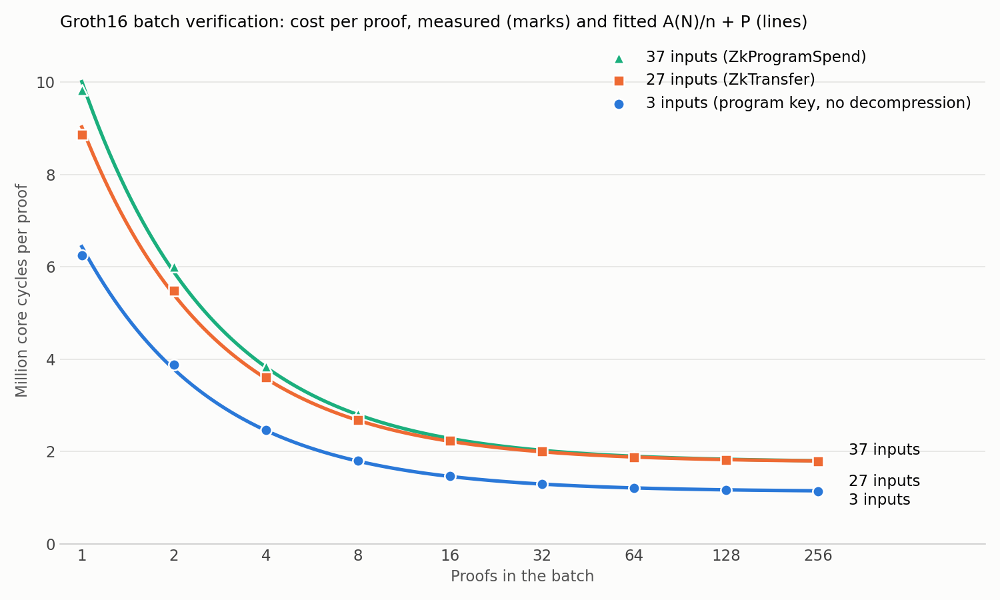

# ANALYSIS-GAS-COST-DETERMINATION

| Field | Value |
| --- | --- |
| Name | [Analysis] Gas Cost Determination |
| Slug | 191 |
| Status | raw |
| Category | Informational |
| Editor | Thomas Lavaur <thomaslavaur@logos.co> |
| Contributors | Filip Dimitrijevic <filip@logos.co> |

<!-- timeline:start -->

## Timeline

- **2026-05-27** — [`b7602ed`](https://github.com/logos-co/logos-lips/blob/b7602ed8a225d41ca0bfaaa432524dc84d2ded7e/docs/blockchain/raw/analysis-gas-cost-determination.md) — chore: move blockchain specs from notion to github

<!-- timeline:end -->

# Revisions History

| Version | Changes | Date |
| --- | --- | --- |
| 1.0.0 | Initial revision. | N/A |
| 1.2.0 | Removed DA, included Execution Gas determination for channel deposits and withdraws. Updated the Execution Gas of the Channel config. | N/A |
| 1.3.0 | [\[RFC\] Make Ledger Transaction an Operation](mantle-transaction-encoding/appendices/rfc-make-ledger-transaction-an-operation.md). Updated project references to Logos Blockchain | N/A |
| 1.4.0 | [\[RFC\] Enforce NoteId uniqueness](mantle-transaction-encoding/appendices/rfc-enforce-noteid-uniqueness.md)​ | N/A |
| 1.4.1 | [\[RFC\] Simplify Mantle Transaction and Refactor Ledger Operations](mantle-transaction-encoding/appendices/rfc-simplify-mantle-transaction-and-refactor-ledger-operations.md) | N/A |
| 1.5.0 | Introduce the new Operation `CHANNEL_STAKE_ASSIGNATION` and update of the channel operations to reflect changes in Mantle | 2026-06-24 |
| 1.5.1 | Reflect Channel Deposit execution modification. It now consumes inputs to update their NoteId | 2026-07-27 |
| 1.5.2 | Renamed locked notes into service notes and stated that the Input Gas covers the check that a note is neither a service nor a channel note | 2026-08-27 |
| 1.5.3 | Adopted "active message" as the single name for the message | 2026-09-02 |
| 1.5.4 | Renamed the `stake_manipulation_threshold` of the channel gas derivations into `transfer_threshold` and the Channel Stake Assignation section into Channel Transfer, following Mantle | 2026-08-31 |
| 1.6.0 | Add the Execution Gas derivation for the `CLAIM_POW_REWARD` Operation | 2026-09-04 |
| 1.7.0 | Per-signature Ed25519 cost re-measured with strict verification ([Common Cryptographic Components](common-cryptographic-components.md) 1.2.0): 56 → 59 Execution Gas, `SDP_DECLARE_GAS` 646 → 649 | 2026-09-24 |
| 1.7.1 | [RFC] The SDP costs price the per-service identifier checks and no lock-period check | 2026-10-05 |
| 1.8.0 | Follow the private ledger of Mantle: the notes are proven with a ZkTransfer and spent by nullifier, channel inscriptions carry the ZkTransfer of their steps, channel withdrawals and SDP withdrawals carry a ZkTransfer, the proof of work claim carries no proof, and the `CHANNEL_TRANSFER` and `LEADER_CLAIM` Operations are removed. The ZkTransfer is priced from the measured batch verification of Groth16 proofs, a fixed part per block and 619 Execution Gas per proof | 2026-10-07 |
| 1.9.0 | Add the Execution Gas of program steps and of the `PROGRAM_REGISTER` Operation, priced from the measured batch verification of the ZkProgramSpend, the verification of a program proof alone with the line coefficients of its key, and the subgroup checks and the pairing `e(α, β)` of a verification key | 2026-10-12 |
| 2.0.0 | Execution Gas measured in core cycles on the node, end to end, over note sets of a million notes, every step of the validation and execution priced. The Execution Gas of a Mantle Transaction sums a term per byte of the signed transaction, a term per note set it changes, and the Execution Gas of its Operations, each built from per-component constants: proofs, root extensions, nullifiers, commitments, the signatures its proof carries, steps, program deposits and openings, a program step including its program proof. The fixed costs of a block are deducted from its Execution Gas limit. The inscriptions of steps pay as transaction bytes | 2026-11-06 |

# Introduction

In Mantle, each Mantle Transaction contains one or more Operations. These components consume gas, measured through fixed gas units that reflect their execution or storage impact. Logos Blockchain introduces two independent gas markets:

- Execution Gas: measuring computational workload.
- Permanent Storage Gas: measuring cost of fully replicated storage.

Gas constants are calibrated to reflect the computational and storage requirements of the validation and execution of Mantle Transactions. By standardizing gas measurements, the system can charge fees proportional to resource usage, preventing network abuse and incentivizing efficient transaction design.

# Overview

The Execution Gas is derived from measurements of the [Rust implementation of the node](https://github.com/logos-blockchain/logos-blockchain), taken on the functions the node runs when it validates and executes a block, on a ledger whose note sets hold a million notes each. Every step of the validation and execution is measured, either within the Mantle Transaction that causes it, or as the fixed work of a block:

- the decoding of the transaction, its hash and the identifiers of its Operations;
- the signatures;
- the decompression and the batch verification of the zero-knowledge proofs, and the verification of program proofs;
- the root each proof is verified against;
- the insertion of nullifiers and the appending of commitments to the note sets, and the hashing of the trees of every changed note set at the end of the block;
- the checks and the state updates of each Operation.

The Execution Gas of a Mantle Transaction is a sum of per-component constants, each fitted on these measurements ([Gas determination from measures](#gas-determination-from-measures)). The constants predict 9.1% more than a full block of mixed transactions costs, measured whole, when the end of block work of each note set is counted once ([Fit and cross-check](#fit-and-cross-check)).

Gas can also be adjusted to incentivize or disincentivize the usage of certain Operations compared to others.

## Permanent Storage Gas

Permanent Storage is paid directly for the entire signed Mantle Transaction. The Permanent Storage Gas price is derived from [Storage Markets](storage-markets.md) and is used to determine the Permanent Storage fee. 1 Permanent Storage Gas corresponds to 1 byte.

```python
permanent_storage_fee = len(encode(tx_signed)) * permanent_storage_gas_price
```

## Execution Gas

Execution is a second general market that represents how costly a Mantle Transaction is to validate and execute. The Execution Gas base price is derived from [Execution Market](execution-market.md). 1 Execution Gas corresponds to 1,000 core cycles of the reference machine ([Method](#method)).

```python
execution_base_fee = tx_execution_gas(tx_signed) * execution_gas_base_price
```

The Execution Gas of a Mantle Transaction is:

```python
def tx_execution_gas(tx_signed, note_sets) -> int:
    # note_sets: the note sets once the Operations of the transaction have run, each
    # recording whether an Operation created or changed it (tx_changed), and the
    # (referenced root, covered) of each root its proofs extended by buffered
    # commitments (tx_extended_roots)
    return (len(encode(tx_signed)) * EXECUTION_KB_GAS // 1000
            + EXECUTION_NOTE_SET_GAS * sum(note_set.tx_changed for note_set in note_sets[SDP_SET:])
            + sum(root_gas(covered) for note_set in note_sets
                  for (_, covered) in note_set.tx_extended_roots)
            + sum(execution_gas(op, op_proof)
                  for op, op_proof in zip(tx_signed.tx.ops, tx_signed.op_proofs)))

# The extension of a referenced root by the commitments buffered before a proof in
# the transaction: the buffer before its mini-block for a user step or a program deposit,
# the whole buffer of the set for the other proofs. Proofs sharing their note set,
# referenced root and number of commitments covered are verified against one extended
# root, computed and paid once.
def root_gas(covered: int) -> int:
    return EXECUTION_ROOT_GAS + EXECUTION_BUFFERED_GAS * covered

# A ZkTransfer or a ZkProgramSpend, with the notes it spends and creates.
def spend_gas(inputs, outputs) -> int:
    return (EXECUTION_PROOF_GAS
            + EXECUTION_NULLIFIER_GAS * len(inputs)
            + EXECUTION_COMMITMENT_GAS * len(outputs))

# A program step of a Channel Inscribe, with its proofs and its openings.
def program_step_gas(step) -> int:
    return (EXECUTION_PROGRAM_STEP_GAS
            + spend_gas(step.inputs, step.program_outputs + step.outputs)
            + EXECUTION_OPENING_GAS * len(step.program_outputs))
```

and the Execution Gas of each Operation, from the Operation and its proof alone, is:

```python
TRANSFER          = EXECUTION_TRANSFER_GAS + spend_gas(inputs, outputs)
CHANNEL_INSCRIBE  = EXECUTION_CHANNEL_INSCRIBE_GAS + EXECUTION_SIGNATURE_GAS
                    + sum(EXECUTION_USER_STEP_GAS + spend_gas(step.inputs, step.outputs)
                          for step in user_steps)
                    + sum(EXECUTION_PROGRAM_DEPOSIT_GAS + spend_gas(step.inputs, step.outputs)
                          for step in program_deposits)
                    + sum(program_step_gas(step) for step in program_steps)
CHANNEL_CONFIG    = EXECUTION_CHANNEL_CONFIG_GAS + EXECUTION_SIGNATURE_GAS * len(proof.signatures)
CHANNEL_DEPOSIT   = EXECUTION_CHANNEL_DEPOSIT_GAS + spend_gas(inputs, outputs)
CHANNEL_WITHDRAW  = EXECUTION_CHANNEL_WITHDRAW_GAS + EXECUTION_NOTE_SET_GAS + spend_gas(inputs, outputs)
SDP_DECLARE       = EXECUTION_SDP_DECLARE_GAS + EXECUTION_SIGNATURE_GAS
                    + spend_gas(inputs, [service_note])
SDP_WITHDRAW      = EXECUTION_SDP_WITHDRAW_GAS + EXECUTION_SIGNATURE_GAS
                    + spend_gas([service_note_nullifier], outputs) + root_gas(1)
SDP_ACTIVE        = EXECUTION_SDP_ACTIVE_GAS + EXECUTION_SIGNATURE_GAS
CLAIM_POW_REWARD  = EXECUTION_CLAIM_POW_REWARD_GAS
PROGRAM_REGISTER  = EXECUTION_PROGRAM_REGISTER_GAS
```

each `EXECUTION_SIGNATURE_GAS` paying an Ed25519 signature the proof of the Operation carries, where `user_steps`, `program_deposits` and `program_steps` are the [user steps](bedrock-v1.1-mantle-specification.md#channel_inscribe), the program deposits and the program steps of the inscription, a user step being a local transaction of the channel: a ZkTransfer moving channel notes, signed by their holder and published by a sequencer, and with the constants of the Operations:

| Constant | Execution Gas | Measure |
| --- | --- | --- |
| `EXECUTION_TRANSFER_GAS` | 10 | [Transfer](#transfer) |
| `EXECUTION_CHANNEL_INSCRIBE_GAS` | 26 | [Channel Inscription](#channel-inscription) |
| `EXECUTION_CHANNEL_CONFIG_GAS` | 24 | [Channel Config](#channel-config) |
| `EXECUTION_CHANNEL_DEPOSIT_GAS` | 26 | [Channel Deposit](#channel-deposit) |
| `EXECUTION_CHANNEL_WITHDRAW_GAS` | 33 | [Channel Withdraw](#channel-withdraw) |
| `EXECUTION_SDP_DECLARE_GAS` | 1693 | [SDP Declaration](#sdp-declaration) |
| `EXECUTION_SDP_WITHDRAW_GAS` | 0 | [SDP Withdraw](#sdp-withdraw) |
| `EXECUTION_SDP_ACTIVE_GAS` | 15117 | [SDP Activation](#sdp-activation) |
| `EXECUTION_CLAIM_POW_REWARD_GAS` | 1506 | [Claim PoW Reward](#claim-pow-reward) |
| `EXECUTION_PROGRAM_REGISTER_GAS` | 15114 | [Program Register](#program-register) |

and the constants of the components:

| Constant | Execution Gas | Measure |
| --- | --- | --- |
| `EXECUTION_KB_GAS` | 30 per 1,000 bytes | 29.1 cycles per byte of the signed transaction |
| `EXECUTION_NOTE_SET_GAS` | 8961 | end of block of a changed note set, with its first nullifier, at most 8,960,550 cycles |
| `EXECUTION_PROOF_GAS` | 4177 | decompression and batch verification of a ZkTransfer or a ZkProgramSpend, at most 4,176,746 cycles |
| `EXECUTION_ROOT_GAS` | 2332 | root of a recent commitment MMR extended by buffered commitments, 2,331,953 cycles |
| `EXECUTION_BUFFERED_GAS` | 60 | append of a buffered commitment to that MMR, one merge on average, 59,249 cycles |
| `EXECUTION_NULLIFIER_GAS` | 1758 | insertion of a nullifier and its share of the hashing of the nullifier tree, 1,757,508 cycles |
| `EXECUTION_COMMITMENT_GAS` | 58 | append of a commitment, 57,597 cycles |
| `EXECUTION_SIGNATURE_GAS` | 557 | Ed25519 signature, 556,608 cycles |
| `EXECUTION_USER_STEP_GAS` | 28 | a user step beyond its spend, 27,659 cycles |
| `EXECUTION_PROGRAM_DEPOSIT_GAS` | 144 | a program deposit beyond its spend and the append of its commitments to the root of the program spend consuming it, 143,284 cycles |
| `EXECUTION_PROGRAM_STEP_GAS` | 13528 | a program step beyond its spend, the program deposits it consumes and its openings, with the verification of its program proof under its registered key, 212,654 + 13,314,344 cycles |
| `EXECUTION_OPENING_GAS` | 470 | the commitment of an opened program note, 469,714 cycles |

The constants of each Operation are what remains of its measure once its components are counted: the decoding and the checks of its fields, and the updates of the ledger state proper to the Operation. Each section below lists the steps behind them. Each is the measure of the Operation with one input and one output where it pays them through `spend_gas`, its release included for a withdrawal, less 59,479 cycles per input and 57,597 per output, the slopes of the Transfer, and less 556,608 cycles per Ed25519 signature, rounded up to the next 1,000 cycles. `EXECUTION_SDP_WITHDRAW_GAS` also deducts `root_gas(1)` and is floored at 0.

The fixed costs of a block, paid once whatever its transactions, are deducted from the Execution Gas limit of the block ([Execution Fee Market](overview-cryptoeconomics.md#execution-fee-market)): 62,201,714 cycles, or 62,202 Execution Gas ([Fixed costs of a block](#fixed-costs-of-a-block)).

# Components

## Transaction bytes

Decoding a transaction, hashing it into its `mantle_txhash` and deriving the identifier of each of its Operations each read every byte of it. Measured on inscriptions whose payload goes from 0 to 16,384 bytes, a transaction costs 29.1 cycles per byte beyond its fixed parts. Alone, decoding costs 3.2 cycles per byte and each Blake2b pass 3.8. The inscription of a user step or of a program deposit pays like any other byte of the transaction. The whole encoded step, its inscription included, is read by one more Blake2b pass, into its `user_step_id` or `program_deposit_id`. That pass is not in the per-byte measure, whose payload is the inscription of the Operation: a byte of the inscription of a step costs about 33 cycles against the 30 priced. A 2 MiB block made of inscriptions of steps spends at most about 8,000 Execution Gas in that pass, about 6,100 beyond what its bytes pay.

## Proofs

The ZkTransfer proofs of a block are verified in one batch, and so are its ZkProgramSpend proofs ([Batch verification of ZK proofs](bedrock-v1.1-block-construction.md#batch-verification-of-zk-proofs)). A batch of `n` proofs costs a fixed part `A(N)`, which grows with the number `N` of public inputs of the key, and a part `P` per proof:

| Proof | Public inputs | `A(N)` | `P` |
| --- | --- | --- | --- |
| ZkTransfer | 27 | 16,171,648 | 4,174,321 |
| ZkProgramSpend | 37 | 19,452,227 | 4,176,746 |

`P` includes the decompression and the validation of the points of the proof, 1,585,326 cycles of it: 77,036 for each G1 point and 1,431,254 for the G2 point, whose subgroup check takes 1,197,300. The batch draws its random coefficients `r_i` on 128 bits, which bound the probability that an invalid proof passes to `2^-128` and halve the multiplication of `π_A` by `r_i` against coefficients of the full field. The fixed parts are deducted from the limit of the block, and each proof pays `EXECUTION_PROOF_GAS = 4177`.

A program proof is verified alone under the key of its program, which no other program shares. The verification, 13,314,344 cycles, decompresses the proof, computes the line coefficients of `-γ` and `-δ` of the key (1,521,609 cycles), and runs a Groth16 verification against the pairing `e(α, β)` stored at the registration of the program.

## Roots

A proof is verified against a root of a recent commitment MMR of its note set, extended by the commitments buffered before it in the transaction ([Validation](bedrock-v1.1-mantle-specification.md#validation)). Without any buffered commitment, the root is the referenced root itself, checked to be recent, 1,392 cycles. With `b` buffered commitments, the commitments are appended to a copy of the peaks of the referenced MMR and its root is computed, 2,331,953 cycles for the root and 59,249 per commitment, the average over the lengths of the referenced MMR: appending `b` commitments to an MMR of `L` commitments merges `popcount(L) + b - popcount(L + b)` peaks, 59,708 cycles each. The proofs of a transaction naming the same note set, referenced root and `b` share one extended root, computed once and paid once, so a step costs the same whatever its position in its mini-block.

## Nullifiers

A nullifier is inserted in the nullifier IMT of its set (depth [`NOTE_SET_DEPTH`](bedrock-v1.1-mantle-specification.md#ledger)) in two parts:

- In the Operation: the check that it is absent (4,452 cycles), the update of the low leaf and of the sorted index, and the append of its leaf, 53,625 cycles alone and at most 61,403 for each further input of an Operation.
- At the end of the block: the hashing of the leaves the block wrote and of every node above them, each node once. The first nullifier of a set in a block costs 4,061,452 cycles, the hashing of two paths of the tree. Every further one costs at most 1,696,105 cycles: its leaf lands next to the leaves appended before it, but its low leaf is anywhere in the tree, and the path of the low leaf shares only its upper levels with the other paths of the block. From 64 to 256 nullifiers of a set, each further one costs 1,311,248 cycles.

`EXECUTION_NULLIFIER_GAS = 1758` prices the largest cost of each part, 1,757,508 cycles. The price holds for note sets of about a million nullifiers, the size measured: each doubling of a set adds about one compression, 59,404 cycles, to a nullifier. The first nullifier of a set is paid by `EXECUTION_NOTE_SET_GAS` for the channel and SDP sets, and by the fixed costs of a block for the ledger set.

## Commitments

Appending a commitment to the commitment [Merkle Mountain Range](bedrock-v1.1-mantle-specification.md#commitment-merkle-mountain-range) (MMR) of its set merges one peak per trailing one bit of the length of the MMR, 59,708 cycles per merge, and costs 57,597 cycles on average over the outputs of an Operation. `EXECUTION_COMMITMENT_GAS = 58`.

## Note sets

At the end of a block, each note set the block changed records its commitment root among its recent roots, expires the roots older than [`ROOT_WINDOW`](bedrock-v1.1-mantle-specification.md#ledger) blocks, and updates its leaf in the eligible tree (depth [`ELIGIBLE_DEPTH`](cryptarchia-proof-of-leadership.md#eligible-sets)). For a set holding a full window of recent roots, this costs 4,867,502 cycles, among which the commitment root (2,331,953), computed once and recorded for both the recent roots and the eligible leaf, the eligible leaf (234,488) and the path of the eligible tree, and 8,928,473 to 8,960,550 cycles with the first nullifier and a commitment the block added to the set, among 1 to `ROOT_WINDOW` recent roots.

A Mantle Transaction pays `EXECUTION_NOTE_SET_GAS = 8961`, the largest of these measures, once for each channel or SDP note set it changes, whatever the number of its Operations changing that set. A set created by the transaction counts as changed: its creation inserts its leaf in the eligible tree, a path of `ELIGIBLE_DEPTH` compressions of 59,404 cycles, below the cost of a changed set. The ledger set changes in every block with the leader note, and its cost is part of the fixed costs of the block.

## Signatures

An Ed25519 signature is verified with strict verification (small-order checks on the public key and on `R`, see [Common Cryptographic Components](common-cryptographic-components.md#eddsa)) over the 32-byte `mantle_txhash`, 525,399 cycles. In a Channel Config, each further signature costs 556,608 cycles with the lookup of its key, the value of `EXECUTION_SIGNATURE_GAS = 557`. An Operation pays it for each Ed25519 signature its proof carries, so its Execution Gas depends on the Operation and its proof alone: a Channel Config pays the signatures it carries, which validation holds to the threshold of the channel, none for a channel it creates.

# Operations

The measures below are the cycles of the whole Operation in a Mantle Transaction holding it alone, from its encoded bytes to the updated state, proofs deferred to the batch of the block.

## Transfer

| Step | Cycles |
| --- | --- |
| Transfer of 1 input and 1 output | 126,817 |
| each further input | 59,479 |
| each further output | 57,597 |
| decompression and batch verification of the ZkTransfer | 4,174,321 |
| hashing of each nullifier at the end of the block, beyond the first of the set | at most 1,696,105 |

The 10 Execution Gas of the Transfer cover the decoding of its fields, the check of its balance and the check that its referenced root is recent.

## Channel Inscription

The validation verifies the Ed25519 signature of the sequencer, its accreditation, the chaining of the inscription to the tip of the channel, and each step. The execution applies the steps to the note set of the channel and updates its tip.

| Step | Cycles |
| --- | --- |
| Inscription without steps | 581,922 |
| of which the signature | 525,399 |
| each user step of 1 input and 1 output, beyond its proof | 144,735 |
| first program deposit consumed by a program step, with the extension of the root of the program spend by its commitment | 2,542,707 |
| each further program deposit of 1 input and 1 output, beyond its proof | 319,608 |
| program step without input nor deposit, 1 output | 852,173 |
| each input of the program spend | 49,103 |
| each output of the program spend | 60,530 |
| each opening of a program note | 469,714 |
| program proof | 13,314,344 |

A user step derives its [`user_step_id`](bedrock-v1.1-mantle-specification.md#channel_inscribe), a BLAKE2b hash of its encoding, and checks its inputs and outputs, 27,659 cycles beyond its nullifier and its commitment. A program deposit derives its [`program_deposit_id`](bedrock-v1.1-mantle-specification.md#channel_inscribe) the same way and enters the hash of the program deposits of the program step consuming it, 143,284 cycles beyond its nullifier, its commitment and the append of that commitment to the root of the program spend, whose extension the first program deposit of a step causes (`EXECUTION_ROOT_GAS`). A program step checks that its program is registered and derives the public inputs of its proofs, 212,654 cycles beyond the inscription without steps and its commitment, and verifies its program proof, 13,314,344 cycles: `EXECUTION_PROGRAM_STEP_GAS` prices both. An opening recomputes the commitment of the opened note and compares it to the output.

## Channel Config

| Step | Cycles |
| --- | --- |
| Channel Config with a threshold of 1 | 579,915 |
| each further signature | 556,608 |

The 24 Execution Gas cover the checks of the configuration and the update of the channel state.

## Channel Deposit

| Step | Cycles |
| --- | --- |
| Deposit of 1 input and 1 output | 142,390 |
| each further input | 55,011 |
| each further output | 58,076 |
| decompression and batch verification of the ZkTransfer | 4,174,321 |

The deposit spends notes of the ledger set and appends its outputs to the note set of the channel.

## Channel Withdraw

| Step | Cycles |
| --- | --- |
| Withdraw of 1 input and 1 output, recorded as pending | 26,964 |
| release at its slot: insertion of 1 nullifier in the channel set and append of 1 commitment to the ledger set | 122,760 |
| each further input released | 61,403 |
| each further output released | 56,435 |
| decompression and batch verification of the ZkTransfer | 4,174,321 |

The release runs before the transactions of the block at the slot of the withdrawal, and the Operation pays it in advance, `EXECUTION_NOTE_SET_GAS` included for the change it makes to the channel note set.

## SDP Declaration

| Step | Cycles |
| --- | --- |
| Declaration with 1 input, among 1,024 declarations of the service | 2,366,053 |
| of which the signature | 525,399 |
| decompression and batch verification of the ZkTransfer | 4,174,321 |

The validation checks the format of the declaration, the length of its locators, the amount, and that its `declaration_id` and `provider_id` are not declared in the service, through keys of the declarations of each service: 2,302,348 cycles among no declaration, 2,366,053 among 1,024. The execution inserts the nullifiers, creates the declaration and appends the service note to the SDP note set.

## SDP Withdraw

| Step | Cycles |
| --- | --- |
| Withdrawal | 2,905,930 |
| of which the signature | 525,399 |
| release at the end of the epoch | 61,455 |
| decompression and batch verification of the ZkTransfer | 4,174,321 |

The validation checks that the declaration exists and is not withdrawn, and the ZkTransfer consuming the service note, whose root is computed from that note alone. That root is the root of the empty MMR extended by one commitment, priced by `root_gas(1) = 2392`, and the rest of the 2294 Execution Gas measured beyond the components leaves `EXECUTION_SDP_WITHDRAW_GAS = 0`. The execution records the withdrawal epoch, inserts the nullifier of the service note in the SDP note set and keeps the output pending, and its release at the end of the epoch appends the output to the ledger note set.

## SDP Activation

| Step | Cycles |
| --- | --- |
| Active message | 15,673,578 |
| of which the signature | 525,399 |

The validation checks that the declaration exists, the nonce, the signature of the `provider_id`, and the activity proof of the service, the [Proof of Quota](proof-of-quota.md) for the Blend Network, which takes most of the cost.

## Claim PoW Reward

| Step | Cycles |
| --- | --- |
| Claim | 1,505,926 |
| of which the re-derivation of the puzzle ticket, one `zkhash` over four field elements | 292,916 |

The validation re-derives the ticket, compares it to the reward difficulty, checks that the referenced block is canonical and within the acceptance window, that the ticket is not in the nullifier set and that the pool covers a reward. The execution inserts the nullifier, derives the note and appends its commitment, and decrements the pool. A claim pays its fee out of the reward it creates, so the per-claim reward clears the Permanent Storage fee of the transaction, these 1506 Execution Gas and the Execution Gas of its bytes, and the Execution Gas of the Transfer spending the reward note with the extension of its root by that note, `root_gas(1)`: 9,901 Execution Gas beyond the bytes for a Transfer of one input and one output.

## Program Register

| Step | Cycles |
| --- | --- |
| Registration | 15,113,912 |
| of which the decompression of the 5 G1 and 3 G2 points of the key, with their subgroup checks | 4,730,145 |
| of which the pairing `e(α, β)` | 5,560,011 |

The execution derives the program identifier and stores the key with `e(α, β)`, 384 bytes. The line coefficients of `-γ` and `-δ` would take tens of kilobytes of ledger state per program, so each program proof computes them.

# Fixed costs of a block

| Step | Cycles |
| --- | --- |
| Header, without its Proof of Leadership | 297,346 |
| Proof of Leadership | 17,282,257 |
| Leader note and end of block of the ledger set | 4,936,784 |
| First nullifier of the ledger set | 4,061,452 |
| Fixed part of the ZkTransfer batch, `A(27)` | 16,171,648 |
| Fixed part of the ZkProgramSpend batch, `A(37)` | 19,452,227 |
| Total | 62,201,714 |

The total, 62,202 Execution Gas, is deducted from the Execution Gas limit of the block.

The releases of the withdrawals due at a block, paid in advance by their Operations, are not deducted: they run in the headroom between the Execution Gas target and the limit, the target being half the limit. The SDP withdrawals of an epoch are all released at its end, 61,455 cycles each, so 10,000 of them take 19.6% of the limit.

# Annex

## Gas determination from measures

### Method

- The measured code is the [gas benchmark of the node](https://github.com/logos-blockchain/logos-blockchain/tree/560e7d6760bff797fbcb71befe2b7d60b0e8e9e8/ledger/benches/gas), which runs the functions of the ledger the node runs: decoding, preverification, `try_apply_transaction`, `try_apply_header`, `try_apply_block_contents`, the batch verifiers and the end of the block.
- Cycles are core cycles counted by the hardware cycle counter of the core (`CPU_CYCLES`, read through `perf_event`, user and kernel), for the measured function only, its inputs being prepared outside the count.
- The node is built with its release profile (`lto = "fat"`, `codegen-units = 1`, `opt-level = 3`), single threaded, pinned to one core under the performance frequency governor: `taskset -c 3 cargo bench -p logos-blockchain-ledger --features test-utils --bench gas`, with `kernel.perf_event_paranoid=1`.
- The ledger note set and the note set of the channel of the measures each hold 1,000,000 nullifiers and 1,000,001 commitments. At this odd count, the next commitment merges one peak of the MMR, the average case, and the root of the MMR skips no level, the worst case. The nullifiers an Operation spends are drawn like the filled ones, so the low leaf of each is anywhere in the tree. One dimension of each Operation varies at a time.
- Each value is the minimum over 5 runs of 15 rounds, each round visiting every case once in a new random order. The measures that look up or insert nullifiers vary much more between runs than the others, up to about 60% for a Channel Withdraw: each nullifier lands anywhere in the tree of a million leaves, and cache misses dominate. Over the 5 runs, the base of a Transfer goes from 1 to 16 Execution Gas.
- The proofs of the Operations are made of valid curve points and decompress as real proofs do. A batch whose proofs do not verify costs what a verified one does: it decompresses every proof and runs every multi-scalar multiplication and the multi-pairing before it compares.

The machine:

- Board     : Raspberry Pi 5 Model B
- CPU       : 4 Cortex-A76 cores at 2.4 GHz, one thread per core
- Cache     : 512 KiB of L2 per core (2 MiB), 2 MiB of L3
- RAM       : 8 GB
- OS        : Debian 13
- Kernel    : 6.18
- Rust      : rustc 1.99.0
- Temperature: 56 to 59 °C during the runs, without thermal throttling

### Fit and cross-check

Each constant is the slope of the measures of the Operation along one dimension, or the measure of a component alone where the Operation cannot isolate it, rounded up to the next 1,000 cycles.

A block of 64 transactions on one channel, measured whole (40 Transfers of 2 inputs and 2 outputs, 16 inscriptions of one user step, 7 inscriptions of one program deposit and one program step of one input, two outputs and one opening, and one channel deposit; 111 nullifiers, 118 commitments, 27,391 bytes), costs 642.1 million cycles with its header, its Proof of Leadership and the verification of its proofs. The constants, with the end of block work of the channel set counted once and the fixed costs of the block, come to 700.6 million cycles, 9.1% above. The 24 transactions changing the channel set each pay that work, as every transaction changing a set does, and the Execution Gas of the block comes to 906.7 million cycles, 41.2% above: the end of block work of a set is paid by each transaction changing it, so that the price of a transaction does not depend on the other transactions of its block.

### Groth16 Proof Batch Verification

For `n` proofs under one verification key with `N` public inputs, the batch verifier of the node does the following work:

- Once per batch, whatever `n`: it folds the public inputs of all the proofs with random coefficients `r_i` of 128 bits, computes one multi-scalar multiplication over the `N + 1` input points of the key, runs the Miller loops of the three terms of the key (`α`, the folded inputs and `π_C`), and one final exponentiation.
- Once per proof: it decompresses and validates the points of the proof, multiplies `π_A` by `r_i`, runs the Miller loop of `(r_i π_A, π_B)`, and adds `π_C` to a multi-scalar multiplication over the `n` proofs.

Its cost is therefore a fixed part `A(N)` plus a part `P` per proof:

```text
cycles(n, N) = A(N) + n * P
```

Measured cycles of one batch verification of `n` proofs. `N = 3` runs the generic verifier on proofs decompressed beforehand, the trend of a key with few inputs; `N = 27` and `N = 37` run the verifiers of the ZkTransfer and of the ZkProgramSpend on compressed proofs:

| Proofs `n` | N = 3 | N = 27 | N = 37 |
| --- | --- | --- | --- |
| 1 | 13,071,300 | 20,000,359 | 23,238,270 |
| 2 | 16,303,586 | 24,905,832 | 28,216,816 |
| 4 | 21,215,688 | 32,985,501 | 36,269,860 |
| 8 | 31,623,395 | 49,790,889 | 53,099,703 |
| 16 | 52,231,911 | 83,277,695 | 86,572,833 |
| 32 | 93,273,616 | 150,085,699 | 153,468,664 |
| 64 | 174,992,722 | 283,284,583 | 286,691,602 |
| 128 | 336,777,836 | 547,602,127 | 551,644,137 |
| 256 | 660,726,395 | 1,078,097,911 | 1,082,547,813 |

Fitted with every point weighted by its relative error:

| N | `A(N)` | `P` | Maximum deviation from the fit |
| --- | --- | --- | --- |
| 3 | 10,833,806 | 2,565,872 | 2.5% |
| 27 | 16,171,648 | 4,174,321 | 1.7% |
| 37 | 19,452,227 | 4,176,746 | 1.7% |



The cost per proof, `A(N) / n + P`, decreases with the size of the batch towards `P`. `P` does not depend on `N`, while `A(N)` grows by about 328k cycles per public input from 27 to 37, the cost of one more point in the multi-scalar multiplication of the batch.

### Verification Key Validation

A [`PROGRAM_REGISTER`](bedrock-v1.1-mantle-specification.md#program_register) Operation carries a Groth16 verification key of 5 compressed G1 points and 3 compressed G2 points. A G1 point on the curve of BN254 is in its prime-order subgroup, while a G2 point needs a subgroup check of its own.

| Work | Cycles |
| --- | --- |
| Decompression of the key, 5 G1 and 3 G2 points validated, subgroup checks included | 4,730,145 |
| Pairing `e(α, β)` | 5,560,011 |
| Line coefficients of `-γ` and `-δ` | 1,521,609 |
| Preparation of a key, `e(α, β)` and the line coefficients | 7,092,530 |

The ledger computes `e(α, β)`, the costliest part of the preparation, once at the registration, and stores it with the key.

### Trees and hashes

| Work | Cycles |
| --- | --- |
| Poseidon2 compression of two field elements | 59,404 |
| `zkhash` of four field elements | 292,916 |
| Blake2b-256 of 0, 1,024 and 65,536 bytes | 1,615, 5,604, 248,228 |
| Root of the commitment MMR of a filled set | 2,331,953 |
| Append to the commitment MMR, per merged peak | 59,708 |
| End of block of a set, nullifiers inserted in the block: 0, 1, 2, 4, 16, 64, 256 | 4,867,502, 8,928,954, 10,625,059, 13,957,759, 32,504,702, 101,156,685, 352,916,326 |
| End of block of a set, among 1, 256 and 1,024 recent roots | 8,931,461, 8,960,550, 8,928,473 |
| Decoding of an inscription of 0, 1,024 and 65,536 bytes of payload | 38,866, 45,948, 247,585 |
