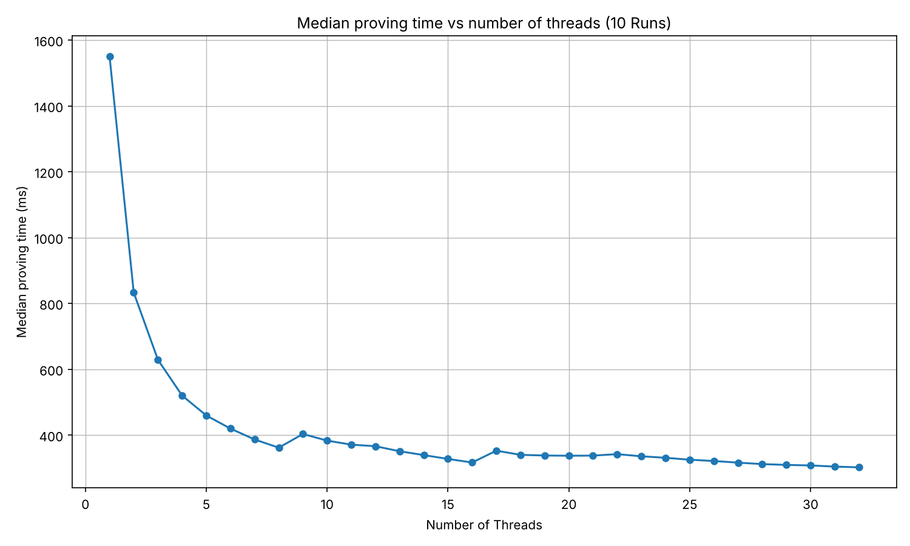
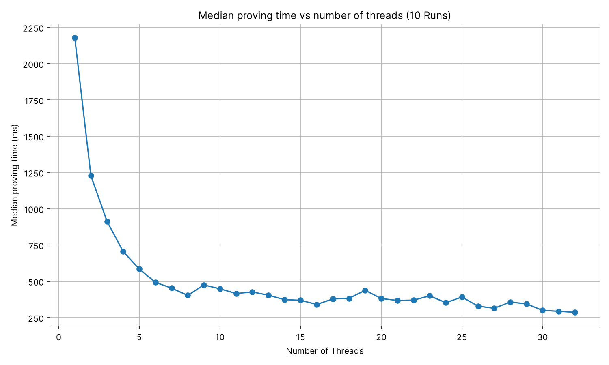

# MANTLE

| Field | Value |
| --- | --- |
| Name | Mantle |
| Slug | 98 |
| Status | raw |
| Category | Informational |
| Editor | Thomas Lavaur <thomas@logos.co> |
| Contributors | David Rusu <davidrusu@logos.co>, Filip Dimitrijevic <filip@logos.co>, Marcin Pawlowski <marcin@logos.co> |

<!-- timeline:start -->

## Timeline

- **2026-05-27** — [`b7602ed`](https://github.com/logos-co/logos-lips/blob/b7602ed8a225d41ca0bfaaa432524dc84d2ded7e/docs/blockchain/raw/bedrock-v1.1-mantle-specification.md) — chore: move blockchain specs from notion to github
- **2026-05-18** — [`58b5698`](https://github.com/logos-co/logos-lips/blob/58b56988429f4d69a9e10a9fc118725e229e37c5/docs/blockchain/raw/bedrock-v1.1-mantle-specification.md) — chore(blockchain): migrate contributor emails to @logos.co (#338)
- **2026-01-19** — [`f24e567`](https://github.com/logos-co/logos-lips/blob/f24e567d0b1e10c178bfa0c133495fe83b969b76/docs/blockchain/raw/bedrock-v1.1-mantle-specification.md) — Chore/updates mdbook (#262)
- **2026-01-16** — [`89f2ea8`](https://github.com/logos-co/logos-lips/blob/89f2ea89fc1d69ab238b63c7e6fb9e4203fd8529/docs/blockchain/raw/bedrock-v1.1-mantle-specification.md) — Chore/mdbook updates (#258)

<!-- timeline:end -->

# Revisions History

| **Version** | **Changes** | Date |
| --- | --- | --- |
| 1.1.0 | Initial revision. | 2026-12-01 |
| 1.2.0 | Removed DA references. Removed notions of Sovereignty and Rollups and used Zones for simplicity. Removed Nomos from specifications and DSTs. Added bridging and decentralized sequencing for channels. | 2026-01-01 |
| 1.2.1 | [RFC] Improve Mantle Transaction hash. | 2026-03-25 |
| 1.3.0 | [[RFC] Make Ledger Transaction an Operation](mantle-transaction-encoding/appendices/rfc-make-ledger-transaction-an-operation.md). | 2026-04-02 |
| 1.4.0 | [[RFC] Enforce NoteId uniqueness](mantle-transaction-encoding/appendices/rfc-enforce-noteid-uniqueness.md). | 2026-04-24 |
| 1.5.0 | [[RFC] Simplify Mantle Transaction and Refactor Ledger Operations](mantle-transaction-encoding/appendices/rfc-simplify-mantle-transaction-and-refactor-ledger-operations.md). | 2026-05-06 |
| 1.6.0 | [RFC] Remove Concept of a Session | 2026-06-22 |
| 1.7.0 | Factor out the multi eddsa threshold verification and added a validation step in channel config to check the new config threshold is lower or equal than the number of accredited keys | 2026-06-25 |
| 1.8.0 | [RFC] Update channels to support proof of stake participation and test vectors for OpId and Mantle Transaction Hash | 2026-07-06 |
| 1.9.0 | Update the execution of `CHANNEL_DEPOSIT` to consume the inputs and recreate them in the channel, updating their NoteId avoid replay attacks in case of withdraw after a deposit | 2026-07-27 |
| 1.9.1 | Rename the excess balance left after the mandatory fees into `tx_priority_tip` and convert it back into a `TokenValue` explicitly | 2026-08-05 |
| 1.9.2 | Required checked arithmetic for all token value, balance, gas, and fee computations. | 2026-08-06 |
| 1.10.0| Enforce non empty inputs for every operation not only transfer moving the assertion in the validation of input spendability | 2026-08-11 |
| 1.10.1| [RFC] One canonical encoding for `ServiceType` and `Locator`: `ServiceType` is its one-byte discriminant and `Locator` is the multiaddr binary form. Added a `declaration_id` test vector | 2026-08-14 |
| 1.10.2| Precise the state validation reads: the Operations of a Mantle Transaction are validated and executed one after the other in the order they appear, each against the state the preceding ones left, and a Mantle Transaction against the state the transactions preceding it in the block left. Accumulated the transaction balance along that pass, replacing `get_transaction_balance` | 2026-08-24 |
| 1.11.0 | Track the configuration lineage of a channel: `ChannelState` gains `config_tip_hash` and the `CHANNEL_CONFIG` payload carries the `parent` configuration it extends, ordering configurations and preventing their replay | 2026-08-27 |
| 1.11.1 | Renamed locked notes into service notes: `service_notes`, `ServiceNote` and `service_note_id` replace their locked counterparts, and the note kind is named after the role it plays rather than after the state it is left in | 2026-08-27 |
| 1.12.0 | Specified the `SDP_ACTIVE` execution effects, matching the implementation: `active` is set to the epoch of the including block, and a message the activity logic rejects makes the Operation invalid. Set `withdraw_at` to `current_epoch + 2`, the epoch at which the node stops providing the service, and removed declarations at `withdraw_at` | 2026-09-02 |
| 1.13.0 | Removed the `None` case of `op_proofs`, every Operation carrying exactly one proof. A `CHANNEL_CONFIG` creating a channel is verified against a threshold of `0` and its proof carries no signature and no index. Execution Gas is derived from the Operation and the state it is validated against, the thresholds pricing the channel Operations being the ones held in the channel state | 2026-08-31 |
| 1.14.0 | Moved SDP declaration removal to `withdraw_at + 1`; the last served epoch's reward is paid in the same first block, before removal | 2026-09-11 |
| 1.15.0 | Add the `CLAIM_POW_REWARD` Operation and the proof of work state it is validated against; the reward pool and the difficulty controllers are specified in [Proof of Work](proof-of-work.md) | 2026-09-08 |
| 1.16.0 | Gas Determination table updated for strict Ed25519 verification: channel Operations 56 → 59 Execution Gas per signature, `EXECUTION_SDP_DECLARE_GAS` 646 → 649, from [Gas Cost Determination](analysis-gas-cost-determination.md) 1.7.0 | 2026-09-24 |
| 1.17.0 | Bound channel inscription data and channel deposit metadata by `MAX_OPERATION_DATA_SIZE` as defined in Mantle Transaction Encoding; aligned SDP activity metadata and its test vectors with the tagged variant encoding. | 2026-10-06 |
| 2.0.0 | Changed the UTXO ledger to private notes with transaction unlinkability, kept in a ledger, an SDP and one note set per channel. Channel notes are moved by the steps their holders sign, each proven against a recent root and the part of the transaction buffer it names, and are withdrawn by their holders. Removed `LEADER_CLAIM`, `CHANNEL_TRANSFER` and the Example sections of the Operations, signed `SDP_ACTIVE` with the `provider_id`, made the `CLAIM_POW_REWARD` ticket publicly verifiable and moved `CLAIM_POW_REWARD` to the opcode `0x30` | 2026-10-01 |
| 2.1.0 | Add programs: notes gain `program` and `data` fields, `PROGRAM_REGISTER` registers a Groth16 verification key, and channel inscriptions carry program steps made of user payments, a `ZkProgramSpend`, a program proof and the openings of the program notes they create | 2026-10-12 |

# Introduction

Mantle is a foundational element of Bedrock, designed to provide a minimal and efficient execution layer that connects together Bedrock Services in order to provide the necessary functionality for Zones. It can be viewed as the system call interface of Bedrock, exposing a safe and constrained set of Operations to interact with lower-level Bedrock services, similar to syscalls in an operating system.

Mantle Transactions provide Operations for Zones and blockchain Services to interact with Bedrock. For example, a Zone sequencer posting an update to Bedrock, or a node operator declaring its participation in the Blend Network, would be done through the corresponding Operations within a Mantle Transaction.

Mantle manages assets using a private note-based ledger that follows an UTXO model. Each Mantle Transaction can include Transfer Operation, and any excess balance serves as the fee payment.

# Overview

## Mantle Transaction

The features of the Logos Blockchain are exposed through Mantle Transactions. Each transaction can contain one or more **Operations**. Mantle Transactions enable users to execute multiple Operations atomically: the Operations are applied one after the other in the order they appear, and either all of them take effect or none does.

## Mantle Operations

Logos Blockchain features are exposed through Mantle Operations, which can be combined in a single Mantle Transaction and validated atomically. These Operations enable transfers and functions such as on-chain data posting, Cross-Zone interactions and SDP interaction.

## Mantle Ledger

The Mantle Ledger enables asset transfers using an obfuscated UTXO model. The ledger tracks three kinds of notes, each in note sets of its own: regular notes, service notes (collateral for service declarations) and channel notes (channel bridge funds). The notes a user holds participate in Proof of Stake, while the notes governed by a [program](#programs) inside a channel do not.

## Transaction Fees

Mantle Transaction fees are derived from a gas model. The Logos Blockchain has two different gas markets, accounting for permanent data storage, and execution costs. Each Operation has an associated Execution Gas cost. Users can build unbalanced Mantle Transactions to tip the leaders and incentivize the network to include their transaction.

| Gas Market | Charged On | Pricing Basis |
| --- | --- | --- |
| Execution Gas | Operations | Operation dependent |
| Permanent Storage Gas | Signed Mantle Transaction | Proportional to encoded size |

# Mantle Transaction

Mantle Transactions form the core of Mantle, enabling users to combine multiple Operations to access different functions. Each transaction contains a list of Operations. The system validates the Operations atomically and executes them in the order they appear.

```python
class MantleTx:
    ops: list[Op]

class Op:
    opcode: byte
    payload: bytes

def mantle_txhash(tx: MantleTx) -> Hash:
    tx_bytes = encode(tx)

    h = Hasher()
    h.update(b"MANTLE_TXHASH_V1")
    h.update(tx_bytes)

    return h.digest()
```

The [hash function used](common-cryptographic-components.md), as well as other cryptographic primitives like ZK proof generation protocol and signature schemes, are described in [Common Cryptographic Components](common-cryptographic-components.md).

## Mantle Transaction Hash

A Mantle Transaction must include all relevant proofs for each Operation.

```python
class SignedMantleTx:
    tx: MantleTx
    op_proofs: list[OpProof] # each Op has exactly 1 associated proof
```

Every Operation proof (zk proofs or signatures) must be cryptographically bound to the `MantleTx` through the `mantle_txhash` to prevent replay attacks. This binding is achieved by including the `MantleTx` hash reduced modulo $`p`$ as a public input in every ZK proof. There are two exceptions: the ZkTransfer of a channel step, signed before the Mantle Transaction exists, is bound to the step itself ([CHANNEL_INSCRIBE](#channel_inscribe)), and `CLAIM_POW_REWARD` carries no proof, its ticket being publicly verifiable.

```python
mantle_txhash_fr = FiniteField(mantle_txhash, byte_order="little", modulus = p)
```

  `mantle_txhash` is a classical 256-bit hash digest and must be reduced to a field element before being passed to any ZkHasher or used as a ZK public input. We apply a direct modular reduction mod $`p`$ (via `FiniteField(..., modulus=p)`). Since $`p \approx 2^{254}`$, the reduction is slightly non-uniform. This is inconsequential in practice as the collision probability remains around $`2^{-254}`$, and proof binding is derived from the collision-resistance of the classic hash, not from uniformity over $`F_p`$.

## Arithmetic

All arithmetic in this specification is checked. Every addition, subtraction, and multiplication over transaction balance, gas amounts, and fees is performed on the stated integer type, and a Mantle Transaction is invalid if any intermediate or final result cannot be represented in that type; results must never silently wrap around or saturate. Token value is supposed to never exceed the precision of `TokenValue` (see the [Notes](#notes) section).

The pseudocode expresses these checks with the following helpers; a failed check makes the Mantle Transaction invalid:

```python
UINT64_MAX = 2**64 - 1

def checked_uint64(value: int) -> TokenValue:
        assert 0 <= value <= UINT64_MAX
        return value
```

The proof of work difficulty updates are the exception to these bounds; they are specified in [Puzzle Target](proof-of-work.md#puzzle-target).

## Mantle Transaction Fee

The transaction mandatory fee is a sum of two components: the multiplication of the total Execution Gas by the `execution_base_fee`, and the total size of the encoded signed Mantle Transaction multiplied by the `permanent_storage_gas_price`. The execution base fee and the permanent storage gas price are protocol-determined values that are the same for every Mantle Transaction in a block. They are derived following [[Execution Market](execution-market.md) and [Storage Markets](storage-markets.md).

```python
def mandatory_fees(signed_tx: SignedMantleTx,
                   ledger: Ledger,
                   channels: dict[ChannelId, ChannelState],
                   permanent_storage_gas_price: TokenValue, # Given by Storage Market
                   execution_gas_base_price: TokenValue) -> uint64:  # Given by Execution Market
    mantle_tx = signed_tx.tx
    permanent_storage_fees = checked_uint64(len(encode(signed_tx)) * permanent_storage_gas_price)
    tx_execution_gas = 0

    for op in mantle_tx.ops:
        # Compute how much execution gas of this operation as defined
        # in the gas determination Appendix, against the state this
        # Operation is validated against
        tx_execution_gas += execution_gas(op, ledger, channels)
    execution_base_fees = checked_uint64(tx_execution_gas * execution_gas_base_price)

    return checked_uint64(execution_base_fees + permanent_storage_fees)
```

The Execution Gas of an Operation is deterministically derived from that Operation and the state it is validated against.

If the Mantle Transaction is unbalanced (meaning that the Transaction consume more value than it creates) and that the leftover balance cover more than the mandatory fees, the remaining is treated as execution tip fees.

## **Validation**

*Given*

```python
signed_tx = SignedMantleTx(
    tx=MantleTx(ops),
    op_proofs
)

permanent_storage_gas_price: TokenValue # Given by Storage Market
execution_gas_base_price: TokenValue    # Given by Execution Market

ledger: Ledger
channels: dict[ChannelId, ChannelState]
```

The state validation reads is not a fixed snapshot: it advances as the block is processed. A Mantle Transaction is validated against the state left by the Mantle Transactions preceding it in the block, as defined in [Block Proposal Validation](bedrock-v1.1-block-construction.md#block-proposal-validation), and validation and execution then follow one another Operation by Operation, in the order the Operations appear: the Operation at index `i` is validated against the state the Operations at indices `0` to `i-1` left, then executed to produce the state the Operation at index `i+1` is validated against. This is what the `ledger`, `channels` and `declarations` given to each Operation below denote.

The commitment MMRs of the [note sets](#ledger) that some Operations are proven against follow the same Operation by Operation progression, but locally to the Mantle Transaction. Every Operation adding notes to the ledger note set or to a channel note set appends their commitments to the buffer of that set for the Mantle Transaction when validated, and every Operation referencing a commitment MMR root of a set references the root of that set at one of the last 1024 blocks, against which it is verified once the buffer of the set is appended to it. A channel step, proven before the Mantle Transaction exists, is verified against its root extended with only the part of the buffer it names, so that its proof depends on that part and not on its position ([CHANNEL_INSCRIBE](#channel_inscribe)). An Operation can therefore consume the outputs of a previous Operation of the same Mantle Transaction without waiting for a block to include them.

Atomicity is what a failed check means, not simultaneity. If any of the checks below fails, the whole Mantle Transaction is invalid: none of its Operations takes effect, whether or not it was reached. An invalid Mantle Transaction is never skipped over either, the block including it being invalid and nothing of that block being executed.

Mantle validators will ensure the following:

1. We have exactly one proof for each Operation, of the variant that Operation requires.
    ```python
    assert len(op_proofs) == len(ops)
    ```

2. Each Operation is valid, and takes effect before the next one is validated.
    ```python
    tx_balance = 0
    for note_set in ledger.sets:
        note_set.tx_cm_buffer = []  # the buffers start empty with every Mantle Transaction
    for op, op_proof in zip(ops, op_proofs):
        assert op.opcode in MANTLE_OPCODES
        validate_mantle_op(mantle_txhash(tx), op.opcode, op.payload, op_proof)
        # the excess of the ZkTransfer of these Operations pays the fees
        if op.opcode in (TRANSFER, CHANNEL_DEPOSIT, SDP_WITHDRAW):
            tx_balance = checked_uint64(tx_balance + op.payload.excess_value)
        execute_mantle_op(op.opcode, op.payload)

    def validate_mantle_op(txhash, opcode, payload, op_proof):
        if opcode == CHANNEL_INSCRIBE:
            validate_channel_inscribe(txhash, payload, op_proof)
        # elif opcode == ...
        #    ...

    def execute_mantle_op(opcode, payload):
        if opcode == CHANNEL_INSCRIBE:
            execute_channel_inscribe(payload)
        # elif opcode == ...
        #    ...
    ```

3. The Mantle Transaction excess balance pays at least the mandatory fees.
    ```python
    tx_mandatory_fee = mandatory_fees(signed_tx,                        # uint64
                                      ledger,
                                      channels,
                                      permanent_storage_gas_price,
                                      execution_gas_base_price)
    assert tx_mandatory_fee <= tx_balance
    tx_priority_tip = checked_uint64(tx_balance - tx_mandatory_fee)
    ```

## Execution

*Given*

```python
SignedMantleTx(
    tx=MantleTx(ops),
    op_proofs
)
```

Mantle Validators execute each Operation in `ops` according to its opcode, in the order the Operations appear and along the state progression [Validation](#validation) defines. The subsections below define, for each opcode, what validating and executing an Operation amount to.

# Operations

## Opcodes

| **Operation** | **Opcode** | **Description** |
| --- | --- | --- |
| TRANSFER | 0x00 | Consume and create notes. |
| PROGRAM_REGISTER | 0x01 | Register a program by its verification key. |
| *RESERVED* | *0x02 - 0x0F* |  |
| CHANNEL_CONFIG | 0x10 | Configure a channel |
| CHANNEL_INSCRIBE | 0x11 | Write a message permanently onto Mantle. |
| CHANNEL_DEPOSIT | 0x12 | Deposit notes into a channel |
| CHANNEL_WITHDRAW | 0x13 | Withdraw notes from a channel |
| *RESERVED* | *0x14 - 0x1F* |  |
| SDP_DECLARE | 0x20 | Declare intention to participate as a node in a Bedrock Service, locking notes as collateral. |
| SDP_WITHDRAW | 0x21 | Withdraw participation from a Bedrock Service, unlocking your notes in the process. |
| SDP_ACTIVE | 0x22 | Signal that you are still an active participant of a Bedrock Service. |
| *RESERVED* | *0x23 - 0x2F* |  |
| CLAIM_POW_REWARD | 0x30 | Claim a reward from the pow reward pool. |
| *RESERVED* | *0x31 - 0xFF* |  |

## Channel Operations

Channels allow Zones to post their updates on chain. Channels form virtual chains that overlay on top of the Cryptarchia blockchain. Clients and Followers of a Zone can watch its channel to learn the state of that Zone. Each channel has its own [note set](#ledger), enabling bridging between Zones and Bedrock.

### Message Ordering

Channels form virtual chains by having each message reference its parent message. The order of messages in these channels is enforced by the sequencer by building a hash chain of messages, i.e. new messages reference the previous messages through a parent hash. Given that Cryptarchia has long finality times, these message parent references allow Zone sequencers to continue to post new updates to channels without having to wait for finality. No matter how Cryptarchia forks and reorgs, the channel messages from honest sequencers will eventually be re-included in a way that satisfies the virtual chain order.

Configurations form a second hash chain within the channel: each configuration names the configuration it supersedes, so a pending reconfiguration stays valid while the sequencer keeps posting inscriptions.

The first time a message is sent to an unclaimed channel, the key that signs the initial message becomes the only accredited key in the list (Note that this key may correspond to a threshold signature key). Accredited keys of a channel forms a committee that can configure the channel and take turns to write messages to that channel following a round-robin algorithm. Configuring a channel includes modifying the list of accredited keys, the round-robin parameters and the required number of signatures to establish a new configuration.

Validators must maintain the following state to process channel Operations:

```python
channels: dict[ChannelId, ChannelState] # ChannelId is 32 bytes

class ChannelState:
    # Channel Configuration
    accredited_keys: list[Ed25519PublicKey]  # limited to 65 535 keys
    configuration_threshold: u16  # indicating how many keys are
                                  # required to update the configuration

    # Message Ordering
    tip_hash: hash         # Last message of the channel
    config_tip_hash: hash  # Last configuration of the channel

    # Decentralized Sequencing
    tip_slot: Slot
    tip_sequencer: u16      # indicating the actual
                            # sequencer position in the list of accredited keys
    tip_sequencer_starting_slot: Slot
    posting_timeframe: u32  # number of slots (0 = infinity)
    posting_timeout: u32    # number of slots (0 = no timeout)

    # Bridging
    note_set: int           # index of the note set of the channel in ledger.sets

def default_channel(block_slot: Slot, keys: list[Ed25519PublicKey], note_set: int) -> ChannelState:
    return ChannelState(
        tip_hash = ZERO,
        config_tip_hash = ZERO,
        tip_slot = block_slot,
        accredited_keys = keys,
        tip_sequencer = 0,
        tip_sequencer_starting_slot = block_slot,
        posting_timeframe = 0,
        posting_timeout = 0,
        configuration_threshold = 1,
        note_set = note_set)

def create_channel(channel_id: ChannelId, block_slot: Slot, keys: list[Ed25519PublicKey]):
    # a new channel gets the next note set, so channels are ordered by creation
    ledger.sets.append(empty_note_set())
    channels[channel_id] = default_channel(block_slot, keys, len(ledger.sets) - 1)
```

Note that the user chooses the ChannelId mapping to the ChannelState (but it’s restricted to 32 bytes). We don't currently impose restrictions on it, but we may do so in the future to prevent undesirable behaviors.

### Decentralized Sequencing

To determine which sequencer is currently authorized to send messages, we use a round-robin algorithm. When a message is posted to a channel, the following algorithm is used to determine who the sequencer is:

```python
# Round Robin algorithm determining the new sequencer index and the
# new sequencer starting slot
def round_robin(block_slot: Slot, channel: ChannelState) -> (u16, u64):
    elapsed_slots = block_slot - channel.tip_slot
    if elapsed_slots >= channel.posting_timeout and channel.posting_timeout != 0:
        # Get the number of sequencers that get timed out
        sequencers_timed_out = elapsed_slots // channel.posting_timeout
        index = (
            (channel.tip_sequencer + sequencers_timed_out)
            % len(channel.accredited_keys)
        )
        starting_slot = (
            channel.tip_slot
            + sequencers_timed_out * channel.posting_timeout
        )
    else:
        # Get the number of timeframes elapsed to get who is the sequencer
        tip_sequencer_duration = block_slot - channel.tip_sequencer_starting_slot
        index = (
            (channel.tip_sequencer + (tip_sequencer_duration // channel.posting_timeframe))
            % len(channel.accredited_keys)
        )
        starting_slot = (
            channel.tip_sequencer_starting_slot
            + (tip_sequencer_duration // channel.posting_timeframe) * channel.posting_timeframe
        )
    return (index, starting_slot)
```

### Bridging

Channels let their bridged notes keep participating in Proof of Stake. When a user deposits notes into a channel, they stay on the ledger and are not turned into inert collateral. They are consumed and re-created as user notes of the channel's note set, which continue to count toward Proof of Stake and can still be used to create PoLs (see [Channel Notes](#channel-notes)). Two goals motivate this design:

- **More PoS participation, stronger security.** Funds deposited into a channel would otherwise leave the staking set. Keeping them as channel notes means the capital backing the application layer also backs consensus security, so bridging does not shrink the stake that secures the chain.
- **No split between security and application.** A user no longer has to choose between staking funds or using them in a channel. The same funds do both at once. They stay usable inside the channel while still earning Proof of Leadership rewards, so capital is never fragmented between the two.

**Holders keep their notes.** A user note of a channel is owned by the holder of its `ZkPublicKey`. Only that holder can spend it, in one of two ways:

- *Inside the channel*, the holder signs off chain a user step, a ZkTransfer that consumes its user notes and creates user notes of the same total value, or a payment to a [program](#programs). The sequencers of the channel collect the steps and payments of their users and publish them in a [`CHANNEL_INSCRIBE`](#channel_inscribe), in the order they choose, since a step or payment proven over notes of earlier blocks holds at any position. The ledger verifies every step, so a sequencer orders the moves of the user notes of a channel but never makes one.
- *Out of the channel*, the holder posts a [`CHANNEL_WITHDRAW`](#channel_withdraw) alone. It takes effect `WITHDRAW_DELAY` slots later, unless an inscription of the channel consumes its notes with a valid step in the meantime.

**Ageing.** Because a deposit and a step consume notes and create new ones, a user note of a channel restarts the ageing process and must age again before it can create a PoL. Bridged funds still count toward Proof of Stake, so the goals above hold, but the participation is not continuous across these moves.

**What each party can do.**

| Party | Can | Cannot |
|---|---|---|
| Holder of a user note's `ZkPublicKey` | Create a PoL with the note and earn its rewards. Sign a user step moving the note inside the channel, or a payment to a program. Withdraw the note alone | Spend the note in any other Operation |
| Channel sequencers | Collect the steps and payments of their users and publish them in the inscriptions of the channel, in the order they choose, a step or payment consuming a note of the same Mantle Transaction coming after it. Prove the program steps | Move a user note without its holder's step or payment. Move a program note without the proof of its program |
| Program | Authorize, by its proof, the program steps consuming and creating its notes and paying users | Consume a user note. Create value |

### Programs

A program governs notes of a channel that no single user holds, such as the reserves of a pool. It is a Groth16 circuit, registered by its verification key with [`PROGRAM_REGISTER`](#program_register), and its notes are the program notes whose `program` field is its identifier. A program runs in the program steps of the [inscriptions](#channel_inscribe) of a channel:

- **Payments.** Users pay the program with ZkTransfers consuming their user notes, whose excess is the value paid to the program. Each payment commits to the program and to an intent, the hash of what its user expects from the program.
- **Program spend.** The sequencer consumes notes of the program and creates notes of the program and the user notes the program pays, with a [ZkProgramSpend](#zero-knowledge-program-spend-proof-zkprogramspend) balancing exactly with the value paid. It publishes the opening of every note of the program it creates.
- **Program proof.** The sequencer proves the rule of the program with a Groth16 proof under its registered key, over the notes of the program spend, the payments with their intents, and the `op_id` of the inscription.

`Groth16_verify(key, public_inputs, proof)` verifies a [Groth16](common-cryptographic-components.md#groth16-zk-snark) proof against a verification key and its public inputs.

**Holder.** A program note has a holder like any note, whose secret key derives its nullifiers and is known to whoever proves the program spend. The program chooses it. For a note open to everyone, such as the reserves of a pool, the convention is the public key of the secret key `0`: anyone can derive its nullifiers, and only the program proof authorizes its moves.

**What enforces what.**

| Property | Enforced by |
| --- | --- |
| No value is created | The ZkTransfers and the ZkProgramSpend balance exactly, and the ledger sums the paid values into the program spend |
| A user note moves only with the key of its holder | The ZkTransfer |
| A payment only pays the program it names, in a step carrying the intent its holder signed | The message of the payment, which commits to the program and the intent |
| A program note is created and consumed only with the proof of its program | The ZkTransfer, which only derives commitments with `program` and `data` set to `0`; the ZkProgramSpend, whose inputs are notes of the program and whose outputs are notes of the program or user notes; the program proof, required by every program step |
| A program step serves the intents over LGO as the rule of the program states | The program proof, which reads the payments and the notes of the program spend |
| The notes of a program can be consumed by the next sequencer | The ledger, which checks the opening of every note of the program a step creates |
| A program step serves the intents over the assets of the zone | The users of the zone, who verify the intents against the inscription and the zone state, and the sequencers of the zone, who slash a faulty sequencer |

A program using LGO only, such as lending, is thus enforced by the ledger, and its users trust only the circuit of the program they pay. A program exchanging LGO with assets of the zone, such as a swap, is enforced by the ledger for its LGO only. Depending on the program, publishing the preimage of each intent in the inscription is recommended, so that the users of the zone can verify how the program step served it.

**Design choices.**

- Creating a program note requires the proof of its program. Otherwise anyone could create a note of the program with any `data`, such as a fake pool state, and the program could not tell it from its own.
- A payment exists only inside its program step. A payment left unconsumed cannot happen: if the sequencer does not publish the program step, the notes of the user are not consumed.
- The program spend and the program proof are bound to the `op_id` of the inscription, which covers the inscription and the public data of every step but no proof. A program step is thus attributable to its inscription and valid in no other.
- Program notes take no part in Proof of Stake, since the Proof of Leadership derives the commitment of its note with `program` and `data` set to `0`. They are never withdrawn either, since a withdrawal consumes notes with a ZkTransfer.
- The opening of every note of the program a step creates is published with the step, and checked by the ledger. A sequencer withholding the opening of a note of the program would otherwise freeze it: program notes are never withdrawn, and no sequencer can prove a program spend consuming a note it cannot open. The openings serve this data availability only: the ledger keeps nothing from them, and they are prunable.

**Privacy.** The paid values are public, and so are the notes of the program, opened in the steps that create them. The amount of each interaction with a program is therefore visible, and so is the total value a program step pays to users: with a single payee, what that payee receives. Its interactions are subject to timing attacks. The users stay hidden: payments consume notes by nullifier, and the notes the program pays are commitments.

### CHANNEL_INSCRIBE

Write a message to a channel with the message data being permanently stored on the Logos Blockchain, and apply the steps the sequencer collected from the users of the channel. The list of steps can be empty, in which case the inscription only writes its message.

#### Payload

```python
class UserStep:
    is_program: bool = False
    inputs: list[NoteNf]        # nullifiers of the consumed user notes of the channel
    outputs: list[NoteCm]       # commitments of the created user notes of the channel
    cm_merkle_root: MerkleRoot  # a recent (less than 1024 blocks) MMR root of the channel note set,
                                # extended for the proof with the first `buffered` commitments
                                # of the tx_cm_buffer of the set
    buffered: int               # UINT16, the number of these commitments, 0 for a step over notes
                                # created before the Mantle Transaction

class Payment:
    inputs: list[NoteNf]        # nullifiers of the consumed user notes of the channel
    outputs: list[NoteCm]       # commitments of the change, user notes of the channel
    cm_merkle_root: MerkleRoot  # a recent (less than 1024 blocks) MMR root of the channel note set,
                                # extended with the tx_cm_buffer of the set for the proof
    paid_value: TokenValue      # the value paid to the program
    intent: zkhash              # the hash of what the user expects from the program

class ProgramStep:
    is_program: bool = True
    program_id: ProgramId       # the program the step executes
    payments: list[Payment]     # the payments of the users to the program, possibly empty
    inputs: list[NoteNf]        # nullifiers of the consumed notes of the program, possibly empty
    outputs: list[NoteCm]       # commitments of the created notes of the program and of the user notes it pays
    program_outputs: list[bool] # (len = len(outputs)) whether each output is a note of the program
    cm_merkle_root: MerkleRoot  # a recent (less than 1024 blocks) MMR root of the channel note set,
                                # extended with the tx_cm_buffer of the set for the proof
    spend_notes_hash: zkhash    # the hash of the input and output notes of the program spend

class Inscribe:
    channel: ChannelId       # 32 bytes Channel being written to
    inscription : bytes      # Message to be written on the blockchain
    parent: hash             # Previous message in the channel
    signer: Ed25519PublicKey # Identity of message sender
    steps: list[UserStep | ProgramStep]  # Moves of channel notes, in the order they apply, possibly empty
```

A user step moves the user notes of its holder. A program step executes a [program](#programs): users pay it with their payments, and the program spend consumes and creates the notes of the program and pays users.

A user step and a payment are signed and proven by the holder of the notes they consume, off chain and before the Mantle Transaction carrying them exists. Each names, with `buffered`, how many commitments of the buffer of the channel note set its proof covers: its ZkTransfer is verified against the referenced root extended with only the first `buffered` commitments of that buffer, those the Operations, steps and payments before it in the Mantle Transaction add first. Most steps and payments consume notes created in earlier blocks: they take `buffered = 0` and are proven against their referenced root of the channel note set alone, so their proofs hold at any position in any transaction. A sequencer can therefore collect the steps and payments of many users, all proven against the same recent root, and publish them in the order it chooses. A proof extended with the whole buffer would instead hold only at the position it was proven for: each holder would have to wait for the sequencer to fix everything before its own step or payment, and they would be proven one after another. Only a step or payment consuming a note created earlier in the same Mantle Transaction covers part of the buffer, up to that note, and must be placed after the commitments it covers. `buffered` is public, so such a step or payment reveals that its inputs are among the first `buffered` commitments of the buffer: a holder may cover more of the buffer than it needs, up to its length at the position of the step or payment, so as not to point at one note, at the cost of fixing more of the order.

Since they are signed before the Mantle Transaction exists, their ZkTransfer is bound to their own content rather than to the `mantle_txhash`. A user step balances exactly, with an `excess_value` of `0`. The `excess_value` of the ZkTransfer of a payment is its `paid_value`, and the message of a payment also commits to the program it pays and to its intent, so its ZkTransfer only verifies in a step of that program, for that intent:

```python
def step_msg(step: UserStep) -> zkhash:
    return zkhash(
        FiniteField(b"CHANNEL_STEP_V1", byte_order="little", modulus=p),
        FiniteField(len(step.inputs), byte_order="little", modulus=p),
        *step.inputs,
        FiniteField(len(step.outputs), byte_order="little", modulus=p),
        *step.outputs)

def payment_msg(program_id: ProgramId, payment: Payment) -> zkhash:
    return zkhash(
        FiniteField(b"PROGRAM_PAYMENT_V1", byte_order="little", modulus=p),
        program_id,
        payment.intent,
        FiniteField(len(payment.inputs), byte_order="little", modulus=p),
        *payment.inputs,
        FiniteField(len(payment.outputs), byte_order="little", modulus=p),
        *payment.outputs)
```

The program spend and the program proof of a program step are produced by the sequencer and bound to the `op_id` of the Inscribe Operation, which covers the inscription and the public data of every step but no proof. The program proof takes three public inputs: `spend_notes_hash`, the hash of the payments of the step, and the `op_id`:

```python
def payments_hash(step: ProgramStep) -> zkhash:
    paid = []
    for payment in step.payments:
        paid.append(FiniteField(payment.paid_value, byte_order="little", modulus=p))
        paid.append(payment.intent)
    return zkhash(
        FiniteField(b"PROGRAM_PAYMENTS_V1", byte_order="little", modulus=p),
        FiniteField(len(step.payments), byte_order="little", modulus=p),
        *paid)
```

A step applies once, since its nullifiers can be inserted only once.

#### Proof

```python
class ProgramNoteOpening:
    value: TokenValue
    nonce: NoteNonce
    public_key: ZkPublicKey
    data: zkhash

class ProgramStepProof:
    payment_proofs: list[ZkTransfer]  # one per payment, in the order of the payments
    spend_proof: ZkProgramSpend
    program_proof: Groth16Proof       # under the verification key of the program
    program_notes: list[ProgramNoteOpening]  # the opening of each output of the program,
                                             # in the order of the outputs

class InscribeProof:
    signature: Ed25519Signature                       # by the signer, over the mantle_txhash
    step_proofs: list[ZkTransfer | ProgramStepProof]  # one per step, in the order of the steps
```

The openings of the program notes a step creates serve only the availability of the state of the program: the next sequencer needs them to consume these notes, and the payees of the program may need them to learn the notes it pays them. The ledger checks each opening against its output and keeps nothing from it. The openings are part of the proof of the step, outside the `op_id` and the Mantle transaction hash, so pruning them changes no hash. The openings are prunable: a block whose openings were pruned is validated without them, every other check of its steps unchanged.

#### Execution Gas

  Channel Inscribe Operations have an Execution Gas cost of `EXECUTION_CHANNEL_INSCRIBE_GAS`, plus `EXECUTION_TRANSFER_GAS` for each user step, plus `EXECUTION_TRANSFER_GAS * len(payments) + EXECUTION_PROGRAM_SPEND_GAS + EXECUTION_PROGRAM_PROOF_GAS` for each program step. See [Gas Determination](#gas-determination) for the Execution Gas values.

#### Validation

  *Given*

```python
txhash: hash
msg: Inscribe
proof: InscribeProof
op_id: Hash          # derive_op_id of the Inscribe Operation

channels: dict[ChannelId, ChannelState]
ledger: Ledger
block_slot: Slot
```
 
  *Validate*

  1. Ensure the inscription does not exceed `MAX_OPERATION_DATA_SIZE`, and continues the channel or creates it.
      ```python
      assert len(msg.inscription) <= MAX_OPERATION_DATA_SIZE

      if msg.channel in channels:
          chan = channels[msg.channel]
          current_sequencer_index = round_robin(block_slot, chan)[0]

          # Ensure the signer is the one authorized to write to the channel
          assert msg.signer == chan.accredited_keys[current_sequencer_index]

          # Ensure message is continuing the channel sequence
          assert msg.parent == chan.tip_hash

          note_set = ledger.sets[chan.note_set]
      else:
          # Channel will be created automatically upon execution
          # Ensure that this message is the genesis message (parent == ZERO)
          assert msg.parent == ZERO

          note_set = empty_note_set()  # the note set the channel gets at its creation
      ```

  2. Ensure the signature of the signer.
      ```python
      assert Ed25519_verify(txhash, msg.signer, proof.signature)
      ```

  3. Ensure there is one proof per step.
      ```python
      assert len(proof.step_proofs) == len(msg.steps)
      op_id_fr = FiniteField(op_id, byte_order="little", modulus=p)
      step_nfs = set()  # the nullifiers of the steps already validated
      ```

  4. Validate the steps in their order, each with its proof in `step_proofs`, a ZkTransfer for a user step and a `ProgramStepProof` for a program step. Each step is validated against the commitments the earlier steps appended to the buffer of the channel note set, so it can consume the outputs of an earlier step, and against `step_nfs`, so no two steps consume the same note.
      ```python
      for step, step_proof in zip(msg.steps, proof.step_proofs):
          if step.is_program:
              # Ensure the program is registered.
              assert step.program_id in ledger.programs

              # Ensure every payment is spendable and signed by its holder, for this program
              # and its intent, and sum the value paid to the program.
              assert len(step_proof.payment_proofs) == len(step.payments)
              paid_value = 0
              for payment, payment_proof in zip(step.payments, step_proof.payment_proofs):
                  note_set.assert_spendable(payment.inputs, payment.cm_merkle_root)
                  for note_nf in payment.inputs:
                      assert note_nf not in step_nfs
                      step_nfs.add(note_nf)
                  assert note_set.verify_transfer(payment.inputs,
                                                  payment.outputs,
                                                  payment.paid_value,
                                                  payment.cm_merkle_root,
                                                  payment_msg(step.program_id, payment),
                                                  payment_proof)
                  # the program spend is verified with the change of the payments
                  note_set.tx_cm_buffer.extend(payment.outputs)
                  paid_value = checked_uint64(paid_value + payment.paid_value)

              # Ensure the program spend consumes unspent notes of the program, possibly none,
              # and balances exactly with the value paid.
              if len(step.inputs) > 0:
                  note_set.assert_spendable(step.inputs, step.cm_merkle_root)
              else:
                  assert step.cm_merkle_root in note_set.recent_cm_roots
              for note_nf in step.inputs:
                  assert note_nf not in step_nfs
                  step_nfs.add(note_nf)
              assert note_set.verify_program_spend(step.inputs,
                                                   step.outputs,
                                                   step.program_outputs,
                                                   step.cm_merkle_root,
                                                   step.program_id,
                                                   paid_value,
                                                   step.spend_notes_hash,
                                                   op_id_fr,
                                                   step_proof.spend_proof)

              # Ensure every output of the program is opened, for the availability of its state.
              assert len(step.program_outputs) == len(step.outputs)
              program_cms = [cm for cm, of_program in zip(step.outputs, step.program_outputs)
                             if of_program]
              assert len(step_proof.program_notes) == len(program_cms)
              for cm, opening in zip(program_cms, step_proof.program_notes):
                  assert cm == derive_note_cm(Note(value=opening.value,
                                                   nonce=opening.nonce,
                                                   public_key=opening.public_key,
                                                   program=step.program_id,
                                                   data=opening.data))

              # Ensure the program accepts the step.
              assert Groth16_verify(ledger.programs[step.program_id],
                                    [step.spend_notes_hash, payments_hash(step), op_id_fr],
                                    step_proof.program_proof)
          else:
              # Ensure the user step is spendable and signed by its holder.
              note_set.assert_spendable(step.inputs, step.cm_merkle_root)
              for note_nf in step.inputs:
                  assert note_nf not in step_nfs
                  step_nfs.add(note_nf)
              assert note_set.verify_transfer(step.inputs,
                                              step.outputs,
                                              0,  # a user step balances exactly
                                              step.cm_merkle_root,
                                              step_msg(step),
                                              step_proof)

          # Append the outputs of the step to the buffer, so the next steps are verified with them.
          note_set.tx_cm_buffer.extend(step.outputs)
      ```

#### Execution

  *Given*

```python
msg: Inscribe

channels: dict[ChannelId, ChannelState]
ledger: Ledger
block_slot: Slot
```

  *Execute*

  1. If the channel does not exist, create it just-in-time.
      ```python
      if msg.channel not in channels:
          create_channel(msg.channel, block_slot, [msg.signer])
      ```

  2. Apply the steps, in their order: the payments of a program step, then its program spend.
      ```python
      note_set = ledger.sets[channels[msg.channel].note_set]
      for step in msg.steps:
          if step.is_program:
              for payment in step.payments:
                  note_set.execute_spending(payment.inputs)
                  note_set.execute_adding(payment.outputs)
          note_set.execute_spending(step.inputs)
          note_set.execute_adding(step.outputs)
      ```

  3. Update the channel sequencer.
      ```python
      chan = channels[msg.channel]
      (new_sequencer_index, new_sequencer_starting_slot) = round_robin(block_slot, chan)

      chan.tip_sequencer_starting_slot = new_sequencer_starting_slot
      chan.tip_sequencer = new_sequencer_index
      ```

  4. Update the channel tip.
      ```python
      chan = channels[msg.channel]
      chan.tip_hash = hash(encode(msg))
      chan.tip_slot = block_slot
      ```

### CHANNEL_CONFIG

Overwrite the configuration of a channel.

#### Payload

```python
class ChannelConfig:
    channel: ChannelId
    parent: hash             # Previous configuration of the channel
    keys: list[Ed25519PublicKey]
    posting_timeframe: u32
    posting_timeout: u32
    configuration_threshold: u16
```

#### Proof

A Channel Config is authorized by a threshold of the channel's accredited keys using [Multiple Ed25519 Signatures Verification](#multiple-ed25519-signatures-verification).

```python
class ChannelConfigOpProof:
    signatures: list[Ed25519Signature] # signatures from configuration_threshold
    indexes: list[u16]  # signatures of accredited keys with their index.
                        # indexes must be ordered from smallest to
                        # biggest without duplication
```

#### Execution Gas

  Channel Config Operations have a linear Execution Gas cost equal to `EXECUTION_CHANNEL_CONFIG_GAS * configuration_threshold`, where `configuration_threshold` is the one held in the channel state, and `0` for a channel that does not exist yet. See [Gas Determination](#gas-determination) for the Execution Gas values.

#### Validation

  *Given*

```python
txhash: zkhash
config: ChannelConfig
proof: ChannelConfigOpProof
channels: dict[ChannelId, ChannelState]
```

  *Validate*

```python
assert config.configuration_threshold > 0
assert len(config.keys) > 0
assert len(config.keys) < 2^16
# The configuration threshold must be reachable with the accredited keys,
# otherwise the channel would be locked out of any future reconfiguration
assert config.configuration_threshold <= len(config.keys)

if config.channel in channels:
    chan = channels[config.channel]

    # Ensure the configuration is extending the last configuration
    # of the channel
    assert config.parent == chan.config_tip_hash

    # Verify the configuration_threshold signatures (see Appendix)
    MultiEd25519_verify(txhash,
                        proof.signatures,
                        proof.indexes,
                        chan.accredited_keys,
                        chan.configuration_threshold)
else:
    # Channel will be created automatically upon execution
    # Ensure that this configuration is the genesis configuration
    assert config.parent == ZERO

    # No key is accredited yet, so the threshold to verify against is 0
    # and the proof must carry no signature and no index (see Appendix)
    MultiEd25519_verify(txhash,
                        proof.signatures,
                        proof.indexes,
                        [],
                        0)
```

#### Execution

  *Given*

```python
config: ChannelConfig

channels: dict[ChannelId, ChannelState]
ledger: Ledger
block_slot: Slot
```

  *Execute*

  1. If the channel does not exist, create it just-in-time.

      ```python
      if config.channel not in channels:
          create_channel(config.channel, block_slot, config.keys)
      ```

  2. Update the configuration.

      ```python
      chan = channels[config.channel]

      # Update Channel Configuration Parameters
      chan.accredited_keys = config.keys
      chan.configuration_threshold = config.configuration_threshold

      # Update Decentralized Sequencing Parameters
      chan.tip_slot = block_slot
      chan.tip_sequencer = 0
      chan.tip_sequencer_starting_slot = block_slot
      chan.posting_timeframe = config.posting_timeframe
      chan.posting_timeout = config.posting_timeout
      ```

  3. Update the configuration tip.

      ```python
      chan = channels[config.channel]
      chan.config_tip_hash = hash(encode(config))
      ```

### CHANNEL_DEPOSIT

Deposit notes to a channel. The deposit consumes notes of the ledger note set and creates notes of the channel note set, which resets their ageing.

A Zone that credits a deposit in its own state must be sure the deposit really lands on-chain. If the Zone reflects the deposit through a `CHANNEL_INSCRIBE` posted in a separate Mantle Transaction, a reorganization can reorder the two so that the inscription is included while the deposit is not, leaving the Zone crediting funds it never received. Two options avoid this:

- Wait for the deposit to be finalized before interpreting it, at the cost of the finalization delay.
- Include the deposit in the same Mantle Transaction as the inscription. Mantle Transactions validate atomically, so the inscription is included only if the deposit is. This removes the waiting period entirely.

#### Payload

```python
class ChannelDeposit:
    channel: ChannelId
    inputs: list[NoteNf]        # nullifiers of the consumed notes of the ledger note set
    cm_merkle_root: MerkleRoot  # a recent (less than 1024 blocks) MMR root of the ledger note set,
                                # extended with the tx_cm_buffer of the set for the proof
    outputs: list[NoteCm]       # commitments of the created notes of the channel note set
    excess_value: TokenValue    # the excess to pay the fees
    metadata: bytes
```

#### Proof

  A Channel Deposit proves the ownership of the notes being consumed, the created notes and the excess value using a [Zero Knowledge Transfer Proof (ZkTransfer)](#zero-knowledge-transfer-proof-zktransfer).

```python
ZkTransfer
```

#### Execution Gas

  Channel Deposit Operations have a fixed Execution Gas cost of `EXECUTION_CHANNEL_DEPOSIT_GAS`. See [Gas Determination](#gas-determination) for the Execution Gas values.

#### Validation

  *Given*

```python
mantle_txhash: zkhash # zkhash of mantle tx containing this ledger tx
deposit: ChannelDeposit
deposit_proof: ZkTransfer

channels: dict[ChannelId, ChannelState]

ledger: Ledger
```

  *Validate*

  1. Ensure the metadata does not exceed `MAX_OPERATION_DATA_SIZE`.
      ```python
      assert len(deposit.metadata) <= MAX_OPERATION_DATA_SIZE
      ```

  2. Verify that the channel exist
      ```python
      assert deposit.channel in channels
      ```

  3. Ensure all inputs are spendable in the ledger note set.
      ```python
      ledger.sets[LEDGER_SET].assert_spendable(deposit.inputs, deposit.cm_merkle_root)
      ```

  4. Validate ownership over deposited notes and balance.
      ```python
      assert ledger.sets[LEDGER_SET].verify_transfer(deposit.inputs,
                                                     deposit.outputs,
                                                     deposit.excess_value,
                                                     deposit.cm_merkle_root,
                                                     mantle_txhash,
                                                     deposit_proof)
      ```

  5. Add the outputs to the buffer of the channel note set.
      ```python
      ledger.sets[channels[deposit.channel].note_set].tx_cm_buffer.extend(deposit.outputs)
      ```

#### Execution

  *Given*

```python
deposit: ChannelDeposit

channels: dict[ChannelId, ChannelState]

ledger: Ledger
```

  *Execute*

Consume the inputs in the ledger note set and create the outputs in the channel note set.

```python
ledger.sets[LEDGER_SET].execute_spending(deposit.inputs)
ledger.sets[channels[deposit.channel].note_set].execute_adding(deposit.outputs)
```

### CHANNEL_WITHDRAW

Withdraw notes from a channel. The holder of the notes posts the withdrawal alone, and it takes effect `WITHDRAW_DELAY` slots later: its inputs are then consumed in the channel note set and its outputs created in the ledger note set, if none of its inputs was consumed in the meantime. Until then, an inscription of the channel can consume these notes with a valid step, which cancels the withdrawal. A holder therefore cannot invalidate an inscription carrying one of its steps by withdrawing the same note, as long as the inscription lands before the withdrawal is due. A due withdrawal is executed at the start of its block, before the transactions ([Block Execution](bedrock-v1.1-block-construction.md#block-execution)), and a later step consuming its notes is invalid, and so is the transaction carrying it. The nullifiers and due slots of pending withdrawals are public in the ledger state: a sequencer should not accept a step whose inputs a pending withdrawal may release before its inscription lands, since removing the step afterwards also invalidates the later steps whose proofs cover its outputs.

```python
WITHDRAW_DELAY: Slot = 86_400  # 1 day
```

#### Payload

```python
class ChannelWithdraw:
    channel: ChannelId
    inputs: list[NoteNf]        # nullifiers of the consumed notes of the channel note set
    cm_merkle_root: MerkleRoot  # a recent (less than 1024 blocks) MMR root of the channel note set,
                                # extended with the tx_cm_buffer of the set for the proof
    outputs: list[NoteCm]       # commitments of the notes created in the ledger note set
```

A withdrawal balances exactly and carries no fee: another Operation of its Mantle Transaction, such as a Transfer, pays the fees. An excess paid when the withdrawal is posted would stay paid even if the withdrawal is dropped later, which would create tokens.

#### Proof

  A Channel Withdraw proves the ownership of the notes being consumed and the created notes, with an excess value of `0`, using a [Zero Knowledge Transfer Proof (ZkTransfer)](#zero-knowledge-transfer-proof-zktransfer).

```python
ZkTransfer
```

#### Execution Gas

  Channel Withdraw Operations have a fixed Execution Gas cost of `EXECUTION_CHANNEL_WITHDRAW_GAS`. See [Gas Determination](#gas-determination) for the Execution Gas values.

#### Validation

  *Given*

```python
mantle_txhash: zkhash
withdrawal: ChannelWithdraw
proof: ZkTransfer

channels: dict[ChannelId, ChannelState]
ledger: Ledger
```

  *Validate*

  1. Check that the channel exists
      ```python
      assert withdrawal.channel in channels
      chan = channels[withdrawal.channel]
      ```

  2. Ensure all inputs are spendable in the channel note set.
      ```python
      ledger.sets[chan.note_set].assert_spendable(withdrawal.inputs, withdrawal.cm_merkle_root)
      ```

  3. Validate ownership over the withdrawn notes and balance.
      ```python
      assert ledger.sets[chan.note_set].verify_transfer(withdrawal.inputs,
                                                        withdrawal.outputs,
                                                        0,  # a withdrawal balances exactly
                                                        withdrawal.cm_merkle_root,
                                                        mantle_txhash,
                                                        proof)
      ```

#### Execution

  *Given*

```python
withdrawal: ChannelWithdraw

channels: dict[ChannelId, ChannelState]
ledger: Ledger
block_slot: Slot
```

  *Execute*

Keep the withdrawal until its due slot.

```python
ledger.pending_withdrawals.append((block_slot + WITHDRAW_DELAY,
                                   channels[withdrawal.channel].note_set,
                                   withdrawal.inputs,
                                   withdrawal.outputs))
```

At the start of every block, before its transactions, every pending withdrawal whose due slot is reached is applied if its inputs are still unspent, and dropped otherwise (see [Block Execution](bedrock-v1.1-block-construction.md#block-execution)):

```python
def release_withdrawals(block_slot: Slot):
    pending = []
    for (due, note_set, inputs, outputs) in ledger.pending_withdrawals:
        if due > block_slot:
            pending.append((due, note_set, inputs, outputs))
            continue
        unspent = True
        for note_nf in inputs:
            if note_nf in ledger.sets[note_set].nullifiers:
                unspent = False
        if unspent:
            ledger.sets[note_set].execute_spending(inputs)
            ledger.sets[LEDGER_SET].execute_adding(outputs)
    ledger.pending_withdrawals = pending
```

## Service Declaration Protocol (SDP) Operations

These Operations implement the [Service Declaration Protocol](bedrock-service-declaration-protocol.md).

Validators must keep the following state when implementing SDP Operations:

```python
declarations: dict[DeclarationID, DeclarationInfo]
```

### Common SDP Structures

```python
class ServiceType(Enum):
    BN=0 # Blend Network; the one-byte discriminant is the canonical encoding

class Locator(bytes):
    # multiaddr binary form; the canonical encoding
    # (see SDP: Locators)
    def validate(self):
        assert len(self) <= 329
        assert validate_multiaddr(self)

class MinStake:
    stake_threshold: int # stake value
    epoch: EpochNumber # epoch number

class ServiceParameters:
    inactivity_period: NumberOfEpochs # number of epochs
    epoch: EpochNumber                # epoch number at which the Service Parameters were set

class DeclarationInfo:
    service: ServiceType
    locators: list[Locator]
    provider_id: Ed25519PublicKey
    zk_id: ZkPublicKey
    service_note: NoteCm             # the note of the SDP note set staked by the declaration
    withdraw_outputs: list[NoteCm]   # the notes the withdrawal creates, released at removal
    created: EpochNumber
    active: EpochNumber
    withdraw_at: EpochNumber | None
    # SDP ops updating a declaration must use monotonically increasing nonces
    nonce: int
```

### SDP_DECLARE

The service registration follows the definition given in [**Declaration Message**](bedrock-service-declaration-protocol.md#declaration-message):

#### Payload

```python
class DeclarationMessage:
    service_type: ServiceType
    locators: list[Locator]
    provider_id: Ed25519PublicKey
    zk_id: ZkPublicKey
    inputs: list[NoteNf]
    cm_merkle_root: MerkleRoot
    amount: TokenValue
```

Service notes are introduced in [Service notes](#service-notes) and serve as Service collaterals. They cannot be spent before the owner withdraws its participation from the declared service.

#### Proof

```python
class DeclarationProof:
    zk_proof: ZkTransfer             # proving spendability over inputs
    provider_sig: Ed25519Signature  # signature proving ownership of provider key
```

  see: [Zero Knowledge Transfer Proof (ZkTransfer)](#zero-knowledge-transfer-proof-zktransfer).

#### Execution Gas

  SDP Declare Operations have a fixed Execution Gas cost of `EXECUTION_SDP_DECLARE_GAS`. See [Gas Determination](#gas-determination) for the Execution Gas values.

#### Validation

  *Given*

```python
txhash: zkhash                  # the txhash of the transaction we are validating
declaration: DeclarationMessage # the declaration we are validating
proof: DeclarationProof

min_stake: MinStake      # the (global) minimum stake setting
ledger: Ledger           # the set of unspent notes
declarations: dict[DeclarationID, DeclarationInfo]
```

  *Validate*

  The declaration is verified according to [Declare](bedrock-service-declaration-protocol.md#declare).

  1. Ensure ownership over the inputs and `provider_id`.
      ```python
      assert ledger.sets[LEDGER_SET].verify_transfer(declaration.inputs,
                                                     [], # no outputs
                                                     declaration.amount,
                                                     declaration.cm_merkle_root,
                                                     txhash,
                                                     proof.zk_proof)
      assert Ed25519_verify(txhash, declaration.provider_id, proof.provider_sig)
      ```

  2. Ensure declaration does not already exist.
      ```python
      assert declaration_id(declaration) not in declarations
      ```

  3. Ensure the locators list is non-empty and has no more than 8 entries.
      ```python
      assert len(declaration.locators) >= 1
      assert len(declaration.locators) <= 8
      ```

  4. Ensure the inputs are spendable and the value is sufficient for joining the service.
      ```python
      ledger.sets[LEDGER_SET].assert_spendable(declaration.inputs, declaration.cm_merkle_root)
      assert declaration.amount >= min_stake.stake_threshold
      ```

#### Execution

  *Given*

```python
declaration: DeclarationMessage # the declaration we are executing
current_epoch: EpochNumber
ledger: Ledger
declarations: dict[DeclarationID, DeclarationInfo]
```

  *Execute*

  1. Consume the inputs in the ledger note set.
      ```python
      ledger.sets[LEDGER_SET].execute_spending(declaration.inputs)
      ```

  2. Create the service note under the `zk_id` in the SDP note set.
      ```python
      declaration_op_id = derive_op_id(declaration)
      service_note = Note(
          value=declaration.amount,
          nonce=derive_note_nonce(declaration_op_id, 0, declaration.amount, declaration.zk_id),
          public_key=declaration.zk_id
      )
      ledger.sets[SDP_SET].execute_adding([derive_note_cm(service_note)])
      ```

  3. Store the declaration as explained in [**Declaration Storage**](bedrock-service-declaration-protocol.md#declaration-storage).
      ```python
      declare_id = declaration_id(declaration)
      declarations[declare_id] = DeclarationInfo(
          service: declaration.service
          locators: declaration.locators
          provider_id: declaration.provider_id
          zk_id: declaration.zk_id
          service_note: derive_note_cm(service_note)
          withdraw_outputs: []
          created=current_epoch,
          active=current_epoch + 2,
          withdraw_at=None
          nonce=0
      )
      ```

### SDP_WITHDRAW

The service withdrawal follows the definition given in [Withdraw Message](bedrock-service-declaration-protocol.md#withdraw-message).

#### Payload

```python
class WithdrawMessage:
    declaration: DeclarationID
    nonce: int
    service_note_nf: NoteNf     # nullifier of the service note of the declaration
    outputs: list[NoteCm]       # commitments of the notes created in the ledger note set
    excess_value: TokenValue    # the excess to pay the fees
```

The withdrawal consumes the service note of the declaration and creates the notes that return its value. Its ZkTransfer is proven against the root of an empty MMR to which only the service note is appended. That root is computed from the commitment held in the declaration, so the nullifier is the one of this service note and of no other note.

#### Proof

  A signature from the `provider_id` attached to the declaration and a [Zero Knowledge Transfer Proof (ZkTransfer)](#zero-knowledge-transfer-proof-zktransfer) by the holder of the service note are required for withdrawing from a service.

```python
class WithdrawProof:
    zk_proof: ZkTransfer             # consuming the service note
    provider_sig: Ed25519Signature   # signature proving ownership of provider key
```

#### Execution Gas

  SDP Withdraw Operations have a fixed Execution Gas cost of `EXECUTION_SDP_WITHDRAW_GAS`. See [Gas Determination](#gas-determination) for the Execution Gas values.

#### Validation

  *Given*

```python
txhash: zkhash # Mantle transaction hash of the tx containing this operation
withdraw: WithdrawMessage
proof: WithdrawProof

ledger: Ledger
declarations: dict[DeclarationID, DeclarationInfo]
```

  *Validate*

  Validate SDP withdrawal according to [**Withdraw**](bedrock-service-declaration-protocol.md#withdraw).

  1. Ensure declaration exists.
      ```python
      assert withdraw.declaration in declarations
      declare_info = declarations[withdraw.declaration]
      ```
  2. Ensure the declaration is not already scheduled for withdrawal.
      ```python
      assert declare_info.withdraw_at is None
      ```
  3. Ensure the `provider_id` attached to this declaration authorized this Operation.
      ```python
      assert Ed25519_verify(txhash, declare_info.provider_id, proof.provider_sig)
      ```
  4. Ensure that the nonce is greater than the previous one.
      ```python
      assert withdraw.nonce > declare_info.nonce
      ```
  5. Ensure the service note of the declaration is consumed by its holder and balances the outputs.
      ```python
      assert withdraw.service_note_nf not in ledger.sets[SDP_SET].nullifiers
      assert ZkTransfer_verify([withdraw.service_note_nf],
                               withdraw.outputs,
                               withdraw.excess_value,
                               mmr_root([(declare_info.service_note, 0)]),  # one peak, the service note
                               txhash,
                               proof.zk_proof)
      ```

#### Execution

  *Given*

```python
withdraw: WithdrawMessage

current_epoch: EpochNumber # current epoch
ledger: Ledger
declarations: dict[DeclarationID, DeclarationInfo]
```

  *Execute*

  Executes the withdrawal protocol [**Withdraw**](bedrock-service-declaration-protocol.md#withdraw).

  1. Update the declaration info with the nonce, the withdrawal epoch and the notes released at removal.
      ```python
      declare_info = declarations[withdraw.declaration]
      declare_info.nonce = withdraw.nonce
      declare_info.withdraw_at = current_epoch + 2
      declare_info.withdraw_outputs = withdraw.outputs
      ```

  2. Consume the service note in the SDP note set.
      ```python
      ledger.sets[SDP_SET].execute_spending([withdraw.service_note_nf])
      ```

### SDP Epoch Finalization

Withdrawn declarations are removed by Mantle as part of the epoch transition,
not when the `WithdrawMessage` is processed. The rewards of epoch
`withdraw_at - 1` ([Withdraw](bedrock-service-declaration-protocol.md#withdraw))
are distributed in the first block of epoch `withdraw_at + 1` (see
[Service Reward Distribution Protocol](bedrock-service-reward-distribution.md)).
In that same block, after the rewards have been distributed, every declaration
with `withdraw_at + 1 <= current_epoch` is removed and its stake unlocked.
Declarations that withdrew without earning a final reward are removed by the
same step.

  *Given*

```python
current_epoch: EpochNumber
ledger: Ledger
declarations: dict[DeclarationID, DeclarationInfo]
```

  *Execute*

  For every `declare_id`, `declare_info` in `declarations` where
  `declare_info.withdraw_at is not None and declare_info.withdraw_at + 1 <= current_epoch`,
  in ascending lexicographic order of the 32 bytes of `declare_id`, so that every node appends the released notes in the same order:

  1. Release the notes created by the withdrawal in the ledger note set.
      ```python
      ledger.sets[LEDGER_SET].execute_adding(declare_info.withdraw_outputs)
      ```

  2. Remove the declaration.
      ```python
      del declarations[declare_id]
      ```

### SDP_ACTIVE

The service active action follows the definition given in [Active Message](bedrock-service-declaration-protocol.md#active-message).

#### Payload

```python
class Active:
    declaration: DeclarationID
    nonce: int
    metadata: ActivityMetadata # tagged service-specific activity metadata
```

#### Proof

  A signature from the `provider_id` attached to the declaration.

```python
Ed25519Signature
```

#### Execution Gas

  SDP Active Operations have a fixed Execution Gas cost of `EXECUTION_SDP_ACTIVE_GAS`. See [Gas Determination](#gas-determination) for the Execution Gas values.

#### Validation

  *Given*

```python
txhash: zkhash # Mantle transaction hash of the tx containing this operation
active: Active
signature: Ed25519Signature

declarations: dict[DeclarationID, DeclarationInfo]
```

  *Validate*

`active.metadata` MUST satisfy the encoding and validation rules of its selected [activity-metadata variant](mantle-transaction-encoding.md#sdp-operations). The current Blend variant follows [Blend Protocol — Active Message](blend-protocol.md#active-message).

```python
assert active.declaration in declarations
declaration_info = declarations[active.declaration]

assert active.nonce > declaration_info.nonce

assert Ed25519_verify(txhash, declaration_info.provider_id, signature)
```

#### Execution

  *Given*

```python
active: Active

current_epoch: EpochNumber # epoch of the block containing this operation
declarations: dict[DeclarationID, DeclarationInfo]
```

  *Execute*

  Executes the active protocol [Active](bedrock-service-declaration-protocol.md#active). If the service-specific activity logic rejects the message, the Operation is invalid.

  1. Update the declaration info with the nonce and the epoch.
      ```python
      declaration_info = declarations[active.declaration]
      declaration_info.nonce = active.nonce
      declaration_info.active = current_epoch
      ```

## Proof of Work Operations

Validators must maintain the following state to process proof of work Operations:

```python
pow_reward_pool: TokenValue      # Reserve the rewards are paid from
epoch_pow_reward: TokenValue     # Reward per claim, fixed for the epoch
difficulty_reward: PowTarget     # the reward threshold, retargeted every block
pow_nullifiers: set[zkhash]      # Spent solutions, retained for the acceptance window
block_slots: dict[hash, SlotNumber]  # Slots of recently seen blocks, for the window check
```

`PowTarget`, the acceptance window, and the maintenance of `pow_reward_pool`, `epoch_pow_reward` and `difficulty_reward` between blocks are specified in [Proof of Work](proof-of-work.md).

### CLAIM_POW_REWARD

This Operation claims a reward from the proof of work [reward pool](proof-of-work.md#reward-pool) by presenting a puzzle solution.

#### Payload

```python
class ClaimPowRewardOp:
    epoch_nonce: zkhash        # Epoch nonce the solution was found against
    block_hash: hash           # Recent canonical block the solution is anchored to
    public_key: ZkPublicKey    # Key the reward note is paid to
    nonce: FrElement           # Value searched for a ticket satisfying the reward threshold
```

#### Proof

  The proof is empty.

#### Execution gas

  Claim Operations have a fixed Execution Gas cost of `EXECUTION_CLAIM_POW_REWARD_GAS`. See [Gas Determination](#gas-determination) for the Execution Gas values.

#### Validation

  *Given*

```python
claim: ClaimPowRewardOp            # the CLAIM_POW_REWARD payload

current_slot: SlotNumber           # slot of the block including this claim
epoch_nonce_current: zkhash        # Cryptarchia epoch nonce of the current epoch
epoch_nonce_previous: zkhash       # and of the epoch before it
WINDOW: SlotNumber                 # the acceptance window, in slots
difficulty_reward: PowTarget       # retargeted every block
pow_nullifiers: set[zkhash]        # spent solutions, retained for WINDOW
pow_reward_pool: TokenValue
epoch_pow_reward: TokenValue
```

  The epoch nonces are the Cryptarchia epoch nonce $`\eta`$ of [Epoch Nonce](cryptarchia-v1-protocol.md#epoch-nonce), and `WINDOW` is derived in [Acceptance Window](proof-of-work.md#acceptance-window).

  *Validate*

```python
# 1. Claiming must be enabled for this block: the pool must be able to cover a reward.
assert epoch_pow_reward > 0
assert pow_reward_pool >= epoch_pow_reward

# 2. The referenced block must be canonical and within the acceptance window.
block = get_block_from_hash(claim.block_hash)   # None if unknown or not canonical
assert block is not None
assert 0 <= current_slot - block.slot <= WINDOW

# 3. The solution must have been found against the current or the previous epoch.
assert claim.epoch_nonce in (epoch_nonce_current, epoch_nonce_previous)

# 4. The ticket must satisfy the reward threshold.
puzzle_ticket = zkhash(claim.public_key,
                       claim.nonce,
                       FiniteField(claim.block_hash, byte_order="little", modulus=p),
                       claim.epoch_nonce)
assert puzzle_ticket < difficulty_reward

# 5. The solution must not have been claimed before. The nullifier is the ticket.
assert puzzle_ticket not in pow_nullifiers

# 6. Construct a single output note of value epoch_pow_reward under the public key
#    given in the payload, and add it to the buffer of the ledger note set.
claim_id = derive_op_id(claim)
output_note = Note(
    value = epoch_pow_reward,
    nonce = derive_note_nonce(claim_id, 0, epoch_pow_reward, claim.public_key),
    public_key = claim.public_key,
)
ledger.sets[LEDGER_SET].tx_cm_buffer.append(derive_note_cm(output_note))
```

#### Execution

  *Given*

```python
claim: ClaimPowRewardOp
puzzle_ticket: zkhash              # computed in validation step 4
output_note: Note                  # constructed in validation step 6

ledger: Ledger
pow_reward_pool: TokenValue
epoch_pow_reward: TokenValue       # fixed for the epoch
pow_nullifiers: set[zkhash]
```

  *Execution*

  1. Add `puzzle_ticket` to the `pow_nullifiers` set. The entry is retained until the claim's referenced block leaves the [acceptance window](proof-of-work.md#acceptance-window).
  2. Insert the output note into the ledger note set:
      ```python
      ledger.sets[LEDGER_SET].execute_adding([derive_note_cm(output_note)])
      ```

  3. Reduce the `pow_reward_pool` by the same amount:
      ```python
      pow_reward_pool = checked_uint64(pow_reward_pool - epoch_pow_reward)
      ```

## Program Operations

### PROGRAM_REGISTER

This Operation registers a [program](#programs) by its Groth16 verification key. Anyone can register a program: a program governs only the notes whose `program` field is its identifier, so a faulty program can only lose the notes its users gave it.

#### Payload

```python
class Groth16VerificationKey:
    alpha: G1
    beta: G2
    gamma: G2
    delta: G2
    ic: list[G1]  # (len = 4) one point per public input of a program proof, plus one

class ProgramRegister:
    verification_key: Groth16VerificationKey
```

A program proof always has the three public inputs `spend_notes_hash`, `payments_hash` and the `op_id` of its inscription. Since the size of a Groth16 verification key depends only on its number of public inputs, every program key has the same size, and the ledger stores and verifies every program the same way.

The identifier of a program is derived from its key:

```python
def derive_program_id(key: Groth16VerificationKey) -> ProgramId:
    h = Hasher() # /!\ This is a classic hash not a zkhash /!\
    h.update(b"PROGRAM_ID_V1")
    h.update(encode(key))
    return FiniteField(h.digest(), byte_order="little", modulus= p)
```

The digest is reduced modulo $`p`$ as `op_id` is, since `ProgramId` is a field of the note commitment.

#### Proof

  The proof is empty.

#### Execution Gas

  Program Register Operations have a fixed Execution Gas cost of `EXECUTION_PROGRAM_REGISTER_GAS`. See [Gas Determination](#gas-determination) for the Execution Gas values.

#### Validation

  *Given*

```python
register: ProgramRegister
```

  *Validate*

  1. Ensure every point of the key is on its curve, in its prime-order subgroup and not the point at infinity, since an invalid point would make the proofs of the program unsound. `is_valid_g1(point)` (resp. `is_valid_g2(point)`) holds when the point satisfies these three conditions in the group $`\mathbb{G}_1`$ (resp. $`\mathbb{G}_2`$) of BN254.
      ```python
      key = register.verification_key
      for point in [key.alpha] + key.ic:
          assert is_valid_g1(point)
      for point in [key.beta, key.gamma, key.delta]:
          assert is_valid_g2(point)
      ```

#### Execution

  *Given*

```python
register: ProgramRegister

ledger: Ledger
```

  *Execute*

Store the prepared key under its identifier. Registering a key already registered has no effect.

```python
program_id = derive_program_id(register.verification_key)
if program_id not in ledger.programs:
    ledger.programs[program_id] = prepare(register.verification_key)
```

`prepare(key)` returns the `Groth16PreparedKey` of the key, the key with what the verification of a proof derives from the key alone, computed once: the pairing $`e(\alpha, \beta)`$ and the line coefficients of the pairings with $`-\gamma`$ and $`-\delta`$. The ledger keeps the prepared key, so that each program proof is verified without this work, and the registration pays for it.

## TRANSFER

Transfer prove the correct consumption and creation of notes. Because notes aren't transparent, this is done by a ZK proof (see [Zero Knowledge Transfer Proof (ZkTransfer)](#zero-knowledge-transfer-proof-zktransfer)), proving the correctness of the transfer and outputting the excess value of the transfer balance to pay for the fees.

Transactions have complete transaction unlinkability and the public key spending the note is hidden in the commitment.

### Payload

```python
class Transfer:
    inputs: list[NoteNf]  		# the list of consumed note nullifiers
                          		# must be non-empty
    outputs: list[NoteCm]       # the list of created note commitments
    cm_merkle_root: MerkleRoot  # a recent (less than 1024 blocks) MMR root of the ledger note set,
                                # extended with the tx_cm_buffer of the set for the proof
    excess_value: TokenValue	# the excess to pay the fees
```

### Proof

  A Transfer proves the inputs, outputs and excess balance with a [Zero Knowledge Transfer Proof (ZkTransfer)](#zero-knowledge-transfer-proof-zktransfer).

```python
ZkTransfer
```

### Execution Gas

  Transfer have a fixed Execution Gas cost of `EXECUTION_TRANSFER_GAS`. See [Gas Determination](#gas-determination) for the Execution Gas values.

### Validation

  *Given*

```python
mantle_txhash: zkhash # zkhash of mantle tx containing this ledger tx
transfer: Transfer
transfer_proof: ZkTransfer

ledger: Ledger
```

  *Validate*

  1. Ensure all inputs are spendable.
      ```python
      ledger.sets[LEDGER_SET].assert_spendable(transfer.inputs, transfer.cm_merkle_root)
      ```

  2. Validate transfer proof.
      ```python
      assert ledger.sets[LEDGER_SET].verify_transfer(transfer.inputs,
                                                     transfer.outputs,
                                                     transfer.excess_value,
                                                     transfer.cm_merkle_root,
                                                     mantle_txhash,
                                                     transfer_proof)
      ```

  3. Add the outputs to the buffer of the ledger note set.
      ```python
      ledger.sets[LEDGER_SET].tx_cm_buffer.extend(transfer.outputs)
      ```

### Execution

  *Given*

```python
transfer: Transfer

ledger: Ledger
```

  *Execution*

  1. Remove inputs from the ledger.
      ```python
      ledger.sets[LEDGER_SET].execute_spending(transfer.inputs)
      ```

  2. Add outputs to the ledger.
      ```python
      ledger.sets[LEDGER_SET].execute_adding(transfer.outputs)
      ```

# Mantle Ledger

## Notes

Notes are composed of five fields representing their value, their holder and the program governing them:

```python
class Note:
    value: TokenValue   # uint64
    nonce: NoteNonce	# FrElement to avoid two notes having the same commitment
    public_key: ZkPublicKey # 32 bytes, the holder, who derives the nullifier
    program: ProgramId = 0  # the program governing the note, 0 for a user note
    data: zkhash = 0        # the state the program commits in the note, 0 for a user note
```

A note whose `program` is `0` is a user note, moved by its holder alone. A note whose `program` is the identifier of a [program](#programs) is a program note: it is created and consumed only with a proof of that program, and its `data` is set by that program.

### Note Commitment and Nullifier

A note can be uniquely identified by its fields. Using the same fields will lead to the same note which is spendable only once. For notes the ledger creates itself, such as rewards and service notes, the nonce can be derived from the Operation that created it and its output number: `(op_id, output_number)` if each Operation are uniquely identifiable. For this reason, every Operation that output notes have a unique payload that is used to derive the Operation identifier.

```python
def derive_op_id(operation: Op) -> Hash:
    op_bytes = encode(operation.payload)
    h = Hasher() # /!\ This is a classic hash not a zkhash /!\
    h.update(b"OPERATION_ID_V1")
    h.update(op_bytes)
    return h.digest()

def derive_note_nonce(op_id: Hash, output_number: int, value: TokenValue, public_key: ZkPublicKey) -> NoteNonce:
    return zkhash(
        FiniteField(b"NOTE_NONCE_V1", byte_order="little", modulus= p),
        FiniteField(op_id, byte_order="little", modulus= p),
        FiniteField(output_number, byte_order="little", modulus= p),
        FiniteField(value, byte_order="little", modulus= p),
        public_key
    )
    
def derive_note_cm(note: Note) -> NoteCm:
    return zkhash(
        FiniteField(b"NOTE_CM_V1", byte_order="little", modulus= p),
        FiniteField(note.value, byte_order="little", modulus= p),
        note.nonce,
        note.public_key,
        note.program,
        note.data
    )
	
def derive_note_nf(note_cm: NoteCm, secret_key: ZkSecretKey) -> NoteNf:
    return zkhash(
        FiniteField(b"NOTE_NF_V1", byte_order="little", modulus= p),
        note_cm,
        secret_key
    )
```

`op_id` is a classical 256-bit hash digest and must be reduced to a field element before being passed to the ZkHasher. We apply a direct modular reduction mod `p` (via `FiniteField(..., modulus=p)`). Since $`p \approx2^{-254}`$, the reduction is slightly non-uniform, values in $`[0, 2^{256} \mod p)`$ appear one extra time, but this is inconsequential in practice: the collision probability remains around $`2^{-254}`$, and `NoteNonce` uniqueness is not derived from uniformity of `op_id` over $`𝔽_p`$ but from the collision-resistance of the underlying hash and per-operation payload uniqueness.

These note commitments and nullifiers uniquely define notes in the system. Nodes maintain each [note set](#ledger) through an MMR for note commitments and an indexed merkle tree for note nullifiers.

### Service notes

Service notes are special notes in Mantle that serve as collateral for Service Declarations. Executing a Declare Operation consumes notes of the ledger note set and creates one service note under the declaration's `zk_id` in the SDP note set, its commitment kept with the declaration. A note of the SDP note set is spent only by the Withdraw Operation of its declaration, and the notes that withdrawal creates enter the ledger note set when the declaration is removed. Service notes participate in Proof of Stake.

### Channel Notes

Channel notes are the notes of the note set of a channel, created by deposits and by the steps of the channel's inscriptions. They are spent only by the steps of the channel's inscriptions and, for the user notes, by withdrawals. The user notes of a channel participate in Proof of Stake, while its program notes do not, since the Proof of Leadership derives the commitment of its note with `program` and `data` set to `0`.

## Ledger

The notes live in note sets, each with its own commitment MMR and nullifier IMT. A note belongs to one set from its creation until it is consumed, and is spent only by the Operations of that set:

| Note set | Index | Notes | Spent by |
| --- | --- | --- | --- |
| Ledger | `LEDGER_SET = 0` | the notes of transfers, rewards and withdrawals | Transfers, deposits and declarations |
| SDP | `SDP_SET = 1` | service notes | the Withdraw Operation of their declaration |
| Channel | `2` onward, in the order the channels were created | channel notes, user and program notes | the steps of the channel's inscriptions, and the withdrawals of user notes |

```python
class NoteSet:
    commitments: list[(MerkleRoot, int)]  # the peaks of the commitment MMR
    nullifiers: set[NoteNf]               # the set of nullifiers, maintained in an IMT
    recent_cm_roots: dict[MerkleRoot, list[(MerkleRoot, int)]]  # the commitment MMR roots of the
                                                                # last 1024 blocks, each with its peaks
    recent_cm_root_blocks: list[MerkleRoot]  # the root at the end of each of these blocks, oldest first
    tx_cm_buffer: list[NoteCm]          # the commitments added by the previous Operations
                                        # of the Mantle Transaction, empty at its start

class Ledger:
    sets: list[NoteSet]  # indexed as in the table above
    # the channel withdrawals waiting for their due slot: (due slot, note set, inputs, outputs)
    pending_withdrawals: list[(Slot, int, list[NoteNf], list[NoteCm])]
    programs: dict[ProgramId, Groth16PreparedKey]  # the registered programs, by their prepared key

def empty_note_set() -> NoteSet:
    return NoteSet(
        commitments=[],                       # an empty MMR has no peak
        nullifiers=set(),                     # an IMT holding only its sentinel leaf
        recent_cm_roots={mmr_root([]): []},   # the root of the empty MMR
        recent_cm_root_blocks=[mmr_root([])],
        tx_cm_buffer=[]
    )
```

At the end of every block, after its transactions and its leader reward, every note set records its commitment MMR root and forgets the root that leaves the window of the last 1024 blocks ([Block Execution](bedrock-v1.1-block-construction.md#block-execution)):

```python
class NoteSet:
    def record_cm_root(self):
        root = mmr_root(self.commitments)
        self.recent_cm_roots[root] = list(self.commitments)
        self.recent_cm_root_blocks.append(root)
        if len(self.recent_cm_root_blocks) > 1024:
            oldest = self.recent_cm_root_blocks.pop(0)
            if oldest not in self.recent_cm_root_blocks:  # the root may repeat across blocks
                del self.recent_cm_roots[oldest]
```

The note sets are what the [Proof of Leadership](cryptarchia-proof-of-leadership.md#eligible-sets) proves a note against.

### Commitment Merkle Mountain Range

The commitments of each note set are appended, in insertion order, to the leaves of a Merkle tree of depth $`32`$ whose every leaf past the last appended one holds $`0`$. The root of that tree is the commitment MMR root of the set, and a commitment is proven in it by a Merkle path of length $`32`$.

A Merkle path, in this tree and in every Merkle tree the circuits prove membership in, lists its nodes from the leaf level up to the root, and its selectors in the same order: the selector of a level is the bit of the leaf index at that level, starting from the least significant, `1` when the node computed at that level from the leaf is the right child, so that the path node is on the left.

The ledger keeps only the peaks of the tree: the roots of its largest perfect subtrees holding appended commitments, with their heights, from left to right. Appending a commitment adds a peak of height $`0`$ and merges the last two peaks while they have the same height, and the root is computed from the peaks and the roots of the empty subtrees:

```python
def mmr_append(peaks: list[(MerkleRoot, int)], note_cm: NoteCm):
    peaks.append((note_cm, 0))
    while len(peaks) > 1 and peaks[-1][1] == peaks[-2][1]:
        (left, height), (right, _) = peaks[-2], peaks[-1]
        peaks[-2:] = [(zkhash(left, right), height + 1)]

def empty_root(height: int) -> MerkleRoot:
    # the root of a perfect subtree of the given height whose leaves all hold 0
    root = 0
    for _ in range(height):
        root = zkhash(root, root)
    return root

def mmr_root(peaks: list[(MerkleRoot, int)]) -> MerkleRoot:
    # fold the peaks from the right, each peak being the left sibling of what lies after it
    root = 0
    height = 0
    for (peak, peak_height) in reversed(peaks):
        while height < peak_height:
            root = zkhash(root, empty_root(height))
            height += 1
        root = zkhash(peak, root)
        height += 1
    while height < 32:
        root = zkhash(root, empty_root(height))
        height += 1
    return root
```

### Nullifier Indexed Merkle Tree

The nullifiers of each note set are maintained in an indexed Merkle tree (IMT) of depth $`32`$, whose leaves are appended in insertion order. Each leaf points to the leaf holding the next greater nullifier, so the leaves form a sorted linked list. The first leaf is the sentinel `(0, 0, 0)`, and a `next_nf` of `0` means there is no greater nullifier.

```python
class NullifierLeaf:
    nf: NoteNf
    next_nf: NoteNf  # the next greater nullifier of the set, 0 if none
    next_index: int  # the index of the leaf holding next_nf, 0 if none

def nullifier_leaf_hash(leaf: NullifierLeaf) -> zkhash:
    return zkhash(
        FiniteField(b"NULLIFIER_IMT_LEAF_V1", byte_order="little", modulus= p),
        leaf.nf,
        leaf.next_nf,
        FiniteField(leaf.next_index, byte_order="little", modulus= p)
    )

def insert_nullifier(leaves: list[NullifierLeaf], nf: NoteNf):
    # walk the sorted list to the leaf of the greatest nullifier lower than nf
    low_index = 0
    while leaves[low_index].next_nf != 0 and leaves[low_index].next_nf < nf:
        low_index = leaves[low_index].next_index
    low = leaves[low_index]

    leaves.append(NullifierLeaf(nf=nf, next_nf=low.next_nf, next_index=low.next_index))
    low.next_nf = nf
    low.next_index = len(leaves) - 1
```

A nullifier `nf` is not in the set if and only if there is a leaf `low` with `low.nf < nf` and either `nf < low.next_nf` or `low.next_nf == 0`. The root of the IMT is the Merkle root of depth $`32`$ over the hashes of its leaves, where every position past the last appended leaf holds the value $`0`$. An empty position is therefore distinct from the sentinel, whose position holds `nullifier_leaf_hash(NullifierLeaf(0, 0, 0))`.

For a note set, `cm_root()` is `mmr_root(self.commitments)`, the root of its commitment MMR, and `nf_root()` is the root of its nullifier IMT.

### Input Notes Spendability Validation

The following method validates that an input of notes of a note set can be consumed:

```python
class NoteSet:
    def assert_spendable(self, inputs: list[NoteNf], cm_merkle_root: MerkleRoot):
        # Assert inputs are not empty
        assert len(inputs) > 0

        ## Check there is no duplicate
        assert len(inputs) == len(set(inputs))

        # Check the root is the commitment MMR root of the set at one of the last 1024 blocks
        assert cm_merkle_root in self.recent_cm_roots

        # Check that each note is unspent
        for note_nf in inputs:
            assert note_nf not in self.nullifiers
```

The proofs spending notes of a note set are verified against the root referenced by the Operation once the commitments of the `tx_cm_buffer` of the set are appended to it, all of them, or only the first `buffered` for a user step or a payment ([CHANNEL_INSCRIBE](#channel_inscribe)). The inputs can therefore be notes created by the previous Operations of the Mantle Transaction:

```python
class NoteSet:
    def tx_cm_root(self, cm_merkle_root: MerkleRoot, buffered: int | None = None) -> MerkleRoot:
        # append the first buffered commitments of tx_cm_buffer, all of them by default,
        # to a copy of the peaks of the MMR of root cm_merkle_root
        peaks = list(self.recent_cm_roots[cm_merkle_root])
        for note_cm in self.tx_cm_buffer[:buffered]:
            mmr_append(peaks, note_cm)
        return mmr_root(peaks)

    def verify_transfer(self, inputs: list[NoteNf], outputs: list[NoteCm], excess_value: TokenValue,
                        cm_merkle_root: MerkleRoot, msg: zkhash, proof: ZkTransfer,
                        buffered: int | None = None) -> bool:
        return ZkTransfer_verify(inputs, outputs, excess_value,
                                 self.tx_cm_root(cm_merkle_root, buffered), msg, proof)

    def verify_program_spend(self, inputs: list[NoteNf], outputs: list[NoteCm],
                             program_outputs: list[bool], cm_merkle_root: MerkleRoot,
                             program_id: ProgramId, paid_value: TokenValue,
                             spend_notes_hash: zkhash, msg: zkhash,
                             proof: ZkProgramSpend) -> bool:
        return ZkProgramSpend_verify(inputs, outputs, program_outputs,
                                     self.tx_cm_root(cm_merkle_root), program_id, paid_value,
                                     spend_notes_hash, msg, proof)
```

See [ZkTransfer](#zero-knowledge-transfer-proof-zktransfer) and [ZkProgramSpend](#zero-knowledge-program-spend-proof-zkprogramspend) for the proofs.

### Consuming Input Notes Execution

Consuming notes of a note set inserts their nullifiers in the nullifier IMT of the set:

```python
class NoteSet:
    def execute_spending(self, inputs: list[NoteNf]):
        for note_nf in inputs:
            self.nullifiers.add(note_nf)
```

### Creating Output Notes Execution

Creating notes of a note set appends their commitments to the commitment MMR of the set:

```python
class NoteSet:
    def execute_adding(self, outputs: list[NoteCm]):
        for note_cm in outputs:
            mmr_append(self.commitments, note_cm)
```

# Appendix

## Gas Determination

From the [[Analysis\] Gas Cost Determination](analysis-gas-cost-determination.md), we get the table below:

| Constants | Value |
| --- | --- |
| EXECUTION_TRANSFER_GAS | 619 |
| EXECUTION_CHANNEL_INSCRIBE_GAS | 59 |
| EXECUTION_CHANNEL_CONFIG_GAS | 59 |
| EXECUTION_CHANNEL_DEPOSIT_GAS | 619 |
| EXECUTION_CHANNEL_WITHDRAW_GAS | 619 |
| EXECUTION_SDP_DECLARE_GAS | 678 |
| EXECUTION_SDP_WITHDRAW_GAS | 678 |
| EXECUTION_SDP_ACTIVE_GAS | 59 |
| EXECUTION_CLAIM_POW_REWARD_GAS | 0 |
| EXECUTION_PROGRAM_REGISTER_GAS | 2278 |
| EXECUTION_PROGRAM_SPEND_GAS | 619 |
| EXECUTION_PROGRAM_PROOF_GAS | 2222 |

## Zero Knowledge Transfer Proof (ZkTransfer)

A proof attesting that for the following public values:

```python
class ZkTransferPublic:
    inputs: list[NoteNf]           # (len = 4)
    inputs_active: list[boolean]   # (len = 4) whether each input consumes a note
    outputs: list[NoteCm]          # (len = 8)
    outputs_active: list[boolean]  # (len = 8) whether each output creates a note
    excess_value: TokenValue
    tx_cm_root: MerkleRoot         # the referenced cm_merkle_root extended with the tx_cm_buffer of the set,
                                   # or its first `buffered` commitments for a channel step
    msg: zkhash
```

`ZkTransfer_verify(inputs, outputs, excess_value, tx_cm_root, msg, proof)` verifies the proof for these public values. The nullifiers of `inputs` fill the first inputs of the circuit and the commitments of `outputs` its first outputs. These are active, and every other input and output is inactive and holds `0`, so the verifier sets the flags from the lengths of the two lists. A ZkTransfer therefore spends at most 4 notes and creates at most 8: an Operation whose `inputs` or `outputs` list is longer is invalid. An Operation spending notes of a note set verifies the proof through the [`verify_transfer`](#input-notes-spendability-validation) method of the set, which appends the commitments created earlier in the Mantle Transaction to the referenced root, all of them, or only the first `buffered` for a channel step.

The prover knows a witness:

```python
class ZkTransferWitness:
    inputs_sk: list[ZkSecretKey]   # (len = 4)
    inputs_nonce: list[FrElement]
    inputs_value: list[TokenValue]
    inputs_selectors: list[list[boolean]]  # (len = 4 x 32) the Merkle path direction of each input
    inputs_path: list[list[FrElement]]     # (len = 4 x 32) the Merkle path of each input
    outputs_pk: list[ZkPublicKey]  # (len = 8)
    outputs_nonce: list[FrElement]
    outputs_value: list[TokenValue]
```

Such that the following constraints hold, where `inputs_pk` and `inputs_cm` are the public keys and commitments the circuit derives for the inputs:

- Each public key is derived from the corresponding secret key.
  ```python
  assert all(
      inputs_pk[i] == zkhash(FiniteField(b"KDF", byte_order="little", modulus= p), inputs_sk[i])
      for i in range(len(inputs_sk))
  )
  ```
  
- Each input flag is boolean, and each input commitment is derived from the public key, the nonce and the value, with `program` and `data` set to `0`, so a ZkTransfer only consumes user notes.
  ```python
  assert all(
      inputs_active[i] * (1 - inputs_active[i]) == 0
      and inputs_cm[i] == zkhash(FiniteField(b"NOTE_CM_V1", byte_order="little", modulus= p), inputs_value[i], inputs_nonce[i], inputs_pk[i], 0, 0)
      for i in range(len(inputs_sk))
  )
  ```
  
- Each active input nullifier is derived from the secret key and the input commitment, and each inactive input has value 0.
  ```python
  assert all(
      inputs[i] == zkhash(FiniteField(b"NOTE_NF_V1", byte_order="little", modulus= p), inputs_cm[i], inputs_sk[i])
      if inputs_active[i] else inputs_value[i] == 0
      for i in range(len(inputs_sk))
  )
  ```
  
- Each active input commitment is in `tx_cm_root`.

- Each output flag is boolean, each active output commitment is derived from the public key, the nonce and the value, with `program` and `data` set to `0`, so a ZkTransfer only creates user notes, and each inactive output has value 0.
  ```python
  assert all(
      outputs_active[i] * (1 - outputs_active[i]) == 0
      and (outputs[i] == zkhash(FiniteField(b"NOTE_CM_V1", byte_order="little", modulus= p), outputs_value[i], outputs_nonce[i], outputs_pk[i], 0, 0)
           if outputs_active[i] else outputs_value[i] == 0)
      for i in range(len(outputs_pk))
  )
  ```
  
- Each output is well-formed and the excess value, zero or more, is outputted.
  ```python
  assert all(
      outputs_value[i] < 2**64
      for i in range(len(outputs_value))
  )
  value_inputs = sum(inputs_value)
  value_outputs = sum(outputs_value)
  assert value_inputs >= value_outputs
  assert excess_value == value_inputs - value_outputs
  ```

- The proof is bound to `msg` (it’s the `mantle_tx_hash` reduced modulo $`p`$ in case of transactions).

The circuit takes at most 4 inputs and 8 outputs. The unused ones are inactive: their entry of `inputs` (or `outputs`) and of `inputs_value` (or `outputs_value` respectively) is `0`, and their other witnesses are arbitrary.

### Benchmark

The material used for the benchmarks is the following:

- CPU       : 13th Gen Intel(R) Core(TM) i9-13980HX (24 cores / 32 threads)
- RAM       : 32GB - Speed: 5600 MT/s
- Motherboard: Micro-Star International Co., Ltd. MS-17S1
- OS        : Ubuntu 22.04.5 LTS
- Kernel    : 6.8.0-59-generic



## Zero Knowledge Program Spend Proof (ZkProgramSpend)

The ZkTransfer adapted to the notes of one program. It is proven by the sequencer publishing the [program step](#programs), which knows the secret key of the holder of the program notes it consumes. A proof attesting that for the following public values:

```python
class ZkProgramSpendPublic:
    inputs: list[NoteNf]           # (len = 4) nullifiers of notes of the program
    inputs_active: list[boolean]   # (len = 4) whether each input consumes a note
    outputs: list[NoteCm]          # (len = 8) notes of the program, or user notes it pays
    outputs_active: list[boolean]  # (len = 8) whether each output creates a note
    outputs_of_program: list[boolean]  # (len = 8) whether each output is a note of the program
    tx_cm_root: MerkleRoot         # the referenced cm_merkle_root extended with the tx_cm_buffer of the set
    program_id: ProgramId
    paid_value: TokenValue         # the total value the payments of the step pay to the program
    spend_notes_hash: zkhash       # the hash of the input and output notes, read by the program proof
    msg: zkhash
```

`ZkProgramSpend_verify(inputs, outputs, program_outputs, tx_cm_root, program_id, paid_value, spend_notes_hash, msg, proof)` verifies the proof for these public values, through the [`verify_program_spend`](#input-notes-spendability-validation) method of the note set. The flags `inputs_active` and `outputs_active` are set from `inputs` and `outputs` as in the ZkTransfer, and `outputs_of_program` is `program_outputs` padded with `False`.

The prover knows a witness:

```python
class ZkProgramSpendWitness:
    inputs_sk: list[ZkSecretKey]   # (len = 4)
    inputs_nonce: list[FrElement]
    inputs_value: list[TokenValue]
    inputs_data: list[zkhash]
    inputs_selectors: list[boolean]
    inputs_path: list[FrElement]
    outputs_pk: list[ZkPublicKey]  # (len = 8)
    outputs_nonce: list[FrElement]
    outputs_value: list[TokenValue]
    outputs_program: list[ProgramId]
    outputs_data: list[zkhash]
```

Such that the following constraints hold:

- Each public key is derived from the corresponding secret key, as in the ZkTransfer.

- Each input flag is boolean, and each input commitment is derived with `program` set to `program_id`, so the inputs are notes of the program.
  ```python
  assert all(
      inputs_active[i] * (1 - inputs_active[i]) == 0
      inputs_cm[i] == zkhash(FiniteField(b"NOTE_CM_V1", byte_order="little", modulus= p), inputs_value[i], inputs_nonce[i], inputs_pk[i], program_id, inputs_data[i])
      for i in range(len(inputs_sk))
  )
  ```

- Each active input nullifier is derived from the secret key and the input commitment, each active input commitment is in `tx_cm_root`, and each inactive input has value 0, as in the ZkTransfer.

- Each output flag is boolean, each active output is a note of the program if `outputs_of_program` says so and a user note otherwise, whose commitment is derived from its fields, and each inactive output has value 0 and is not a note of the program.
  ```python
  assert all(
      outputs_active[i] * (1 - outputs_active[i]) == 0
      outputs_of_program[i] * (1 - outputs_of_program[i]) == 0
      if outputs_active[i]:
          if outputs_of_program[i]:
              outputs_program[i] == program_id
          else:
              outputs_program[i] == 0 and outputs_data[i] == 0
          outputs[i] == zkhash(FiniteField(b"NOTE_CM_V1", byte_order="little", modulus= p), outputs_value[i], outputs_nonce[i], outputs_pk[i], outputs_program[i], outputs_data[i])
      else:
          outputs_value[i] == 0 and outputs_of_program[i] == 0
      for i in range(len(outputs_pk))
  )
  ```
  The flags `outputs_of_program` tell the ledger which outputs are notes of the program, whose openings the step must publish.

- `spend_notes_hash` commits to the flag and the note of every input and output, nonce included, which the program proof opens to check its rule. Their fields are hashed one after the other, input by input, then output by output.
  ```python
  assert spend_notes_hash == zkhash(
      FiniteField(b"PROGRAM_SPEND_NOTES_V1", byte_order="little", modulus= p),
      *[field for i in range(len(inputs_sk))
            for field in (inputs_active[i], inputs_value[i], inputs_nonce[i], inputs_pk[i], inputs_data[i])],
      *[field for i in range(len(outputs_pk))
            for field in (outputs_active[i], outputs_value[i], outputs_nonce[i], outputs_pk[i], outputs_program[i], outputs_data[i])]
  )
  ```
  The nonces let the program proof constrain them. The sequencer picks the nonce of every note the step creates, and the holder of a note needs its nonce to spend it: a program can require the nonce and the value of each output to be derived from data its users know, so that a note it pays cannot be withheld from its holder, and no two outputs share a commitment.

  The recommended nonce of the output at index `k` of the program spend of the step at index `i` of the inscription is `derive_note_nonce(hash(msg.channel + msg.parent), 8 * i + k, value, public_key)`. The `parent` is the hash of the previous inscription of the channel, known before the inscription is built, whereas the `op_id` of the inscription covers the output commitments and thus their nonces. With the channel, the nonce differs for every output of every inscription, the first inscriptions of channels included, whose `parent` is `ZERO`. The holder of a note recomputes it from the inscription, the value and the public key of the note. The program proof sees neither the `parent` nor the index of its step, so a program cannot enforce this derivation on its own.

- The outputs are well-formed, and the inputs and the paid value balance the outputs exactly.
  ```python
  assert all(
      outputs_value[i] < 2^64
      for i in range(len(outputs_value))
  )
  assert sum(inputs_value) + paid_value == sum(outputs_value)
  ```

- The proof is bound to `msg`, the `op_id` of the Channel Inscribe Operation reduced modulo $`p`$.

The circuit takes at most 4 inputs and 8 outputs, the unused ones being inactive as in the ZkTransfer. It is the ZkTransfer circuit with the program checks, the flags of the outputs of the program, the hash of the notes and `paid_value` added.

### Benchmark

The material used for the benchmarks is the following:

- CPU       : 13th Gen Intel(R) Core(TM) i9-13980HX (24 cores / 32 threads)
- RAM       : 32GB - Speed: 5600 MT/s
- Motherboard: Micro-Star International Co., Ltd. MS-17S1
- OS        : Ubuntu 22.04.5 LTS
- Kernel    : 6.8.0-59-generic



## Multiple Ed25519 Signatures Verification

The [Channel Configuration](#channel_config) authorizes an action with a threshold of
Ed25519 signatures produced by a list of accredited keys. Each signature comes
with the index, in the accredited keys list, of the key that produced it. The
verification is factored out in the following routine:

*Given*

```python
msg: zkhash                        # the message being signed (the mantle txhash)
signatures: list[Ed25519Signature]
indexes: list[u16]                 # for each signature, the index in `keys` of
                                   # the signing key
keys: list[Ed25519PublicKey]       # the accredited keys
threshold: u16                     # the number of required signatures
```

*Verify*

```python
def MultiEd25519_verify(msg, signatures, indexes, keys, threshold):
    # There must be exactly one index per signature
    assert len(signatures) == len(indexes)

    # There must be exactly `threshold` signatures
    assert len(signatures) == threshold

    # Indexes must be ordered from smallest to biggest without duplication.
    # Being strictly increasing rejects duplicates and, since `idx` is used to
    # index `keys`, guarantees every index stays within bounds.
    for i in range(len(indexes) - 1):
        assert indexes[i] < indexes[i + 1]

    # Each signature must be valid for the accredited key at its index
    for sig, idx in zip(signatures, indexes):
        assert Ed25519_verify(msg, keys[idx], sig)
```

## Test Vectors

To see what the payloads represent, refer to [Mantle Transaction Encoding](mantle-transaction-encoding.md). The vectors are derived from this specification: `op_id` is the BLAKE2b-256 hash of `OPERATION_ID_V1` and the payload, without its opcode, and the transaction hash the BLAKE2b-256 hash of `MANTLE_TXHASH_V1` and the encoded `MantleTx`. Each field holds a small distinct value, so that every field can be told apart in the payload. The verification key of the `PROGRAM_REGISTER` payload holds placeholder bytes rather than curve points: the vector covers its encoding and its `op_id`, not its validation.

### Operation Id

| Operation | Payload | `op_id` |
| ------------------------- | - | - |
| `TRANSFER`                | 0x0201000000000000000000000000000000000000000000000000000000000000000200000000000000000000000000000000000000000000000000000000000000020300000000000000000000000000000000000000000000000000000000000000040000000000000000000000000000000000000000000000000000000000000005000000000000000000000000000000000000000000000000000000000000000600000000000000 | 0xb39493d223a2fefae67c6aac3c8f9338e3272137d4ae4ce714607bcbc9d011a4 |
| `PROGRAM_REGISTER`        | 0x3e3e3e3e3e3e3e3e3e3e3e3e3e3e3e3e3e3e3e3e3e3e3e3e3e3e3e3e3e3e3e3e3f3f3f3f3f3f3f3f3f3f3f3f3f3f3f3f3f3f3f3f3f3f3f3f3f3f3f3f3f3f3f3f3f3f3f3f3f3f3f3f3f3f3f3f3f3f3f3f3f3f3f3f3f3f3f3f3f3f3f3f3f3f3f3f40404040404040404040404040404040404040404040404040404040404040404040404040404040404040404040404040404040404040404040404040404040414141414141414141414141414141414141414141414141414141414141414141414141414141414141414141414141414141414141414141414141414141414242424242424242424242424242424242424242424242424242424242424242434343434343434343434343434343434343434343434343434343434343434344444444444444444444444444444444444444444444444444444444444444444545454545454545454545454545454545454545454545454545454545454545 | 0xc7cc0a188f1d9aeb1dd35b8e951bafa34aebcf51bbcd2181173bf118931351d0 |
| `CHANNEL_CONFIG`          | 0x0707070707070707070707070707070707070707070707070707070707070707000000000000000000000000000000000000000000000000000000000000000002001398f62c6d1a457c51ba6a4b5f3dbd2f69fca93216218dc8997e416bd17d93cafd1724385aa0c75b64fb78cd602fa1d991fdebf76b13c58ed702eac835e9f6180a0000000b0000000c00 | 0xce2011caae1d309c81b201ba7dc3c7516e93fbd43359e1fe8aff423d61fd7cc1 |
| `CHANNEL_INSCRIBE`        | 0x0e0e0e0e0e0e0e0e0e0e0e0e0e0e0e0e0e0e0e0e0e0e0e0e0e0e0e0e0e0e0e0e0b00000068656c6c6f206c6f676f730000000000000000000000000000000000000000000000000000000000000000d9bf2148748a85c89da5aad8ee0b0fc2d105fd39d41a4c796536354f0ae2900c020000012300000000000000000000000000000000000000000000000000000000000000012400000000000000000000000000000000000000000000000000000000000000250000000000000000000000000000000000000000000000000000000000000001340000000000000000000000000000000000000000000000000000000000000001013500000000000000000000000000000000000000000000000000000000000000013600000000000000000000000000000000000000000000000000000000000000370000000000000000000000000000000000000000000000000000000000000038000000000000003900000000000000000000000000000000000000000000000000000000000000013a00000000000000000000000000000000000000000000000000000000000000013b00000000000000000000000000000000000000000000000000000000000000013c000000000000000000000000000000000000000000000000000000000000003d00000000000000000000000000000000000000000000000000000000000000 | 0xaf0f0d6db9bc5d8b63b532ccd9787436802f25d3b2d0b8fcea16e91830a29df7 |
| `CHANNEL_DEPOSIT`         | 0x101010101010101010101010101010101010101010101010101010101010101001110000000000000000000000000000000000000000000000000000000000000026000000000000000000000000000000000000000000000000000000000000000127000000000000000000000000000000000000000000000000000000000000002800000000000000100000006465706f7369742d6d65746164617461 | 0x83eeb0ac0b7e03bb6c93c0c7596512413707b9536b2b3d56a86656f8f527d6f6 |
| `CHANNEL_WITHDRAW`        | 0x12121212121212121212121212121212121212121212121212121212121212120113000000000000000000000000000000000000000000000000000000000000002900000000000000000000000000000000000000000000000000000000000000012a00000000000000000000000000000000000000000000000000000000000000 | 0x8d6ae69200aab259bca71e5829d43f0a289ba612383d29ddcd7d217f1ede0996 |
| `SDP_DECLARE`             | 0x00010b00047f00000191020bb8cd0353470962558a6e0839022ae65c6b2723b32772e5c0c5f4776cb8e6a3e10ba2f31900000000000000000000000000000000000000000000000000000000000000011a000000000000000000000000000000000000000000000000000000000000002c000000000000000000000000000000000000000000000000000000000000002d00000000000000 | 0xeee94894496fe11261d5f649f414c586c852436ba4c6c3fdb60294894a3dc19c |
| `SDP_WITHDRAW`            | 0x1b1b1b1b1b1b1b1b1b1b1b1b1b1b1b1b1b1b1b1b1b1b1b1b1b1b1b1b1b1b1b1b1d000000000000001c00000000000000000000000000000000000000000000000000000000000000012e000000000000000000000000000000000000000000000000000000000000002f00000000000000 | 0xf385d531e2efc2cfca261d1b12643937a3ba2d19a6f7be9b617d59e2d3264f8a |
| `SDP_ACTIVE`              | 0x1e1e1e1e1e1e1e1e1e1e1e1e1e1e1e1e1e1e1e1e1e1e1e1e1e1e1e1e1e1e1e1e1f00000000000000010a0000008a88e3dd7409f195fd52db2d3cba5d72ca6709bf1d94121bf3748801b40f6f5c020202020202020202020202020202020202020202020202020202020202020202020202020202020202020202020202020202020202020202020202020202020202020202020202020202020202020202020202020202020202020202020202020202020202020202020202020202020202020202020202020202020202020202020202020202020202020202020202020202020202020202020202020202020303030303030303030303030303030303030303030303030303030303030303 | 0xc4a2a639034016f52728f34041cf95fc2c7adb8f54cf94b4361b2d0cb72ebb70 |
| `CLAIM_POW_REWARD`        | 0x3000000000000000000000000000000000000000000000000000000000000000313131313131313131313131313131313131313131313131313131313131313132000000000000000000000000000000000000000000000000000000000000003300000000000000000000000000000000000000000000000000000000000000 | 0xbc5ccb3bf2ceae92f0479fb84cd1e8049d4e7cb33cc72d16a3d5e30780a34c2b |

### Mantle Transaction Hash

| Transaction | Payload | Transaction Hash                                                   |
| - | - | - |
| Empty transaction | 0x00 | 0x2eba3f667b80a508f3d44d149a1c27a90ea365a51e4fc8209289088142b364e5 |
| Transaction with one of each operation | 0x0a000201000000000000000000000000000000000000000000000000000000000000000200000000000000000000000000000000000000000000000000000000000000020300000000000000000000000000000000000000000000000000000000000000040000000000000000000000000000000000000000000000000000000000000005000000000000000000000000000000000000000000000000000000000000000600000000000000013e3e3e3e3e3e3e3e3e3e3e3e3e3e3e3e3e3e3e3e3e3e3e3e3e3e3e3e3e3e3e3e3f3f3f3f3f3f3f3f3f3f3f3f3f3f3f3f3f3f3f3f3f3f3f3f3f3f3f3f3f3f3f3f3f3f3f3f3f3f3f3f3f3f3f3f3f3f3f3f3f3f3f3f3f3f3f3f3f3f3f3f3f3f3f3f40404040404040404040404040404040404040404040404040404040404040404040404040404040404040404040404040404040404040404040404040404040414141414141414141414141414141414141414141414141414141414141414141414141414141414141414141414141414141414141414141414141414141414242424242424242424242424242424242424242424242424242424242424242434343434343434343434343434343434343434343434343434343434343434344444444444444444444444444444444444444444444444444444444444444444545454545454545454545454545454545454545454545454545454545454545100707070707070707070707070707070707070707070707070707070707070707000000000000000000000000000000000000000000000000000000000000000002001398f62c6d1a457c51ba6a4b5f3dbd2f69fca93216218dc8997e416bd17d93cafd1724385aa0c75b64fb78cd602fa1d991fdebf76b13c58ed702eac835e9f6180a0000000b0000000c00110e0e0e0e0e0e0e0e0e0e0e0e0e0e0e0e0e0e0e0e0e0e0e0e0e0e0e0e0e0e0e0e0b00000068656c6c6f206c6f676f730000000000000000000000000000000000000000000000000000000000000000d9bf2148748a85c89da5aad8ee0b0fc2d105fd39d41a4c796536354f0ae2900c020000012300000000000000000000000000000000000000000000000000000000000000012400000000000000000000000000000000000000000000000000000000000000250000000000000000000000000000000000000000000000000000000000000001340000000000000000000000000000000000000000000000000000000000000001013500000000000000000000000000000000000000000000000000000000000000013600000000000000000000000000000000000000000000000000000000000000370000000000000000000000000000000000000000000000000000000000000038000000000000003900000000000000000000000000000000000000000000000000000000000000013a00000000000000000000000000000000000000000000000000000000000000013b00000000000000000000000000000000000000000000000000000000000000013c000000000000000000000000000000000000000000000000000000000000003d0000000000000000000000000000000000000000000000000000000000000012101010101010101010101010101010101010101010101010101010101010101001110000000000000000000000000000000000000000000000000000000000000026000000000000000000000000000000000000000000000000000000000000000127000000000000000000000000000000000000000000000000000000000000002800000000000000100000006465706f7369742d6d657461646174611312121212121212121212121212121212121212121212121212121212121212120113000000000000000000000000000000000000000000000000000000000000002900000000000000000000000000000000000000000000000000000000000000012a000000000000000000000000000000000000000000000000000000000000002b000000000000002000010b00047f00000191020bb8cd0353470962558a6e0839022ae65c6b2723b32772e5c0c5f4776cb8e6a3e10ba2f31900000000000000000000000000000000000000000000000000000000000000011a000000000000000000000000000000000000000000000000000000000000002c000000000000000000000000000000000000000000000000000000000000002d00000000000000211b1b1b1b1b1b1b1b1b1b1b1b1b1b1b1b1b1b1b1b1b1b1b1b1b1b1b1b1b1b1b1b1d000000000000001c00000000000000000000000000000000000000000000000000000000000000012e000000000000000000000000000000000000000000000000000000000000002f00000000000000221e1e1e1e1e1e1e1e1e1e1e1e1e1e1e1e1e1e1e1e1e1e1e1e1e1e1e1e1e1e1e1e1f00000000000000010a0000008a88e3dd7409f195fd52db2d3cba5d72ca6709bf1d94121bf3748801b40f6f5c020202020202020202020202020202020202020202020202020202020202020202020202020202020202020202020202020202020202020202020202020202020202020202020202020202020202020202020202020202020202020202020202020202020202020202020202020202020202020202020202020202020202020202020202020202020202020202020202020202020202020202020202020202020303030303030303030303030303030303030303030303030303030303030303303000000000000000000000000000000000000000000000000000000000000000313131313131313131313131313131313131313131313131313131313131313132000000000000000000000000000000000000000000000000000000000000003300000000000000000000000000000000000000000000000000000000000000 | 0xdb2077989f87d9a6841fe8af573e64366cc32d230a9aa526c68957b1fbaf4333 |

### Declaration Id

The `declaration_id` ([Declaration Storage](bedrock-service-declaration-protocol.md#declaration-storage)) is `Hash(service||provider_id||zk_id||locators)` (BLAKE2b, 256-bit output, no DST), where `service` is the one-byte `ServiceType` discriminant and `locators` is the `Locators` production ([Mantle Transaction Encoding](mantle-transaction-encoding.md#sdp-operations)): the element count followed by each `Locator`'s binary form prefixed with its 2-byte little-endian byte length. Note that the preimage field order differs from the `SDP_DECLARE` wire order and excludes the `inputs`, the `cm_merkle_root` and the `amount`. This vector reuses the fields of the `SDP_DECLARE` payload from [Operation Id](#operation-id).

| Field | Value |
| - | - |
| `service` | 0x00 |
| `provider_id` | 0x53470962558a6e0839022ae65c6b2723b32772e5c0c5f4776cb8e6a3e10ba2f3 |
| `zk_id` | 0x1900000000000000000000000000000000000000000000000000000000000000 |
| `locators` | 0x010b00047f00000191020bb8cd03 |
| Preimage | 0x0053470962558a6e0839022ae65c6b2723b32772e5c0c5f4776cb8e6a3e10ba2f31900000000000000000000000000000000000000000000000000000000000000010b00047f00000191020bb8cd03 |
| `declaration_id` | 0x7fb647c069bade94e06685b0825299d220e7cc14752cfc474773b6c4040e37b5 |
