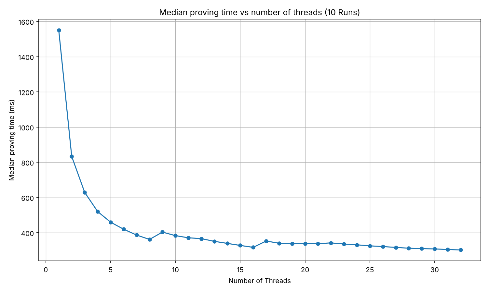
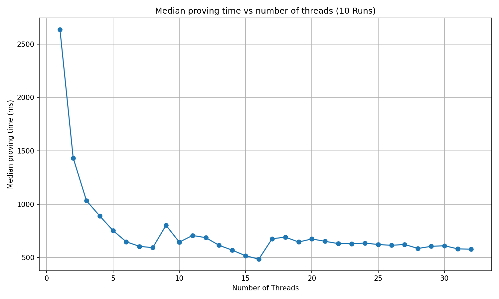

# MANTLE

| Field | Value |
| --- | --- |
| Name | Mantle |
| Slug | 98 |
| Status | raw |
| Category | Informational |
| Editor | Thomas Lavaur <thomas@logos.co> |
| Contributors | David Rusu <davidrusu@logos.co>, Filip Dimitrijevic <filip@logos.co>, Marcin Pawlowski <marcin@logos.co> |

<!-- timeline:start -->

## Timeline

- **2026-05-27** — [`b7602ed`](https://github.com/logos-co/logos-lips/blob/b7602ed8a225d41ca0bfaaa432524dc84d2ded7e/docs/blockchain/raw/bedrock-v1.1-mantle-specification.md) — chore: move blockchain specs from notion to github
- **2026-05-18** — [`58b5698`](https://github.com/logos-co/logos-lips/blob/58b56988429f4d69a9e10a9fc118725e229e37c5/docs/blockchain/raw/bedrock-v1.1-mantle-specification.md) — chore(blockchain): migrate contributor emails to @logos.co (#338)
- **2026-01-19** — [`f24e567`](https://github.com/logos-co/logos-lips/blob/f24e567d0b1e10c178bfa0c133495fe83b969b76/docs/blockchain/raw/bedrock-v1.1-mantle-specification.md) — Chore/updates mdbook (#262)
- **2026-01-16** — [`89f2ea8`](https://github.com/logos-co/logos-lips/blob/89f2ea89fc1d69ab238b63c7e6fb9e4203fd8529/docs/blockchain/raw/bedrock-v1.1-mantle-specification.md) — Chore/mdbook updates (#258)

<!-- timeline:end -->

# Revisions History

| **Version** | **Changes** | Date |
| --- | --- | --- |
| 1.1.0 | Initial revision. | 2026-12-01 |
| 1.2.0 | Removed DA references. Removed notions of Sovereignty and Rollups and used Zones for simplicity. Removed Nomos from specifications and DSTs. Added bridging and decentralized sequencing for channels. | 2026-01-01 |
| 1.2.1 | [RFC] Improve Mantle Transaction hash. | 2026-03-25 |
| 1.3.0 | [[RFC] Make Ledger Transaction an Operation](mantle-transaction-encoding/appendices/rfc-make-ledger-transaction-an-operation.md). | 2026-04-02 |
| 1.4.0 | [[RFC] Enforce NoteId uniqueness](mantle-transaction-encoding/appendices/rfc-enforce-noteid-uniqueness.md). | 2026-04-24 |
| 1.5.0 | [[RFC] Simplify Mantle Transaction and Refactor Ledger Operations](mantle-transaction-encoding/appendices/rfc-simplify-mantle-transaction-and-refactor-ledger-operations.md). | 2026-05-06 |
| 1.6.0 | [RFC] Remove Concept of a Session | 2026-06-22 |
| 1.7.0 | Factor out the multi eddsa threshold verification and added a validation step in channel config to check the new config threshold is lower or equal than the number of accredited keys | 2026-06-25 |
| 1.8.0 | [RFC] Update channels to support proof of stake participation and test vectors for OpId and Mantle Transaction Hash | 2026-07-06 |
| 1.9.0 | Update the execution of `CHANNEL_DEPOSIT` to consume the inputs and recreate them in the channel, updating their NoteId avoid replay attacks in case of withdraw after a deposit | 2026-07-27 |
| 1.9.1 | Rename the excess balance left after the mandatory fees into `tx_priority_tip` and convert it back into a `TokenValue` explicitly | 2026-08-05 |
| 1.9.2 | Required checked arithmetic for all token value, balance, gas, and fee computations. | 2026-08-06 |
| 1.10.0| Enforce non empty inputs for every operation not only transfer moving the assertion in the validation of input spendability | 2026-08-11 |
| 1.10.1| [RFC] One canonical encoding for `ServiceType` and `Locator`: `ServiceType` is its one-byte discriminant and `Locator` is the multiaddr binary form. Added a `declaration_id` test vector | 2026-08-14 |
| 1.10.2| Precise the state validation reads: the Operations of a Mantle Transaction are validated and executed one after the other in the order they appear, each against the state the preceding ones left, and a Mantle Transaction against the state the transactions preceding it in the block left. Accumulated the transaction balance along that pass, replacing `get_transaction_balance` | 2026-08-24 |
| 1.11.0 | Track the configuration lineage of a channel: `ChannelState` gains `config_tip_hash` and the `CHANNEL_CONFIG` payload carries the `parent` configuration it extends, ordering configurations and preventing their replay | 2026-08-27 |
| 1.11.1 | Renamed locked notes into service notes: `service_notes`, `ServiceNote` and `service_note_id` replace their locked counterparts, and the note kind is named after the role it plays rather than after the state it is left in | 2026-08-27 |
| 1.12.0 | Specified the `SDP_ACTIVE` execution effects, matching the implementation: `active` is set to the epoch of the including block, and a message the activity logic rejects makes the Operation invalid. Set `withdraw_at` to `current_epoch + 2`, the epoch at which the node stops providing the service, and removed declarations at `withdraw_at` | 2026-09-02 |
| 1.13.0 | Removed the `None` case of `op_proofs`, every Operation carrying exactly one proof. A `CHANNEL_CONFIG` creating a channel is verified against a threshold of `0` and its proof carries no signature and no index. Execution Gas is derived from the Operation and the state it is validated against, the thresholds pricing the channel Operations being the ones held in the channel state | 2026-08-31 |
| 1.14.0 | Moved SDP declaration removal to `withdraw_at + 1`; the last served epoch's reward is paid in the same first block, before removal | 2026-09-11 |
| 1.15.0 | Add the `CLAIM_POW_REWARD` Operation and the proof of work state it is validated against; the reward pool and the difficulty controllers are specified in [Proof of Work](proof-of-work.md) | 2026-09-08 |
| 1.16.0 | Gas Determination table updated for strict Ed25519 verification: channel Operations 56 → 59 Execution Gas per signature, `EXECUTION_SDP_DECLARE_GAS` 646 → 649, from [Gas Cost Determination](analysis-gas-cost-determination.md) 1.7.0 | 2026-09-24 |
| 1.17.0 | Bound channel inscription data and channel deposit metadata by `MAX_OPERATION_DATA_SIZE` as defined in Mantle Transaction Encoding; aligned SDP activity metadata and its test vectors with the tagged variant encoding. | 2026-10-06 |
| 1.18.0 | [RFC] The `declaration_id` is the hash of the service and the `zk_id`; a note backs one declaration per service, `SDP_WITHDRAW` no longer names the note, and a `nonce` carries the `created` epoch of its declaration | 2026-10-27 |
| 1.19.0 | `MinStake` holds `threshold` and the block number `timestamp`, following the Service Declaration Protocol | 2026-10-27 |
| 2.0.0 | Changed the UTXO ledger to private notes with transaction unlinkability, kept in a ledger, an SDP and one note set per channel but the null channel. Channel notes are moved by the steps their holders sign, each with its own inscription, grouped in the mini-blocks of an inscription, each proven against a recent root and the transaction buffer before its mini-block, and are withdrawn by their holders. Removed `LEADER_CLAIM`, `CHANNEL_TRANSFER` and the Example sections of the Operations, signed `SDP_ACTIVE` with the `provider_id`, made the `CLAIM_POW_REWARD` ticket publicly verifiable and independent of the epoch nonce, and moved `CLAIM_POW_REWARD` to the opcode `0x30`. A declaration names in `note_pk` the key of its service note, and `SDP_WITHDRAW` carries no nonce, consumes the service note, and releases its outputs with the channel withdrawals when its declaration is removed. A channel deposit carries an `inscription`. The commitment MMR and the nullifier IMT of a note set have depth `NOTE_SET_DEPTH` = 40, and a commitment root stays recent for `ROOT_WINDOW` = 1024 blocks | 2026-11-06 |
| 2.1.0 | Add programs: notes gain `stake_public_key`, `program` and `data` fields, a nullifier key sitting between the spending secret key and the public key, program notes leading in Proof of Stake unless their staking key is `0`, a declaration naming in `note_stake_pk` the staking key of its service note and rewards, `PROGRAM_REGISTER` registers a Groth16 verification key, and the mini-blocks of channel inscriptions carry, next to user steps, program deposits and program steps made of a `ZkProgramSpend`, a program proof and the openings of the program notes they create, each step with its own inscription and its kind carried only by its encoding. A program deposit, like a user step, is proven against the buffer before its mini-block, and a program spend against the whole buffer at its position. A program step consumes the program deposits after the previous program step of its mini-block, which all pay its program, and lists the notes of the program it creates apart from the user notes it pays. Every program note is held by the key of the spending secret key `0`. The ZkProgramSpend derives the nonces of the outputs of a step consuming a note of the program. Add the proving time benchmarks of the ZkTransfer and the ZkProgramSpend | 2026-11-06 |
| 2.1.1 | Added Note Delivery: how the holder of a note learns its `value` and `nonce`, the user notes a sender creates being delivered off chain, by the Note Encryption of [Common Cryptographic Components](common-cryptographic-components.md#note-encryption-construction), a delivered note taking the public key of its recipient as staking key unless the recipient asked for another | 2026-11-02 |

# Introduction

Mantle is a foundational element of Bedrock, designed to provide a minimal and efficient execution layer that connects together Bedrock Services in order to provide the necessary functionality for Zones. It can be viewed as the system call interface of Bedrock, exposing a safe and constrained set of Operations to interact with lower-level Bedrock services, similar to syscalls in an operating system.

Mantle Transactions provide Operations for Zones and blockchain Services to interact with Bedrock. For example, a Zone sequencer posting an update to Bedrock, or a node operator declaring its participation in the Blend Network, would be done through the corresponding Operations within a Mantle Transaction.

Mantle manages assets using a private note-based ledger that follows an UTXO model. Each Mantle Transaction can include Transfer Operation, and any excess balance serves as the fee payment.

# Overview

## Mantle Transaction

The features of the Logos Blockchain are exposed through Mantle Transactions. Each transaction can contain one or more **Operations**. Mantle Transactions enable users to execute multiple Operations atomically: the Operations are applied one after the other in the order they appear, and either all of them take effect or none does.

## Mantle Operations

Logos Blockchain features are exposed through Mantle Operations, which can be combined in a single Mantle Transaction and validated atomically. These Operations enable transfers and functions such as on-chain data posting, Cross-Zone interactions and SDP interaction.

## Mantle Ledger

The Mantle Ledger enables asset transfers using a private note-based ledger. The ledger tracks three kinds of notes, each in note sets of its own: regular notes, service notes (collateral for service declarations) and channel notes (channel bridge funds). Every note participates in Proof of Stake through its staking key, the notes governed by a [program](#programs) inside a channel included, unless the program fixes their staking key to `0`. Each note set has a commitment Merkle Mountain Range (MMR) and a nullifier Indexed Merkle Tree (IMT).

## Transaction Fees

Mantle Transaction fees are derived from a gas model. The Logos Blockchain has two different gas markets, accounting for permanent data storage, and execution costs. Each Operation has an associated Execution Gas cost. Users can build unbalanced Mantle Transactions to tip the leaders and incentivize the network to include their transaction.

| Gas Market | Charged On | Pricing Basis |
| --- | --- | --- |
| Execution Gas | Operations | Operation dependent |
| Permanent Storage Gas | Signed Mantle Transaction | Proportional to encoded size |

# Mantle Transaction

Mantle Transactions form the core of Mantle, enabling users to combine multiple Operations to access different functions. Each transaction contains a list of Operations. The system validates the Operations atomically and executes them in the order they appear.

```python
class MantleTx:
    ops: list[Op]

class Op:
    opcode: byte
    payload: bytes

def mantle_txhash(tx: MantleTx) -> Hash:
    tx_bytes = encode(tx)

    h = Hasher()
    h.update(b"MANTLE_TXHASH_V1")
    h.update(tx_bytes)

    return h.digest()
```

The [hash function used](common-cryptographic-components.md), as well as other cryptographic primitives like ZK proof generation protocol and signature schemes, are described in [Common Cryptographic Components](common-cryptographic-components.md).

## Mantle Transaction Hash

A Mantle Transaction must include all relevant proofs for each Operation.

```python
class SignedMantleTx:
    tx: MantleTx
    op_proofs: list[OpProof] # each Op has exactly 1 associated proof
```

Every Operation proof (zk proofs or signatures) must be cryptographically bound to the `MantleTx` through the `mantle_txhash` to prevent replay attacks. This binding is achieved by signing the 32-byte `mantle_txhash` digest with every Ed25519 signature, and by including it reduced modulo $`p`$ as a public input in every ZK proof. The proofs of the steps of an inscription ([CHANNEL_INSCRIBE](#channel_inscribe)) and the proof of a proof of work claim are the exceptions:

- The [ZkTransfer](#zero-knowledge-transfer-proof-zktransfer) of a user step and of a program deposit is signed by its holder before the Mantle Transaction exists, so it is bound to its own content, through `user_step_id` or `program_deposit_id`.
- The [ZkProgramSpend](#zero-knowledge-program-spend-proof-zkprogramspend) and the program proof of a [program step](#programs) are produced by the sequencer, and bound to the `op_id` of the inscription, which covers the public data of every step without any proof.
- The proof of [CLAIM_POW_REWARD](#claim_pow_reward) is empty, its ticket being bound to the public key it pays: a claim copied into another Mantle Transaction pays the same key, but invalidates the transaction it was copied from.

```python
mantle_txhash_fr = FiniteField(mantle_txhash, byte_order="little", modulus = p)
```

  `mantle_txhash` is a classical 256-bit hash digest and must be reduced to a field element before being passed to any ZkHasher or used as a ZK public input. We apply a direct modular reduction mod $`p`$ (via `FiniteField(..., modulus=p)`). Since $`p \approx 2^{254}`$, the reduction is slightly non-uniform. This is inconsequential in practice as the collision probability remains around $`2^{-254}`$, and proof binding is derived from the collision-resistance of the classic hash, not from uniformity over $`F_p`$.

## Arithmetic

All arithmetic in this specification is checked. Every addition, subtraction, and multiplication over transaction balance, gas amounts, and fees is performed on the stated integer type, and a Mantle Transaction is invalid if any intermediate or final result cannot be represented in that type; results must never silently wrap around or saturate. A `TokenValue` counts [LEPTA](overview-cryptoeconomics.md#token-units-and-precision). No token is minted after [Genesis](bedrock-genesis-block.md), so no token value exceeds the maximum supply of $`10^{19}`$ LEPTA ([Block Rewards](block-rewards.md)), which a `TokenValue` holds.

The pseudocode expresses these checks with the following helpers; a failed check makes the Mantle Transaction invalid:

```python
UINT64_MAX = 2**64 - 1

def checked_uint64(value: int) -> TokenValue:
        assert 0 <= value <= UINT64_MAX
        return value
```

The proof of work difficulty updates are the exception to these bounds; they are specified in [Puzzle Target](proof-of-work.md#puzzle-target).

## Mantle Transaction Fee

The transaction mandatory fee is a sum of two components: the multiplication of the total Execution Gas by the `execution_base_fee`, and the total size of the encoded signed Mantle Transaction multiplied by the `permanent_storage_gas_price`. The execution base fee and the permanent storage gas price are protocol-determined values that are the same for every Mantle Transaction in a block. They are derived following [[Execution Market](execution-market.md) and [Storage Markets](storage-markets.md).

```python
def mandatory_fees(signed_tx: SignedMantleTx,
                   tx_execution_gas: uint64,  # total Execution Gas of the Operations
                   permanent_storage_gas_price: TokenValue, # Given by Storage Market
                   execution_gas_base_price: TokenValue) -> uint64:  # Given by Execution Market
    permanent_storage_fees = checked_uint64(len(encode(signed_tx)) * permanent_storage_gas_price)
    execution_base_fees = checked_uint64(tx_execution_gas * execution_gas_base_price)

    return checked_uint64(execution_base_fees + permanent_storage_fees)
```

The Execution Gas of an Operation is deterministically derived from that Operation and the state it is validated against.

If the Mantle Transaction is unbalanced (meaning that the Transaction consume more value than it creates) and that the leftover balance cover more than the mandatory fees, the remaining is treated as execution tip fees.

## **Validation**

*Given*

```python
signed_tx = SignedMantleTx(
    tx=MantleTx(ops),
    op_proofs
)

permanent_storage_gas_price: TokenValue # Given by Storage Market
execution_gas_base_price: TokenValue    # Given by Execution Market

ledger: Ledger
channels: dict[ChannelId, ChannelState]
```

The state validation reads is not a fixed snapshot: it advances as the block is processed. A Mantle Transaction is validated against the state left by the Mantle Transactions preceding it in the block, as defined in [Block Proposal Validation](bedrock-v1.1-block-construction.md#block-proposal-validation), and validation and execution then follow one another Operation by Operation, in the order the Operations appear: the Operation at index `i` is validated against the state the Operations at indices `0` to `i-1` left, then executed to produce the state the Operation at index `i+1` is validated against. This is what the `ledger`, `channels` and `declarations` given to each Operation below denote.

The commitment MMRs of the [note sets](#ledger) that some Operations are proven against follow the same Operation by Operation progression, but locally to the Mantle Transaction. Every Operation adding notes to the ledger note set or to a channel note set appends their commitments to the buffer of that set for the Mantle Transaction, its `tx_commitment_buffer`, when validated, and every Operation referencing a commitment MMR root of a set references the root of that set at one of the last [`ROOT_WINDOW`](#ledger) blocks, against which it is verified once the buffer of the set is appended to it. A user step or a program deposit, proven before the Mantle Transaction exists, is verified against its root extended with the buffer as it stands when its mini-block starts, so that its proof depends on what precedes its mini-block and not on its position inside it ([CHANNEL_INSCRIBE](#channel_inscribe)). `SDP_WITHDRAW` references no root: its proof is verified against the root of an MMR holding only the service note of its declaration ([SDP_WITHDRAW](#sdp_withdraw)). An Operation can therefore consume the outputs of a previous Operation of the same Mantle Transaction without waiting for a block to include them.

Atomicity is what a failed check means, not simultaneity. If any of the checks below fails, the whole Mantle Transaction is invalid: none of its Operations takes effect, whether or not it was reached. An invalid Mantle Transaction is never skipped over either, the block including it being invalid and nothing of that block being executed.

Mantle validators will ensure the following:

1. We have exactly one proof for each Operation, of the variant that Operation requires.
    ```python
    assert len(op_proofs) == len(ops)
    ```

2. Each Operation is valid, and takes effect before the next one is validated.
    ```python
    tx_balance = 0
    tx_execution_gas = 0
    for op, op_proof in zip(ops, op_proofs):
        assert op.opcode in MANTLE_OPCODES
        validate_mantle_op(mantle_txhash(tx), op.opcode, op.payload, op_proof)
        tx_execution_gas = checked_uint64(tx_execution_gas + execution_gas(op, ledger, channels))
        # the excess of the ZkTransfer of these Operations pays the fees
        if op.opcode in (TRANSFER, CHANNEL_DEPOSIT, SDP_WITHDRAW):
            tx_balance = checked_uint64(tx_balance + op.payload.excess_value)
        execute_mantle_op(op.opcode, op.payload)
    for note_set in note_sets_appended_to(tx):  # the note sets the transaction appended a commitment to
        note_set.tx_commitment_buffer = []  # the buffers start empty with every Mantle Transaction

    def validate_mantle_op(txhash, opcode, payload, op_proof):
        if opcode == CHANNEL_INSCRIBE:
            validate_channel_inscribe(txhash, payload, op_proof)
        # elif opcode == ...
        #    ...

    def execute_mantle_op(opcode, payload):
        if opcode == CHANNEL_INSCRIBE:
            execute_channel_inscribe(payload)
        # elif opcode == ...
        #    ...
    ```

3. The Mantle Transaction excess balance pays at least the mandatory fees.
    ```python
    tx_mandatory_fee = mandatory_fees(signed_tx,                        # uint64
                                      tx_execution_gas,
                                      permanent_storage_gas_price,
                                      execution_gas_base_price)
    assert tx_mandatory_fee <= tx_balance
    tx_priority_tip = checked_uint64(tx_balance - tx_mandatory_fee)
    ```

## Execution

*Given*

```python
SignedMantleTx(
    tx=MantleTx(ops),
    op_proofs
)
```

Mantle Validators execute each Operation in `ops` according to its opcode, in the order the Operations appear and along the state progression [Validation](#validation) defines. The subsections below define, for each opcode, what validating and executing an Operation amount to.

# Operations

## Opcodes

| **Operation** | **Opcode** | **Description** |
| --- | --- | --- |
| TRANSFER | 0x00 | Consume and create notes. |
| PROGRAM_REGISTER | 0x01 | Register a program by its verification key. |
| *RESERVED* | *0x02 - 0x0F* |  |
| CHANNEL_CONFIG | 0x10 | Configure a channel |
| CHANNEL_INSCRIBE | 0x11 | Write a message permanently onto Mantle. |
| CHANNEL_DEPOSIT | 0x12 | Deposit notes into a channel |
| CHANNEL_WITHDRAW | 0x13 | Withdraw notes from a channel |
| *RESERVED* | *0x14 - 0x1F* |  |
| SDP_DECLARE | 0x20 | Declare intention to participate as a node in a Bedrock Service, locking funds as collateral. |
| SDP_WITHDRAW | 0x21 | Withdraw participation from a Bedrock Service, consuming its service note in the process. |
| SDP_ACTIVE | 0x22 | Signal that you are still an active participant of a Bedrock Service. |
| *RESERVED* | *0x23 - 0x2F* |  |
| CLAIM_POW_REWARD | 0x30 | Claim a reward from the pow reward pool. |
| *RESERVED* | *0x31 - 0xFF* |  |

## Channel Operations

Channels allow Zones to post their updates on chain. Channels form virtual chains that overlay on top of the Cryptarchia blockchain. Clients and Followers of a Zone can watch its channel to learn the state of that Zone. Each channel has its own [note set](#ledger), enabling bridging between Zones and Bedrock.

### Message Ordering

Channels form virtual chains by having each message reference its parent message. The order of messages in these channels is enforced by the sequencer by building a hash chain of messages, i.e. new messages reference the previous messages through a parent hash. Given that Cryptarchia has long finality times, these message parent references allow Zone sequencers to continue to post new updates to channels without having to wait for finality. No matter how Cryptarchia forks and reorgs, the channel messages from honest sequencers will eventually be re-included in a way that satisfies the virtual chain order, with one limit: a step is valid only against a commitment root recorded in the last [`ROOT_WINDOW`](#ledger) blocks of the fork it lands on. A reorg that moves the channel deposits or the steps a step builds on into other blocks can leave its root absent from the winning fork, which invalidates the inscription carrying the step and the inscriptions chained after it, and the sequencer, who cannot prove the step again for its holder, re-publishes the chain without it, proving again the program steps of these inscriptions, whose proofs are bound to the `op_id` of their inscription.

Configurations form a second hash chain within the channel: each configuration names the configuration it supersedes, so a pending reconfiguration stays valid while the sequencer keeps posting inscriptions.

The first time a message is sent to an unclaimed channel, the key that signs the initial message becomes the only accredited key in the list (Note that this key may correspond to a threshold signature key). Accredited keys of a channel forms a committee that can configure the channel and take turns to write messages to that channel following a round-robin algorithm. Configuring a channel includes modifying the list of accredited keys, the round-robin parameters and the required number of signatures to establish a new configuration.

Validators must maintain the following state to process channel Operations:

```python
channels: dict[ChannelId, ChannelState] # ChannelId is 32 bytes

class ChannelState:
    # Channel Configuration
    accredited_keys: list[Ed25519PublicKey]  # limited to 65 535 keys
    configuration_threshold: u16  # indicating how many keys are
                                  # required to update the configuration

    # Message Ordering
    tip_hash: hash         # Last message of the channel
    config_tip_hash: hash  # Last configuration of the channel

    # Decentralized Sequencing
    tip_slot: Slot
    tip_sequencer: u16      # indicating the actual
                            # sequencer position in the list of accredited keys
    tip_sequencer_starting_slot: Slot
    posting_timeframe: u32  # number of slots (0 = infinity)
    posting_timeout: u32    # number of slots (0 = no timeout)

    # Bridging
    note_set: int | None    # index of the note set of the channel in ledger.sets,
                            # None for the null channel

def default_channel(block_slot: Slot, keys: list[Ed25519PublicKey], note_set: int | None) -> ChannelState:
    return ChannelState(
        tip_hash = ZERO,
        config_tip_hash = ZERO,
        tip_slot = block_slot,
        accredited_keys = keys,
        tip_sequencer = 0,
        tip_sequencer_starting_slot = block_slot,
        posting_timeframe = 0,
        posting_timeout = 0,
        configuration_threshold = 1,
        note_set = note_set)

def create_channel(channel_id: ChannelId, block_slot: Slot, keys: list[Ed25519PublicKey]):
    if channel_id == ZERO:
        # the null channel only receives the Genesis inscriptions and holds no note
        channels[channel_id] = default_channel(block_slot, keys, None)
    else:
        # a new channel appends a new note set, so note sets of channels are ordered by creation
        ledger.sets.append(empty_note_set())
        channels[channel_id] = default_channel(block_slot, keys, len(ledger.sets) - 1)
```

The null channel, whose `ChannelId` is 32 zero bytes, carries the inscriptions of the [Genesis block](bedrock-genesis-block.md) and nothing after them, since it is signed by a key no one holds. It has no note set: no Operation can deposit to it, withdraw from it or publish a step in it.

Note that the user chooses the ChannelId mapping to the ChannelState (but it’s restricted to 32 bytes). We don't currently impose restrictions on it, but we may do so in the future to prevent undesirable behaviors.

### Decentralized Sequencing

To determine which sequencer is currently authorized to send messages, we use a round-robin algorithm. When a message is posted to a channel, the following algorithm is used to determine who the sequencer is:

```python
# Round Robin algorithm determining the new sequencer index and the
# new sequencer starting slot
def round_robin(block_slot: Slot, channel: ChannelState) -> (u16, u64):
    elapsed_slots = block_slot - channel.tip_slot
    if elapsed_slots >= channel.posting_timeout and channel.posting_timeout != 0:
        # Get the number of sequencers that get timed out
        sequencers_timed_out = elapsed_slots // channel.posting_timeout
        index = (
            (channel.tip_sequencer + sequencers_timed_out)
            % len(channel.accredited_keys)
        )
        starting_slot = (
            channel.tip_slot
            + sequencers_timed_out * channel.posting_timeout
        )
    elif channel.posting_timeframe == 0:
        # An infinite timeframe never rotates: the tip sequencer keeps its turn
        index = channel.tip_sequencer
        starting_slot = channel.tip_sequencer_starting_slot
    else:
        # Get the number of timeframes elapsed to get who is the sequencer
        tip_sequencer_duration = block_slot - channel.tip_sequencer_starting_slot
        index = (
            (channel.tip_sequencer + (tip_sequencer_duration // channel.posting_timeframe))
            % len(channel.accredited_keys)
        )
        starting_slot = (
            channel.tip_sequencer_starting_slot
            + (tip_sequencer_duration // channel.posting_timeframe) * channel.posting_timeframe
        )
    return (index, starting_slot)
```

### Bridging

Channels let their bridged notes keep participating in Proof of Stake. When a user deposits notes into a channel, they are not turned into inert collateral. They are consumed and re-created as user notes of the channel's note set, which continue to count toward Proof of Stake and can still be used to create PoLs (see [Ledger](#ledger)). Two goals motivate this design:

- **More PoS participation, stronger security.** Funds deposited into a channel would otherwise leave the staking set. Keeping them as channel notes means the capital backing the application layer also backs consensus security, so bridging does not shrink the stake that secures the chain.
- **No split between security and application.** A user no longer has to choose between staking funds or using them in a channel. The same funds do both at once. They stay usable inside the channel while still earning Proof of Leadership rewards, so capital is never fragmented between the two.

**Holders keep their notes.** A user note of a channel is owned by the holder of its `ZkPublicKey`. Only that holder can spend it, in one of two ways:

- *Inside the channel*, the holder signs off-chain, with its zone message as inscription, a user step, a ZkTransfer that consumes its user notes and creates user notes of the same total value, or a program deposit to a [program](#programs). The sequencers of the channel collect the steps of their users and publish them in a [`CHANNEL_INSCRIBE`](#channel_inscribe), grouping them in mini-blocks and ordering each mini-block as they choose, since a user step or a program deposit holds at any position in its mini-block. The ledger verifies every step, so a sequencer orders the moves of the user notes of a channel but never makes one.
- *Out of the channel*, the holder posts a [`CHANNEL_WITHDRAW`](#channel_withdraw) alone, its fee paid by a ledger note in the same Mantle Transaction. It takes effect `WITHDRAW_DELAY` slots later, unless an inscription of the channel consumes its notes with a valid user step or program deposit in the meantime. The withdrawal is the forced exit of a holder whose steps the sequencers do not publish. It also settles a holder who signs both a step and a withdrawal of the same notes optimistically: the step wins if an inscription publishes it before the withdrawal is due, and the holder has then paid the fees of the withdrawal for nothing.

**Ageing.** Because a channel deposit and a step consume notes and create new ones, a note of a channel restarts the ageing process and must age again before it can create a PoL. Bridged funds still count toward Proof of Stake, so the goals above hold, but the participation is not continuous across these moves: only a note left unspent across the freeze of the stake distribution leads, so a program that wants to stake keeps its stake in notes its steps do not move.

**What each party can do.**

| Party | Can | Cannot |
|---|---|---|
| Holder of a user note's spending secret key | Sign a user step moving the note inside the channel, or a program deposit. Withdraw the note alone, paying the fee with a ledger note | Spend the note in any other Operation. Create a PoL with the note without the staking secret key |
| Holder of a note's nullifier key and staking secret key, the same key by default | Create a PoL with the note and earn its rewards under a key of its choice. See when the note is spent | Spend the note. Create a PoL with a note whose staking key is `0` |
| Channel sequencers | Collect the user steps and program deposits of their users and publish them in the inscriptions of the channel, grouped in mini-blocks in the order they choose, a user step or program deposit consuming an output of the inscription coming in a later mini-block. Prove the program steps, choosing the staking key of the notes they create when the program does not fix it. Freeze the program notes of the channel, by publishing no program step. Hold a signed program deposit until its root leaves the window | Move a user note without its holder's user step or program deposit. Move a program note without the proof of its program |
| Program | Authorize, by its proof, the program steps consuming and creating its notes and paying users. Fix the staking key of the notes it creates, to `0` to keep them out of Proof of Stake | Consume a user note. Create value |

### Programs

A program governs notes of a channel that no single user holds, such as the reserves of a pool. It is a Groth16 circuit, registered by its verification key with [`PROGRAM_REGISTER`](#program_register), and its notes are the program notes whose `program` field is its identifier. A program runs in the steps of the [inscriptions](#channel_inscribe) of a channel:

- **Program deposits.** Users pay the program with program deposits, steps whose ZkTransfer consumes their user notes and whose excess is the value paid to the program. Each program deposit commits to the program and to an intent, the hash of what its user expects from the program.
- **Program steps.** A program step consumes the program deposits after the previous program step of its mini-block, which must all pay its program; a sequencer usually places them right before it. The sequencer consumes notes of the program and creates notes of the program and the user notes the program pays, with a [ZkProgramSpend](#zero-knowledge-program-spend-proof-zkprogramspend) balancing exactly with the value deposited, and publishes the opening of every note of the program it creates. It proves the rule of the program with a Groth16 proof under its registered key, over the notes of the program spend, the deposits with their intents, and the `op_id` of the inscription.

`Groth16_verify(key, public_inputs, proof)` verifies a [Groth16](common-cryptographic-components.md#groth16-zk-snark) proof against a verification key, given with the pairing $`e(\alpha, \beta)`$ stored by [`PROGRAM_REGISTER`](#program_register), and its public inputs. `pairing(P, Q)` is the optimal ate pairing of BN254, from $`\mathbb{G}_1 \times \mathbb{G}_2`$ to $`\mathbb{G}_T`$, the subgroup of order $`p`$ of $`\mathbb{F}_{q^{12}}^*`$, $`q`$ being the modulus of the base field of BN254, whose elements take 384 bytes.

**Holder.** Every program note is held by `PK0`, the public key of the spending secret key `0` ([Keys](#keys)). A program note moves only with the proof of its program, so it needs no holder of its own, and a fixed holder keeps a sequencer from creating a note of the program under its own key, which no other sequencer could then spend. Anyone can therefore derive the nullifiers of the program notes, and which program notes a step consumes is public, as the state of a program is. A program whose notes only some sequencers may move enforces it in its circuit, for example with a signature over the `op_id`.

**Staker.** A program note has a [staking key](#keys) like any note, which the program chooses. A program should never give a note of the program the staking key `PK0`: `NF_SK0`, its nullifier key and its staking secret key, is public, so anyone could lead with that note.

The ledger fixes neither the value of each note a program pays, nor the staking key of the notes it pays, nor the note an intent targets, so a program should fix all three, the staking key of a payout for example to the public key of its payee. Otherwise a sequencer can split a payout so that its payee cannot recompute the note, or give a payout a staking key its payee does not know, so that the payee cannot spend it. The program proof sees neither the channel nor the signer, so a creation step its rule admits runs in any channel, by any sequencer, and two pools of one program in one channel can serve each other's intents unless each intent names its pool.

**What enforces what.**

| Property | Enforced by |
| --- | --- |
| No value is created | The ZkTransfers and the ZkProgramSpend balance exactly, and the ledger sums the values of the program deposits into the `paid_value` of the program spend that consumes them |
| A user note moves only with the key of its holder | The ZkTransfer |
| A program deposit only pays the program it names, a registered one, with the intent its holder signed | `program_deposit_id`, which commits to the program and the intent; the ledger, which checks that the program is registered |
| A program deposit is consumed by the next program step of its mini-block, which runs its program | The ledger, which checks the program of the program deposits a program step consumes and rejects an inscription leaving one unconsumed at the end of a mini-block |
| A program note is created and consumed only with the proof of its program, and held by `PK0` | The ZkTransfer, which only derives commitments with `program` and `data` set to `0`; the ZkProgramSpend, whose inputs and program outputs are notes of the program held by `PK0` and whose other outputs are user notes; the program proof, required by every program step |
| A note leads only with its nullifier key and its staking secret key | The Proof of Leadership |
| A program step serves the intents over LOGOS as the rule of the program states | The program proof, which reads the program deposits and the notes of the program spend |
| The opening of every note of a program is published in the block creating it, and every node holds it until that block is immutable | The ledger, which checks the opening of every note of the program a step creates |
| A program step serves the intents over the assets of the zone | Not enforced by the ledger: the users of the zone can detect a step that does not serve an intent over the assets of the zone |

A program using LOGOS only, such as lending, is thus enforced by the ledger, and its users trust the circuit of the program they pay and the setup that produced its key: whoever kept the trapdoor of that setup can prove any statement under the key and move every note of the program, and nothing on chain shows how a key was produced. A public phase-2 ceremony over shared powers of tau is recommended for the key of a program ([Trusted Setup Ceremony](trusted-setup-ceremony.md)). A program exchanging LOGOS with assets of the zone, such as a swap, is enforced by the ledger for its LOGOS only. Depending on the program, publishing the preimage of each intent in the inscription is recommended, so that the users of the zone can verify how the program step served it.

**What the ledger does not guarantee.** A program note moves only in a program step of an inscription, and only the current sequencer of a channel posts inscriptions. The sequencers of a channel can therefore freeze every program note of the channel for good by publishing no program step, with all the value users paid into it: they cannot take that value, but they can hold it. A signed program deposit has no expiry either. A sequencer can hold it until [`ROOT_WINDOW`](#ledger) blocks, about 8.5 hours, after its root stopped being the current root of the note set, a root that stays current staying valid, and fill it at the worst price its intent accepts, since the program proof sees no time. Its holder can cancel it only with a `CHANNEL_WITHDRAW`, which takes `WITHDRAW_DELAY` slots, and a step published before the withdrawal is due wins.

**Design choices.**

- Creating a program note requires the proof of its program. Otherwise anyone could create a note of the program with any `data`, such as a fake pool state, and the program could not tell it from its own.
- A program deposit exists only together with the program step that consumes it, the next program step of its mini-block, so it is never left unconsumed: if the sequencer does not publish the program step, the inscription carrying the program deposit is invalid and the notes of the user are not consumed.
- The program spend and the program proof are bound to the `op_id` of the inscription, which covers the inscription and the public data of every step but no proof. A program step is thus attributable to its inscription and valid in no other.
- Program notes take part in Proof of Stake by default, as every note does through its staking key: the Proof of Leadership reads the `program` and `data` of its note. The LOGOS a program keeps in notes its steps do not move thus stakes, and a program open to everyone, such as a pool, can offer liquid staking, its notes moved by any sequencer and staked by the holder of their staking secret key. A program opts out by constraining the staking key of its notes to `0` in its proof ([Keys](#keys)).
- The reward of a block led by a program note goes, as for any leader, to the key its staker chooses, not to the program: the ledger cannot make the reward a note of the program, since only the proof of a program creates its notes. A program that does not constrain the staking key of the notes it creates, its own notes and its payouts, lets the sequencer proving the step choose it: that sequencer can stake the notes of the program and keep their rewards, their value staying governed by the program, and a payout whose staking key its payee does not know cannot be spent by the payee.
- Program notes are never withdrawn, since a withdrawal consumes notes with a ZkTransfer.
- The opening of every note of the program a step creates is published with the step, and checked by the ledger. A sequencer withholding the opening of a note of the program would otherwise freeze it: program notes are never withdrawn, and no sequencer can prove a program spend consuming a note it cannot open. The openings serve this data availability only: the ledger keeps nothing from them, and they are prunable from the blocks behind the latest immutable block of the node.

**Privacy.** The values of the program deposits are public, and so are the notes of the program, opened in the steps that create them. The amount of each interaction with a program is therefore visible, and so is the total value a program step pays to users: with a single payee, what that payee receives. Its interactions are subject to timing attacks. The users stay hidden: program deposits consume notes by nullifier, and the notes the program pays are commitments, as long as each payee uses a one-time public key, since the [nonce of such a note](#zero-knowledge-program-spend-proof-zkprogramspend) is a public function of its value and public key.

### CHANNEL_INSCRIBE

Write a message to a channel with the message data being permanently stored on the Logos Blockchain, and apply the steps the sequencer collected from the users of the channel. The list of mini-blocks can be empty, in which case the inscription only writes its message.

#### Payload

```python
class UserStep:
    inputs: list[NoteNullifier]    # nullifiers of the consumed user notes of the channel
    outputs: list[NoteCommitment]  # commitments of the created user notes of the channel
    commitment_root: MerkleRoot    # the MMR root of the channel note set at the end of one of the last ROOT_WINDOW blocks
    inscription: bytes             # the zone message of this step, signed by its holder

class ProgramDeposit:
    program_id: ProgramId          # the program the program deposit pays
    inputs: list[NoteNullifier]    # nullifiers of the consumed user notes of the channel
    outputs: list[NoteCommitment]  # commitments of the change, user notes of the channel
    commitment_root: MerkleRoot    # the MMR root of the channel note set at the end of one of the last ROOT_WINDOW blocks
    value: TokenValue              # the value the program deposit pays to the program
    intent: zkhash                 # the hash of what the user expects from the program
    inscription: bytes             # the zone message of this program deposit, signed by its holder

class ProgramStep:
    program_id: ProgramId                  # the program the step executes
    inputs: list[NoteNullifier]            # nullifiers of the consumed notes of the program, possibly empty
    program_outputs: list[NoteCommitment]  # commitments of the created notes of the program
    outputs: list[NoteCommitment]          # commitments of the user notes the step pays
    commitment_root: MerkleRoot            # the MMR root of the channel note set at the end of one of the last ROOT_WINDOW blocks
    program_step_id: zkhash                # the hash of the input and output notes of the program spend
    inscription: bytes                     # the zone message of this step, bound by the op_id

Step = UserStep | ProgramDeposit | ProgramStep

class Inscribe:
    channel: ChannelId       # 32 bytes Channel being written to
    inscription : bytes      # Message to be written on the blockchain
    parent: hash             # Previous message in the channel
    signer: Ed25519PublicKey # Identity of message sender
    mini_blocks: list[list[Step]]  # Moves of channel notes, in the order they apply, possibly
                                   # empty. A mini-block holds at least one step
```

A `NoteNullifier` is the nullifier of a note and a `NoteCommitment` its commitment, as [Note Commitment and Nullifier](#note-commitment-and-nullifier) defines them, a `MerkleRoot` the root of a Merkle tree, and a `ProgramId` the identifier of a program, derived in [PROGRAM_REGISTER](#program_register). The [encoding](mantle-transaction-encoding.md#channel-operations) tags each step with its kind.

A mini-block is a flat list of steps of three kinds. A user step moves the user notes of its holder. A program deposit pays a [program](#programs) from the user notes of its holder. A program step executes a program: it consumes the program deposits after the previous program step of its mini-block, which must all pay its program, taken in their order in the mini-block, which the sequencer chooses, and its program spend consumes the notes of the program, creates its `program_outputs`, notes of the program, and pays its `outputs`, user notes. A sequencer usually places the program deposits of a program step right before it. A program deposit that no program step consumes in its mini-block makes the inscription invalid, so a program deposit is never left unconsumed.

The `inscription` of the `Inscribe` is the message of the sequencer, and the `inscription` of a user step or of a program deposit the zone message of its holder. The ZkTransfer of the user step or of the program deposit binds its inscription together with its inputs and outputs, so a sequencer publishes the message a holder signed with the move it signed, or drops it whole. The `inscription` of a program step is the zone message of the step, bound like the rest of its public data by the `op_id`, to which the proofs of the sequencer are bound. The inscription of the `Inscribe` and the inscriptions of its steps count together against `MAX_OPERATION_DATA_SIZE`.

The steps of an inscription are grouped in mini-blocks. A user step and a program deposit are signed and proven by the holder of the notes they consume, off-chain and before the Mantle Transaction carrying them exists. The ZkTransfer of each is verified, by the [`verify_transfer`](#input-notes-spendability-validation) method of the note set, against its referenced root extended with the buffer of the channel note set as it stands when its mini-block starts: the commitments the earlier Operations of the Mantle Transaction and the earlier mini-blocks of the inscription added. It can therefore consume the notes of earlier blocks and the outputs of the earlier mini-blocks, but not the outputs of its own mini-block. Its proof depends on what precedes its mini-block and not on its position inside it, and the holders prove theirs independently of one another:

- The user steps and program deposits of the first mini-block, when no earlier Operation of the Mantle Transaction added to the channel note set, are proven against their recent root alone, so a sequencer collects those of many users and publishes them in the order it chooses. A sequencer should place an Operation adding to that note set after the inscription: if it comes first, every user step and program deposit of the first mini-block covers what it adds.
- If the first mini-block adds 400 commitments to the buffer, every user step and program deposit of the second mini-block covers these 400: it can consume the outputs of the first mini-block, and those of the second mini-block are again ordered freely among themselves. The same holds for the next mini-blocks.

Extending every proof of a holder with the whole buffer would instead tie each proof to its position: each holder would have to wait for the sequencer to fix everything before its own user step or program deposit, and they would be proven one after another.

The program spend of a program step is proven by the sequencer once the inscription is fixed, so it covers the whole buffer at its position, whatever its mini-block. It can consume a note of the program created by an earlier program step of the same mini-block, so the program steps moving one pool can follow each other in a single mini-block.

The mini-block of a user step or program deposit is public, so one of a later mini-block reveals that its inputs are among the notes under its root and the commitments it covers. Covering the whole of the previous mini-blocks keeps it from pointing at the notes it consumes.

Since they are signed before the Mantle Transaction exists, their ZkTransfer is bound to their own content rather than to the `mantle_txhash`: `user_step_id` for a user step and `program_deposit_id` for a program deposit. A user step balances exactly, with an `excess_value` of `0`. The `excess_value` of the ZkTransfer of a program deposit is its `value`, and `program_deposit_id` also commits to the program it pays and to its intent, so its ZkTransfer only verifies for that program and that intent.

Each identifier is a BLAKE2b-256 hash, under its own domain separation tag, of the channel and of the encoded step, its kind tag and every field included, reduced modulo $`p`$ as `op_id` is. It is a classic hash because it is only the public `msg` of the ZkTransfer of the holder, which no circuit recomputes.

```python
def step_id(dst: bytes, channel: ChannelId, step: UserStep | ProgramDeposit) -> zkhash:
    h = Hasher() # /!\ This is a classic hash not a zkhash /!\
    h.update(dst)
    h.update(channel)
    h.update(encode(step))  # the Step of the encoding, its kind tag included
    return FiniteField(h.digest(), byte_order="little", modulus= p)

def user_step_id(channel: ChannelId, step: UserStep) -> zkhash:
    return step_id(b"USER_STEP_V1", channel, step)

def program_deposit_id(channel: ChannelId, program_deposit: ProgramDeposit) -> zkhash:
    return step_id(b"PROGRAM_DEPOSIT_V1", channel, program_deposit)
```

The program spend and the program proof of a program step are produced by the sequencer and bound to the `op_id` of the Inscribe Operation, which covers the inscription and the public data of every step but no proof. The program proof takes three public inputs: the `program_step_id` of the step, the hash of its program deposits, taken in their order in the mini-block, and the `op_id`. The `program_step_id` hashes the notes of the program spend, private fields included, so the ledger cannot recompute it: it is the public value that links the ZkProgramSpend and the program proof of the step.

```python
def program_deposits_hash(program_deposits: list[ProgramDeposit]) -> zkhash:
    paid = []
    for program_deposit in program_deposits:
        paid.append(FiniteField(program_deposit.value, byte_order="little", modulus=p))
        paid.append(program_deposit.intent)
    return zkhash(
        FiniteField(b"PROGRAM_DEPOSITS_V1", byte_order="little", modulus=p),
        FiniteField(len(program_deposits), byte_order="little", modulus=p),
        *paid)
```

An intent is not authenticated. `program_deposits_hash` gives the program only `(value, intent)` pairs and nothing about the payer: anyone with a note in the channel can pay 0 with any intent, and a secret inside an intent does not help, since the sequencer learns the preimage to prove the step and can reuse it. A program should authorize a user inside its circuit, for example with a signature over the action by a key the position of the user records.

A program step consuming no note applies only with its inscription, to whose `op_id` its proofs are bound, and an inscription extends its channel only once.

#### Proof

```python
class ProgramNoteOpening:
    value: TokenValue              # the value of the note
    nonce: NoteNonce               # the nonce of the note
    stake_public_key: ZkPublicKey  # the staking key of the note
    data: zkhash                   # the data of the note

class ProgramStepProof:
    spend_proof: ZkProgramSpend       # the proof of the program spend
    program_proof: Groth16Proof       # under the verification key of the program
    program_notes: list[ProgramNoteOpening]  # the opening of each of the program_outputs,
                                             # in their order

class ChannelInscribeOpProof:
    signature: Ed25519Signature                       # by the signer, over the mantle_txhash
    step_proofs: list[ZkTransfer | ProgramStepProof]  # one per step, in the order of the steps: a ZkTransfer
                                                      # for a user step or a program deposit
```

An opening holds no public key, since every program note is held by `PK0`.

The openings of the program notes a step creates serve only the availability of the state of the program: the next sequencer needs them to consume these notes, and the users of the program may need this state to learn the notes it pays them. The ledger checks each opening against its output and keeps nothing from it. The openings are part of the proof of the step, outside the `op_id` and the Mantle transaction hash, so pruning them changes no hash. A block is valid only with all its openings, so no one can skip the check by stripping them. Since the `block_id` does not cover the openings, a copy of a block lacking some of them, or carrying altered ones, fails as a copy, whether received as a proposal, as in [Block Proposal Validation](bedrock-v1.1-block-construction.md#block-proposal-validation), or in full through synchronisation: it is discarded without recording a verdict against its `block_id`. A node may prune the openings of the blocks behind its [latest immutable block](cryptarchia-v1-protocol.md#latest-immutable-block), which it never validates again. A node syncing these blocks needs a peer that kept their openings, or [bootstraps from a checkpoint](cryptarchia-v1-bootstr-sync.md#bootstrapping-from-checkpoint) after them. Every node thus holds an opening until the block carrying it is immutable. Past that point the sequencers of a channel should keep the openings of its unspent program notes, and a sequencer joining the channel can get them from the others. An opening covers only the fields of its note: the next sequencer can take over a program from the openings alone as long as its notes hold its state in their opened fields, rather than a hash of it in `data`.

#### Execution Gas

  Channel Inscribe Operations have an Execution Gas cost of `EXECUTION_CHANNEL_INSCRIBE_GAS`, plus `EXECUTION_TRANSFER_GAS` for each user step and each program deposit, plus `EXECUTION_PROGRAM_SPEND_GAS + EXECUTION_PROGRAM_PROOF_GAS` for each program step. See [Gas Determination](#gas-determination) for the Execution Gas values.

#### Validation

  *Given*

```python
txhash: hash
msg: Inscribe
proof: ChannelInscribeOpProof
op_id: Hash          # derive_op_id of the Inscribe Operation

channels: dict[ChannelId, ChannelState]
ledger: Ledger
block_slot: Slot
```
 
  *Validate*

  1. Ensure the inscription and the inscriptions of the steps together do not exceed `MAX_OPERATION_DATA_SIZE`, and that the inscription continues the channel or creates it.
      ```python
      inscription_size = len(msg.inscription)
      for step in [step for mini_block in msg.mini_blocks for step in mini_block]:
          inscription_size += len(step.inscription)
      assert inscription_size <= MAX_OPERATION_DATA_SIZE

      if msg.channel in channels:
          chan = channels[msg.channel]
          current_sequencer_index = round_robin(block_slot, chan)[0]

          # Ensure the signer is the one authorized to write to the channel
          assert msg.signer == chan.accredited_keys[current_sequencer_index]

          # Ensure message is continuing the channel sequence
          assert msg.parent == chan.tip_hash

          note_set = ledger.sets[chan.note_set] if chan.note_set is not None else None
      else:
          # Channel will be created automatically upon execution
          # Ensure that this message is the genesis message (parent == ZERO)
          assert msg.parent == ZERO

          note_set = None  # a channel being created holds no note yet
      ```

  2. Ensure the signature of the signer.
      ```python
      assert Ed25519_verify(txhash, msg.signer, proof.signature)
      ```

  3. Ensure a channel being created, which holds no note, and the null channel, which has no note set, receive no step, that a mini-block holds at least one step, and that there is one proof per step.
      ```python
      assert note_set is not None or len(msg.mini_blocks) == 0
      assert all(len(mini_block) > 0 for mini_block in msg.mini_blocks)
      assert len(proof.step_proofs) == sum(len(mini_block) for mini_block in msg.mini_blocks)
      step_proofs = iter(proof.step_proofs)
      op_id_fr = FiniteField(op_id, byte_order="little", modulus=p)
      step_nullifiers = set()  # the nullifiers of the steps already validated
      ```

  4. Validate the steps in their order, each with its proof in `step_proofs`, a ZkTransfer for a user step or a program deposit and a `ProgramStepProof` for a program step. A user step or a program deposit is validated against the commitments the earlier Operations and mini-blocks of the Mantle Transaction appended to the buffer of the channel note set, and a program spend against the whole buffer at its position. Each step is validated against `step_nullifiers`, so no two steps consume the same note. A program deposit is pending until the next program step, which consumes every pending program deposit and must run its program, and none is left pending at the end of a mini-block.
      ```python
      for mini_block in msg.mini_blocks:
          # the user steps and program deposits of the mini-block cover the buffer as it stands now
          covered = len(note_set.tx_commitment_buffer)
          program_deposits = []  # the program deposits pending for the next program step
          for step in mini_block:
              step_proof = next(step_proofs)

              # Ensure the step consumes unspent notes of the channel, which no earlier step
              # consumed, a program step possibly none.
              if not isinstance(step, ProgramStep) or len(step.inputs) > 0:
                  note_set.assert_spendable(step.inputs)
              for note_nullifier in step.inputs:
                  assert note_nullifier not in step_nullifiers
                  step_nullifiers.add(note_nullifier)

              if isinstance(step, UserStep):
                  # Ensure the user step is signed by its holder.
                  assert note_set.verify_transfer(step.inputs,
                                                  step.outputs,
                                                  0,  # a user step balances exactly
                                                  step.commitment_root,
                                                  user_step_id(msg.channel, step),
                                                  step_proof,
                                                  covered)
              elif isinstance(step, ProgramDeposit):
                  # Ensure the program deposit pays a registered program and is signed by its
                  # holder for that program and its intent, and keep it for the next program step.
                  assert step.program_id in ledger.programs
                  assert note_set.verify_transfer(step.inputs,
                                                  step.outputs,
                                                  step.value,
                                                  step.commitment_root,
                                                  program_deposit_id(msg.channel, step),
                                                  step_proof,
                                                  covered)
                  program_deposits.append(step)
              else:
                  # Ensure the program is registered and is the one every pending program
                  # deposit pays.
                  assert step.program_id in ledger.programs
                  assert all(program_deposit.program_id == step.program_id
                             for program_deposit in program_deposits)
                  paid_value = 0  # the value the program deposits of the step pay into the program
                  for program_deposit in program_deposits:
                      paid_value = checked_uint64(paid_value + program_deposit.value)

                  # Ensure the program spend consumes notes of the program, creates the program
                  # outputs and the user outputs, and balances exactly with the value deposited.
                  assert note_set.verify_program_spend(step.inputs,
                                                       step.program_outputs,
                                                       step.outputs,
                                                       step.commitment_root,
                                                       step.program_id,
                                                       paid_value,
                                                       step.program_step_id,
                                                       op_id_fr,
                                                       step_proof.spend_proof)

                  # Ensure every note of the program the step creates is opened, for the
                  # availability of its state.
                  assert len(step_proof.program_notes) == len(step.program_outputs)
                  for commitment, opening in zip(step.program_outputs, step_proof.program_notes):
                      assert commitment == derive_note_commitment(Note(value=opening.value,
                                                                       nonce=opening.nonce,
                                                                       public_key=PK0,
                                                                       stake_public_key=opening.stake_public_key,
                                                                       program=step.program_id,
                                                                       data=opening.data))

                  # Ensure the program accepts the step, which consumes the pending program deposits.
                  assert Groth16_verify(ledger.programs[step.program_id],
                                        [step.program_step_id, program_deposits_hash(program_deposits), op_id_fr],
                                        step_proof.program_proof)
                  program_deposits = []
                  note_set.tx_commitment_buffer.extend(step.program_outputs)

              # Append the outputs of the step to the buffer: the next program spends cover them,
              # and so do the user steps and program deposits of the next mini-blocks.
              note_set.tx_commitment_buffer.extend(step.outputs)
          assert len(program_deposits) == 0  # every program deposit of the mini-block was consumed
      ```

#### Execution

  *Given*

```python
msg: Inscribe

channels: dict[ChannelId, ChannelState]
ledger: Ledger
block_slot: Slot
```

  *Execute*

  1. If the channel does not exist, create it just-in-time.
      ```python
      if msg.channel not in channels:
          create_channel(msg.channel, block_slot, [msg.signer])
      ```

  2. Apply the steps, in their order, a program step creating its `program_outputs` before its `outputs`.
      ```python
      for step in [step for mini_block in msg.mini_blocks for step in mini_block]:
          note_set = ledger.sets[channels[msg.channel].note_set]
          note_set.execute_spending(step.inputs)
          if isinstance(step, ProgramStep):
              note_set.execute_adding(step.program_outputs)
          note_set.execute_adding(step.outputs)
      ```

  3. Update the channel sequencer.
      ```python
      chan = channels[msg.channel]
      (new_sequencer_index, new_sequencer_starting_slot) = round_robin(block_slot, chan)

      chan.tip_sequencer_starting_slot = new_sequencer_starting_slot
      chan.tip_sequencer = new_sequencer_index
      ```

  4. Update the channel tip.
      ```python
      chan = channels[msg.channel]
      chan.tip_hash = hash(encode(msg))
      chan.tip_slot = block_slot
      ```

### CHANNEL_CONFIG

Overwrite the configuration of a channel.

#### Payload

```python
class ChannelConfig:
    channel: ChannelId
    parent: hash             # Previous configuration of the channel
    keys: list[Ed25519PublicKey]
    posting_timeframe: u32
    posting_timeout: u32
    configuration_threshold: u16
```

#### Proof

A Channel Config is authorized by a threshold of the channel's accredited keys using [Multiple Ed25519 Signatures Verification](#multiple-ed25519-signatures-verification).

```python
class ChannelConfigOpProof:
    signatures: list[Ed25519Signature] # signatures from configuration_threshold
    indexes: list[u16]  # signatures of accredited keys with their index.
                        # indexes must be ordered from smallest to
                        # biggest without duplication
```

#### Execution Gas

  Channel Config Operations have a linear Execution Gas cost equal to `EXECUTION_CHANNEL_CONFIG_GAS * configuration_threshold`, where `configuration_threshold` is the one held in the channel state, and `0` for a channel that does not exist yet. See [Gas Determination](#gas-determination) for the Execution Gas values.

#### Validation

  *Given*

```python
txhash: hash
config: ChannelConfig
proof: ChannelConfigOpProof
channels: dict[ChannelId, ChannelState]
```

  *Validate*

```python
assert config.configuration_threshold > 0
assert len(config.keys) > 0
assert len(config.keys) < 2**16
# The configuration threshold must be reachable with the accredited keys,
# otherwise the channel would be locked out of any future reconfiguration
assert config.configuration_threshold <= len(config.keys)

if config.channel in channels:
    chan = channels[config.channel]

    # Ensure the configuration is extending the last configuration
    # of the channel
    assert config.parent == chan.config_tip_hash

    # Verify the configuration_threshold signatures (see Appendix)
    MultiEd25519_verify(txhash,
                        proof.signatures,
                        proof.indexes,
                        chan.accredited_keys,
                        chan.configuration_threshold)
else:
    # Channel will be created automatically upon execution
    # Ensure that this configuration is the genesis configuration
    assert config.parent == ZERO

    # No key is accredited yet, so the threshold to verify against is 0
    # and the proof must carry no signature and no index (see Appendix)
    MultiEd25519_verify(txhash,
                        proof.signatures,
                        proof.indexes,
                        [],
                        0)
```

#### Execution

  *Given*

```python
config: ChannelConfig

channels: dict[ChannelId, ChannelState]
ledger: Ledger
block_slot: Slot
```

  *Execute*

  1. If the channel does not exist, create it just-in-time.

      ```python
      if config.channel not in channels:
          create_channel(config.channel, block_slot, config.keys)
      ```

  2. Update the configuration.

      ```python
      chan = channels[config.channel]

      # Update Channel Configuration Parameters
      chan.accredited_keys = config.keys
      chan.configuration_threshold = config.configuration_threshold

      # Update Decentralized Sequencing Parameters
      chan.tip_slot = block_slot
      chan.tip_sequencer = 0
      chan.tip_sequencer_starting_slot = block_slot
      chan.posting_timeframe = config.posting_timeframe
      chan.posting_timeout = config.posting_timeout
      ```

  3. Update the configuration tip.

      ```python
      chan = channels[config.channel]
      chan.config_tip_hash = hash(encode(config))
      ```

### CHANNEL_DEPOSIT

Deposit notes to a channel. The channel deposit consumes notes of the ledger note set and creates notes of the channel note set, which resets their ageing.

A channel deposit creates its outputs under the keys its depositor chooses, and the holder of each output withdraws it alone. A Zone should therefore credit in its own state only channel deposit outputs under a key it holds: a withdrawal shows a nullifier, which the Zone cannot link to a commitment without the key of the holder.

A Zone that credits a channel deposit in its own state must be sure the channel deposit really lands on-chain. If the Zone reflects the channel deposit through a `CHANNEL_INSCRIBE` posted in a separate Mantle Transaction, a reorganization can reorder the two so that the inscription is included while the channel deposit is not, leaving the Zone crediting funds it never received. Two options avoid this:

- Wait for the channel deposit to be finalized before interpreting it, at the cost of the finalization delay.
- Include the channel deposit in the same Mantle Transaction as the inscription. Mantle Transactions validate atomically, so the inscription is included only if the channel deposit is. This removes the waiting period entirely.

#### Payload

```python
class ChannelDeposit:
    channel: ChannelId
    inputs: list[NoteNullifier]    # nullifiers of the consumed notes of the ledger note set
    outputs: list[NoteCommitment]  # commitments of the created notes of the channel note set
    commitment_root: MerkleRoot    # the MMR root of the ledger note set at the end of one of the last ROOT_WINDOW blocks
    excess_value: TokenValue       # the excess to pay the fees
    inscription: bytes             # the zone message of the channel deposit
```

#### Proof

  A Channel Deposit proves the ownership of the notes being consumed, the created notes and the excess value using a [Zero Knowledge Transfer Proof (ZkTransfer)](#zero-knowledge-transfer-proof-zktransfer).

```python
ZkTransfer
```

#### Execution Gas

  Channel Deposit Operations have a fixed Execution Gas cost of `EXECUTION_CHANNEL_DEPOSIT_GAS`. See [Gas Determination](#gas-determination) for the Execution Gas values.

#### Validation

  *Given*

```python
mantle_txhash_fr: zkhash # mantle_txhash of the tx containing this Operation, reduced modulo p
deposit: ChannelDeposit
deposit_proof: ZkTransfer

channels: dict[ChannelId, ChannelState]

ledger: Ledger
```

  *Validate*

  1. Ensure the inscription does not exceed `MAX_OPERATION_DATA_SIZE`.
      ```python
      assert len(deposit.inscription) <= MAX_OPERATION_DATA_SIZE
      ```

  2. Verify that the channel exist and has a note set, which the null channel has not.
      ```python
      assert deposit.channel in channels
      assert channels[deposit.channel].note_set is not None
      ```

  3. Ensure all inputs are spendable in the [ledger note set](#ledger), `LEDGER_SET`.
      ```python
      ledger.sets[LEDGER_SET].assert_spendable(deposit.inputs)
      ```

  4. Validate ownership over deposited notes and balance.
      ```python
      assert ledger.sets[LEDGER_SET].verify_transfer(deposit.inputs,
                                                     deposit.outputs,
                                                     deposit.excess_value,
                                                     deposit.commitment_root,
                                                     mantle_txhash_fr,
                                                     deposit_proof)
      ```

  5. Add the outputs to the buffer of the channel note set.
      ```python
      ledger.sets[channels[deposit.channel].note_set].tx_commitment_buffer.extend(deposit.outputs)
      ```

#### Execution

  *Given*

```python
deposit: ChannelDeposit

channels: dict[ChannelId, ChannelState]

ledger: Ledger
```

  *Execute*

Consume the inputs in the ledger note set and create the outputs in the channel note set.

```python
ledger.sets[LEDGER_SET].execute_spending(deposit.inputs)
ledger.sets[channels[deposit.channel].note_set].execute_adding(deposit.outputs)
```

### CHANNEL_WITHDRAW

Withdraw notes from a channel. The holder of the notes posts the withdrawal alone, and it takes effect `WITHDRAW_DELAY` slots later: its inputs are then consumed in the channel note set and its outputs created in the ledger note set, if none of its inputs was consumed in the meantime. Until then, an inscription of the channel can consume these notes with a valid user step or program deposit, which cancels the withdrawal. A holder therefore cannot invalidate an inscription carrying one of its steps by withdrawing the same note, as long as the inscription lands before the withdrawal is due. A due withdrawal is executed at the start of its block, before the transactions ([Block Execution](bedrock-v1.1-block-construction.md#block-execution)), and a later step consuming its notes is invalid, and so is the transaction carrying it. The nullifiers and due slots of pending withdrawals are public in the ledger state: a sequencer should not accept a step whose inputs a pending withdrawal may release before its inscription lands, nor a step whose inputs another accredited key of the channel may consume first, since removing the step afterwards also invalidates the steps of the later mini-blocks, whose proofs cover its outputs, and changes the `op_id` the proofs of every program step of the inscription are bound to. The sequencers of a channel should share the nullifiers of the steps they hold before a later mini-block covers them.

```python
WITHDRAW_DELAY: Slot = 86_400  # 1 day
```

`WITHDRAW_DELAY` leaves the sequencers of the channel time to include the steps they accepted before a forced exit takes their notes, so that a withdrawal does not bypass a step its holder authorized. A sequencer checks the `pending_withdrawals` of the channel when it publishes a step, not only when it accepts it, since a step stays valid as long as its root is recent, which on a quiet channel can outlast the delay.

#### Payload

```python
class ChannelWithdraw:
    channel: ChannelId
    inputs: list[NoteNullifier]    # nullifiers of the consumed notes of the channel note set
    outputs: list[NoteCommitment]  # commitments of the notes created in the ledger note set
    commitment_root: MerkleRoot    # the MMR root of the channel note set at the end of one of the last ROOT_WINDOW blocks
```

A withdrawal balances exactly and carries no fee: another Operation of its Mantle Transaction, such as a Transfer, pays the fees. A holder whose funds are all in channels therefore needs a ledger note, of its own or added by a third party, to post its withdrawal. An excess paid when the withdrawal is posted would stay paid even if the withdrawal is dropped later, which would create tokens.

#### Proof

  A Channel Withdraw proves the ownership of the notes being consumed and the created notes, with an excess value of `0`, using a [Zero Knowledge Transfer Proof (ZkTransfer)](#zero-knowledge-transfer-proof-zktransfer).

```python
ZkTransfer
```

#### Execution Gas

  Channel Withdraw Operations have a fixed Execution Gas cost of `EXECUTION_CHANNEL_WITHDRAW_GAS`. See [Gas Determination](#gas-determination) for the Execution Gas values.

#### Validation

  *Given*

```python
mantle_txhash_fr: zkhash # mantle_txhash of the tx containing this Operation, reduced modulo p
withdrawal: ChannelWithdraw
proof: ZkTransfer

channels: dict[ChannelId, ChannelState]
ledger: Ledger
```

  *Validate*

  1. Check that the channel exists and has a note set, which the null channel has not.
      ```python
      assert withdrawal.channel in channels
      chan = channels[withdrawal.channel]
      assert chan.note_set is not None
      ```

  2. Ensure all inputs are spendable in the channel note set.
      ```python
      ledger.sets[chan.note_set].assert_spendable(withdrawal.inputs)
      ```

  3. Validate ownership over the withdrawn notes and balance.
      ```python
      assert ledger.sets[chan.note_set].verify_transfer(withdrawal.inputs,
                                                        withdrawal.outputs,
                                                        0,  # a withdrawal balances exactly
                                                        withdrawal.commitment_root,
                                                        mantle_txhash_fr,
                                                        proof)
      ```

#### Execution

  *Given*

```python
withdrawal: ChannelWithdraw

channels: dict[ChannelId, ChannelState]
ledger: Ledger
block_slot: Slot
```

  *Execute*

Keep the withdrawal in the [`pending_withdrawals`](#ledger) of the ledger until its due slot.

```python
ledger.pending_withdrawals.append((block_slot + WITHDRAW_DELAY,
                                   channels[withdrawal.channel].note_set,
                                   withdrawal.inputs,
                                   withdrawal.outputs))
```

At the start of every block, before its transactions, every pending withdrawal whose due slot is reached is applied if its inputs are still unspent, and dropped otherwise, in the order the withdrawals were posted (see [Block Execution](bedrock-v1.1-block-construction.md#block-execution)). That order is not the order of the due slots, since an SDP withdrawal can fall due after a channel withdrawal posted later, and it sets the order in which the outputs are appended to the ledger note set:

```python
def release_withdrawals(block_slot: Slot):
    pending = []
    for (due, note_set, inputs, outputs) in ledger.pending_withdrawals:
        if due > block_slot:
            pending.append((due, note_set, inputs, outputs))
            continue
        unspent = True
        for note_nullifier in inputs:
            if note_nullifier in ledger.sets[note_set].nullifiers:
                unspent = False
        if unspent:
            ledger.sets[note_set].execute_spending(inputs)
            ledger.sets[LEDGER_SET].execute_adding(outputs)
    ledger.pending_withdrawals = pending
```

## Service Declaration Protocol (SDP) Operations

These Operations implement the [Service Declaration Protocol](bedrock-service-declaration-protocol.md).

Validators must keep the following state when implementing SDP Operations:

```python
providers: dict[ServiceType, dict[Ed25519PublicKey, DeclarationId]]
declarations: dict[ServiceType, dict[DeclarationId, DeclarationInfo]]
```

`declarations` holds one map per `ServiceType`, keyed by `declaration_id`.
`providers` maps a provider identity to its declaration in each service.
`find_declaration` returns the service and the entry of a `declaration_id`, or
`None` when no service holds it:

```python
def find_declaration(declarations, declaration_id):
    for service, entries in declarations.items():
        if declaration_id in entries:
            return service, entries[declaration_id]
    return None
```

### Common SDP Structures

```python
class ServiceType(Enum):
    BN=0 # Blend Network; the one-byte discriminant is the canonical encoding

class Locator(bytes):
    # multiaddr binary form; the canonical encoding
    # (see SDP: Locators)
    def validate(self):
        assert len(self) <= 329
        assert validate_multiaddr(self)

class MinStake:
    threshold: TokenValue # stake value
    timestamp: BlockHeight # see SDP: Minimum Stake

class ServiceParameters:
    inactivity_period: NumberOfEpochs # number of epochs
    epoch: EpochNumber                # epoch number at which the Service Parameters were set

class DeclarationInfo:
    service: ServiceType
    provider_id: Ed25519PublicKey
    service_note: NoteCommitment            # the note of the SDP note set staked by the declaration
    locators: list[Locator]
    zk_id: ZkPublicKey
    note_pk: ZkPublicKey        # the public key of the service note and of the rewards
    note_stake_pk: ZkPublicKey  # the staking key of the service note and of the rewards
    created: EpochNumber
    active: EpochNumber
    withdraw_at: EpochNumber | None
    # lifecycle_epoch << 32 | sequence, see Declaration Storage in the SDP
    nonce: int
```

### SDP_DECLARE

The service registration follows the definition given in [**Declaration Message**](bedrock-service-declaration-protocol.md#declaration-message):

#### Payload

```python
class DeclarationMessage:
    service_type: ServiceType
    locators: list[Locator]
    provider_id: Ed25519PublicKey
    zk_id: ZkPublicKey
    note_pk: ZkPublicKey
    note_stake_pk: ZkPublicKey
    inputs: list[NoteNullifier]
    commitment_root: MerkleRoot
    amount: TokenValue
```

`note_pk` is the public key and `note_stake_pk` the [staking key](#keys) the service note and the rewards of the validator are created under. No check reads them and no proof covers their secrets, so getting them right is the wallet's responsibility, as for the outputs of a Transfer: a `note_pk` whose secret nobody holds locks the stake for good, and a declarer can keep both keys in a cold wallet.

Service notes are introduced in [Service notes](#service-notes) and serve as Service collaterals. They cannot be spent before the owner withdraws its participation from the declared service.

#### Proof

```python
class DeclarationProof:
    zk_proof: ZkTransfer             # proving spendability over inputs
    provider_sig: Ed25519Signature  # signature proving ownership of provider key
```

  see: [Zero Knowledge Transfer Proof (ZkTransfer)](#zero-knowledge-transfer-proof-zktransfer).

#### Execution Gas

  SDP Declare Operations have a fixed Execution Gas cost of `EXECUTION_SDP_DECLARE_GAS`. See [Gas Determination](#gas-determination) for the Execution Gas values.

#### Validation

  *Given*

```python
txhash: hash                    # the txhash of the transaction we are validating
declaration: DeclarationMessage # the declaration we are validating
proof: DeclarationProof

min_stake: MinStake      # the (global) minimum stake setting
ledger: Ledger           # the note sets
providers: dict[ServiceType, dict[Ed25519PublicKey, DeclarationId]]
declarations: dict[ServiceType, dict[DeclarationId, DeclarationInfo]]
```

  *Validate*

  The declaration is verified according to [Declare](bedrock-service-declaration-protocol.md#declare).

  1. Ensure no identifier is already taken
     ([Identifier Uniqueness](bedrock-service-declaration-protocol.md#identifier-uniqueness)),
     the `declaration_id` being derived as in [Declaration Storage](bedrock-service-declaration-protocol.md#declaration-storage).
      ```python
      declare_id = declaration_id(declaration)
      assert declare_id not in declarations[declaration.service_type]
      assert declaration.provider_id not in providers[declaration.service_type]
      ```

  2. Ensure the locators list is non-empty and has no more than 8 entries.
      ```python
      assert len(declaration.locators) >= 1
      assert len(declaration.locators) <= 8
      ```

  3. Ensure the inputs are spendable and the value is sufficient for joining the service.
      ```python
      ledger.sets[LEDGER_SET].assert_spendable(declaration.inputs)
      assert declaration.amount >= min_stake.threshold
      ```

  4. Ensure ownership over the inputs and `provider_id`.
      ```python
      assert ledger.sets[LEDGER_SET].verify_transfer(declaration.inputs,
                                                     [], # no outputs
                                                     declaration.amount,
                                                     declaration.commitment_root,
                                                     FiniteField(txhash, byte_order="little", modulus = p),
                                                     proof.zk_proof)
      assert Ed25519_verify(txhash, declaration.provider_id, proof.provider_sig)
      ```

#### Execution

  *Given*

```python
declaration: DeclarationMessage # the declaration we are executing
current_epoch: EpochNumber
ledger: Ledger
providers: dict[ServiceType, dict[Ed25519PublicKey, DeclarationId]]
declarations: dict[ServiceType, dict[DeclarationId, DeclarationInfo]]
```

  *Execute*

  1. Consume the inputs in the ledger note set.
      ```python
      ledger.sets[LEDGER_SET].execute_spending(declaration.inputs)
      ```

  2. Create the service note under the `note_pk` and the `note_stake_pk` in the [SDP note set](#ledger), `SDP_SET`, its nonce and commitment derived as in [Note Commitment and Nullifier](#note-commitment-and-nullifier).
      ```python
      declaration_op_id = derive_op_id(declaration)
      service_note = Note(
          value=declaration.amount,
          nonce=derive_note_nonce(declaration_op_id, 0, declaration.amount, declaration.note_pk),
          public_key=declaration.note_pk,
          stake_public_key=declaration.note_stake_pk
      )
      ledger.sets[SDP_SET].execute_adding([derive_note_commitment(service_note)])
      ```

  3. Index the provider identity by this declaration.
      ```python
      declare_id = declaration_id(declaration)
      providers[declaration.service_type][declaration.provider_id] = declare_id
      ```

  4. Store the declaration as explained in [**Declaration Storage**](bedrock-service-declaration-protocol.md#declaration-storage).
      ```python
      declarations[declaration.service_type][declare_id] = DeclarationInfo(
          service=declaration.service_type,
          provider_id=declaration.provider_id,
          service_note=derive_note_commitment(service_note),
          locators=declaration.locators,
          zk_id=declaration.zk_id,
          note_pk=declaration.note_pk,
          note_stake_pk=declaration.note_stake_pk,
          created=current_epoch,
          active=current_epoch + 2,
          withdraw_at=None,
          nonce=current_epoch << 32,  # lifecycle_epoch = created, sequence = 0
      )
      ```

### SDP_WITHDRAW

The service withdrawal follows the definition given in [Withdraw Message](bedrock-service-declaration-protocol.md#withdraw-message).

#### Payload

```python
class WithdrawMessage:
    declaration: DeclarationId
    service_note_nullifier: NoteNullifier  # nullifier of the service note of the declaration
    outputs: list[NoteCommitment]          # commitments of the notes created in the ledger note set
    excess_value: TokenValue               # the excess to pay the fees
```

The withdrawal consumes the service note of the declaration and creates the notes that return its value. Its ZkTransfer is proven against the root of an empty MMR to which only the service note is appended. That root is computed from the commitment held in the declaration, so the nullifier is the one of this service note and of no other note. A withdrawal carries no nonce: it is valid only while the declaration has no withdrawal scheduled, and that single nullifier is consumed once, so it cannot be replayed.

The service note is consumed when the withdrawal is posted, so the stake leaves Proof of Stake at once and its excess pays the fees. The outputs wait in the [`pending_withdrawals`](#ledger) of the ledger, as an entry with no input, until the declaration is removed at the first slot of epoch `withdraw_at + 1`, where [`release_withdrawals`](#channel_withdraw) creates them in the ledger note set. Having no input to check, the entry is always released, so the value of the service note is counted once.

#### Proof

  A signature from the `provider_id` attached to the declaration and a [Zero Knowledge Transfer Proof (ZkTransfer)](#zero-knowledge-transfer-proof-zktransfer) by the holder of the service note, who has the secret of the `note_pk`, are required for withdrawing from a service.

```python
class WithdrawProof:
    zk_proof: ZkTransfer             # consuming the service note
    provider_sig: Ed25519Signature   # signature proving ownership of provider key
```

#### Execution Gas

  SDP Withdraw Operations have a fixed Execution Gas cost of `EXECUTION_SDP_WITHDRAW_GAS`. See [Gas Determination](#gas-determination) for the Execution Gas values.

#### Validation

  *Given*

```python
txhash: hash # Mantle transaction hash of the tx containing this operation
withdraw: WithdrawMessage
proof: WithdrawProof

ledger: Ledger
declarations: dict[ServiceType, dict[DeclarationId, DeclarationInfo]]
```

  *Validate*

  Validate SDP withdrawal according to [**Withdraw**](bedrock-service-declaration-protocol.md#withdraw).

  1. Ensure declaration exists.
      ```python
      found = find_declaration(declarations, withdraw.declaration)
      assert found is not None
      _, declare_info = found
      ```
  2. Ensure the declaration is not already scheduled for withdrawal.
      ```python
      assert declare_info.withdraw_at is None
      ```
  3. Ensure the `provider_id` attached to this declaration authorized this Operation.
      ```python
      assert Ed25519_verify(txhash, declare_info.provider_id, proof.provider_sig)
      ```
  4. Ensure the service note of the declaration is unspent, consumed by its holder and balances the outputs, with [`ZkTransfer_verify`](#zero-knowledge-transfer-proof-zktransfer) against the [`mmr_root`](#commitment-merkle-mountain-range) of the single peak holding the service note.
      ```python
      ledger.sets[SDP_SET].assert_spendable([withdraw.service_note_nullifier])
      assert ZkTransfer_verify([withdraw.service_note_nullifier],
                               withdraw.outputs,
                               withdraw.excess_value,
                               mmr_root([(declare_info.service_note, 0)]),  # one peak, the service note
                               FiniteField(txhash, byte_order="little", modulus = p),
                               proof.zk_proof)
      ```

#### Execution

  *Given*

```python
withdraw: WithdrawMessage

current_epoch: EpochNumber # current epoch
ledger: Ledger
declarations: dict[ServiceType, dict[DeclarationId, DeclarationInfo]]
```

  *Execute*

  Executes the withdrawal protocol [**Withdraw**](bedrock-service-declaration-protocol.md#withdraw).

  1. Update the declaration info with the withdrawal epoch.
      ```python
      _, declare_info = find_declaration(declarations, withdraw.declaration)
      declare_info.withdraw_at = current_epoch + 2
      ```

  2. Consume the service note in the SDP note set.
      ```python
      ledger.sets[SDP_SET].execute_spending([withdraw.service_note_nullifier])
      ```

  3. Keep the outputs in the [`pending_withdrawals`](#ledger) of the ledger, with no input, until the first slot of epoch `withdraw_at + 1`, `EPOCH_LENGTH` being the number of slots of an epoch ([Epoch Schedule](cryptarchia-v1-protocol.md#epoch-schedule)).
      ```python
      ledger.pending_withdrawals.append(((declare_info.withdraw_at + 1) * EPOCH_LENGTH,
                                         SDP_SET,
                                         [],
                                         withdraw.outputs))
      ```

### SDP Epoch Finalization

Withdrawn declarations are removed by Mantle as part of the epoch transition,
not when the `WithdrawMessage` is processed. The rewards of epoch
`withdraw_at - 1` ([Withdraw](bedrock-service-declaration-protocol.md#withdraw))
are distributed in the first block of epoch `withdraw_at + 1` (see
[Service Reward Distribution Protocol](bedrock-service-reward-distribution.md)).
In that same block, after the rewards have been distributed, every declaration
with `withdraw_at + 1 <= current_epoch` is removed and the outputs of its withdrawal
released, through its [pending withdrawal](#sdp_withdraw).
Declarations that withdrew without earning a final reward are removed by the
same step.

  *Given*

```python
current_epoch: EpochNumber
providers: dict[ServiceType, dict[Ed25519PublicKey, DeclarationId]]
declarations: dict[ServiceType, dict[DeclarationId, DeclarationInfo]]
```

  *Execute*

  For every `service`, `declare_id`, `declare_info` in `declarations` where
  `declare_info.withdraw_at is not None and declare_info.withdraw_at + 1 <= current_epoch`:

  1. Release the provider identity the declaration held.
      ```python
      del providers[service][declare_info.provider_id]
      ```

  2. Remove the declaration.
      ```python
      del declarations[service][declare_id]
      ```

### SDP_ACTIVE

The service active action follows the definition given in [Active Message](bedrock-service-declaration-protocol.md#active-message).

#### Payload

```python
class Active:
    declaration: DeclarationId
    nonce: int
    metadata: ActivityMetadata # tagged service-specific activity metadata
```

#### Proof

  A signature from the `provider_id` attached to the declaration.

```python
Ed25519Signature
```

#### Execution Gas

  SDP Active Operations have a fixed Execution Gas cost of `EXECUTION_SDP_ACTIVE_GAS`. See [Gas Determination](#gas-determination) for the Execution Gas values.

#### Validation

  *Given*

```python
txhash: hash # Mantle transaction hash of the tx containing this operation
active: Active
signature: Ed25519Signature

declarations: dict[ServiceType, dict[DeclarationId, DeclarationInfo]]
```

  *Validate*

`active.metadata` MUST satisfy the encoding and validation rules of its selected [activity-metadata variant](mantle-transaction-encoding.md#sdp-operations). The current Blend variant follows [Blend Protocol — Active Message](blend-protocol.md#active-message).

```python
found = find_declaration(declarations, active.declaration)
assert found is not None
_, declaration_info = found

assert active.nonce >> 32 == declaration_info.created
assert active.nonce & 0xFFFFFFFF > declaration_info.nonce & 0xFFFFFFFF

assert Ed25519_verify(txhash, declaration_info.provider_id, signature)
```

#### Execution

  *Given*

```python
active: Active

current_epoch: EpochNumber # epoch of the block containing this operation
declarations: dict[ServiceType, dict[DeclarationId, DeclarationInfo]]
```

  *Execute*

  Executes the active protocol [Active](bedrock-service-declaration-protocol.md#active). If the service-specific activity logic rejects the message, the Operation is invalid.

  1. Update the declaration info with the nonce and the epoch.
      ```python
      _, declaration_info = find_declaration(declarations, active.declaration)
      declaration_info.nonce = active.nonce
      declaration_info.active = current_epoch
      ```

## Proof of Work Operations

Validators must maintain the following state to process proof of work Operations:

```python
pow_reward_pool: TokenValue      # Reserve the rewards are paid from
epoch_pow_reward: TokenValue     # Reward per claim, fixed for the epoch
difficulty_reward: PowTarget     # the reward threshold, retargeted every block
pow_nullifiers: set[zkhash]      # Spent solutions, retained for the acceptance window
block_slots: dict[hash, SlotNumber]  # Slots of recently seen blocks, for the window check
```

`PowTarget`, the acceptance window, and the maintenance of `pow_reward_pool`, `epoch_pow_reward` and `difficulty_reward` between blocks are specified in [Proof of Work](proof-of-work.md).

### CLAIM_POW_REWARD

This Operation claims a reward from the proof of work [reward pool](proof-of-work.md#reward-pool) by presenting a puzzle solution.

#### Payload

```python
class ClaimPowRewardOp:
    block_hash: hash           # Block ID of a recent canonical block the solution is anchored to
    public_key: ZkPublicKey    # Key the reward note is paid to
    nonce: zkhash              # Value searched for a ticket satisfying the reward threshold
```

`block_hash` is the [Block ID](cryptarchia-v1-protocol.md#block-id) of that block.

#### Proof

  The proof is empty.

#### Execution gas

  Claim Operations have a fixed Execution Gas cost of `EXECUTION_CLAIM_POW_REWARD_GAS`. See [Gas Determination](#gas-determination) for the Execution Gas values.

#### Validation

  *Given*

```python
claim: ClaimPowRewardOp            # the CLAIM_POW_REWARD payload
ledger: Ledger

current_slot: SlotNumber           # slot of the block including this claim
WINDOW: SlotNumber                 # the acceptance window, in slots
difficulty_reward: PowTarget       # retargeted every block
pow_nullifiers: set[zkhash]        # spent solutions, retained for WINDOW
pow_reward_pool: TokenValue
epoch_pow_reward: TokenValue
```

  `WINDOW` is derived in [Acceptance Window](proof-of-work.md#acceptance-window). The ticket hashes no epoch nonce: the referenced block is at most `WINDOW` slots old, so its hash already binds the claim to the chain and makes the ticket unpredictable before that block exists.

  *Validate*

```python
# 1. Claiming must be enabled for this block: the pool must be able to cover a reward.
assert epoch_pow_reward > 0
assert pow_reward_pool >= epoch_pow_reward

# 2. The referenced block must be canonical and within the acceptance window.
block = get_block_from_hash(claim.block_hash)   # None if unknown or not canonical
assert block is not None
assert 0 <= current_slot - block.slot <= WINDOW

# 3. The ticket must satisfy the reward threshold.
puzzle_ticket = zkhash(FiniteField(b"POW_CLAIM_V1", byte_order="little", modulus=p),
                       claim.public_key,
                       claim.nonce,
                       FiniteField(claim.block_hash, byte_order="little", modulus=p))
assert puzzle_ticket < difficulty_reward

# 4. The solution must not have been claimed before. The nullifier is the ticket.
assert puzzle_ticket not in pow_nullifiers

# 5. Construct a single output note of value epoch_pow_reward under the public key
#    given in the payload, which is also its staking key, and add it to the buffer
#    of the ledger note set.
claim_id = derive_op_id(claim)
output_note = Note(
    value = epoch_pow_reward,
    nonce = derive_note_nonce(claim_id, 0, epoch_pow_reward, claim.public_key),
    public_key = claim.public_key,
    stake_public_key = claim.public_key,
)
ledger.sets[LEDGER_SET].tx_commitment_buffer.append(derive_note_commitment(output_note))
```

#### Execution

  *Given*

```python
claim: ClaimPowRewardOp
puzzle_ticket: zkhash              # computed in validation step 3
output_note: Note                  # constructed in validation step 5

ledger: Ledger
pow_reward_pool: TokenValue
epoch_pow_reward: TokenValue       # fixed for the epoch
pow_nullifiers: set[zkhash]
```

  *Execution*

  1. Add `puzzle_ticket` to the `pow_nullifiers` set. The entry is retained until the claim's referenced block leaves the [acceptance window](proof-of-work.md#acceptance-window).
  2. Insert the output note into the ledger note set:
      ```python
      ledger.sets[LEDGER_SET].execute_adding([derive_note_commitment(output_note)])
      ```

  3. Reduce the `pow_reward_pool` by the same amount:
      ```python
      pow_reward_pool = checked_uint64(pow_reward_pool - epoch_pow_reward)
      ```

## Program Operations

### PROGRAM_REGISTER

This Operation registers a [program](#programs) by its Groth16 verification key. Anyone can register a program: a program governs only the notes whose `program` field is its identifier, so a faulty program can only lose the notes its users gave it.

#### Payload

```python
class Groth16VerificationKey:
    alpha: G1
    beta: G2
    gamma: G2
    delta: G2
    ic: list[G1]  # (len = 4) one point per public input of a program proof, plus one

class ProgramRegister:
    verification_key: Groth16VerificationKey
```

`G1` and `G2` are points of the groups of BN254 of these names, and `alpha`, `beta`, `gamma`, `delta` and `ic` are the points of a [Groth16](common-cryptographic-components.md#groth16-zk-snark) verification key.

A program proof always has the three public inputs `program_step_id`, `program_deposits_hash` and the `op_id` of its inscription. Since the size of a Groth16 verification key depends only on its number of public inputs, every program key has the same size, and the ledger stores and verifies every program the same way.

The identifier of a program is derived from its key:

```python
def derive_program_id(key: Groth16VerificationKey) -> ProgramId:
    h = Hasher() # /!\ This is a classic hash not a zkhash /!\
    h.update(b"PROGRAM_ID_V1")
    h.update(encode(key))
    return FiniteField(h.digest(), byte_order="little", modulus= p)
```

The digest is reduced modulo $`p`$ as `op_id` is, since `ProgramId` is a field of the note commitment.

#### Proof

  The proof is empty.

#### Execution Gas

  Program Register Operations have a fixed Execution Gas cost of `EXECUTION_PROGRAM_REGISTER_GAS`. See [Gas Determination](#gas-determination) for the Execution Gas values.

#### Validation

  *Given*

```python
register: ProgramRegister
```

  *Validate*

  1. Ensure every point of the key is on its curve, in its prime-order subgroup and not the point at infinity, since an invalid point would make the proofs of the program unsound. `is_valid_g1(point)` (resp. `is_valid_g2(point)`) holds when the point satisfies these three conditions in the group $`\mathbb{G}_1`$ (resp. $`\mathbb{G}_2`$) of BN254.
      ```python
      key = register.verification_key
      for point in [key.alpha] + key.ic:
          assert is_valid_g1(point)
      for point in [key.beta, key.gamma, key.delta]:
          assert is_valid_g2(point)
      ```

#### Execution

  *Given*

```python
register: ProgramRegister

ledger: Ledger
```

  *Execute*

Store the key under its identifier, with the pairing $`e(\alpha, \beta)`$ of its points. Registering a key already registered has no effect.

```python
program_id = derive_program_id(register.verification_key)
if program_id not in ledger.programs:
    key = register.verification_key
    ledger.programs[program_id] = Groth16StoredKey(key=key, alpha_beta=pairing(key.alpha, key.beta))
```

The pairing $`e(\alpha, \beta)`$, an element of $`\mathbb{G}_T`$ of 384 bytes, is the costliest part of what a verification derives from the key alone; it is computed once and paid by the registration. The line coefficients of the pairings with $`-\gamma`$ and $`-\delta`$ are not stored, since they would take tens of kilobytes of ledger state per program: each program proof computes them, and pays for it.

## TRANSFER

Transfer prove the correct consumption and creation of notes. Because notes aren't transparent, this is done by a ZK proof (see [Zero Knowledge Transfer Proof (ZkTransfer)](#zero-knowledge-transfer-proof-zktransfer)), proving the correctness of the transfer and outputting the excess value of the transfer balance to pay for the fees.

A Transfer hides which commitments its nullifiers spend, and the values and public keys of its notes. It reveals its nullifiers, its commitments, their numbers, the root it names and its `excess_value`.

### Payload

```python
class Transfer:
    inputs: list[NoteNullifier]    # the list of consumed note nullifiers
                                   # must be non-empty
    outputs: list[NoteCommitment]  # the list of created note commitments
    commitment_root: MerkleRoot    # the MMR root of the ledger note set at the end of one of the last ROOT_WINDOW blocks
    excess_value: TokenValue       # the excess to pay the fees
```

### Proof

  A Transfer proves the inputs, outputs and excess balance with a [Zero Knowledge Transfer Proof (ZkTransfer)](#zero-knowledge-transfer-proof-zktransfer).

```python
ZkTransfer
```

### Execution Gas

  Transfer have a fixed Execution Gas cost of `EXECUTION_TRANSFER_GAS`. See [Gas Determination](#gas-determination) for the Execution Gas values.

### Validation

  *Given*

```python
mantle_txhash_fr: zkhash # mantle_txhash of the tx containing this Operation, reduced modulo p
transfer: Transfer
transfer_proof: ZkTransfer

ledger: Ledger
```

  *Validate*

  1. Ensure all inputs are spendable.
      ```python
      ledger.sets[LEDGER_SET].assert_spendable(transfer.inputs)
      ```

  2. Validate transfer proof.
      ```python
      assert ledger.sets[LEDGER_SET].verify_transfer(transfer.inputs,
                                                     transfer.outputs,
                                                     transfer.excess_value,
                                                     transfer.commitment_root,
                                                     mantle_txhash_fr,
                                                     transfer_proof)
      ```

  3. Add the outputs to the buffer of the ledger note set.
      ```python
      ledger.sets[LEDGER_SET].tx_commitment_buffer.extend(transfer.outputs)
      ```

### Execution

  *Given*

```python
transfer: Transfer

ledger: Ledger
```

  *Execution*

  1. Remove inputs from the ledger.
      ```python
      ledger.sets[LEDGER_SET].execute_spending(transfer.inputs)
      ```

  2. Add outputs to the ledger.
      ```python
      ledger.sets[LEDGER_SET].execute_adding(transfer.outputs)
      ```

# Mantle Ledger

## Notes

Notes are composed of six fields representing their value, their holder, their staker and the program governing them:

```python
class Note:
    value: TokenValue   # uint64
    nonce: NoteNonce	# to avoid two notes having the same commitment
    public_key: ZkPublicKey # 32 bytes, the holder, whose nullifier key derives the nullifier
    stake_public_key: ZkPublicKey  # 32 bytes, the staking key, whose secret the Proof of Leadership takes
    program: ProgramId = 0  # the program governing the note, 0 for a user note
    data: zkhash = 0        # the state the program commits in the note, 0 for a user note
```

A note whose `program` is `0` is a user note, moved by its holder alone. A note whose `program` is the identifier of a [program](#programs) is a program note: it is created and consumed only with a proof of that program, its `data` is set by that program, and it is held by `PK0` ([Keys](#keys)).

`MerkleRoot`, `NoteCommitment`, `NoteNullifier` and `NoteNonce` are `zkhash` values, elements of $`\mathbb{F}_p`$. A `NoteCommitment` hashes the fields of a note and identifies it without revealing them, and a `NoteNullifier` hashes the commitment and the nullifier key of the holder and is published when the note is spent.

### Keys

The holder of a note keeps three secrets. Its spending secret key `spending_sk` derives its nullifier key `nf_sk`, which derives the `public_key` of the note, and its staking secret key `staking_sk` derives the staking key `stake_public_key` of the note:

```python
nf_sk = zkhash(FiniteField(b"NF_KDF_V1", byte_order="little", modulus= p), spending_sk)
public_key = zkhash(FiniteField(b"KDF", byte_order="little", modulus= p), nf_sk)
stake_public_key = zkhash(FiniteField(b"KDF", byte_order="little", modulus= p), staking_sk)
```

These derivations use the compression mode of Poseidon2 ([Common Cryptographic Components](common-cryptographic-components.md)), each over a single field element.

The keys of the spending secret key `0`, which everyone knows, hold every [program note](#programs):

```python
NF_SK0 = zkhash(FiniteField(b"NF_KDF_V1", byte_order="little", modulus= p), 0)
PK0 = zkhash(FiniteField(b"KDF", byte_order="little", modulus= p), NF_SK0)
```

`NF_SK0` is public, so `PK0` should never be the staking key of a note `PK0` holds: anyone could lead with it, taking `NF_SK0` as nullifier key and as staking secret key.

- **Spending.** A [ZkTransfer](#zero-knowledge-transfer-proof-zktransfer) proves `spending_sk`, from which it derives `nf_sk`, then the `public_key` and the nullifier of the note. Spending a note takes `spending_sk`, and no other secret.
- **Leading.** A [Proof of Leadership](cryptarchia-proof-of-leadership.md#zero-knowledge-proof-statement) proves the `public_key` from `nf_sk`, which ties the nullifier it shows unspent to the note, and the `stake_public_key` from `staking_sk`, which derives the lottery ticket. The nullifier key sits between the spending secret key and the public key so that this proof never takes `spending_sk`.

No secret key is known whose public key is `0`, so a note whose staking key is `0` cannot lead: that is how a [program](#programs) keeps its notes out of Proof of Stake. How a wallet chooses these keys, for cold staking and for a cold service declaration, is recommended in the [Wallet Technical Standard](wallet-technical-standard.md#staking-keys).

### Note Commitment and Nullifier

A note can be uniquely identified by its fields. Any two notes with the same fields share a commitment and a nullifier, so only one of them can be spent: value can be lost this way, never created. For notes the ledger creates itself, such as rewards and service notes, the nonce can be derived from the Operation that created it and its output number: `(op_id, output_number)` if each Operation are uniquely identifiable. For this reason, every Operation that output notes have a unique payload that is used to derive the Operation identifier.

```python
def derive_op_id(payload) -> Hash:
    op_bytes = encode(payload)
    h = Hasher() # /!\ This is a classic hash not a zkhash /!\
    h.update(b"OPERATION_ID_V1")
    h.update(op_bytes)
    return h.digest()

def derive_note_nonce(op_id: Hash, output_number: int, value: TokenValue, public_key: ZkPublicKey) -> NoteNonce:
    return zkhash(
        FiniteField(b"NOTE_NONCE_V1", byte_order="little", modulus= p),
        FiniteField(op_id, byte_order="little", modulus= p),
        FiniteField(output_number, byte_order="little", modulus= p),
        FiniteField(value, byte_order="little", modulus= p),
        public_key
    )
    
def derive_note_commitment(note: Note) -> NoteCommitment:
    return zkhash(
        FiniteField(b"NOTE_CM_V1", byte_order="little", modulus= p),
        FiniteField(note.value, byte_order="little", modulus= p),
        note.nonce,
        note.public_key,
        note.stake_public_key,
        note.program,
        note.data
    )
	
def derive_note_nullifier(note_commitment: NoteCommitment, nf_sk: ZkSecretKey) -> NoteNullifier:
    return zkhash(
        FiniteField(b"NOTE_NF_V1", byte_order="little", modulus= p),
        note_commitment,
        nf_sk
    )
```

`op_id` is a classical 256-bit hash digest and must be reduced to a field element before being passed to the ZkHasher. We apply a direct modular reduction mod `p` (via `FiniteField(..., modulus=p)`). Since $`p \approx 2^{254}`$, the reduction is slightly non-uniform, values in $`[0, 2^{256} \mod p)`$ appear one extra time, but this is inconsequential in practice: the collision probability remains around $`2^{-254}`$, and `NoteNonce` uniqueness is not derived from uniformity of `op_id` over $`𝔽_p`$ but from the collision-resistance of the underlying hash and per-operation payload uniqueness.

These note commitments and nullifiers uniquely define notes in the system. Nodes maintain each [note set](#ledger) through an MMR for note commitments and an indexed merkle tree for note nullifiers.

### Note Delivery

The ledger holds the commitment of a note and nothing of its contents. The holder of a note learns its `value` and `nonce` in one of two ways:

- Notes the ledger creates, such as rewards and service notes, carry their nonce in the Operation that creates them ([Note Commitment and Nullifier](#note-commitment-and-nullifier)), and the user notes a program pays in a step consuming a note of the program carry the nonce the [ZkProgramSpend](#zero-knowledge-program-spend-proof-zkprogramspend) derives. Their value is public, or fixed by the rule of the program from public data, and their staking key is their public key, the `note_stake_pk` of their declaration for a service note or a service reward note, or the key the rule of the program fixes for a payout ([Keys](#keys)), so their holder recomputes the commitment alone. The leader reward note comes from no Operation: its value is in the header of its block, and its leader chose its nonce ([Block Execution](bedrock-v1.1-block-construction.md#block-execution)). A service reward note comes from no Operation either: its value and nonce follow [Service Reward Distribution](bedrock-service-reward-distribution.md), and its keys are those of its declaration.
- A user note created by a Transfer, a channel deposit, a channel withdrawal, an SDP withdrawal, a user step, a program deposit or a program step consuming no note of the program, or paid in an amount its holder cannot recompute, is delivered off chain: the ledger carries nothing of it but the commitment. The RECOMMENDED delivery is the note ciphertext of [Note Encryption](common-cryptographic-components.md#note-encryption-construction), the encryption of `value` and `nonce` under the encryption key of the recipient with the commitment as associated data, handed over through a direct channel or published on a data availability layer the recipient reads. A sender MUST give a note delivered this way the public key of its recipient as staking key, unless the recipient named another key to it ([Keys](#keys)): the recipient cannot recompute the commitment, nor spend the note, under a staking key it does not know. The recipient decrypts it and owns the note if the commitment it recomputes, from the plaintext and its keys, is the one in the ledger ([Wallet Technical Standard](wallet-technical-standard.md#note-discovery-and-recovery)).

### Service notes

Service notes are special notes in Mantle that serve as collateral for Service Declarations. Executing a Declare Operation consumes notes of the ledger note set and creates one service note under the declaration's `note_pk` and `note_stake_pk` in the SDP note set, its commitment kept with the declaration. A note of the SDP note set is spent only by the Withdraw Operation of its declaration, and the notes that withdrawal creates enter the ledger note set when the declaration is removed. Service notes participate in Proof of Stake.

## Ledger

The notes live in note sets, each with its own commitment MMR and nullifier IMT. A note belongs to one set from its creation until it is consumed, and is spent only by the Operations of that set:

| Note set | Index | Notes | Spent by |
| --- | --- | --- | --- |
| Ledger | `LEDGER_SET = 0` | the notes of transfers, rewards and withdrawals | Transfers, channel deposits and declarations |
| SDP | `SDP_SET = 1` | service notes | the Withdraw Operation of their declaration |
| Channel | `2` onward, in the order the channels were created, the null channel having none | channel notes, user and program notes | the steps of the channel's inscriptions, and the withdrawals of user notes |

Two parameters fix the trees of a note set and how long their roots can be proven against:

```python
NOTE_SET_DEPTH = 40  # depth of the commitment MMR and of the nullifier IMT of every note set
ROOT_WINDOW = 1024   # number of blocks a commitment MMR root stays recent for the Operations
```

```python
class NoteSet:
    commitments: list[(MerkleRoot, int)]        # the peaks of the commitment MMR
    nullifiers: set[NoteNullifier]              # the set of nullifiers
    nullifier_leaves: list[NullifierLeaf]       # the leaves of the nullifier IMT, in insertion order
    current_commitment_root: MerkleRoot         # the commitment MMR root at the end of the previous block
    recent_commitment_roots: dict[MerkleRoot, RecentRoot]  # the current root and the roots of the last ROOT_WINDOW blocks
    tx_commitment_buffer: list[NoteCommitment]  # the commitments added by the previous Operations
                                                # of the Mantle Transaction, empty at its start

class RecentRoot:
    peaks: list[(MerkleRoot, int)]  # the peaks of the commitment MMR at this root
    last_block: BlockHeight | None  # the height of the last block at whose end this was the root
                                    # of the set, None for the current root

class Groth16StoredKey:
    key: Groth16VerificationKey
    alpha_beta: GT  # the pairing e(alpha, beta), computed at registration

class Ledger:
    sets: list[NoteSet]  # indexed as in the table above
    # the channel and SDP withdrawals waiting for their due slot: (due slot, note set, inputs, outputs)
    pending_withdrawals: list[(Slot, int, list[NoteNullifier], list[NoteCommitment])]
    programs: dict[ProgramId, Groth16StoredKey]  # the registered programs: their key and e(alpha, beta)

def empty_note_set() -> NoteSet:
    return NoteSet(
        commitments=[],                       # an empty MMR has no peak
        nullifiers={0},                       # the nullifier of the sentinel leaf
        nullifier_leaves=[NullifierLeaf(0, 0)],  # an IMT holding only its sentinel leaf
        current_commitment_root=mmr_root([]),  # the root of the empty MMR
        recent_commitment_roots={mmr_root([]): RecentRoot([], None)},
        tx_commitment_buffer=[]
    )
```

At the end of a block at height `block_height`, after its transactions and its leader reward, every note set a commitment was appended to in the block records its commitment MMR root and forgets the roots that have left the window of the last `ROOT_WINDOW` blocks ([Block Execution](bedrock-v1.1-block-construction.md#block-execution)), `note_sets_appended_to` giving the note sets a block or a Mantle Transaction appended a commitment to. The work of a block thus follows the note sets it changes, and a note set no block changes costs the later blocks nothing:

```python
class NoteSet:
    def record_commitment_root(self, block_height: BlockHeight):
        self.recent_commitment_roots[self.current_commitment_root].last_block = block_height - 1
        self.current_commitment_root = mmr_root(self.commitments)
        self.recent_commitment_roots[self.current_commitment_root] = RecentRoot(list(self.commitments), None)
        for root, recent in list(self.recent_commitment_roots.items()):
            if recent.last_block is not None and recent.last_block < block_height - ROOT_WINDOW + 1:
                del self.recent_commitment_roots[root]
```

A root is recent for a block at height `block_height` if it is the current root of the set, or if its `last_block` is at least `block_height - ROOT_WINDOW`: a root is the root of the set at the end of each block from the one that recorded it until the block before the one that replaces it.

The note sets are what the [Proof of Leadership](cryptarchia-proof-of-leadership.md#eligible-sets) proves a note against.

### Commitment Merkle Mountain Range

The commitments of each note set are appended, in insertion order, to the leaves of a Merkle tree of depth `NOTE_SET_DEPTH` whose every leaf past the last appended one holds $`0`$. The root of that tree is the commitment MMR root of the set, and a commitment is proven in it by a Merkle path of length `NOTE_SET_DEPTH`. A note set therefore holds at most `2**NOTE_SET_DEPTH` commitments and, its [IMT](#nullifier-indexed-merkle-tree) giving a leaf to the sentinel, `2**NOTE_SET_DEPTH - 1` nullifiers, a capacity that transfers of 8 outputs at the Execution Gas target take about 50 years to fill. An Operation adding a commitment or a nullifier to a full set is invalid.

A Merkle path, in this tree and in every Merkle tree the circuits prove membership in, lists its nodes from the leaf level up to the root, and its selectors in the same order: the selector of a level is the bit of the leaf index at that level, starting from the least significant, `1` when the node computed at that level from the leaf is the right child, so that the path node is on the left. The root of a path is computed as follows:

```python
def path_root(leaf: zkhash, path: list[zkhash], selectors: list[boolean]) -> MerkleRoot:
    node = leaf
    for (sibling, selector) in zip(path, selectors):
        node = zkhash(sibling, node) if selector == 1 else zkhash(node, sibling)
    return node
```

The ledger keeps only the peaks of the tree: the roots of its largest perfect subtrees holding appended commitments, with their heights, from left to right. Appending a commitment adds a peak of height $`0`$ and merges the last two peaks while they have the same height, and the root is computed from the peaks and the roots of the empty subtrees:

```python
def mmr_append(peaks: list[(MerkleRoot, int)], note_commitment: NoteCommitment):
    assert sum(2**height for (_, height) in peaks) < 2**NOTE_SET_DEPTH  # the number of leaves of the tree
    peaks.append((note_commitment, 0))
    while len(peaks) > 1 and peaks[-1][1] == peaks[-2][1]:
        (left, height), (right, _) = peaks[-2], peaks[-1]
        peaks[-2:] = [(zkhash(left, right), height + 1)]

def empty_root(height: int) -> MerkleRoot:
    # the root of a perfect subtree of the given height whose leaves all hold 0
    root = 0
    for _ in range(height):
        root = zkhash(root, root)
    return root

def mmr_root(peaks: list[(MerkleRoot, int)]) -> MerkleRoot:
    if len(peaks) == 1 and peaks[0][1] == NOTE_SET_DEPTH:
        return peaks[0][0]  # a full tree is its single peak
    # fold the peaks from the right, each peak being the left sibling of what lies after it
    root = 0
    height = 0
    for (peak, peak_height) in reversed(peaks):
        while height < peak_height:
            root = zkhash(root, empty_root(height))
            height += 1
        root = zkhash(peak, root)
        height += 1
    while height < NOTE_SET_DEPTH:
        root = zkhash(root, empty_root(height))
        height += 1
    return root
```

### Nullifier Indexed Merkle Tree

The nullifiers of each note set are maintained in an indexed Merkle tree (IMT) of depth `NOTE_SET_DEPTH`, whose leaves are appended in insertion order. Each leaf holds the next greater nullifier of the set, so the leaves form a sorted linked list. The first leaf is the sentinel `(0, 0)`, and a `next_nullifier` of `0` means there is no greater nullifier.

```python
class NullifierLeaf:
    nullifier: NoteNullifier       # the nullifier this leaf holds
    next_nullifier: NoteNullifier  # the next greater nullifier of the set, 0 if none

def nullifier_leaf_hash(leaf: NullifierLeaf) -> zkhash:
    return zkhash(
        FiniteField(b"NULLIFIER_IMT_LEAF_V1", byte_order="little", modulus= p),
        leaf.nullifier,
        leaf.next_nullifier
    )

def insert_nullifier(leaves: list[NullifierLeaf], nullifier: NoteNullifier):
    assert len(leaves) < 2**NOTE_SET_DEPTH  # the number of leaves of the IMT, the sentinel included
    # the leaf of the greatest nullifier lower than nullifier
    low = max((leaf for leaf in leaves if leaf.nullifier < nullifier), key=lambda leaf: leaf.nullifier)

    leaves.append(NullifierLeaf(nullifier=nullifier, next_nullifier=low.next_nullifier))
    low.next_nullifier = nullifier
```

A `nullifier` is not in the set if and only if there is a leaf `low` with `low.nullifier < nullifier` and either `nullifier < low.next_nullifier` or `low.next_nullifier == 0`. The root of the IMT is the Merkle root of depth `NOTE_SET_DEPTH` over the hashes of its leaves, where every position past the last appended leaf holds the value $`0`$. An empty position is therefore distinct from the sentinel, whose position holds `nullifier_leaf_hash(NullifierLeaf(0, 0))`.

For a note set, the method `commitment_root()` is `mmr_root(self.commitments)`, the root of its commitment MMR as it stands, and `nullifier_root()` is the root of its nullifier IMT, over the hashes of `self.nullifier_leaves`. The `commitment_root` field of an Operation is one of the roots the set recorded.

### Input Notes Spendability Validation

The following method validates that an input of notes of a note set can be consumed:

```python
class NoteSet:
    def assert_spendable(self, inputs: list[NoteNullifier]):
        # Assert inputs are not empty
        assert len(inputs) > 0

        ## Check there is no duplicate
        assert len(inputs) == len(set(inputs))

        # Check that each note is unspent
        for note_nullifier in inputs:
            assert note_nullifier not in self.nullifiers
```

The proofs spending notes of a note set are verified against the root referenced by the Operation, which must be recent, once the commitments of the `tx_commitment_buffer` of the set are appended to it, all of them, or only those before its mini-block for a user step or a program deposit ([CHANNEL_INSCRIBE](#channel_inscribe)). The inputs can therefore be notes created by the previous Operations of the Mantle Transaction:

```python
class NoteSet:
    def tx_commitment_root(self, commitment_root: MerkleRoot, covered: int | None = None) -> MerkleRoot:
        # Check the root is the commitment MMR root of the set at the end of one of the last
        # ROOT_WINDOW blocks, block_height being the height of the block validated
        assert commitment_root in self.recent_commitment_roots
        last_block = self.recent_commitment_roots[commitment_root].last_block
        assert last_block is None or last_block >= block_height - ROOT_WINDOW
        # append the first covered commitments of tx_commitment_buffer, all of them by default,
        # to a copy of the peaks of the MMR of root commitment_root
        peaks = list(self.recent_commitment_roots[commitment_root].peaks)
        for note_commitment in self.tx_commitment_buffer[:covered]:
            mmr_append(peaks, note_commitment)
        return mmr_root(peaks)

    def verify_transfer(self, inputs: list[NoteNullifier], outputs: list[NoteCommitment], excess_value: TokenValue,
                        commitment_root: MerkleRoot, msg: zkhash, proof: ZkTransfer,
                        covered: int | None = None) -> bool:
        return ZkTransfer_verify(inputs, outputs, excess_value,
                                 self.tx_commitment_root(commitment_root, covered), msg, proof)

    def verify_program_spend(self, inputs: list[NoteNullifier], program_outputs: list[NoteCommitment],
                             outputs: list[NoteCommitment], commitment_root: MerkleRoot,
                             program_id: ProgramId, paid_value: TokenValue,
                             program_step_id: zkhash, msg: zkhash,
                             proof: ZkProgramSpend) -> bool:
        return ZkProgramSpend_verify(inputs, program_outputs, outputs,
                                     self.tx_commitment_root(commitment_root), program_id, paid_value,
                                     program_step_id, msg, proof)
```

See [ZkTransfer](#zero-knowledge-transfer-proof-zktransfer) and [ZkProgramSpend](#zero-knowledge-program-spend-proof-zkprogramspend) for the proofs.

### Consuming Input Notes Execution

Consuming notes of a note set inserts their nullifiers in the nullifier IMT of the set:

```python
class NoteSet:
    def execute_spending(self, inputs: list[NoteNullifier]):
        for note_nullifier in inputs:
            self.nullifiers.add(note_nullifier)
            insert_nullifier(self.nullifier_leaves, note_nullifier)
```

### Creating Output Notes Execution

Creating notes of a note set appends their commitments to the commitment MMR of the set:

```python
class NoteSet:
    def execute_adding(self, outputs: list[NoteCommitment]):
        for note_commitment in outputs:
            mmr_append(self.commitments, note_commitment)
```

# Appendix

## Gas Determination

From the [[Analysis\] Gas Cost Determination](analysis-gas-cost-determination.md), we get the table below:

| Constants | Value |
| --- | --- |
| EXECUTION_TRANSFER_GAS | 619 |
| EXECUTION_CHANNEL_INSCRIBE_GAS | 59 |
| EXECUTION_CHANNEL_CONFIG_GAS | 59 |
| EXECUTION_CHANNEL_DEPOSIT_GAS | 619 |
| EXECUTION_CHANNEL_WITHDRAW_GAS | 619 |
| EXECUTION_SDP_DECLARE_GAS | 678 |
| EXECUTION_SDP_WITHDRAW_GAS | 678 |
| EXECUTION_SDP_ACTIVE_GAS | 59 |
| EXECUTION_CLAIM_POW_REWARD_GAS | 0 |
| EXECUTION_PROGRAM_REGISTER_GAS | 1896 |
| EXECUTION_PROGRAM_SPEND_GAS | 619 |
| EXECUTION_PROGRAM_PROOF_GAS | 2451 |

## Zero Knowledge Transfer Proof (ZkTransfer)

A proof attesting that for the following public values:

```python
class ZkTransferPublic:
    inputs: list[NoteNullifier]     # (len = 4) the nullifiers of the consumed notes
    inputs_active: list[boolean]    # (len = 4) whether each input consumes a note
    outputs: list[NoteCommitment]   # (len = 8) the commitments of the created notes
    outputs_active: list[boolean]   # (len = 8) whether each output creates a note
    excess_value: TokenValue        # the value of the inputs left over by the outputs
    tx_commitment_root: MerkleRoot  # the referenced commitment_root extended with the tx_commitment_buffer of the set,
                                    # or the commitments before its mini-block for a user step or a program deposit
    msg: zkhash                     # the message the proof is bound to
```

`ZkTransfer_verify(inputs, outputs, excess_value, tx_commitment_root, msg, proof)` verifies the proof for these public values. The nullifiers of `inputs` fill the first inputs of the circuit and the commitments of `outputs` its first outputs. These are active, and every other input and output is inactive and holds `0`, so the verifier sets the flags from the lengths of the two lists. A ZkTransfer therefore spends at most 4 notes and creates at most 8: an Operation whose `inputs` or `outputs` list is longer is invalid. An Operation spending notes of a note set, other than `SDP_WITHDRAW`, verifies the proof through the [`verify_transfer`](#input-notes-spendability-validation) method of the set, which appends the commitments created earlier in the Mantle Transaction to the referenced root, all of them, or only those before its mini-block for a user step or a program deposit.

The circuit fixes the order of the public signals of the proof: the outputs `inputs`, `outputs` and `excess_value` first, then `inputs_active`, `outputs_active`, `tx_commitment_root` and `msg`.

The prover knows a witness:

```python
class ZkTransferWitness:
    inputs_spending_sk: list[ZkSecretKey]  # (len = 4) the spending secret key of each input
    inputs_stake_pk: list[ZkPublicKey]     # the staking key of each input note
    inputs_nonce: list[zkhash]             # the nonce of each input note
    inputs_value: list[TokenValue]         # the value of each input note
    inputs_selectors: list[list[boolean]]  # (len = 4 x NOTE_SET_DEPTH) the Merkle path direction of each input
    inputs_path: list[list[zkhash]]        # (len = 4 x NOTE_SET_DEPTH) the Merkle path of each input
    outputs_pk: list[ZkPublicKey]          # (len = 8) the public key of each output note
    outputs_stake_pk: list[ZkPublicKey]    # the staking key of each output note
    outputs_nonce: list[zkhash]            # the nonce of each output note
    outputs_value: list[TokenValue]        # the value of each output note
```

Such that the following constraints hold, where `inputs_nf_sk`, `inputs_pk` and `inputs_commitment` are the nullifier keys, public keys and commitments the circuit derives for the inputs:

- Each nullifier key is derived from the corresponding spending secret key, and each public key from the nullifier key ([Keys](#keys)).
  ```python
  assert all(
      inputs_nf_sk[i] == zkhash(FiniteField(b"NF_KDF_V1", byte_order="little", modulus= p), inputs_spending_sk[i])
      and inputs_pk[i] == zkhash(FiniteField(b"KDF", byte_order="little", modulus= p), inputs_nf_sk[i])
      for i in range(len(inputs_spending_sk))
  )
  ```
  
- Each input flag is boolean, and each input commitment is derived from the value, the nonce, the public key and the staking key, with `program` and `data` set to `0`, so a ZkTransfer only consumes user notes. The staking key is not proven: spending a note takes its spending secret key alone.
  ```python
  assert all(
      inputs_active[i] * (1 - inputs_active[i]) == 0
      and inputs_commitment[i] == zkhash(FiniteField(b"NOTE_CM_V1", byte_order="little", modulus= p), inputs_value[i], inputs_nonce[i], inputs_pk[i], inputs_stake_pk[i], 0, 0)
      for i in range(len(inputs_spending_sk))
  )
  ```
  
- Each active input nullifier is derived from the nullifier key and the input commitment, and each inactive input has value 0.
  ```python
  assert all(
      inputs[i] == zkhash(FiniteField(b"NOTE_NF_V1", byte_order="little", modulus= p), inputs_commitment[i], inputs_nf_sk[i])
      if inputs_active[i] else inputs_value[i] == 0
      for i in range(len(inputs_spending_sk))
  )
  ```
  
- The nullifiers of the active inputs are pairwise distinct, so a note is consumed at most once and counted once in the balance.
  ```python
  assert all(
      inputs[i] != inputs[j]
      for i in range(len(inputs_spending_sk))
      for j in range(i + 1, len(inputs_spending_sk))
      if inputs_active[i] and inputs_active[j]
  )
  ```
  
- Each selector is a bit, and each active input commitment is in `tx_commitment_root`, its path computed by [`path_root`](#commitment-merkle-mountain-range).
  ```python
  assert all(
      inputs_selectors[i][j] * (1 - inputs_selectors[i][j]) == 0
      for i in range(len(inputs_spending_sk))
      for j in range(len(inputs_selectors[i]))
  )
  assert all(
      path_root(inputs_commitment[i], inputs_path[i], inputs_selectors[i]) == tx_commitment_root
      or not inputs_active[i]
      for i in range(len(inputs_spending_sk))
  )
  ```

- Each output flag is boolean, each active output commitment is derived from the value, the nonce, the public key and the staking key, with `program` and `data` set to `0`, so a ZkTransfer only creates user notes, and each inactive output has value 0.
  ```python
  assert all(
      outputs_active[i] * (1 - outputs_active[i]) == 0
      and (outputs[i] == zkhash(FiniteField(b"NOTE_CM_V1", byte_order="little", modulus= p), outputs_value[i], outputs_nonce[i], outputs_pk[i], outputs_stake_pk[i], 0, 0)
           if outputs_active[i] else outputs_value[i] == 0)
      for i in range(len(outputs_pk))
  )
  ```
  
- Each output is well-formed and the excess value, zero or more, is outputted. Input values need no range check: every commitment of a set opens to a value below $`2^{64}`$, since ZkTransfer outputs are range-checked and every other note the ledger creates holds a `TokenValue`. Every Operation and note kind must keep this.
  ```python
  assert all(
      outputs_value[i] < 2**64
      for i in range(len(outputs_value))
  )
  value_inputs = sum(inputs_value)
  value_outputs = sum(outputs_value)
  assert value_inputs >= value_outputs
  assert excess_value == value_inputs - value_outputs
  ```

- The proof is bound to `msg` (it’s the `mantle_tx_hash` reduced modulo $`p`$ in case of transactions).

The circuit takes at most 4 inputs and 8 outputs. The unused ones are inactive: their entry of `inputs` (or `outputs`) and of `inputs_value` (or `outputs_value` respectively) is `0`, and their other witnesses are arbitrary.

### Benchmark

The material used for the benchmarks is the following:

- CPU       : 13th Gen Intel(R) Core(TM) i9-13980HX (24 cores / 32 threads)
- RAM       : 32GB - Speed: 5600 MT/s
- Motherboard: Micro-Star International Co., Ltd. MS-17S1
- OS        : Ubuntu 24.04.5 LTS
- Kernel    : 6.8.0-138-generic



## Zero Knowledge Program Spend Proof (ZkProgramSpend)

The ZkTransfer adapted to the notes of one program. It is proven by the sequencer publishing the [program step](#programs). Every note of the program is held by `PK0`, whose nullifier key `NF_SK0` everyone knows ([Keys](#keys)), so any sequencer can prove it and the program proof alone authorizes the step. A proof attesting that for the following public values:

```python
class ZkProgramSpendPublic:
    inputs: list[NoteNullifier]        # (len = 4) nullifiers of notes of the program
    inputs_active: list[boolean]       # (len = 4) whether each input consumes a note
    outputs: list[NoteCommitment]      # (len = 8) notes of the program, then user notes it pays
    outputs_active: list[boolean]      # (len = 8) whether each output creates a note
    outputs_of_program: list[boolean]  # (len = 8) whether each output is a note of the program
    tx_commitment_root: MerkleRoot     # the referenced commitment_root extended with the tx_commitment_buffer of the set
    program_id: ProgramId              # the program whose notes the step spends
    paid_value: TokenValue             # the total value the program deposits of the step pay to the program
    program_step_id: zkhash            # the hash of the input and output notes, read by the program proof
    msg: zkhash                        # the message the proof is bound to
```

`ZkProgramSpend_verify(inputs, program_outputs, outputs, tx_commitment_root, program_id, paid_value, program_step_id, msg, proof)` verifies the proof for these public values, through the [`verify_program_spend`](#input-notes-spendability-validation) method of the note set. The public `outputs` are the `program_outputs` of the step followed by its `outputs`. The flags `inputs_active` and `outputs_active` are set from the lengths of the lists as in the ZkTransfer, and `outputs_of_program` from the length of `program_outputs`: it holds `1` for each of them and `0` after. A program spend therefore consumes at most 4 notes and creates at most 8: a program step with more than 4 `inputs`, or more than 8 `program_outputs` and `outputs` together, is invalid.

The circuit fixes the order of the public signals of the proof: the outputs `inputs`, `outputs` and `program_step_id` first, then `inputs_active`, `outputs_active`, `outputs_of_program`, `tx_commitment_root`, `program_id`, `paid_value` and `msg`.

The prover knows a witness:

```python
class ZkProgramSpendWitness:
    inputs_stake_pk: list[ZkPublicKey]     # (len = 4) the staking key of each input note
    inputs_nonce: list[zkhash]             # the nonce of each input note
    inputs_value: list[TokenValue]         # the value of each input note
    inputs_data: list[zkhash]              # the data of each input note
    inputs_selectors: list[list[boolean]]  # (len = 4 x NOTE_SET_DEPTH) the Merkle path direction of each input
    inputs_path: list[list[zkhash]]        # (len = 4 x NOTE_SET_DEPTH) the Merkle path of each input
    outputs_pk: list[ZkPublicKey]          # (len = 8) the public key of each output note
    outputs_stake_pk: list[ZkPublicKey]    # the staking key of each output note
    outputs_nonce: list[zkhash]            # the nonce of each output note
    outputs_value: list[TokenValue]        # the value of each output note
    outputs_program: list[ProgramId]       # the program field of each output note
    outputs_data: list[zkhash]             # the data of each output note
```

Such that the following constraints hold, where `inputs_commitment` are the commitments the circuit derives for the inputs:

- Each input flag is boolean, the active inputs come first, and each input commitment is derived with the public key `PK0` and `program` set to `program_id`, so the inputs are notes of the program. The circuit takes no spending secret key: `PK0` and `NF_SK0` are constants.
  ```python
  assert all(
      inputs_active[i] * (1 - inputs_active[i]) == 0
      and (i == 0 or inputs_active[i] * (1 - inputs_active[i - 1]) == 0)
      and inputs_commitment[i] == zkhash(FiniteField(b"NOTE_CM_V1", byte_order="little", modulus= p), inputs_value[i], inputs_nonce[i], PK0, inputs_stake_pk[i], program_id, inputs_data[i])
      for i in range(len(inputs_value))
  )
  ```

- Each active input nullifier is derived from `NF_SK0` and the input commitment, each selector is a bit, each active input commitment is in `tx_commitment_root`, its path computed by [`path_root`](#commitment-merkle-mountain-range), and each inactive input has value 0, and the nullifiers of the active inputs are pairwise distinct, as in the ZkTransfer.
  ```python
  assert all(
      inputs[i] == zkhash(FiniteField(b"NOTE_NF_V1", byte_order="little", modulus= p), inputs_commitment[i], NF_SK0)
      if inputs_active[i] else inputs_value[i] == 0
      for i in range(len(inputs_value))
  )
  assert all(
      inputs[i] != inputs[j]
      for i in range(len(inputs_value))
      for j in range(i + 1, len(inputs_value))
      if inputs_active[i] and inputs_active[j]
  )
  ```

- Each output flag is boolean, each active output is a note of the program held by `PK0` if `outputs_of_program` says so and a user note otherwise, whose commitment is derived from its fields, and each inactive output has value 0 and is not a note of the program.
  ```python
  assert all(
      outputs_active[i] * (1 - outputs_active[i]) == 0
      and outputs_of_program[i] * (1 - outputs_of_program[i]) == 0
      and ((outputs_program[i] == program_id and outputs_pk[i] == PK0 if outputs_of_program[i]
            else outputs_program[i] == 0 and outputs_data[i] == 0)
           and outputs[i] == zkhash(FiniteField(b"NOTE_CM_V1", byte_order="little", modulus= p), outputs_value[i], outputs_nonce[i], outputs_pk[i], outputs_stake_pk[i], outputs_program[i], outputs_data[i])
           if outputs_active[i]
           else outputs_value[i] == 0 and outputs_of_program[i] == 0)
      for i in range(len(outputs_pk))
  )
  ```
  The flags `outputs_of_program` mark the `program_outputs` of the step, whose openings the step must publish.

- If the step consumes a note of the program, the nonce of each active output is derived from the nullifier of the first input and the index of the output, as the nonce of a note the ledger creates is derived from its `op_id` and its output number. `k` counts the `program_outputs` of the step first, so entry `j` of its `outputs` has `k = len(program_outputs) + j`. The active inputs come first, which the circuit enforces, so `inputs_active[0]` holds exactly when the step consumes a note.
  ```python
  assert not inputs_active[0] or all(
      outputs_nonce[k] == zkhash(FiniteField(b"NOTE_NONCE_V1", byte_order="little", modulus= p), inputs[0], FiniteField(k, byte_order="little", modulus= p), outputs_value[k], outputs_pk[k])
      for k in range(len(outputs_pk)) if outputs_active[k]
  )
  ```
  A nullifier is consumed once in its note set, so such a step re-creates neither a note that it consumes nor the output of another such step: a sequencer cannot burn a note by re-creating it, and, when the program fixes the staking key of a payout, cannot withhold it from a holder who knows its value, since the holder recomputes the nonce from the inscription, the value and the public key of the note. A commitment created ahead of time with a chosen nonce costs its creator the value. The `op_id` cannot serve here, since it covers the output commitments and thus their nonces. A step consuming no note of the program picks the nonces of its outputs, and a program whose rule admits such a step should constrain them through `program_step_id`. Its outputs are paid from `paid_value` alone, so an output repeating the commitment of an existing note costs the program deposits of the step its value and takes nothing from the existing note. A derived nonce is a public function of the value and the public key of the note, so anyone can test a known public key against the commitment of a payout, and a payee should use a one-time public key.

- `program_step_id` commits to the flag and the note of every input and output, nonce and staking key included, which the program proof opens to check its rule, such as the staking key of the notes the step creates. Their fields are hashed one after the other, input by input, then output by output, each multiplied by the flag of its input or output. The fields of an inactive input or output therefore read as `0`, so a spend has a single `program_step_id`, and a program that does not check a flag cannot be fed a note through an inactive input or output.
  ```python
  assert program_step_id == zkhash(
      FiniteField(b"PROGRAM_STEP_ID_V1", byte_order="little", modulus= p),
      *[field for i in range(len(inputs_value))
            for field in (inputs_active[i], inputs_value[i], inputs_active[i] * inputs_nonce[i], inputs_active[i] * PK0, inputs_active[i] * inputs_stake_pk[i], inputs_active[i] * inputs_data[i])],
      *[field for i in range(len(outputs_pk))
            for field in (outputs_active[i], outputs_value[i], outputs_active[i] * outputs_nonce[i], outputs_active[i] * outputs_pk[i], outputs_active[i] * outputs_stake_pk[i], outputs_active[i] * outputs_program[i], outputs_active[i] * outputs_data[i])]
  )
  ```

- The outputs are well-formed, the paid value is below $`2^{64}`$, and the inputs and the paid value balance the outputs exactly. The sum of the input values is below $`2^{74}`$, as the ZkTransfer bounds its sums, so neither side of the balance wraps around $`p`$.
  ```python
  assert all(
      outputs_value[i] < 2**64
      for i in range(len(outputs_value))
  )
  assert paid_value < 2**64
  assert sum(inputs_value) < 2**74
  assert sum(inputs_value) + paid_value == sum(outputs_value)
  ```

- The proof is bound to `msg`, the `op_id` of the Channel Inscribe Operation reduced modulo $`p`$.

The circuit takes at most 4 inputs and 8 outputs, the unused ones being inactive as in the ZkTransfer. It is the ZkTransfer circuit with the keys of its inputs and of the notes of the program fixed to `PK0` and `NF_SK0`, the program checks, the flags of the outputs of the program, the order of the input flags, the derivation of the nonces, the hash of the notes and `paid_value` with its range check added.

### Benchmark

The material used for the benchmarks is the following:

- CPU       : 13th Gen Intel(R) Core(TM) i9-13980HX (24 cores / 32 threads)
- RAM       : 32GB - Speed: 5600 MT/s
- Motherboard: Micro-Star International Co., Ltd. MS-17S1
- OS        : Ubuntu 24.04.5 LTS
- Kernel    : 6.8.0-138-generic



## Multiple Ed25519 Signatures Verification

The [Channel Configuration](#channel_config) authorizes an action with a threshold of Ed25519 signatures produced by a list of accredited keys. Each signature comes with the index, in the accredited keys list, of the key that produced it. The verification is factored out in the following routine:

*Given*

```python
msg: hash                          # the 32-byte mantle_txhash digest being signed
signatures: list[Ed25519Signature]
indexes: list[u16]                 # for each signature, the index in `keys` of
                                   # the signing key
keys: list[Ed25519PublicKey]       # the accredited keys
threshold: u16                     # the number of required signatures
```

*Verify*

```python
def MultiEd25519_verify(msg, signatures, indexes, keys, threshold):
    # There must be exactly one index per signature
    assert len(signatures) == len(indexes)

    # There must be exactly `threshold` signatures
    assert len(signatures) == threshold

    # Indexes must be ordered from smallest to biggest without duplication,
    # and the last one, hence every one, must index a key of `keys`.
    for i in range(len(indexes) - 1):
        assert indexes[i] < indexes[i + 1]
    assert len(indexes) == 0 or indexes[-1] < len(keys)

    # Each signature must be valid for the accredited key at its index
    for sig, idx in zip(signatures, indexes):
        assert Ed25519_verify(msg, keys[idx], sig)
```

## Test Vectors

To see what the payloads represent, refer to [Mantle Transaction Encoding](mantle-transaction-encoding.md). The vectors are derived from this specification: `op_id` is the BLAKE2b-256 hash of `OPERATION_ID_V1` and the payload, without its opcode, and the transaction hash the BLAKE2b-256 hash of `MANTLE_TXHASH_V1` and the encoded `MantleTx`. Each field holds a small distinct value, so that every field can be told apart in the payload. The verification key of the `PROGRAM_REGISTER` payload is the key of the [Program Id](#program-id) vector.

### Operation Id

| Operation | Payload | `op_id` |
| ------------------------- | - | - |
| `TRANSFER`                | 0x0201000000000000000000000000000000000000000000000000000000000000000200000000000000000000000000000000000000000000000000000000000000020300000000000000000000000000000000000000000000000000000000000000040000000000000000000000000000000000000000000000000000000000000005000000000000000000000000000000000000000000000000000000000000000600000000000000 | 0xb39493d223a2fefae67c6aac3c8f9338e3272137d4ae4ce714607bcbc9d011a4 |
| `PROGRAM_REGISTER`        | 0x0100000000000000000000000000000000000000000000000000000000000000b9b3b4620913f849ee2aa6a9cfd35c9d146f3e7c27596cc3e8d311fd3472dc2779ad28398ced57998435d8c63164b86d7033733ab82101b6379bf1b45d203ea0f5c7fb9406fade12005e9ab08c477e8d5e7192e12628e551900eb14d784e0606856eb6ff324f82c9a7a078686b1504bcebe4cf5dcd9151734297bb572f7714102ce236b4ddb40977fd454c08e570151342c4cc50a86380c3472f6a6ff8dbdd296f237195c2856d5a3f8ca190f6666f2084d776f9935a48a2d57a569e476806a9a93f16faa7a849e89ca35389d8dee46243772b760402bc66f7e0fe0edf39c117f94a688c5b3dfe2a762ab3d315927156987792e7d92f79e0f4523f1a41caf40978e0ffab866b3a9876bd01b8ecc66fcb86936277f425539a758dbbd32e2b0717636a302c88373904f75a15fe21c13882a8fe9c3be9f572f4100c48231dd5b188 | 0x87e8c6cec157aab8a5f80f9058851063f8f4586992bcb54a256769694cbb0dd1 |
| `CHANNEL_CONFIG`          | 0x0707070707070707070707070707070707070707070707070707070707070707000000000000000000000000000000000000000000000000000000000000000002001398f62c6d1a457c51ba6a4b5f3dbd2f69fca93216218dc8997e416bd17d93cafd1724385aa0c75b64fb78cd602fa1d991fdebf76b13c58ed702eac835e9f6180a0000000b0000000200 | 0xc9f038b929299dd9ef28856916375021b04ce20e284bbfdc4355edab718846c2 |
| `CHANNEL_INSCRIBE`        | 0x0e0e0e0e0e0e0e0e0e0e0e0e0e0e0e0e0e0e0e0e0e0e0e0e0e0e0e0e0e0e0e0e0b00000068656c6c6f206c6f676f730000000000000000000000000000000000000000000000000000000000000000d9bf2148748a85c89da5aad8ee0b0fc2d105fd39d41a4c796536354f0ae2900c0100030000012300000000000000000000000000000000000000000000000000000000000000012400000000000000000000000000000000000000000000000000000000000000250000000000000000000000000000000000000000000000000000000000000010000000737465702d696e736372697074696f6e013400000000000000000000000000000000000000000000000000000000000000013500000000000000000000000000000000000000000000000000000000000000013600000000000000000000000000000000000000000000000000000000000000370000000000000000000000000000000000000000000000000000000000000038000000000000003900000000000000000000000000000000000000000000000000000000000000130000006465706f7369742d696e736372697074696f6e023400000000000000000000000000000000000000000000000000000000000000013a00000000000000000000000000000000000000000000000000000000000000013b00000000000000000000000000000000000000000000000000000000000000003c000000000000000000000000000000000000000000000000000000000000003d000000000000000000000000000000000000000000000000000000000000001800000070726f6772616d2d737465702d696e736372697074696f6e | 0x1f5700526b623c843e77095c4dfc855810a36d7f68f9caa147006db47a427654 |
| `CHANNEL_DEPOSIT`         | 0x1010101010101010101010101010101010101010101010101010101010101010011100000000000000000000000000000000000000000000000000000000000000012700000000000000000000000000000000000000000000000000000000000000260000000000000000000000000000000000000000000000000000000000000028000000000000001b0000006368616e6e656c2d6465706f7369742d696e736372697074696f6e | 0x27586493a0af5c413ec02bbb1cf310f70c74370df5b81c1d729f5e355a1e2937 |
| `CHANNEL_WITHDRAW`        | 0x1212121212121212121212121212121212121212121212121212121212121212011300000000000000000000000000000000000000000000000000000000000000012a000000000000000000000000000000000000000000000000000000000000002900000000000000000000000000000000000000000000000000000000000000 | 0x18e88fc3142c430bce8210829302c77689735fd470668a303d26568d17939d09 |
| `SDP_DECLARE`             | 0x00010b00047f00000191020bb8cd0353470962558a6e0839022ae65c6b2723b32772e5c0c5f4776cb8e6a3e10ba2f3190000000000000000000000000000000000000000000000000000000000000030000000000000000000000000000000000000000000000000000000000000003e00000000000000000000000000000000000000000000000000000000000000011a000000000000000000000000000000000000000000000000000000000000002c000000000000000000000000000000000000000000000000000000000000002d00000000000000 | 0x3bde3b9b04ed242ca887f6f8139e317acf9fe0d8a6237f92e048bc0447bc9b64 |
| `SDP_WITHDRAW`            | 0x1b1b1b1b1b1b1b1b1b1b1b1b1b1b1b1b1b1b1b1b1b1b1b1b1b1b1b1b1b1b1b1b1c00000000000000000000000000000000000000000000000000000000000000012e000000000000000000000000000000000000000000000000000000000000002f00000000000000 | 0x22cfc077d947c544eada3e018542be63f726bda60c96f64477518eee62d88009 |
| `SDP_ACTIVE`              | 0x1e1e1e1e1e1e1e1e1e1e1e1e1e1e1e1e1e1e1e1e1e1e1e1e1e1e1e1e1e1e1e1e1f00000000000000010a0000008a88e3dd7409f195fd52db2d3cba5d72ca6709bf1d94121bf3748801b40f6f5c020202020202020202020202020202020202020202020202020202020202020202020202020202020202020202020202020202020202020202020202020202020202020202020202020202020202020202020202020202020202020202020202020202020202020202020202020202020202020202020202020202020202020202020202020202020202020202020202020202020202020202020202020202020303030303030303030303030303030303030303030303030303030303030303 | 0xc4a2a639034016f52728f34041cf95fc2c7adb8f54cf94b4361b2d0cb72ebb70 |
| `CLAIM_POW_REWARD`        | 0x313131313131313131313131313131313131313131313131313131313131313132000000000000000000000000000000000000000000000000000000000000003300000000000000000000000000000000000000000000000000000000000000 | 0x271876ff684b7087005dba3153c44e8dcefd09257aa7e0d491399e2a483c975a |

### Mantle Transaction Hash

| Transaction | Payload | Transaction Hash                                                   |
| - | - | - |
| Empty transaction | 0x00 | 0x2eba3f667b80a508f3d44d149a1c27a90ea365a51e4fc8209289088142b364e5 |
| Transaction with one of each operation | 0x0a000201000000000000000000000000000000000000000000000000000000000000000200000000000000000000000000000000000000000000000000000000000000020300000000000000000000000000000000000000000000000000000000000000040000000000000000000000000000000000000000000000000000000000000005000000000000000000000000000000000000000000000000000000000000000600000000000000010100000000000000000000000000000000000000000000000000000000000000b9b3b4620913f849ee2aa6a9cfd35c9d146f3e7c27596cc3e8d311fd3472dc2779ad28398ced57998435d8c63164b86d7033733ab82101b6379bf1b45d203ea0f5c7fb9406fade12005e9ab08c477e8d5e7192e12628e551900eb14d784e0606856eb6ff324f82c9a7a078686b1504bcebe4cf5dcd9151734297bb572f7714102ce236b4ddb40977fd454c08e570151342c4cc50a86380c3472f6a6ff8dbdd296f237195c2856d5a3f8ca190f6666f2084d776f9935a48a2d57a569e476806a9a93f16faa7a849e89ca35389d8dee46243772b760402bc66f7e0fe0edf39c117f94a688c5b3dfe2a762ab3d315927156987792e7d92f79e0f4523f1a41caf40978e0ffab866b3a9876bd01b8ecc66fcb86936277f425539a758dbbd32e2b0717636a302c88373904f75a15fe21c13882a8fe9c3be9f572f4100c48231dd5b188100707070707070707070707070707070707070707070707070707070707070707000000000000000000000000000000000000000000000000000000000000000002001398f62c6d1a457c51ba6a4b5f3dbd2f69fca93216218dc8997e416bd17d93cafd1724385aa0c75b64fb78cd602fa1d991fdebf76b13c58ed702eac835e9f6180a0000000b0000000200110e0e0e0e0e0e0e0e0e0e0e0e0e0e0e0e0e0e0e0e0e0e0e0e0e0e0e0e0e0e0e0e0b00000068656c6c6f206c6f676f730000000000000000000000000000000000000000000000000000000000000000d9bf2148748a85c89da5aad8ee0b0fc2d105fd39d41a4c796536354f0ae2900c0100030000012300000000000000000000000000000000000000000000000000000000000000012400000000000000000000000000000000000000000000000000000000000000250000000000000000000000000000000000000000000000000000000000000010000000737465702d696e736372697074696f6e013400000000000000000000000000000000000000000000000000000000000000013500000000000000000000000000000000000000000000000000000000000000013600000000000000000000000000000000000000000000000000000000000000370000000000000000000000000000000000000000000000000000000000000038000000000000003900000000000000000000000000000000000000000000000000000000000000130000006465706f7369742d696e736372697074696f6e023400000000000000000000000000000000000000000000000000000000000000013a00000000000000000000000000000000000000000000000000000000000000013b00000000000000000000000000000000000000000000000000000000000000003c000000000000000000000000000000000000000000000000000000000000003d000000000000000000000000000000000000000000000000000000000000001800000070726f6772616d2d737465702d696e736372697074696f6e121010101010101010101010101010101010101010101010101010101010101010011100000000000000000000000000000000000000000000000000000000000000012700000000000000000000000000000000000000000000000000000000000000260000000000000000000000000000000000000000000000000000000000000028000000000000001b0000006368616e6e656c2d6465706f7369742d696e736372697074696f6e131212121212121212121212121212121212121212121212121212121212121212011300000000000000000000000000000000000000000000000000000000000000012a0000000000000000000000000000000000000000000000000000000000000029000000000000000000000000000000000000000000000000000000000000002000010b00047f00000191020bb8cd0353470962558a6e0839022ae65c6b2723b32772e5c0c5f4776cb8e6a3e10ba2f3190000000000000000000000000000000000000000000000000000000000000030000000000000000000000000000000000000000000000000000000000000003e00000000000000000000000000000000000000000000000000000000000000011a000000000000000000000000000000000000000000000000000000000000002c000000000000000000000000000000000000000000000000000000000000002d00000000000000211b1b1b1b1b1b1b1b1b1b1b1b1b1b1b1b1b1b1b1b1b1b1b1b1b1b1b1b1b1b1b1b1c00000000000000000000000000000000000000000000000000000000000000012e000000000000000000000000000000000000000000000000000000000000002f00000000000000221e1e1e1e1e1e1e1e1e1e1e1e1e1e1e1e1e1e1e1e1e1e1e1e1e1e1e1e1e1e1e1e1f00000000000000010a0000008a88e3dd7409f195fd52db2d3cba5d72ca6709bf1d94121bf3748801b40f6f5c02020202020202020202020202020202020202020202020202020202020202020202020202020202020202020202020202020202020202020202020202020202020202020202020202020202020202020202020202020202020202020202020202020202020202020202020202020202020202020202020202020202020202020202020202020202020202020202020202020202020202020202020202020202030303030303030303030303030303030303030303030303030303030303030330313131313131313131313131313131313131313131313131313131313131313132000000000000000000000000000000000000000000000000000000000000003300000000000000000000000000000000000000000000000000000000000000 | 0xc0b13bf58cfec98c7396e1a03899771cf4fdada063cb6d3c1fe02c5142edc41e |

### Declaration Id

The `declaration_id` ([Declaration Storage](bedrock-service-declaration-protocol.md#declaration-storage)) is `Hash(service||zk_id)`. This vector reuses the fields of the `SDP_DECLARE` payload from [Operation Id](#operation-id).

| Field | Value |
| - | - |
| `service` | 0x00 |
| `zk_id` | 0x1900000000000000000000000000000000000000000000000000000000000000 |
| Preimage | 0x001900000000000000000000000000000000000000000000000000000000000000 |
| `declaration_id` | 0x67fa7d1fe7f1391195fdd479bba30dd97c9e6d2e1525436ac2427f2bf8567a0d |

### Program Id

`derive_program_id` over a key of real points, encoded as in [Mantle Transaction Encoding](mantle-transaction-encoding.md#common-structures), each point a multiple of the generator of its group.

| Field | Value |
| - | - |
| `alpha` | $`[1]G_1`$ |
| `beta`, `gamma`, `delta` | $`[2]G_2`$, $`[3]G_2`$, $`[4]G_2`$ |
| `ic` | $`[5]G_1`$, $`[6]G_1`$, $`[7]G_1`$, $`[8]G_1`$ |
| `ProgramId` | 0x33b431d9ebbada5bb9243a0b78fec6cd54034e0bf0bc8e9db776775c2b658705 |
