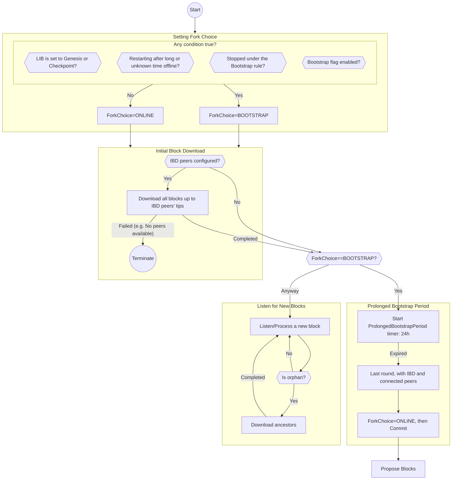
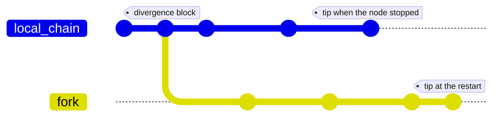

# CRYPTARCHIA-BOOTSTRAPPING-SYNCHRONIZATION

| Field | Value |
| --- | --- |
| Name | Cryptarchia Bootstrapping & Synchronization |
| Slug | 96 |
| Status | raw |
| Category | Standards Track |
| Editor | Youngjoon Lee <youngjoon@logos.co> |
| Contributors | David Rusu <david@logos.co>, Giacomo Pasini <giacomo@logos.co>, Álvaro Castro-Castilla <alvaro@logos.co>, Daniel Sanchez Quiros <daniel@logos.co>, Filip Dimitrijevic <filip@logos.co> |

<!-- timeline:start -->

## Timeline

- **2026-05-27** — [`b7602ed`](https://github.com/logos-co/logos-lips/blob/b7602ed8a225d41ca0bfaaa432524dc84d2ded7e/docs/blockchain/raw/cryptarchia-v1-bootstr-sync.md) — chore: move blockchain specs from notion to github
- **2026-05-18** — [`58b5698`](https://github.com/logos-co/logos-lips/blob/58b56988429f4d69a9e10a9fc118725e229e37c5/docs/blockchain/raw/cryptarchia-v1-bootstr-sync.md) — chore(blockchain): migrate contributor emails to @logos.co (#338)
- **2026-01-19** — [`f24e567`](https://github.com/logos-co/logos-lips/blob/f24e567d0b1e10c178bfa0c133495fe83b969b76/docs/blockchain/raw/cryptarchia-v1-bootstr-sync.md) — Chore/updates mdbook (#262)
- **2026-01-16** — [`89f2ea8`](https://github.com/logos-co/logos-lips/blob/89f2ea89fc1d69ab238b63c7e6fb9e4203fd8529/docs/blockchain/raw/cryptarchia-v1-bootstr-sync.md) — Chore/mdbook updates (#258)

<!-- timeline:end -->

# Revision History

| **Version** | **Changes** | **Date** |
| --- | --- | --- |
| 1.0.0 | Initial revision. | 2026-02-17 |
| 1.0.1 | Noted that a streamed `Block` carries the signed headers of the uncles it references, which is what lets a synchronizing node validate those blocks and reproduce the [Total Stake Inference](cryptarchia-v1-protocol.md#total-stake-inference) without ever seeing their proposals, due to updated [Cryptarchia Protocol](cryptarchia-v1-protocol.md) (uncle references). | 2026-08-06 |
| 1.0.2 | Spread block download requests across connected and discovered peers instead of downloading only from the configured IBD peers, which now only provide the chain tips to catch up with. Added [Selecting Peers for Downloading](#selecting-peers-for-downloading) and the `GetTipRequest` message. | 2026-10-20 |
| 1.1.0 | Added [Switching to the Online Rule](#switching-to-the-online-rule): a last round that downloads each peer's tip from that peer, then [Commit](cryptarchia-v1-protocol.md#commit). Bounded `T_offline` by the finality window `K`. A node restarts with the Bootstrap rule if it stopped under it or cannot tell how long it was offline, and stores `c_loc`, `B_imm` and its fork choice rule together. | 2026-11-17 |

# Introduction

When a new node joins the network or a previously-bootstrapped node has been offline for a while, it cannot follow the most recent honest chain solely by receiving only new blocks because those new blocks cannot be added to the block tree that does not have their parent block. These nodes must first catch up with the most recent honest chain by fetching missing blocks from their peers before they start listening for new blocks.

This document specifies a protocol for nodes to bootstrap with the honest chain efficiently while mitigating long range attacks. It also defines how to handle the case which the node falls behind after the bootstrapping is complete.

This protocol adheres to the key invariant: We never roll back blocks that are deeper than the latest immutable block $`B_\text{imm}`$ in the local chain $`c_{loc}`$, as defined in [Cryptarchia Protocol](cryptarchia-v1-protocol.md) .

# Overview

This protocol defines the bootstrapping mechanism that covers all of the following cases:

- From the **Genesis** block
- From the **checkpoint** block obtained from a trusted checkpoint provider
- From the **local block tree** (with $`B_\text{imm}`$ newer than the Genesis and the checkpoint)

Additionally, the protocol defines the synchronization mechanism that handles orphan blocks while listening for new blocks after the bootstrapping is completed.

The protocol consists of the following key components:

- Determining the fork choice rule ([Bootstrap Fork Choice Rule](fork-choice.md#bootstrap-fork-choice-rule) or [Online Fork Choice Rule](fork-choice.md#online-fork-choice-rule)) at startup
- Switching the fork choice rule from Bootstrap to Online
- Downloading blocks from peers

The details are described in the [Protocol](#protocol). This section provides only a high-level overview.



Upon startup, a node **determines the fork choice rule**, as defined in [Setting the Fork Choice Rule](#setting-the-fork-choice-rule). If the Bootstrap rule is selected, it is maintained for the [Prolonged Bootstrap Period](#prolonged-bootstrap-period), after which the node catches up once more with its peers' tips and switches to the Online rule.

Using the fork choice rule chosen, the node **downloads blocks** to catch up with the tip of the local chain $`c_{loc}`$ of each peer.

After downloading is done, the node starts **listening for new blocks.** Upon receiving a new block, the node validates and adds it to its local block tree. If the ancestors of the block are missing from the local block tree, the node downloads missing ancestors using the same mechanism as above.

The node can **propose blocks** after switching to the Online fork choice rule.

# Protocol

## Constants

| Constant | Name | Description | Value |
| --- | --- | --- | --- |
| $`T_\text{offline}`$ | Offline Grace Period | A period during which a node can be restarted without switching to the Bootstrap rule. It also limits what the last round of [Switching to the Online Rule](#switching-to-the-online-rule) waits for. It must be shorter than the finality window $`K`$ ([Constants](cryptarchia-v1-protocol.md#constants)), or a fork built entirely while the node was offline can become immutable at the restart. | 20 minutes |
| $`T_\text{boot}`$ | Prolonged Bootstrap Period | A period during which Bootstrap fork choice rule must be continuously used after Initial Block Download is completed. This gives nodes additional time to compare their synced chain with a broader set of peers. | 24 hours |
| $`s_\text{gen}`$ | Density Check Slot Window | A number of slots used by density check of Bootstrap rule. This constant is defined in [Definitions](fork-choice.md#definitions). | $`\lfloor\frac{k}{4f}\rfloor`$ (=4h30m) |
| $`T_\text{round}`$ | IBD Round Delay | A delay between rounds of [Initial Block Download](#initial-block-download), and between the repetitions of the steps of [Switching to the Online Rule](#switching-to-the-online-rule). Implementers can choose a different value. | 1 second (recommended) |
| $`N_\text{conn}`$ | Connected Peers per Download | The maximum number of connected peers a download request is sent to, as defined in [Selecting Peers for Downloading](#selecting-peers-for-downloading). Implementers can choose a different value. | 16 (recommended) |
| $`N_\text{disc}`$ | Discovered Peers per Download | The maximum number of discovered but not connected peers a download request is sent to, as defined in [Selecting Peers for Downloading](#selecting-peers-for-downloading). Implementers can choose a different value. | 16 (recommended) |

## Setting the Fork Choice Rule

Upon startup, a node sets the fork choice rule to the **Bootstrap** rule in one of the following cases. Otherwise, the node uses the **Online** fork choice rule.

- **A node is starting with** $`B_\text{imm}`$ **set to the Genesis block or from a checkpoint block.**
  The node is setting its latest immutable block $`B_\text{imm}`$ to the Genesis or a checkpoint, which clearly indicates that the node intends to catch up with the subsequent blocks. Regardless of how many subsequent blocks remain, the node should use the Bootstrap rule to mitigate long range attacks.

- **A node is restarting after being offline longer than** $`T_\text{offline}`$ **(20 minutes), or cannot tell how long it was offline.**
  Unlike starting from Genesis or checkpoint, in the case where a node is restarted while preserving its existing block tree, the node must choose a fork choice rule depending on how long it has been offline.

  The node uses the Bootstrap rule upon startup unless it is certain that it has been offline for at most the offline grace period $`T_\text{offline}`$ since it last used the Online rule.

  Details of $`T_\text{offline}`$ are described in [Offline Grace Period](#offline-grace-period). A recommended way how to measure the offline duration is introduced in [**Offline Duration Measurement**](#offline-duration-measurement).

- **A node is restarting after it stopped under the Bootstrap rule.**

- **A node operator set the Bootstrap rule explicitly (e.g., by** **`--bootstrap`** **flag).**
  In any case where the node operator is clearly aware that the tip of the node's local chain is more than the finality window $`K`$ old, they should be able to start the node with the Bootstrap rule. For example, the operator may obtain the slot of the latest block from another trusted operator and realize that their node has fallen significantly behind due to some issue.

A node stores $`c_{loc}`$, $`B_\text{imm}`$ and the fork choice rule it uses together: after it sets the rule at startup, after each block it processes, and after it switches to the Online rule. A restart loads the three as last stored.

## Initial Block Download

If peers for Initial Block Download (IBD) are configured, a node performs IBD by downloading blocks to catch up with the tip of the local chain $`c_{loc}`$ of each IBD peer using the fork choice rule chosen in [Setting the Fork Choice Rule](#setting-the-fork-choice-rule). If no peer is configured, the node skips IBD. For example, genesis nodes will configure no IBD peer because they have to build a chain from scratch.

Blocks are downloaded in parent-to-child order, as defined in the [Downloading Blocks](#downloading-blocks) mechanism. This mechanism applies not only when a node starts from the Genesis block, but also when it already has the local block tree (or a checkpoint block)

During Initial Block Download, the configured IBD peers are used only to learn which chain tips the node must catch up with. The blocks themselves are not downloaded only from the IBD peers. Instead, each download request is spread across the connected and discovered peers, as defined in [Selecting Peers for Downloading](#selecting-peers-for-downloading). IBD peers are typically a small set of well-known nodes that every new node is configured with. If every new node downloaded the whole chain from them, they would be overloaded, and the IBD of the whole network would depend on their capacity.

IBD runs in rounds. In each round, the node:

1. Requests the chain tip from every IBD peer in parallel, using `GetTipRequest` defined in [Downloading Blocks](#downloading-blocks).
2. Downloads the blocks up to each fetched tip that is not yet in the local block tree, from peers selected as defined in [Selecting Peers for Downloading](#selecting-peers-for-downloading).
3. Waits for a short delay $`T_\text{round}`$ before starting the next round. The delay keeps the node from flooding the IBD peers with tip requests when downloads fail immediately, and gives the node time to discover more peers.

IBD completes when every tip fetched in a round is already in the local block tree. Because tips are fetched again in every round, the node also catches up with the blocks that the IBD peers added while the node was downloading.

```python
def initial_block_download(ibd_peers: List[Node], local_tree: Tree):
    # Skip IBD if no peer is set.
    # For example, genesis nodes should be able to skip IBD.
    if len(ibd_peers) == 0:
        return

    while True:
        # Fetch tips from all IBD peers in parallel.
        # Peers that fail to respond are ignored.
        # In real implementation, this can be retried with backoff before giving up.
        tips = {tip for tip in parallel(get_tip(peer) for peer in ibd_peers) if tip is not None}
        # If none of IBD peers returns a tip (e.g. network errors),
        # IBD is considered failed.
        if len(tips) == 0:
            raise IBDFailure

        unsynced_tips = {tip for tip in tips if not local_tree.has(tip)}
        if len(unsynced_tips) == 0:
            return

        # Blocks are downloaded from peers selected from the connected and discovered peers,
        # not from the IBD peers.
        # In real implementation, these downloads can be run in parallel.
        for tip in unsynced_tips:
            download_blocks(local_tree, target_block=tip)

        sleep(T_round)
```


The downloaded blocks are validated and added to the local block tree using the fork choice rule determined above. Both block headers and block bodies must be validated. The header validation rules are defined in [Block Header Validation](cryptarchia-v1-protocol.md#block-header-validation).

If none of the IBD peers returns its tip (e.g., network errors), the node is terminated with an error, allowing the operator to restart the node with other IBD peers.

If downloading is done successfully, the node starts listening for new blocks as described in [Listening for New Blocks](#listening-for-new-blocks).

## Prolonged Bootstrap Period

After [Initial Block Download](#initial-block-download) is completed, a node must maintain the Bootstrap fork choice rule during the Bootstrap Period $`T_\text{boot}`$, if the node chose the Bootstrap rule at [Setting the Fork Choice Rule](#setting-the-fork-choice-rule).

The purpose of the Prolonged Bootstrap Period is giving a syncing node additional time to compare its synced chain with a broader set of peers. In other words, it provides the node with an opportunity to connect to different peers and verify whether they are on the same chain. If the syncing node has downloaded blocks only from peers within an isolated network, the result of [Initial Block Download](#initial-block-download) may not reflect the honest chain followed by the majority of the entire network. To resolve such situations, the node should continue using the Bootstrap rule while discovering additional peers, allowing it to switch to a better chain if one is found.

This protocol configures the Bootstrap Period to 24 hours.

A timer must be started when [Listening for New Blocks](#listening-for-new-blocks) is started after [Initial Block Download](#initial-block-download) is completed. At that time the node also records the latest block of $`c_{loc}`$ whose slot lies at least $`K`$ behind the slot of its tip, or $`B_\text{imm}`$ if there is none. Once the time is completed, the node switches to the Online rule as defined in [Switching to the Online Rule](#switching-to-the-online-rule).

### Switching to the Online Rule

Peers that fill the connections of a node can withhold the chain that the rest of the network follows, so that a fork the Bootstrap rule rejected wins after the switch. Before the switch, the node therefore runs a last round: it fetches the tip of every IBD peer and of every other connected peer, and the blocks up to each tip from the peer that returned it. The round waits for a peer that is not an IBD peer for a limited time only, so that such a peer cannot hold the node on the Bootstrap rule.

The node runs the last round under the Bootstrap rule, and keeps [Listening for New Blocks](#listening-for-new-blocks) during it. It handles every IBD peer and every other connected peer in parallel. For each peer it repeats the following steps:

1. It requests the chain tip of the peer, using `GetTipRequest` defined in [Downloading Blocks](#downloading-blocks). If the request fails, it continues at step 4. The node is not terminated if no tip arrives.
2. If the tip is in the local block tree, the handling of the peer ends.
3. Otherwise it downloads the blocks up to the tip from that peer, as defined in [Downloading Blocks](#downloading-blocks). Each request of the download names in `KnownBlocks.additional_blocks`:
   - the block recorded when the [Prolonged Bootstrap Period](#prolonged-bootstrap-period) started;
   - the last valid block that the peer delivered in an earlier download of the round;
   - if the peer has delivered none, the latest blocks of $`c_{loc}`$ whose slots lie at least $`T_\text{offline}`$, $`s_\text{gen}`$ and $`K`$ behind the slot of its tip, where each exists.

   A peer that does not hold the tip of $`c_{loc}`$ can then start its stream from one of them, not from $`B_\text{imm}`$.
4. It waits $`T_\text{round}`$ and starts again at step 1.

The handling of a peer also ends as follows, in any step:

- The handling of an IBD peer ends when $`T_\text{offline}`$ has passed since the round started, or since the peer last delivered a block that counts, whichever is later. A block counts if it is valid and no download from the peer delivered it earlier in the round. It counts whether or not the local block tree already holds it.
- The handling of any other peer ends $`T_\text{offline}`$ after the round started.

A request or download that is running when the handling ends is cancelled, and the blocks it delivered stay in the local block tree. The round ends when the handling of every peer has ended.

```python
def last_round(ibd_peers: List[Node], local_tree: Tree, recorded: BlockId):
    def catch_up(peer: Node):
        while True:
            tip = get_tip(peer)
            if tip is not None:
                if local_tree.has(tip):
                    return
                # The block recorded when the Prolonged Bootstrap Period started, and the last
                # valid block that the peer delivered in an earlier download of the round. If
                # it has delivered none: the latest blocks of the local chain whose slots lie
                # at least T_offline, s_gen and K behind the slot of its tip.
                last = last_delivered(peer)
                known = [recorded] + ([last] if last is not None else
                                      local_tree.blocks_behind_tip([T_offline, s_gen, K]))
                download_blocks(local_tree, target_block=tip, peers=[peer], known=known)
            sleep(T_round)

    # Every peer is handled in parallel. The handling of a peer is cancelled as stated above.
    parallel(catch_up(peer) for peer in set(ibd_peers) | connected_peers())
```

When the round ends, the node switches the fork choice rule to the Online rule and runs [Commit](cryptarchia-v1-protocol.md#commit) on $`c_{loc}`$ before it processes any further block.

## Listening for New Blocks

Once [Initial Block Download](#initial-block-download) is complete and [Prolonged Bootstrap Period](#prolonged-bootstrap-period) is started, a node starts listening for new blocks relayed by its peers.

Upon receiving a new block, the node tries to validate and add it to its local block tree, as defined in [Chain Maintenance](cryptarchia-v1-protocol.md#chain-maintenance).

If the parent of the block is missing from the local block tree, the block cannot be fully validated and added. These blocks are called *orphan blocks*. To handle an orphan block, the node downloads missing blocks as described in [Downloading Blocks](#downloading-blocks), from peers selected as defined in [Selecting Peers for Downloading](#selecting-peers-for-downloading). If the download fails, the node may retry with newly selected peers before abandoning the orphan block. The retry policy can be configured by implementers.

Note that downloading missing blocks does not need to be triggered if it is clear that the orphan block is in a fork diverged before the latest immutable (committed) block, as the node should never revert immutable blocks.

```python
def listen_and_process_new_blocks(fork_choice: ForkChoice, local_tree: Tree):
    for block in listen_for_new_blocks():
        try:
            # Run the chain maintenance defined in the Cryptarchia spec.
            local_tree.on_block(block, fork_choice)
        except InvalidBlock:
            continue
        except ParentNotFound:
            # Ignore the orphan block proactively,
            # if it's clear that the orphan block is in a fork behind the latest immutable block
            # because immutable blocks should never be revereted.
            # This check doesn't cover all cases, but the uncovered cases will be handled by
            # the Cryptarchia block validation during the `download_blocks` below.
            if block.height ≤ local_tree.latest_immutable_block().height:
                continue
            # In real implemention, downloading can be run in background with the retry policy.
            download_blocks(local_tree, target_block=block.id)
```

## Downloading Blocks

For performing [Initial Block Download](#initial-block-download) and handling orphan blocks while [Listening for New Blocks](#listening-for-new-blocks), a node sends a `DownloadBlocksRequest` to peers selected as defined in [Selecting Peers for Downloading](#selecting-peers-for-downloading). A peer must respond with blocks in parent-to-child order. To learn the tip of a peer's local chain $`c_{loc}`$ (e.g. the tips of the IBD peers in [Initial Block Download](#initial-block-download)), a node sends a `GetTipRequest` to the peer. This communication should be implemented based on the [Libp2p streaming](https://github.com/libp2p/rust-libp2p/tree/master/protocols/stream).

**Libp2p Protocol ID**

- Mainnet: `/logos-blockchain/cryptarchia/sync/1.0.0`
- Testnet: `/logos-blockchain-testnet/cryptarchia/sync/1.0.0`

```python
class DownloadBlocksRequest:
    # Ask blocks up to the target block.
    # The response may not contain the target block if the responder limits the number of blocks returned.
    # In that case, the requester must repeat the request.
    target_block: BlockId
    # To allow the peer to determine the starting block to return.
    known_blocks: KnownBlocks

class KnownBlocks:
    local_tip: BlockId
    latest_immutable_block: BlockId
    # Additional known blocks.
    # A responder will reject a request if this list contains more than 5.
    additional_blocks: list[BlockId]

class DownloadBlocksResponse:
    # A stream of blocks in parent-to-child order.
    # The max number of blocks to be returned can be limited by implementers.
    # A requester can read the stream until the stream returns "NoMoreBlock".
    blocks: Stream[Block | "NoMoreBlock"]

class GetTipRequest:
    pass

class GetTipResponse:
    # The tip of the responder's local chain.
    tip: BlockId
    slot: Slot
    height: int
```

A peer that cannot serve these requests yet (e.g. a peer still performing its own [Initial Block Download](#initial-block-download)) may reject them. The requesting node treats the rejection as a failed request.

Each streamed `Block` carries the signed headers of the uncles it references, in its `uncle_headers` field ([Block Construction, Validation and Execution](bedrock-v1.1-block-construction.md#block)). This is what lets a synchronizing node apply the validity rules of [Uncle References](cryptarchia-v1-protocol.md#uncle-references) to every downloaded block, and then reproduce the [Total Stake Inference](cryptarchia-v1-protocol.md#total-stake-inference) of every past epoch and the finality floor of [Commit](cryptarchia-v1-protocol.md#commit) from the uncles those blocks carry, even though it never receives the proposals the blocks were reconstructed from.

The responding peer uses `KnownBlocks` to determine the optimal starting block for the response stream, aiming to minimize the number of blocks to be returned. The requesting node can include any block it believes could assist in this process to the `KnownBlocks.additional_blocks`. To avoid spamming responders, the size of `KnownBlocks.additional_blocks` is limited to 5.

The responding peer finds the latest common ancestor (i.e. LCA) between the `target_block` and each of the known blocks that it holds. It ignores a known block that it does not hold. Then, it returns a stream of blocks, starting from the highest LCA. To mitigate malicious downloading requests, the peer limits the number of blocks to be returned. The detailed implementation is up to implementers, depending on their internal architecture (e.g. storage design).


The requesting node should repeat `DownloadBlocksRequest`s by updating the `KnownBlocks` in order to download the next batches of blocks. Each repeated request is sent to newly selected peers, except in the last round, as defined in [Selecting Peers for Downloading](#selecting-peers-for-downloading). The following code shows how the requesting node can be implemented.

```python
def download_blocks(local_tree: Tree, target_block: BlockId,
                    peers: Optional[List[Node]] = None, known: Optional[List[BlockId]] = None):
    latest_downloaded: Optional[Block] = None
    while True:
        # Don't start downloading if target is already in local.
        if local_tree.has(target_block):
            return

        req = DownloadBlocksRequest(
            target_block=target_block,
            known_blocks=KnownBlocks(
                local_tip=local_tree.tip().id,
                latest_immutable_block=local_tree.latest_immutable_block().id,
                # Provide the latest downloaded block as well
                # to avoid downloading duplicate blocks
                additional_blocks=(known or [])
                    + ([latest_downloaded.id] if latest_downloaded is not None else []),
            )
        )

        # Send the request to the given peers, or to newly selected peers if none are given,
        # and take the first valid response.
        # See the "Selecting Peers for Downloading" section.
        resp = send_request_to_peers(peers or select_peers(), req)
        if resp is None:
            # No peer responded.
            return

        num_received = 0
        for block in resp.blocks():
            num_received += 1
            latest_downloaded = block
            try:
                # Run the chain maintenance defined in the Cryptarchia spec.
                local_tree.on_block(block)
                # Early stop if the target has been reached.
                if block == req.target_block:
                    return
            except:
                return

        # Stop if the response contained no block.
        if num_received == 0:
            return
```

If the node is continuing from a previous `DownloadBlocksRequest`, it is important to include the latest downloaded block to the `KnownBlocks.additional_blocks` to avoid downloading duplicate blocks. This also lets the next request be answered correctly by a different peer from the one that answered the previous request.


If the requesting node is downloading blocks up to the peer’s tip $`c_{loc}`$ (e.g. [Initial Block Download](#initial-block-download)), the $`c_{loc}`$ may switch while the node is downloading blocks. [Initial Block Download](#initial-block-download) handles this case by fetching the most recent tips of the IBD peers in each round, and downloading blocks up to those tips. Each download starts from the highest LCA between the new tip and the blocks the node already has.


### Selecting Peers for Downloading

A node should spread its `DownloadBlocksRequest`s across the peers it knows, instead of sending them only to a fixed set of peers such as the IBD peers. This keeps any single peer, in particular the well-known IBD peers, from serving most of the download traffic of the network. It also lets a node download blocks even when some peers are slow, unreachable, or malicious.

This selection does not apply to the downloads of [Switching to the Online Rule](#switching-to-the-online-rule). For every other `DownloadBlocksRequest`, including each repeated request of the same download, the node selects peers as follows:

1. Consider only peers that support the sync protocol (i.e. that advertise the [Libp2p Protocol ID](#downloading-blocks) above).
2. Randomly select up to $`N_\text{conn}`$ peers from the connected peers.
3. Randomly select up to $`N_\text{disc}`$ peers from the peers that are discovered (e.g. via the peer discovery protocol) but not connected. The node connects to them to send the request.

The node sends the same request to all selected peers concurrently. It reads the first item of each response, and uses the response of the first peer whose first item is not an error. All other responses are dropped. If no peer returns a usable response, the request is considered failed.

If no peer can be selected, the request fails immediately.

Selecting discovered peers that are not connected spreads the requests beyond the current connections, which are often the same well-known peers that the node bootstrapped from. It also lets a node with few connections download blocks.

```python
def select_peers() -> List[Node]:
    eligible = sync_protocol_peers()
    connected = connected_peers() & eligible
    discovered = (discovered_peers() & eligible) - connected
    return random.sample(connected, min(N_conn, len(connected))) \
        + random.sample(discovered, min(N_disc, len(discovered)))

def send_request_to_peers(peers: List[Node], req: DownloadBlocksRequest) -> Optional[DownloadBlocksResponse]:
    # Send the request to all peers concurrently.
    # Return the first response whose first item is not an error.
    # Return None if no such response arrives.
    ...
```

Sending one request to many peers costs some duplicate traffic, because peers that respond later have their responses dropped. Implementers can limit this cost by lowering $`N_\text{conn}`$ and $`N_\text{disc}`$, or by closing the dropped streams as early as possible.

## Proposing New Blocks

Unlike [Listening for New Blocks](#listening-for-new-blocks), a node can start proposing blocks after [Prolonged Bootstrap Period](#prolonged-bootstrap-period) is complete. In other words, the node should not propose blocks before switching to the Online fork choice rule.

## Bootstrapping from Checkpoint

Instead of bootstrapping from the Genesis block or from the local block tree, a node can choose to bootstrap the honest chain starting from a checkpoint block obtained from a trusted checkpoint provider. In this case, the node fully trusts the checkpoint provider and considers blocks deeper than the checkpoint block as immutable (including the checkpoint block itself).

A trusted checkpoint provider exposes a HTTP endpoint, allowing nodes to download the checkpoint block and the corresponding ledger state. The details are defined in [Checkpoint Provider HTTP API](#checkpoint-provider-http-api).

The bootstrapping node imports the downloaded checkpoint block and ledger state before starting bootstrapping. The imported checkpoint block is used as the latest immutable block $`B_{imm}`$ and the local chain tip $`c_{loc}`$. Starting from the checkpoint block, the same [Initial Block Download](#initial-block-download) is used to downloads blocks up to the tip of the local chain of each peer. As defined in [Setting the Fork Choice Rule](#setting-the-fork-choice-rule), the Bootstrap fork choice rule must be used upon startup.


If it turns out that none of the peers’ local chains are connected to the checkpoint block, the node is terminated with an error, allowing the node operator to select a new checkpoint.


# Details

## Offline Grace Period

The offline grace period $`T_\text{offline}`$ is a period during which a node can be restarted without switching to the Bootstrap rule.

This protocol configures $`T_\text{offline}`$ to 20 minutes. Here are the advantages and disadvantages of a short period:

- Advantages
  - Limits the time malicious peers have to grow a fork that a restarted node would make immutable under the Online rule.
  - Conservatively enables the Bootstrap rule to handle long forks.

- Disadvantages
  - Even a short offline duration can too sensitively trigger the Bootstrap rule, which then lasts for the long [Prolonged Bootstrap Period](#prolonged-bootstrap-period).

The following example explains why $`T_\text{offline}`$ should not be set too long.

- A local node stopped under the Online rule in the following situation. A malicious peer is building a fork that diverged a little less than the finality window $`K`$ before the tip of the local chain. The fork is a little shorter than the local chain.
- The local node has been offline shorter than $`T_\text{offline}`$ and just restarted. As defined in this protocol, the Online fork choice rule is used because the offline duration is short.
- During the offline duration, the malicious peer extended its fork. Now the fork is longer than the local chain, its first block lies at least $`K`$ slots behind the tip of the fork, and at least the finality floor $`\phi`$ of occupied slots follows that block.
- If the malicious peer sends the fork to the restarted node faster than the honest peer, the restarted node will switch to the fork and [Commit](cryptarchia-v1-protocol.md#commit) will move $`B_\text{imm}`$ past the divergence block. Even if the node later receives the honest chain from the honest peer, it cannot revert blocks that are already immutable.
- Even if the malicious peer made its fork long enough after $`T_\text{offline}`$, the fork will be rejected by the syncing node because it will use the Bootstrap rule if it has been offline longer after $`T_\text{offline}`$.



The fork is shorter than the local chain when the node stops. It passes the local chain while the node is offline. Lengths are not to scale.

A disadvantage is that a syncing node, which has been offline longer than $`T_\text{offline}`$, should maintain the Bootstrap rule during the [Prolonged Bootstrap Period](#prolonged-bootstrap-period), which is 24 hours in the current setting. In the future, the team will consider designing a better mechanism to replace the long Bootstrap Period.

## **Offline Duration Measurement**

As defined in [Setting the Fork Choice Rule](#setting-the-fork-choice-rule), when a node is restarted, it should be able to choose a proper fork choice rule depending on how long it has been offline since it last used the Online rule.

It is considered unsafe to rely on any external information (e.g. the slot or height of peer’s tip) to check how long the node has been offline, since such information could be manipulated as an attack vector. Instead, it is recommended to employ a local method to measure the offline duration.

While the specific implementation is left to the discretion of implementers, one approach is for the node to periodically record the current time to a local file while it is running with the **Online** fork choice rule. Upon restart, it can use this timestamp to calculate how long it has been offline.

## Checkpoint Provider HTTP API

A trusted checkpoint provider serves the `GET /checkpoint` API, allowing users (which are not connected via p2p) to download the latest checkpoint block and its corresponding ledger state.

```yaml
openapi: 3.0

paths:
    /checkpoint
        get:
            responses:
                '200':
                    description: OK
                    content:
                        multipart/mixed:
                            schema:
                                type: object
                                properties:
                                    checkpoint_block:
                                        type: string
                                        format: binary
                                    checkpoint_ledger_state:
                                        type: string
                                        format: binary
```
