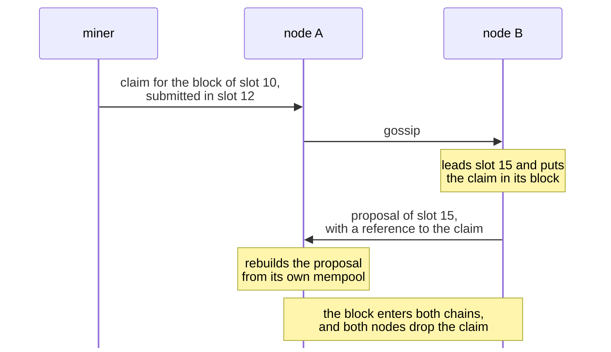
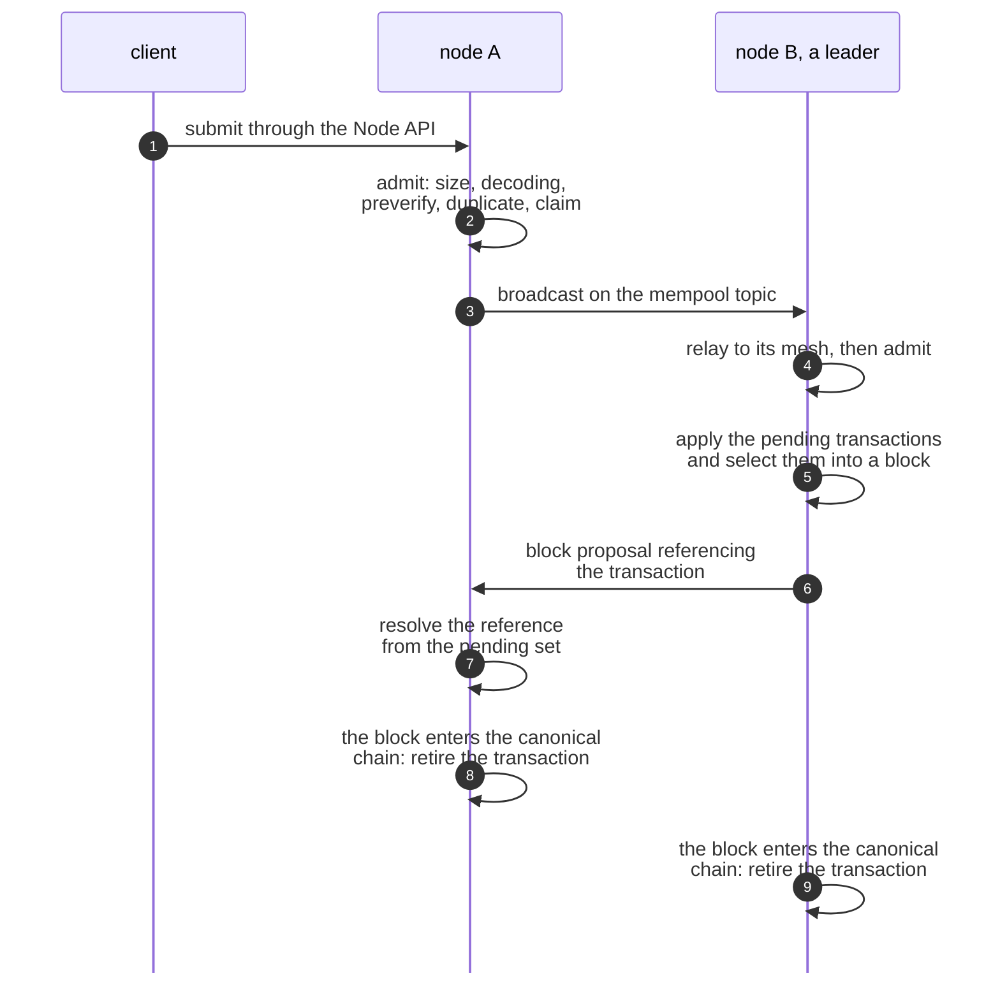

# MEMPOOL

| Field | Value |
| --- | --- |
| Name | Mempool |
| Slug | 251 |
| Status | raw |
| Category | Standards Track |
| Editor | Marcin Pawlowski <marcin@logos.co> |
| Contributors |  |

<!-- timeline:start -->

## Timeline

- **2026-09-04** — [`5de1e93`](https://github.com/logos-co/logos-lips/blob/5de1e9348b010157222d99fbac2649e5e68aa278/docs/blockchain/raw/mempool.md) — docs(blockchain): retire on joining the chain, not on becoming the tip
- **2026-09-02** — [`15e9269`](https://github.com/logos-co/logos-lips/blob/15e92695a7a5b3c23b0b1528a2dd33beb42eceb9/docs/blockchain/raw/mempool.md) — docs(blockchain): drop mempool state that nothing reads
- **2026-09-01** — [`6a9d9c9`](https://github.com/logos-co/logos-lips/blob/6a9d9c98df738c49489a1911abff1741fb5d1ae0/docs/blockchain/raw/mempool.md) — docs(blockchain): remove restated and non-normative text
- **2026-08-24** — [`8e11a5f`](https://github.com/logos-co/logos-lips/blob/8e11a5f027660e97c925c4d0fc6d645f1673d4bd/docs/blockchain/raw/mempool.md) — docs(blockchain): add the mempool specification

<!-- timeline:end -->

# Revision History

| **Version** | **Changes** | **Date** |
| --- | --- | --- |
| 1.0.0 | Initial revision. | 2026-10-13 |

# Introduction

A leader can include only transactions it holds, and a validator can rebuild a block proposal only from transactions it holds. A transaction submitted to one node is therefore of no use until the nodes that build and check blocks hold it too.

The mempool removes this obstacle. The mempool is a node's store of Mantle Transactions that have been submitted but are not yet in the canonical chain. Nodes pass these transactions to each other, offer them to block building, and resolve the references of block proposals against them.

This document specifies how a node admits and disseminates transactions, what it offers to block building, how it resolves references, when it retires a transaction, what it persists, and what it exposes to local clients. [Mantle](bedrock-v1.1-mantle-specification.md) specifies when a transaction applies, [Block Construction, Validation and Execution](bedrock-v1.1-block-construction.md) specifies what a validator does with a resolved or unresolved reference, and [P2P Network](../draft/p2p-network.md) specifies the topic transactions travel on.

# Overview

Each node keeps its own mempool. Nodes admit and retire independently, so their pending sets differ.

A transaction reaches a node from a local client, by gossip from another node, or back from a block that a fork switch removed from the chain. The node checks only that the transaction is well formed. It does not consult the ledger, so its mempool can hold transactions that will never apply.

Take a miner who submits a reward claim to node A in slot 12. The claim names the block of slot 10, and node B leads slot 15.



The claim reaches node B before B leads, so node A can rebuild B's proposal from its own copy. A proposal names each transaction by a short reference. If a reference matches nothing in a node's mempool, or matches several transactions, the node cannot rebuild the proposal from its mempool.

A leader's block building receives every transaction in its mempool, oldest first, and keeps those that apply on its chain. A transaction that applies but does not fit in the block stays for the next leader.

A transaction leaves the mempool when a block on the node's chain carries it, when block building finds it can never apply, when it grows older than its time to live, or when it is a reward claim that no block may include any more.

A block may include the example's claim up to slot 20. A node keeps the claim for twenty slots after that, unless a block carries it first.

```mermaid
---
displayMode: compact
config:
  gantt:
    useWidth: 800
---
gantt
    title A claim for the block of slot 10 that no block includes
    dateFormat X
    axisFormat slot %s
    tickInterval 10second
    todayMarker off
    section Blocks
        before the named block : done, b0, 0, 10s
        may include the claim : b1, after b0, 11s
    section Node A
        before the claim arrives : done, a0, 0, 12s
        holds it : a1, after a0, 9s
        grace : a2, after a1, 20s
        drops it : milestone, a3, after a2, 0s
```



With a window of ten slots and a grace of twenty, a node drops the claim once it holds a block of slot 41 or later.

A node keeps its mempool across a restart.

# Protocol

## Admission Pipeline

A node accepts transactions from local clients and from any peer, so it must turn malformed ones away before it stores them. It does so without reading ledger state.

A transaction arrives by local submission through the [Node API](#node-api), by gossip, or by re-insertion after a fork switch. It becomes **pending** if it passes these checks, in this order, and stays pending until the node **retires** it:

- its encoding is no larger than `MAX_BLOCK_SIZE`;
- it decodes, and decoding consumes the whole payload;
- it passes `preverify`, the [Mantle validation rules](bedrock-v1.1-mantle-specification.md#validation) that read no ledger state;
- it is not already pending;
- it carries no proof-of-work reward **claim** whose **deadline** has passed.

A claim's deadline passes when the highest slot of any block that [Chain Maintenance](cryptarchia-v1-protocol.md#chain-maintenance) has added to the node's block tree is more than `CLAIM_GRACE` slots past the last slot whose block may include the claim. A claim that names a block the node does not hold has no deadline. A transaction that is already pending is a duplicate: it is dropped if it came by gossip, and answered as success and broadcast again if it came from a local client. [Transaction Admission](#transaction-admission) specifies the procedure.

## Gossip

A transaction must reach every node, whichever node it was submitted to. Nodes pass transactions on by gossip.

Transactions travel on the mempool topic of [P2P Network](../draft/p2p-network.md), and a message is identified by the digest of its payload. A node relays a message as soon as it receives it, before it admits the transaction. It broadcasts a transaction it admits by local submission or by re-insertion, and not one it received by gossip. [Dissemination](#dissemination) specifies the rules.

## Block Building Input

A leader must fill its block with transactions that apply on its chain, including transactions that depend on each other. The mempool offers it every pending transaction, and block building finds the ones that apply.

The leader passes over the pending transactions in admission order and applies each one that succeeds, repeating until a pass applies nothing new. It then fills the block in the same order, up to `MAX_BLOCK_TXS` and `MAX_BLOCK_SIZE`. A transaction that never applies is retired, and one that applies but does not fit stays pending. [Block Building View](#block-building-view) specifies both steps.

## Proposal References

A block proposal carries a short reference to each of its transactions instead of the transaction itself. Every validator rebuilds the proposal from its own mempool.

A **reference** is a prefix of the transaction's hash. It resolves only when exactly one pending transaction carries that prefix. A reference with no match, or with several, is not searched further. [Block Construction, Validation and Execution](bedrock-v1.1-block-construction.md) specifies what an unresolved reference means for the proposal, and [Reference Resolution](#reference-resolution) specifies the procedure.

## Retirement Reasons

Without retirement, the pending set would only grow. A node retires a transaction for one of four reasons:

- a block that carries it enters the node's canonical chain;
- block building never applies it;
- its age exceeds `TRANSACTION_TTL`;
- it carries a claim whose deadline has passed.

Retirement discards everything the node kept for the transaction. When a fork switch displaces blocks from the canonical chain, the node re-admits the transactions they carried that the new canonical chain does not carry. [Retirement](#retirement) and [Reorganisation](#reorganisation) specify the rules.

## A Transaction Step by Step

A transaction passes through these steps from submission to retirement. The numbers in the diagram match the list below.



1. A client submits the transaction to node A through the [Node API](#node-api).
2. Node A admits it ([Transaction Admission](#transaction-admission)).
3. Node A broadcasts it, since it arrived by local submission ([Dissemination](#dissemination)).
4. Node B relays it to its mesh neighbours, then admits it ([Dissemination](#dissemination)).
5. Node B leads a slot. It applies its pending transactions and selects this one into its block ([Block Building View](#block-building-view)).
6. Node B's proposal references the transaction by a prefix of its hash ([References](bedrock-v1.1-block-construction.md#references)).
7. Node A resolves the reference from its pending set ([Reference Resolution](#reference-resolution)).
8. The block enters node A's canonical chain, and node A retires the transaction ([Inclusion in a Canonical Block](#inclusion-in-a-canonical-block)).
9. The block enters node B's canonical chain, and node B retires the transaction ([Inclusion in a Canonical Block](#inclusion-in-a-canonical-block)).

## Node State

A node keeps these values for its mempool, defined in [Mempool State](#mempool-state):

- `pending`, the pending hashes in admission order, which changes when the node admits a transaction ([Transaction Admission](#transaction-admission)) or retires one ([Retirement](#retirement));
- `bodies` and `admitted_at`, the body and admission time of each pending transaction, which change with `pending`;
- `by_prefix`, the pending hashes keyed by their reference prefix, which changes with `pending`;
- `highest_slot`, the highest slot in the block tree, which rises when Chain Maintenance adds a block of a higher slot.

The node persists `pending`, `admitted_at` and `bodies`, and rebuilds `by_prefix` and `highest_slot` on recovery ([Persistence and Recovery](#persistence-and-recovery)). Local clients read the pending set through the [Node API](#node-api).

# Details

## Notation

| Symbol | Name | Description |
| --- | --- | --- |
| `WINDOW` | acceptance window | The window of [Acceptance Window](proof-of-work.md#acceptance-window), in slots. |
| `MAX_BLOCK_SIZE` | maximum block size | From [Constants](cryptarchia-v1-protocol.md#constants). |
| `MAX_BLOCK_TXS` | maximum block transactions | From [Constants](cryptarchia-v1-protocol.md#constants). |
| `REFERENCE_PREFIX_LENGTH` | reference prefix length | The length of a reference in bytes, from [References](bedrock-v1.1-block-construction.md#references). |

## Parameters

```python
TRANSACTION_TTL: uint64 = 24 * 60 * 60  # seconds a transaction may stay pending before it is retired
CLAIM_GRACE: uint64 = 2 * WINDOW        # slots a claim stays pending after its acceptance window closes
```

`CLAIM_GRACE` must exceed the time, in slots, that a block proposal takes to reach every node. Otherwise a node can retire a claim before a proposal that selected it in the last slot of its acceptance window arrives.

## Mempool State

```python
@dataclass
class Mempool:
    pending: OrderedSet[TxHash]         # admitted, not yet retired, in admission order
    bodies: Map[TxHash, SignedMantleTx] # transaction bodies
    admitted_at: Map[TxHash, Timestamp] # admission time, per pending transaction
    by_prefix: Map[bytes, Set[TxHash]]  # pending hashes, keyed by reference prefix
    highest_slot: SlotNumber            # highest slot in the block tree
```

A transaction is keyed by `mantle_txhash(tx)`, defined in [Mantle](bedrock-v1.1-mantle-specification.md#mantle-transaction-hash).

An `OrderedSet` iterates in insertion order. A `Timestamp` is a time in seconds, as an unsigned 64-bit integer.

`by_prefix` maps `prefix(hash, REFERENCE_PREFIX_LENGTH)` to the pending hashes carrying that prefix, where `prefix` is defined in [References](bedrock-v1.1-block-construction.md#references).

`highest_slot` is the highest slot of any block that [Chain Maintenance](cryptarchia-v1-protocol.md#chain-maintenance) has added to the node's block tree.

## Transaction Admission

A transaction reaches the mempool by local submission through the [Node API](#node-api), by gossip on the mempool topic, or by re-insertion after a [Reorganisation](#reorganisation). All three follow this procedure.

```python
def admit(mempool, encoded: bytes) -> Result:
    if len(encoded) > MAX_BLOCK_SIZE:
        return Reject(TransactionTooLarge)

    tx = decode_signed_mantle_tx(encoded)
    if tx is None:
        return Reject(Malformed)

    if not preverify(tx):
        return Reject(FailedStatelessValidation)

    key = mantle_txhash(tx)
    if key in mempool.pending:
        return Duplicate(key)

    if claim_expired(mempool, tx):
        return Reject(ExpiredClaim)

    mempool.bodies[key] = tx
    mempool.admitted_at[key] = now()
    mempool.pending.add(key)
    mempool.by_prefix[prefix(key, REFERENCE_PREFIX_LENGTH)].add(key)
    return Accept(key)
```

Admission reads the transaction, the mempool and the node's block tree, and no other state. A node must not treat membership of the mempool as evidence that a transaction can be applied.

`decode_signed_mantle_tx` returns the transaction that [Decoding](#decoding) describes, or `None` if `encoded` does not decode. `claim_expired` is defined in [Expired Claim](#expired-claim). `now()` is the node's current time as a `Timestamp`. `admit` returns `Accept(key)` when it admits the transaction, `Duplicate(key)` when the transaction is already pending, and `Reject` with the reason otherwise.

### Decoding

The payload is the canonical encoding defined in [Mantle Transaction Encoding](mantle-transaction-encoding.md), carried in the envelope defined in [Network Wire Format](network-wire-format.md). Decoding must consume the payload exactly.

### Stateless Validation

`preverify` applies the subset of the [Mantle validation rules](bedrock-v1.1-mantle-specification.md#validation) that reads no ledger state:

1. The transaction carries one proof entry per operation, which may be the `None` entry where the opcode admits one.
2. Each proof entry has the type its operation's opcode requires.
3. Each proof bound only to the transaction hash and the operation payload verifies.

### Reorganisation

```python
def reorganise(mempool, displaced: list[Block], adopted: list[Block]) -> None:
    carried = {mantle_txhash(tx) for block in adopted for tx in block.transactions}
    for block in displaced:
        for tx in block.transactions:
            if mantle_txhash(tx) not in carried:
                admit(mempool, encode_signed_mantle_tx(tx))
```

A node runs `reorganise` when a fork switch displaces blocks from the canonical chain. `displaced` holds the blocks that leave the canonical chain and `adopted` the blocks that enter it, each in chain order. `Block` is defined in [Block](bedrock-v1.1-block-construction.md#block). `encode_signed_mantle_tx` produces the payload that [Decoding](#decoding) consumes.

### Duplicates

`admit` reports a duplicate. The caller decides what follows:

- A duplicate received by gossip is dropped.
- A duplicate received by local submission is answered as success, and the transaction is broadcast again.

## Dissemination

Transactions are gossiped on the mempool topic defined in [P2P Network](../draft/p2p-network.md#gossiping).

A message's identity on that topic is the Blake2b-256 digest of its payload. Implementations must not use gossipsub's default source-and-sequence-number identity.

A node relays a received message to its mesh neighbours on receipt, before admission.

A node broadcasts a transaction it admits by local submission or by re-insertion. It does not broadcast a transaction it received by gossip.

## Block Building View

The mempool supplies the bodies of every pending transaction in admission order.

```python
def applicability(mempool, parent_state, header) -> tuple[list[SignedMantleTx], list[TxHash]]:
    state = apply_header(parent_state, header)       # the working state
    applied, remaining = [], list(mempool.pending)   # remaining in admission order
    progress = True
    while progress:
        # A transaction may spend what one admitted after it creates,
        # so passes repeat until a pass applies nothing.
        progress = False
        for key in list(remaining):
            after = apply_transaction(state, mempool.bodies[key])
            if after is not None:
                state = after
                applied.append(mempool.bodies[key])
                remaining.remove(key)
                progress = True
    return applied, remaining

def selection(applied: list[SignedMantleTx]) -> list[SignedMantleTx]:
    block = []
    for tx in applied:
        # Stopping, rather than skipping, keeps every transaction a later one depends on.
        if len(block) == MAX_BLOCK_TXS or encoded_size(block + [tx]) > MAX_BLOCK_SIZE:
            break
        block.append(tx)
    return block
```

`applicability` is the leader's **applicability determination**, and no block limit applies to it. `remaining` holds the transactions it never applies. In **selection**, the leader fills its block from `applied`, in the order the determination applied them.

`parent_state` is the ledger state after the parent of the block being built. `apply_header(parent_state, header)` returns the state against which [Block Execution](bedrock-v1.1-block-construction.md#block-execution) executes the first transaction of a block with that header. `apply_transaction(state, tx)` returns the state after executing `tx` against `state` as [Mantle](bedrock-v1.1-mantle-specification.md) specifies, or `None` if `tx` is not valid against `state`. `encoded_size(txs)` is the size of `txs` serialized as the `transactions` of a block, which rule 2 of [Block Header Validation](cryptarchia-v1-protocol.md#block-header-validation) bounds by `MAX_BLOCK_SIZE`.

## Reference Resolution

A block proposal carries a `REFERENCE_PREFIX_LENGTH`-byte prefix of each transaction hash, as defined in [References](bedrock-v1.1-block-construction.md#references). A validator resolves each reference against the mempool.

```python
def resolve(mempool, reference) -> Optional[SignedMantleTx]:
    matches = mempool.by_prefix.get(reference, set())
    if len(matches) != 1:
        return None
    (key,) = matches
    return mempool.bodies[key]
```

A non-unique match must not be searched.

Resolution reads the proposal, `by_prefix` and `bodies`, and nothing else.

How a validator uses the result, and what a failure to resolve establishes about the block, are specified in [Block Proposal Reconstruction](bedrock-v1.1-block-construction.md#block-proposal-reconstruction) and [Block Proposal Validation](bedrock-v1.1-block-construction.md#block-proposal-validation).

## Retirement

A transaction leaves `pending` for one of four reasons.

### Inclusion in a Canonical Block

When a block enters the node's canonical chain, the transactions it carries are retired.

### Inapplicability

A transaction that the applicability determination of [Block Building View](#block-building-view) never applies is retired.

### Expiry

A pending transaction whose age exceeds `TRANSACTION_TTL` is retired.

### Expired Claim

A claim is the payload of a `CLAIM_POW_REWARD` Operation, defined in [CLAIM_POW_REWARD](bedrock-v1.1-mantle-specification.md#claim_pow_reward).

```python
def claim_expired(mempool, tx) -> bool:
    slots = [block_slot(claim.block_hash) for claim in claims(tx)]
    known = [slot for slot in slots if slot is not None]
    if not known:
        return False
    # One claim the ledger rejects invalidates the whole transaction, so the
    # earliest referenced block decides. A block at slot s + WINDOW is the last
    # that can include a claim referencing a block at slot s.
    return mempool.highest_slot >= min(known) + WINDOW + 1 + CLAIM_GRACE
```

A pending transaction for which `claim_expired` holds is retired.

`claims(tx)` is the list of claims in `tx`. `block_slot(h)` is the slot of the block with hash `h` in the node's block tree, or `None` if the block tree holds no such block.

### Effects of Retirement

```python
def retire(mempool, key: TxHash) -> None:
    mempool.pending.remove(key)
    mempool.by_prefix[prefix(key, REFERENCE_PREFIX_LENGTH)].discard(key)
    del mempool.admitted_at[key]
    del mempool.bodies[key]
```

A node retires a transaction by running `retire`.

## Persistence and Recovery

A node persists the pending hashes, their admission timestamps, and the transaction bodies.

A node does not persist `by_prefix` or `highest_slot`. It rebuilds them on recovery:

```python
def recover(saved, block_tree) -> Mempool:
    by_prefix = defaultdict(set)
    for key in saved.pending:
        by_prefix[prefix(key, REFERENCE_PREFIX_LENGTH)].add(key)
    return Mempool(pending=saved.pending, bodies=saved.bodies,
                   admitted_at=saved.admitted_at, by_prefix=by_prefix,
                   highest_slot=max(block.slot for block in block_tree))
```

`saved` holds what the node persisted, and `block_tree` holds the blocks of the node's block tree.

## Node API

A node exposes the mempool to local clients through endpoints that carry no consensus meaning.

| Operation | Description |
| --- | --- |
| Submit transaction | Admit a transaction by local submission and broadcast it. Returns the outcome of [Transaction Admission](#transaction-admission). |
| View | The hashes of the pending transactions. |
| Status | For each queried hash, whether the transaction is pending or unknown to this node. |
| Metrics | The number of pending transactions and the time of the most recent admission. |

# References

- [Block Construction, Validation and Execution](bedrock-v1.1-block-construction.md)
- [Cryptarchia Protocol](cryptarchia-v1-protocol.md)
- [Mantle](bedrock-v1.1-mantle-specification.md)
- [Mantle Transaction Encoding](mantle-transaction-encoding.md)
- [Network Wire Format](network-wire-format.md)
- [P2P Network](../draft/p2p-network.md)
- [Proof of Work](proof-of-work.md)
