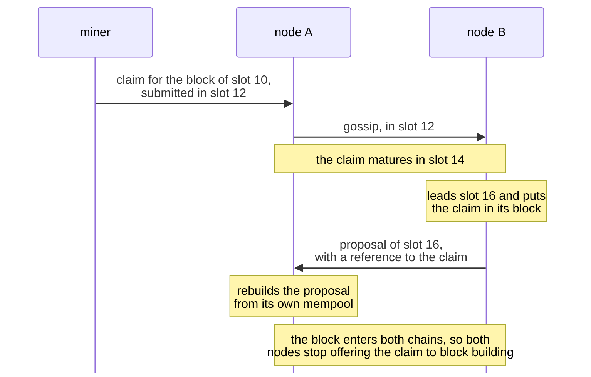
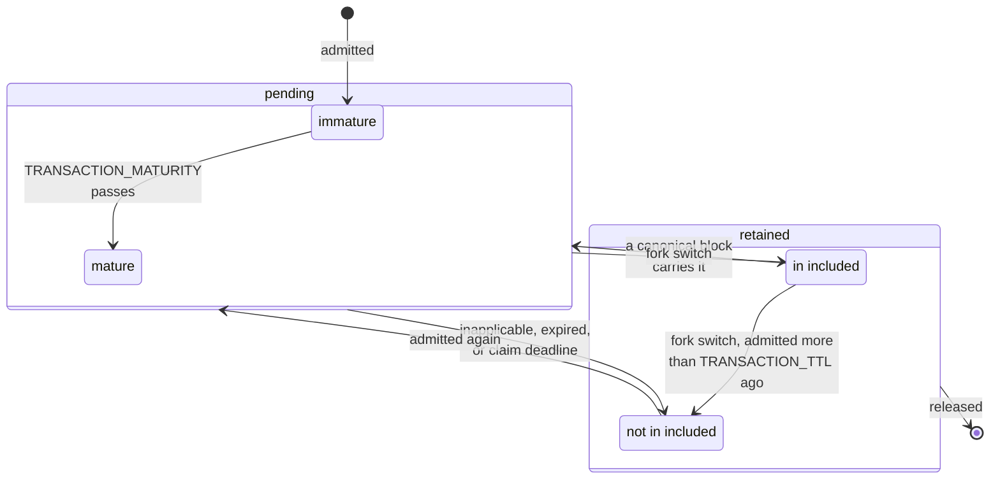
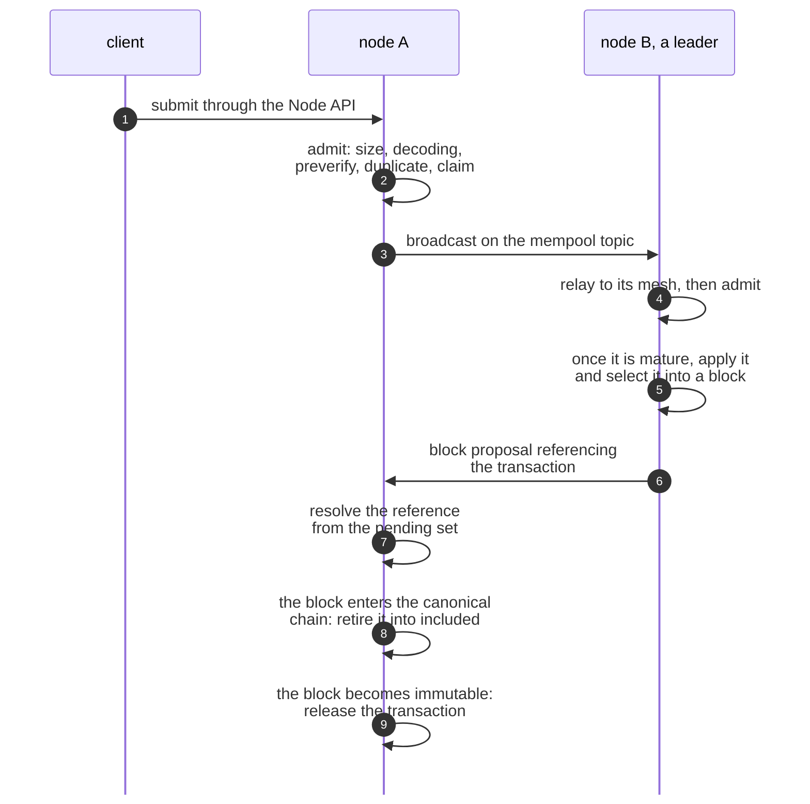

# MEMPOOL

| Field | Value |
| --- | --- |
| Name | Mempool |
| Slug | 251 |
| Status | raw |
| Category | Standards Track |
| Editor | Marcin Pawlowski <marcin@logos.co> |
| Contributors |  |

<!-- timeline:start -->

## Timeline

- **2026-09-04** — [`5de1e93`](https://github.com/logos-co/logos-lips/blob/5de1e9348b010157222d99fbac2649e5e68aa278/docs/blockchain/raw/mempool.md) — docs(blockchain): retire on joining the chain, not on becoming the tip
- **2026-09-02** — [`15e9269`](https://github.com/logos-co/logos-lips/blob/15e92695a7a5b3c23b0b1528a2dd33beb42eceb9/docs/blockchain/raw/mempool.md) — docs(blockchain): drop mempool state that nothing reads
- **2026-09-01** — [`6a9d9c9`](https://github.com/logos-co/logos-lips/blob/6a9d9c98df738c49489a1911abff1741fb5d1ae0/docs/blockchain/raw/mempool.md) — docs(blockchain): remove restated and non-normative text
- **2026-08-24** — [`8e11a5f`](https://github.com/logos-co/logos-lips/blob/8e11a5f027660e97c925c4d0fc6d645f1673d4bd/docs/blockchain/raw/mempool.md) — docs(blockchain): add the mempool specification

<!-- timeline:end -->

# Revision History

| **Version** | **Changes** | **Date** |
| --- | --- | --- |
| 1.0.0 | Initial revision. | 2026-10-13 |

# Introduction

A leader can include only transactions it holds, and a validator can rebuild a block proposal only from transactions it holds. A transaction submitted to one node is therefore of no use until the nodes that build and check blocks hold it too.

The mempool removes this obstacle. The mempool is a node's store of Mantle Transactions that have been submitted but are not yet in an immutable block. Nodes pass these transactions to each other, offer them to block building, and resolve the references of block proposals against them.

This document specifies how a node admits and disseminates transactions, what it offers to block building, how it resolves references, when it retires a transaction and when it releases it, what it persists, and what it exposes to local clients. [Mantle](bedrock-v1.1-mantle-specification.md) specifies when a transaction applies, [Block Construction, Validation and Execution](bedrock-v1.1-block-construction.md) specifies what a validator does with a resolved or unresolved reference, and [P2P Network](../draft/p2p-network.md) specifies the topic transactions travel on.

# Overview

Each node keeps its own mempool. Nodes admit and retire independently, so their pending sets differ.

A transaction reaches a node from a local client, by gossip from another node, or back from a block that a fork switch removed from the chain. The node checks only that the transaction is well formed. It does not consult the ledger, so its mempool can hold transactions that will never apply.

Take a miner who submits a reward claim to node A in slot 12. The claim names the block of slot 10, and node B leads slot 16. In this example a transaction matures two slots after a node admits it.



The claim reaches node B before B leads, so node A can rebuild B's proposal from its own copy. A proposal names each transaction by a short reference. If a reference matches nothing in a node's mempool, or matches several transactions, the node cannot rebuild the proposal from its mempool.

A leader's block building receives the transactions that have been in its mempool long enough to have reached every node, oldest first, and keeps those that apply on its chain. A transaction that applies but does not fit in the block stays for the next leader.

A transaction leaves block building when a block on the node's chain carries it, when block building finds it can never apply, when it grows older than its time to live, or when it is a reward claim that no block may include any more. The node keeps it for a while after that, and can still rebuild a proposal that references it. It drops the transaction once the block that carries it is final, once a claim passes its deadline, or otherwise twice its time to live after it arrived.

A block may include the example's claim up to slot 20, and a node keeps the claim for twenty slots after that.

```mermaid
---
displayMode: compact
config:
  gantt:
    useWidth: 800
---
gantt
    title The claim of the example at node A
    dateFormat X
    axisFormat slot %s
    tickInterval 10second
    todayMarker off
    section Blocks
        before the named block : done, b0, 0, 10s
        may include the claim : b1, after b0, 11s
    section Node A
        before the claim arrives : done, a0, 0, 12s
        pending : a1, after a0, 4s
        retained, carried by a block : a3, after a1, 25s
        dropped : milestone, a4, after a3, 0s
```



Node B's block of slot 16 carries the claim, so node A stops offering it to block building in that slot. With a window of ten slots and a grace of twenty, node A drops the claim once it holds a block of slot 41 or later, whether or not a block carried it.

A transaction that a fork switch puts back keeps the time it first arrived, and comes back only if it is younger than its time to live. A node keeps its mempool across a restart, and recovers from the blocks it stores which transactions they carry.

# Protocol

## Admission Pipeline

A node accepts transactions from local clients and from any peer, so it must turn malformed ones away before it stores them. It does so without reading ledger state.

A transaction arrives by local submission through the [Node API](#node-api), by gossip, or by re-insertion after a fork switch. It becomes **pending** if it passes these checks, in this order, and stays pending until the node **retires** it:

- its encoding is no larger than `MAX_BLOCK_SIZE`;
- it decodes, and decoding consumes the whole payload;
- it passes `preverify`, the [Mantle validation rules](bedrock-v1.1-mantle-specification.md#validation) that read no ledger state;
- it is not already pending, and no canonical block that is not yet immutable carries it;
- it carries no proof-of-work reward **claim** whose **deadline** has passed.

A claim's deadline passes when the highest slot of any block that [Chain Maintenance](cryptarchia-v1-protocol.md#chain-maintenance) has added to the node's block tree is more than `CLAIM_GRACE` slots past the last slot whose block may include the claim. A claim that names a block the node does not hold has no deadline. A transaction that fails the fourth check is a duplicate: it is dropped if it came by gossip, and answered as success and broadcast again if it came from a local client. [Transaction Admission](#transaction-admission) specifies the procedure.

## Gossip

A transaction must reach every node, whichever node it was submitted to. Nodes pass transactions on by gossip.

Transactions travel on the mempool topic of [P2P Network](../draft/p2p-network.md), and a message is identified by the digest of its payload. A node subscribes to the topic when it starts [Listening for New Blocks](cryptarchia-v1-bootstr-sync.md#listening-for-new-blocks). It relays a message as soon as it receives it, before it admits the transaction. It broadcasts a transaction it admits by local submission or by re-insertion, and not one it received by gossip. [Dissemination](#dissemination) specifies the rules.

## Block Building Input

A leader must fill its block with transactions that apply on its chain and that every validator has had time to receive. The mempool offers it the transactions old enough to have reached every node, and block building finds the ones that apply.

A pending transaction is **mature** once it has been pending for `TRANSACTION_MATURITY`, the time a block proposal takes to cross the Blend network and reach every node. The leader passes over the mature transactions in admission order and applies each one that succeeds, repeating until a pass applies nothing new. It then fills the block in the same order, up to `MAX_BLOCK_TXS` and `MAX_BLOCK_SIZE`. A mature transaction that never applies is retired, and one that applies but does not fit stays pending. [Block Building View](#block-building-view) specifies both steps.

## Retirement Reasons

The pending set must hold only transactions that block building may still select. A node retires a transaction for one of four reasons:

- a block that carries it enters the node's canonical chain;
- block building never applies it;
- its age exceeds `TRANSACTION_TTL`;
- it carries a claim whose deadline has passed.

[Retirement](#retirement) specifies the rules.

## Retained Transactions

A competing chain may carry a transaction that this node's chain already includes, and a late proposal may select one that this node has retired. The node keeps a retired transaction until no valid block can reference it.

A retired transaction is **retained** until the node **releases** it. A retained transaction still resolves references, and keeps its admission time if it is admitted again. The node keeps in `included` the retained transactions that a block of its canonical chain carries. It releases a transaction:

- when the block that carries it becomes immutable, as [Latest Immutable Block](cryptarchia-v1-protocol.md#latest-immutable-block) defines;
- when its age exceeds `TRANSACTION_RETENTION`, if no canonical block carries it;
- when it carries a claim whose deadline has passed.

When a fork switch displaces blocks from the canonical chain, their transactions that the new canonical chain does not carry leave `included`. The node re-admits each, except one it admitted more than `TRANSACTION_TTL` ago. [Release](#release) and [Reorganisation](#reorganisation) specify the rules.



A transaction moves between the pending set and the retained set until the node releases it.

## Proposal References

A block proposal carries a short reference to each of its transactions instead of the transaction itself. Every validator rebuilds the proposal from its own mempool.

A **reference** is a prefix of the transaction's hash. It resolves only when exactly one pending or retained transaction carries that prefix. A reference with no match, or with several, is not searched further. [Block Construction, Validation and Execution](bedrock-v1.1-block-construction.md) specifies what an unresolved reference means for the proposal, and [Reference Resolution](#reference-resolution) specifies the procedure.

## A Transaction Step by Step

A transaction passes through these steps from submission to release. The numbers in the diagram match the list below.



1. A client submits the transaction to node A through the [Node API](#node-api).
2. Node A admits it ([Transaction Admission](#transaction-admission)).
3. Node A broadcasts it, since it arrived by local submission ([Dissemination](#dissemination)).
4. Node B relays it to its mesh neighbours, then admits it ([Dissemination](#dissemination)).
5. Node B leads a slot. Once the transaction is mature, it applies the mature transactions and selects this one into its block ([Block Building View](#block-building-view)).
6. Node B's proposal references the transaction by a prefix of its hash ([References](bedrock-v1.1-block-construction.md#references)).
7. Node A resolves the reference from its pending set ([Reference Resolution](#reference-resolution)).
8. The block enters node A's canonical chain, and node A retires the transaction into `included` ([Inclusion in a Canonical Block](#inclusion-in-a-canonical-block)). Node B does the same.
9. The block becomes immutable at node A, and node A releases the transaction ([Release](#release)). Node B does the same.

## Node State

A node keeps these values for its mempool, defined in [Mempool State](#mempool-state):

- `pending`, the pending hashes in admission order, which changes when the node admits a transaction ([Transaction Admission](#transaction-admission)) or retires one ([Retirement](#retirement));
- `included`, the retained hashes that a canonical block carries, which changes when a block enters the canonical chain ([Inclusion in a Canonical Block](#inclusion-in-a-canonical-block)), when a fork switch displaces one ([Reorganisation](#reorganisation)), and on release ([Release](#release));
- `bodies`, the body of each pending or retained transaction, which changes on admission, on inclusion of a transaction the node did not hold, and on release;
- `admitted_at`, the admission time of each pending or retained transaction, which changes on admission and on release;
- `by_prefix`, the pending and retained hashes keyed by their reference prefix, which changes on admission, on inclusion of a transaction the node did not hold, and on release;
- `highest_slot`, the highest slot in the block tree, which rises when Chain Maintenance adds a block of a higher slot.

The node persists the pending hashes, the other retained hashes, their bodies and every admission time. On recovery it rebuilds `by_prefix` and `highest_slot`, and rebuilds `included` from the blocks of its canonical chain after the latest immutable block ([Persistence and Recovery](#persistence-and-recovery)). Local clients read the pending set through the [Node API](#node-api).

# Details

## Notation

| Symbol | Name | Description |
| --- | --- | --- |
| `WINDOW` | acceptance window | The window of [Acceptance Window](proof-of-work.md#acceptance-window), in slots. |
| `MAX_BLOCK_SIZE` | maximum block size | From [Constants](cryptarchia-v1-protocol.md#constants). |
| `MAX_BLOCK_TXS` | maximum block transactions | From [Constants](cryptarchia-v1-protocol.md#constants). |
| `REFERENCE_PREFIX_LENGTH` | reference prefix length | The length of a reference in bytes, from [References](bedrock-v1.1-block-construction.md#references). |
| $`T_M`$ | message traversal time | The message traversal time of [Transition Period](blend-protocol.md#transition-period), converted from rounds to seconds by the length of a round given in [Time](blend-protocol.md#time). |

## Parameters

```python
TRANSACTION_TTL: uint64 = 24 * 60 * 60                # seconds a transaction may stay pending before it is retired
TRANSACTION_RETENTION: uint64 = 2 * TRANSACTION_TTL   # seconds a transaction that no canonical block carries stays resolvable before it is released
BROADCAST_DELAY: uint64 = 5                           # seconds a block proposal takes to reach every node once it leaves the Blend network
TRANSACTION_MATURITY: uint64 = T_M + BROADCAST_DELAY  # seconds a transaction must have been pending to be mature
CLAIM_GRACE: uint64 = 2 * WINDOW                      # slots a claim stays pending after its acceptance window closes
```

`TRANSACTION_TTL` must not exceed the [Prolonged Bootstrap Period](cryptarchia-v1-bootstr-sync.md#prolonged-bootstrap-period). A node that has just completed that period cannot resolve a reference to a transaction admitted before the period began.

`TRANSACTION_RETENTION` must exceed `TRANSACTION_TTL` by more than `TRANSACTION_MATURITY`. Otherwise a proposal that selects a transaction just under `TRANSACTION_TTL` arrives after that transaction was released.

`BROADCAST_DELAY` must not be less than the time a block proposal takes to reach every node by gossip. Otherwise a mature transaction has had less time to spread than the proposal carrying it takes to arrive.

`TRANSACTION_MATURITY` must be less than `TRANSACTION_TTL`. Otherwise a transaction is retired before it is mature, and nothing is ever selected.

`CLAIM_GRACE` slots must last longer than `TRANSACTION_MATURITY`. Otherwise a node can release a claim before a proposal that selected it in the last slot of its acceptance window arrives.

## Mempool State

```python
class Mempool:
    pending: TimeOrderedSet[TxHash]     # admitted, not yet retired, in admission order
    included: Set[TxHash]               # retained, carried by a canonical block not yet immutable
    bodies: Map[TxHash, SignedMantleTx] # transaction bodies
    admitted_at: Map[TxHash, Timestamp] # admission time
    by_prefix: Map[bytes, Set[TxHash]]  # hashes keyed by reference prefix
    highest_slot: SlotNumber            # highest slot in the block tree
```

A transaction is keyed by `mantle_txhash(tx)`, defined in [Mantle](bedrock-v1.1-mantle-specification.md#mantle-transaction-hash).

A transaction is **retained** between its [Retirement](#retirement) and its [Release](#release). `bodies`, `admitted_at` and `by_prefix` hold the retained transactions as well as the pending ones.

`by_prefix` maps `prefix(hash, REFERENCE_PREFIX_LENGTH)` to the hashes carrying that prefix.

`insert_by` places a hash at the position its admission time gives it.

`highest_slot` is the highest slot of any block that [Chain Maintenance](cryptarchia-v1-protocol.md#chain-maintenance) has added to the node's block tree.

## Transaction Admission

A transaction is admitted by local submission through the [Node API](#node-api), by gossip on the mempool topic, or by re-insertion after a [Reorganisation](#reorganisation). All three follow this procedure.

```python
def admit(mempool, encoded: bytes) -> Result:
    if len(encoded) > MAX_BLOCK_SIZE:
        return Reject(TransactionTooLarge)

    tx = decode_signed_mantle_tx(encoded)
    if tx is None:
        return Reject(Malformed)

    if not preverify(tx):
        return Reject(FailedStatelessValidation)

    key = mantle_txhash(tx)
    if key in mempool.pending or key in mempool.included:
        return Duplicate(key)

    if claim_expired(mempool, tx):
        return Reject(ExpiredClaim)

    mempool.bodies[key] = tx
    mempool.admitted_at[key] = mempool.admitted_at.get(key, now())
    mempool.pending.insert_by(key, mempool.admitted_at[key])
    mempool.by_prefix[prefix(key, REFERENCE_PREFIX_LENGTH)].add(key)
    return Accept(key)
```

Admission reads the transaction, the mempool and the node's block tree, and no other state. A node must not treat membership of the mempool as evidence that a transaction can be applied.

Admitting a retained transaction again does not change its admission time.

`claim_expired` is defined in [Expired Claim](#expired-claim).

### Decoding

The payload is the canonical encoding defined in [Mantle Transaction Encoding](mantle-transaction-encoding.md), carried in the envelope defined in [Network Wire Format](network-wire-format.md). Decoding must consume the payload exactly.

### Stateless Validation

`preverify` applies the subset of the [Mantle validation rules](bedrock-v1.1-mantle-specification.md#validation) that reads no ledger state:

1. The transaction carries one proof entry per operation, which may be the `None` entry where the opcode admits one.
2. Each proof entry has the type its operation's opcode requires.
3. Each proof bound only to the transaction hash and the operation payload verifies.

### Reorganisation

When a fork switch displaces blocks from the canonical chain, the transactions they carried that the blocks now in the canonical chain do not carry leave `included`. The node re-admits each, except one admitted more than `TRANSACTION_TTL` ago.

### Duplicates

`admit` reports a duplicate. The caller decides what follows:

- A duplicate received by gossip is dropped.
- A duplicate received by local submission is answered as success, and the transaction is broadcast again.

## Dissemination

Transactions are gossiped on the mempool topic defined in [P2P Network](../draft/p2p-network.md#gossiping).

A node subscribes to the topic when it starts [Listening for New Blocks](cryptarchia-v1-bootstr-sync.md#listening-for-new-blocks).

A message's identity on that topic is the Blake2b-256 digest of its payload. Implementations must not use gossipsub's default source-and-sequence-number identity.

A node relays a received message to its mesh neighbours on receipt, before admission.

A node broadcasts a transaction it admits by local submission or by re-insertion. It does not broadcast a transaction it received by gossip.

## Block Building View

A pending transaction is **mature** once its age reaches `TRANSACTION_MATURITY`.

The mempool supplies the bodies of every mature transaction in admission order.

The leader's **applicability determination** finds the transactions that apply:

1. Apply the block header to the ledger state. This is the working state.
2. Pass over the mature transactions in admission order. Apply each transaction that succeeds to the working state.
3. Repeat step 2 until a pass applies no transaction.

No block limit applies to this computation.

In **selection**, the leader fills the block from the applicable transactions in the same order, stopping at the first transaction that would exceed `MAX_BLOCK_TXS` or `MAX_BLOCK_SIZE`.

## Reference Resolution

A block proposal carries a `REFERENCE_PREFIX_LENGTH`-byte prefix of each transaction hash, as defined in [References](bedrock-v1.1-block-construction.md#references). A validator resolves each reference against the mempool.

```python
def resolve(mempool, reference) -> Optional[SignedMantleTx]:
    matches = mempool.by_prefix.get(reference, empty_set)
    if len(matches) != 1:
        return None
    return mempool.bodies[single(matches)]
```

A non-unique match must not be searched.

Resolution reads the proposal, `by_prefix` and `bodies`, and nothing else.

How a validator uses the result, and what a failure to resolve establishes about the block, are specified in [Block Proposal Reconstruction](bedrock-v1.1-block-construction.md#block-proposal-reconstruction) and [Block Proposal Validation](bedrock-v1.1-block-construction.md#block-proposal-validation).

## Retirement

A transaction leaves `pending` for one of four reasons.

### Inclusion in a Canonical Block

When a block enters the node's canonical chain, the transactions it carries are retired and added to `included`. For a transaction the mempool does not hold, the body is taken from the block and the hash is added to `by_prefix`.

### Inapplicability

A mature transaction that the applicability determination of [Block Building View](#block-building-view) never applies is retired.

### Expiry

A pending transaction whose age exceeds `TRANSACTION_TTL` is retired.

### Expired Claim

A claim is the payload of a `CLAIM_POW_REWARD` Operation, defined in [CLAIM_POW_REWARD](bedrock-v1.1-mantle-specification.md#claim_pow_reward).

```python
def claim_expired(mempool, tx) -> bool:
    slots = [block_slot(claim.block_hash) for claim in claims(tx)]
    known = [slot for slot in slots if slot is not None]
    if not known:
        return False
    # One claim the ledger rejects invalidates the whole transaction, so the
    # earliest referenced block decides. A block at slot s + WINDOW is the last
    # that can include a claim referencing a block at slot s.
    return mempool.highest_slot >= min(known) + WINDOW + 1 + CLAIM_GRACE
```

A pending transaction for which `claim_expired` holds is retired.

`claims(tx)` is the list of claims in `tx`. `block_slot(h)` is the slot of the block with hash `h` in the node's block tree, or `None` if the block tree holds no such block.

## Release

When a block becomes immutable, as defined in [Latest Immutable Block](cryptarchia-v1-protocol.md#latest-immutable-block), the transactions it carries are released.

A retained transaction that is not in `included` is released when its age exceeds `TRANSACTION_RETENTION`.

A transaction for which [`claim_expired`](#expired-claim) holds is released.

Release removes the hash from `included` and from `by_prefix`, and discards its `admitted_at` entry and its body.

## Persistence and Recovery

A node persists the pending hashes, the retained hashes that are not in `included`, the bodies of those transactions, and every admission timestamp.

A node does not persist `included`, `by_prefix` or `highest_slot`. On recovery it rebuilds `by_prefix` from the recovered hashes and `highest_slot` from its block tree. It then applies [Inclusion in a Canonical Block](#inclusion-in-a-canonical-block) to each block of its canonical chain after the [latest immutable block](cryptarchia-v1-protocol.md#latest-immutable-block).

## Node API

A node exposes the mempool to local clients through endpoints that carry no consensus meaning.

| Operation | Description |
| --- | --- |
| Submit transaction | Admit a transaction by local submission and broadcast it. Returns the outcome of [Transaction Admission](#transaction-admission). |
| View | The hashes of the pending transactions. |
| Status | For each queried hash, whether the transaction is pending, retained, or unknown to this node. |
| Metrics | The number of pending transactions and the time of the most recent admission. |

# References

- [Blend Protocol](blend-protocol.md)
- [Block Construction, Validation and Execution](bedrock-v1.1-block-construction.md)
- [Cryptarchia Bootstrapping & Synchronization](cryptarchia-v1-bootstr-sync.md)
- [Cryptarchia Protocol](cryptarchia-v1-protocol.md)
- [Mantle](bedrock-v1.1-mantle-specification.md)
- [Mantle Transaction Encoding](mantle-transaction-encoding.md)
- [Network Wire Format](network-wire-format.md)
- [P2P Network](../draft/p2p-network.md)
- [Proof of Work](proof-of-work.md)
