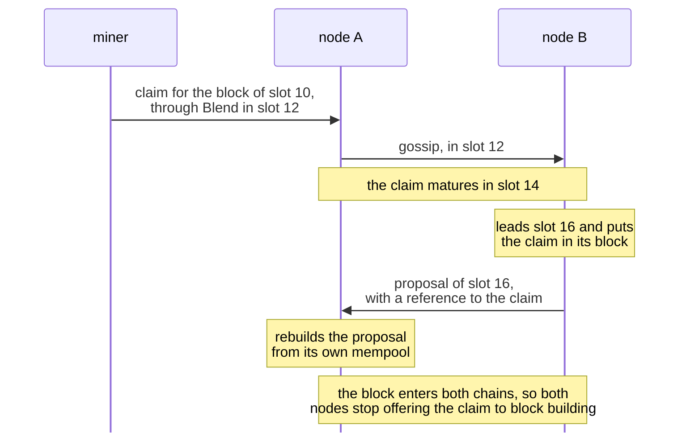
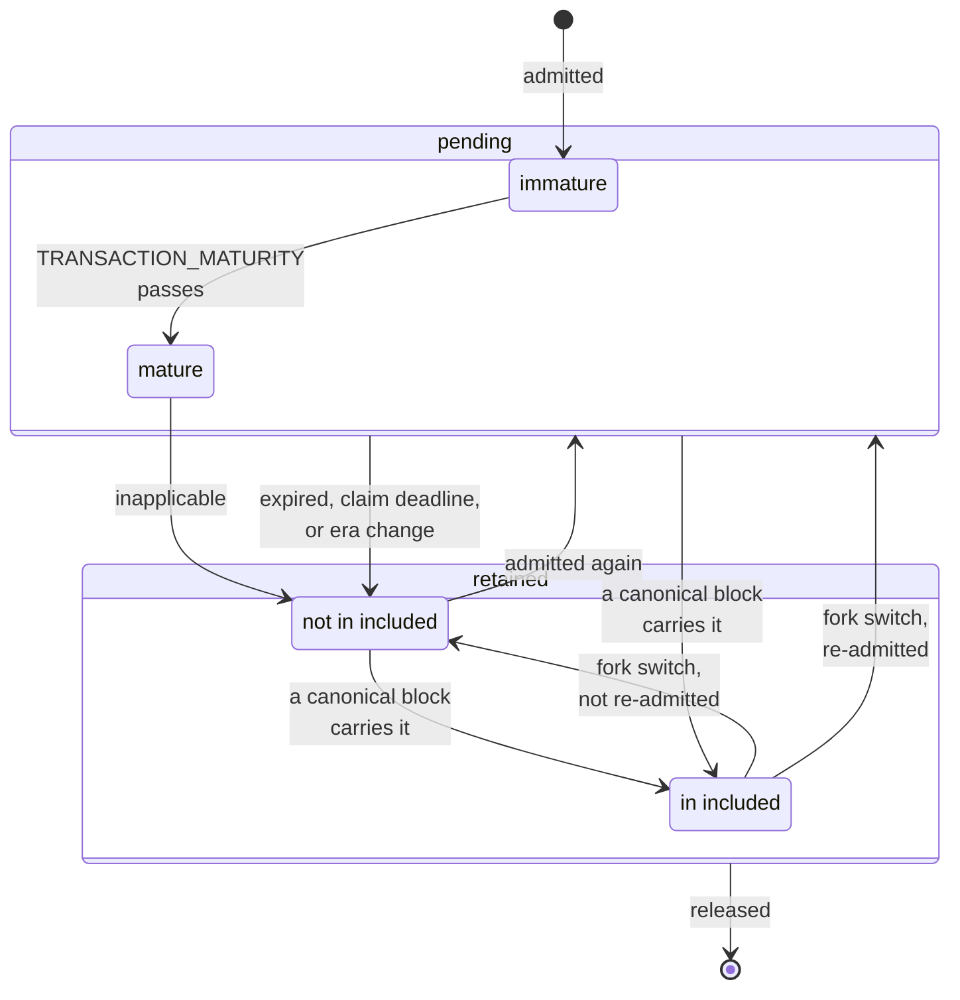
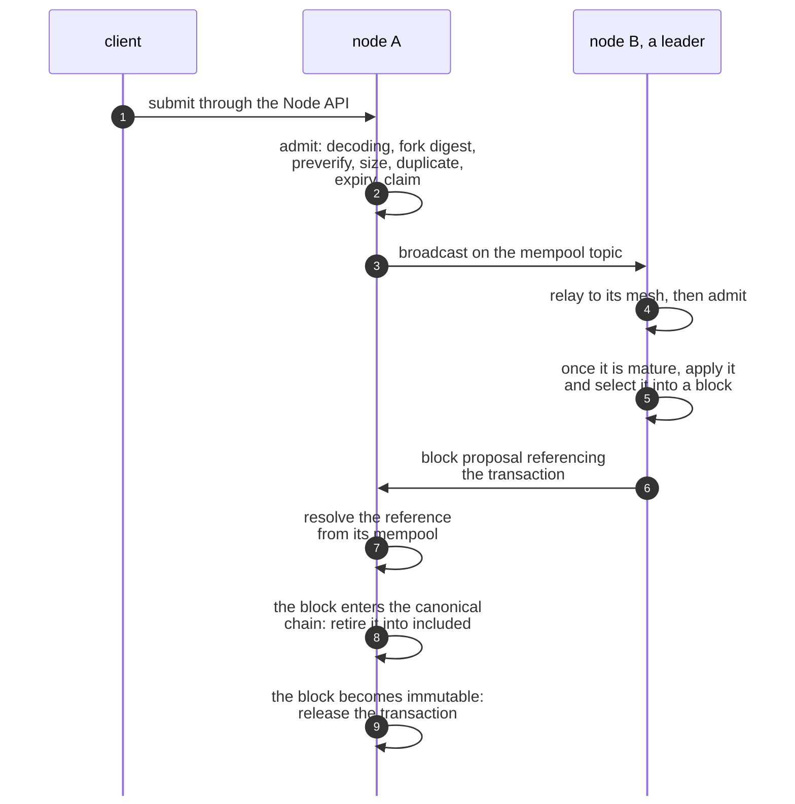

# MEMPOOL

| Field | Value |
| --- | --- |
| Name | Mempool |
| Slug | 251 |
| Status | raw |
| Category | Standards Track |
| Editor | Marcin Pawlowski <marcin@logos.co> |
| Contributors |  |

<!-- timeline:start -->

## Timeline

- **2026-09-04** — [`5de1e93`](https://github.com/logos-co/logos-lips/blob/5de1e9348b010157222d99fbac2649e5e68aa278/docs/blockchain/raw/mempool.md) — docs(blockchain): retire on joining the chain, not on becoming the tip
- **2026-09-02** — [`15e9269`](https://github.com/logos-co/logos-lips/blob/15e92695a7a5b3c23b0b1528a2dd33beb42eceb9/docs/blockchain/raw/mempool.md) — docs(blockchain): drop mempool state that nothing reads
- **2026-09-01** — [`6a9d9c9`](https://github.com/logos-co/logos-lips/blob/6a9d9c98df738c49489a1911abff1741fb5d1ae0/docs/blockchain/raw/mempool.md) — docs(blockchain): remove restated and non-normative text
- **2026-08-24** — [`8e11a5f`](https://github.com/logos-co/logos-lips/blob/8e11a5f027660e97c925c4d0fc6d645f1673d4bd/docs/blockchain/raw/mempool.md) — docs(blockchain): add the mempool specification

<!-- timeline:end -->

# Revision History

| **Version** | **Changes** | **Date** |
| --- | --- | --- |
| 1.0.0 | Initial revision. | 2026-11-09 |
| 1.1.0 | A transaction is decoded under the era its fork digest names, admitted only when the era in force accepts that digest, applied under the era of the block's slot, and retired when the era in force stops accepting its digest or a block of the block's era cannot carry it ([Bedrock Eras](bedrock-eras.md)). | 2026-11-10 |
| 1.2.0 | `TRANSACTION_TTL` is an era parameter in place of a node setting, and expiry cannot be disabled; `RETIREMENT_GRACE` is an era parameter too, and must outlast the propagation of a selected transaction. | 2026-11-10 |
| 1.3.0 | Transactions expire at a slot that their sender draws at random: a node refuses one whose expiry slot is too near or too far ahead, and retires and releases transactions by that slot. | 2026-11-24 |

# Introduction

A leader can include only transactions it holds, and a validator can rebuild a block proposal only from transactions it holds. A transaction submitted to one node is therefore of no use until the nodes that build and check blocks hold it too.

The mempool removes this obstacle. The mempool is a node's store of Mantle Transactions that have been submitted but are not yet final. Nodes pass these transactions to each other, offer them to block building, and resolve the references of block proposals against them.

This document specifies how a sender sets the slot at which its transaction expires, how a node admits and disseminates transactions, what it offers to block building, how it resolves references, when it stops offering a transaction to block building and when it discards it, what it persists, and what it exposes to local clients. [Mantle](bedrock-v1.1-mantle-specification.md) specifies when a transaction applies, [Block Construction, Validation and Execution](bedrock-v1.1-block-construction.md) specifies what a validator does with a resolved or unresolved reference, and [P2P Network](../draft/p2p-network.md) specifies the topic transactions travel on.

# Overview

Each node keeps its own mempool. Nodes admit and retire independently, so their pending sets differ.

Every transaction names its expiry slot, the last slot whose block may include it. Its sender draws the slot at random.

A transaction reaches a node from a local client, out of the Blend network, by gossip from another node, or back from a block that a fork switch removed from the chain. The node checks only that the transaction is well formed, that the era in force accepts its fork digest, that its expiry slot is neither too near nor too far ahead, and that a reward claim it carries has not expired. It does not consult the ledger, so its mempool can hold transactions that will never apply.

An expiry slot is too far if it comes more than an hour ahead, which is the time to live. It is too near if it has passed, if it comes less than a minute ahead when the sender submits the transaction, or less than twenty seconds ahead when the transaction leaves the Blend network.

Take a miner whose reward claim leaves the Blend network at node A in slot 12. The claim names the block of slot 10, its transaction expires at slot 40, and node B leads slot 16. In this example a transaction matures two slots after a node admits it.



The claim reaches node B before B leads, so node A can rebuild B's proposal from its own copy. A proposal names each transaction by a short reference. If a reference matches nothing in a node's mempool, or matches several transactions, the node cannot rebuild the proposal from its mempool.

A leader's block building receives the transactions that have been in its mempool long enough to have reached every node, oldest first, and keeps those that apply on its chain. A transaction that applies but does not fit in the block stays for the next leader.

A transaction leaves block building when a block on the node's chain carries it, when a leader's block building cannot apply it, when it expires, or, for a reward claim, a set time after no block may include it any more. The node keeps it for a while after that, and can still rebuild a proposal that references it.

The node drops the transaction once the block that carries it is deep enough in the chain to be final, once that set time has passed for a reward claim, or otherwise ten minutes after it expires.

A block may include the example's claim up to slot 20, and a node keeps the claim for twenty slots after that.

```mermaid
---
displayMode: compact
config:
  gantt:
    useWidth: 800
---
gantt
    title The claim of the example at node A
    dateFormat X
    axisFormat slot %s
    tickInterval 10second
    todayMarker off
    section Blocks
        up to the named block : done, b0, 0, 11s
        may include the claim : b1, after b0, 10s
    section Node A
        before the claim arrives : done, a0, 0, 12s
        pending : a1, after a0, 4s
        retained, carried by a block : a3, after a1, 25s
        dropped : milestone, a4, after a3, 0s
```



Node B's block of slot 16 carries the claim, so node A stops offering it to block building once that block enters its chain. With a window of ten slots and a grace of twenty, node A drops the claim once it holds a block of slot 41 or later, whether or not a block carried it.

A transaction that a fork switch puts back keeps the time it first arrived, and comes back only if it has not expired. A node keeps its mempool across a restart.

# Protocol

## Transaction Lifetime

A sender must be able to bound the time during which a block may include its transaction, without showing when it made the transaction. Every transaction therefore names its **expiry slot**, the last slot whose block may include it ([Validation](bedrock-v1.1-mantle-specification.md#validation)). Its sender draws that slot at random.

The sender chooses the longest time for which it lets a block include the transaction, at most `TRANSACTION_TTL`, the time to live. It draws the expiry slot from the second half of that time. The expiry slot is **in range** at a node while it is not before the current slot and comes at most `TRANSACTION_TTL` ahead. It must also come at least `MIN_LIFETIME` ahead when the sender submits the transaction, and at least `TRANSACTION_MATURITY` ahead when the transaction leaves the Blend network. `TRANSACTION_MATURITY` is the transaction maturity that [Block Proposal Reconstruction](bedrock-v1.1-block-construction.md#block-proposal-reconstruction) assumes. [Expiry Slot](#expiry-slot) specifies the draw and the range.

## Admission Pipeline

A node accepts transactions from local clients and from any peer, so it must turn malformed ones away before it stores them. It does so without reading ledger state.

A transaction arrives by local submission, from a client, the node itself or the [Blend Protocol](blend-protocol.md), by gossip, or by re-insertion after a fork switch. It becomes **pending** if it passes these checks, in this order, and stays pending until the node **retires** it:

- its encoding is no larger than `MAX_BLOCK_SIZE`;
- it decodes, and decoding consumes the whole payload;
- the era in force accepts its fork digest ([Era of Chain Data](bedrock-eras.md#era-of-chain-data));
- it passes `preverify`, a set of rules of Mantle's [Validation](bedrock-v1.1-mantle-specification.md#validation) that read no ledger state;
- it is not already pending, and the node does not hold it for a block of its canonical chain after the [Latest Immutable Block](cryptarchia-v1-protocol.md#latest-immutable-block);
- its expiry slot is in range;
- it carries no [Proof of Work](proof-of-work.md) reward **claim** whose **deadline** has passed.

A local submission is decoded and passes `preverify` before its size is checked.

`highest_slot` is the highest slot of a block that [Chain Maintenance](cryptarchia-v1-protocol.md#chain-maintenance) has added to the block tree since the node started. A claim's deadline passes when `highest_slot` is more than `CLAIM_GRACE` slots past the end of its [Acceptance Window](proof-of-work.md#acceptance-window). No deadline passes before the node adds a block, and a claim that names a block the node does not hold has no deadline. A transaction that fails the fifth check is a duplicate. It is broadcast again if it came by local submission, and dropped otherwise, and a local client is answered as success. [Transaction Admission](#transaction-admission) specifies the procedure.

## Gossip

A transaction must reach every node, whichever node it was submitted to. Nodes pass transactions on by gossip.

A node neither relays nor remembers a message whose transaction expires more than `TRANSACTION_TTL` ahead. [Dissemination](#dissemination) specifies the topic, the message identity, and when a node relays and broadcasts.

## Block Building Input

A leader must fill its block with transactions that apply on its chain and that every validator holds. The mempool offers it only mature transactions, and block building finds the ones that apply.

A pending transaction is **mature** once its age reaches `TRANSACTION_MATURITY`. The leader passes over the mature transactions in admission order and applies each one that succeeds, repeating until a pass applies nothing new. It stops early at the first transaction that would take the block's Execution Gas past `G_max`. A mature transaction is **inapplicable** if its encoding is larger than `MAX_BLOCK_SIZE`, if its own Execution Gas exceeds `G_max`, or if no pass applies it and the leader did not stop early. The leader then fills the block in the order it applied the transactions, up to `MAX_BLOCK_TXS` and `MAX_BLOCK_SIZE`. A transaction that applies but does not fit stays pending. [Block Building View](#block-building-view) specifies both steps.

## Proposal References

A block proposal carries a short reference to each of its transactions instead of the transaction itself. Every validator rebuilds the proposal from its own mempool.

A **reference** is a prefix of the transaction's hash. It resolves only when exactly one transaction the mempool holds carries that prefix. [Block Construction, Validation and Execution](bedrock-v1.1-block-construction.md) specifies what an unresolved reference means for the proposal, and [Reference Resolution](#reference-resolution) specifies the procedure.

## Retirement Reasons

The pending set must hold only transactions that block building may still select. A node retires a transaction for one of five reasons:

- a block that carries it enters the node's canonical chain;
- a leader's block building finds it inapplicable;
- its expiry slot is before the current slot;
- it carries a claim whose deadline has passed;
- the era in force changes to one that does not accept its fork digest.

[Retirement](#retirement) specifies the rules.

## Retained Transactions

A competing chain may carry a transaction that this node's chain already includes, and a late proposal may select one that this node has retired. The node keeps a retired transaction until no fork that the [Online Fork Choice Rule](fork-choice.md#online-fork-choice-rule) accepts can reference it.

A transaction that the node holds but that is not pending is **retained** until the node **releases** it. A retained transaction still resolves references, and keeps its admission time if it is admitted again. When a block enters its canonical chain, the node keeps in `included` each transaction of that block that it holds. It releases a retained transaction:

- when the block that carries it becomes immutable, if it is in `included`;
- `RETIREMENT_GRACE` after its expiry slot, if it is not in `included`;
- when it carries a claim whose deadline has passed.

When a fork switch displaces blocks from the canonical chain, their transactions that the new canonical chain does not carry leave `included`. The node re-admits each whose expiry slot is in range, except one that it never held and whose expiry slot was too far ahead at the start of the displaced block's slot. [Release](#release) and [Reorganisation](#reorganisation) specify the rules.



A transaction moves between the pending set and the retained set until the node releases it.

## A Transaction Step by Step

A transaction passes through these steps from submission to release. The numbers in the diagram match the list below.



1. A client submits the transaction to node A through the [Node API](#node-api).
2. Node A admits it ([Transaction Admission](#transaction-admission)).
3. Node A broadcasts it, since it arrived by local submission ([Dissemination](#dissemination)).
4. Node B relays it to its mesh neighbours, then admits it ([Dissemination](#dissemination)).
5. Node B leads a slot after the transaction is mature. Node B applies the mature transactions and selects this one into its block ([Block Building View](#block-building-view)).
6. Node B's proposal references the transaction by a prefix of its hash ([References](bedrock-v1.1-block-construction.md#references)).
7. Node A resolves the reference from its mempool ([Reference Resolution](#reference-resolution)).
8. The block enters node A's canonical chain, and node A retires the transaction into `included` ([Inclusion in a Canonical Block](#inclusion-in-a-canonical-block)). Node B does the same.
9. The block becomes immutable in node A's canonical chain, and node A applies [Release](#release) to the transaction. Node B does the same.

## Node State

A node keeps these values for its mempool, defined in [Mempool State](#mempool-state):

- `pending`, the pending hashes in admission order, which changes on [Transaction Admission](#transaction-admission) and on [Retirement](#retirement);
- `included`, the retained hashes held for a canonical block, which changes on [Inclusion in a Canonical Block](#inclusion-in-a-canonical-block), on [Reorganisation](#reorganisation) and on [Release](#release);
- `bodies`, the body of each pending or retained transaction, which changes on [Transaction Admission](#transaction-admission) and on [Release](#release);
- `admitted_at`, the time from which each transaction's age is measured, which changes on [Transaction Admission](#transaction-admission) and on [Release](#release);
- `by_prefix`, the pending and retained hashes keyed by their reference prefix, which changes on [Transaction Admission](#transaction-admission) and on [Release](#release);
- `highest_slot`, the highest slot of a block added since the node started, which rises when Chain Maintenance adds a block of a higher slot.

[Persistence and Recovery](#persistence-and-recovery) specifies what the node persists and rebuilds. Local clients read the pending set through the [Node API](#node-api).

# Details

## Notation

| Symbol | Name | Description |
| --- | --- | --- |
| `WINDOW` | acceptance window | The window of [Acceptance Window](proof-of-work.md#acceptance-window), in slots. |
| `MAX_BLOCK_SIZE` | maximum block size | From [Constants](cryptarchia-v1-protocol.md#constants). |
| `MAX_BLOCK_TXS` | maximum block transactions | From [Constants](cryptarchia-v1-protocol.md#constants). |
| `G_max` | maximum Execution Gas per block | The limit on a block's total Execution Gas, $`G_{\max}`$ in the [Notation](execution-market.md#notation) of Execution Market. |
| `REFERENCE_PREFIX_LENGTH` | reference prefix length | The length of a reference in bytes, from [References](bedrock-v1.1-block-construction.md#references). |
| $`T_M`$ | message traversal time | The message traversal time of [Transition Period](blend-protocol.md#transition-period), converted from rounds to seconds by the length of a round given in [Time](blend-protocol.md#time). |

## Parameters

```python
TRANSACTION_TTL: uint64 = 60 * 60                     # longest time, in seconds, that a transaction may have left until its expiry slot
RETIREMENT_GRACE: uint64 = 10 * 60                    # seconds a transaction that no canonical block carries stays resolvable after its expiry slot
BROADCAST_DELAY: uint64 = 5                           # seconds a block proposal takes to reach every node once it leaves the Blend network
TRANSACTION_MATURITY: uint64 = T_M + BROADCAST_DELAY  # seconds of age at which a transaction is mature
MIN_LIFETIME: uint64 = 3 * TRANSACTION_MATURITY       # shortest time, in seconds, that a transaction may have left until its expiry slot when its sender submits it
CLAIM_GRACE: uint64 = 2 * WINDOW                      # slots a node keeps a claim after its acceptance window closes
SEEN_TTL: uint64 = 24 * 60 * 60                       # seconds a node remembers a message identity on the mempool topic
BROADCAST_RETRIES: uint64 = 3                         # retries of a broadcast that finds no peer on the mempool topic
BROADCAST_BACKOFF: uint64 = 5                         # base, in seconds, of the wait before each retry
```

`TRANSACTION_TTL` and `RETIREMENT_GRACE` are era parameters, the `transaction_ttl_in_seconds` and `retirement_grace_in_seconds` of the parameter record ([Era Parameters](bedrock-eras.md#era-parameters)). The `TRANSACTION_TTL` of a transaction is that of the era of its expiry slot, and `RETIREMENT_GRACE` is that of the era in force.

`SEEN_TTL` is a node setting, and the value above is its default.

The wait before retry `i`, counting from `0`, is `BROADCAST_BACKOFF ** i` seconds. With `BROADCAST_BACKOFF` at 5, the retries follow the first attempt by 1, 6 and 31 seconds.

With `WINDOW` at 300 slots, `CLAIM_GRACE` is 600 slots. With $`T_M`$ at 15 rounds of one second and `BROADCAST_DELAY` at 5 seconds, `TRANSACTION_MATURITY` is 20 seconds and `MIN_LIFETIME` is 60 seconds.

`RETIREMENT_GRACE` must exceed one round plus `TRANSACTION_MATURITY`. Otherwise a node can release a transaction before a proposal that selected it in its expiry slot arrives.

`BROADCAST_DELAY` must not be less than the time a block proposal takes to reach every node by gossip. Otherwise a mature transaction has had less time to spread than the proposal carrying it takes to arrive.

`MIN_LIFETIME` must exceed one round, plus $`T_M`$, plus the time a transaction takes to reach every node by gossip, plus `TRANSACTION_MATURITY`. Otherwise a transaction that its sender broadcasts directly ([Direct Broadcast](blend-protocol.md#direct-broadcast)) can expire before any leader may select it.

`TRANSACTION_TTL` must be at least `2 * MIN_LIFETIME`. Otherwise a sender can choose no `max_lifetime` ([Expiry Slot](#expiry-slot)).

`TRANSACTION_MATURITY` must be shorter than `WINDOW` slots. Otherwise a claim never matures while a block may still include it, and no claim is ever selected.

`CLAIM_GRACE` slots must last longer than `TRANSACTION_MATURITY`. Otherwise a node can release a claim before a proposal that selected it in the last slot of its acceptance window arrives.

## Mempool State

```python
@dataclass
class Mempool:
    pending: TimeOrderedSet[TxHash]     # admitted, not yet retired, in admission order
    included: Set[TxHash]               # retained, carried by a canonical block after the latest immutable block
    bodies: Map[TxHash, SignedMantleTx] # transaction bodies
    admitted_at: Map[TxHash, Timestamp] # admission time
    by_prefix: Map[bytes, Set[TxHash]]  # pending and retained hashes, keyed by reference prefix
    highest_slot: Optional[SlotNumber]  # highest slot of a block added since the node started
```

A transaction `tx` is keyed by `mantle_txhash(tx)`, the [Mantle Transaction Hash](bedrock-v1.1-mantle-specification.md#mantle-transaction-hash) of `tx.tx`.

A transaction is retained while it is in `bodies` and not in `pending`. `bodies` and `by_prefix` hold the retained transactions as well as the pending ones.

A `TimeOrderedSet` iterates in admission order, by ascending `admitted_at`, and `insert_by` places a hash at the position its admission time gives it. A `Timestamp` is a time in seconds since the Unix epoch, as an unsigned 64-bit integer, and `now()` is the node's current time as a `Timestamp`. A transaction's age is `now()` minus its `admitted_at` entry.

`by_prefix` maps `prefix(hash, REFERENCE_PREFIX_LENGTH)` to the pending and retained hashes carrying that prefix, where `prefix` is defined in [References](bedrock-v1.1-block-construction.md#references). A prefix that no such hash carries maps to an empty set.

`highest_slot` is the highest slot of any block that [Chain Maintenance](cryptarchia-v1-protocol.md#chain-maintenance) has added to the node's block tree since the node started, or `None` before the first.

## Expiry Slot

```python
def draw_expiry_slot(submission: Timestamp, max_lifetime: uint64 = TRANSACTION_TTL) -> SlotNumber:
    return uniform(slot_of_time(submission + max_lifetime // 2), slot_of_time(submission + max_lifetime))

def too_far(expiry_slot: SlotNumber, at: Timestamp) -> bool:
    return expiry_slot > slot_of_time(at + ttl(expiry_slot))

def expiry_in_range(expiry_slot: SlotNumber, least: uint64) -> bool:
    return slot_of_time(now() + least) <= expiry_slot and not too_far(expiry_slot, now())
```

A sender should set the `expiry_slot` of its transaction to `draw_expiry_slot(submission, max_lifetime)`. `submission` is the time at which the sender expects to generate the data message that carries the transaction, or to submit the transaction to a node. `max_lifetime` is the longest time, in seconds after `submission`, for which the sender lets a block include the transaction. It is at least `2 * MIN_LIFETIME` and at most `TRANSACTION_TTL`. `uniform(a, b)` is a slot drawn uniformly at random from `a` to `b`, both included. `slot_of_time` is that of [Era Boundaries](bedrock-eras.md#era-boundaries), and `ttl(sl)` is the `TRANSACTION_TTL` of the era of slot `sl`.

No block can include a transaction once the slot of the [Latest Immutable Block](cryptarchia-v1-protocol.md#latest-immutable-block) is after its expiry slot. Until then, a sender that replaces the transaction must spend one of the transaction's notes in the replacement.

`least` is the shortest time, in seconds, that a transaction must have left until its expiry slot. It depends on the transaction's origin:

| Origin | `least` |
| --- | --- |
| The [Node API](#node-api), or the node's own services | `MIN_LIFETIME` |
| A data message ([Message Lifecycle](blend-protocol.md#message-lifecycle)), or a direct broadcast in its place ([Direct Broadcast](blend-protocol.md#direct-broadcast)) | `TRANSACTION_MATURITY` |
| Gossip or re-insertion | `0` |

An expiry slot is in range for submission while `expiry_in_range(expiry_slot, MIN_LIFETIME)` holds, and too near for submission once it is before `slot_of_time(now() + MIN_LIFETIME)`.

## Transaction Admission

A transaction reaches the mempool by local submission, by gossip on the mempool topic, or by re-insertion after a [Reorganisation](#reorganisation). A local submission is a transaction submitted through the [Node API](#node-api), one that the node's own services create, such as the SDP activity it posts, one extracted from a data message as [Message Lifecycle](blend-protocol.md#message-lifecycle) in Blend Protocol specifies, or one broadcast directly in place of a data message ([Direct Broadcast](blend-protocol.md#direct-broadcast)). All three follow this procedure.

```python
def admit(mempool, encoded: bytes, least: uint64) -> Result:
    if len(encoded) > MAX_BLOCK_SIZE:
        return Reject(TransactionTooLarge)

    tx = decode_signed_mantle_tx(encoded)
    if tx is None:
        return Reject(Malformed)

    if not accepts_fork_digest(era_in_force(), tx.tx.fork_digest):
        return Reject(UnacceptedForkDigest)

    if not preverify(tx):
        return Reject(FailedStatelessValidation)

    key = mantle_txhash(tx)
    if key in mempool.pending or key in mempool.included:
        return Duplicate(key)

    if not expiry_in_range(tx.tx.expiry_slot, least):
        return Reject(ExpiryOutOfRange)

    if claim_expired(mempool, tx):
        return Reject(ExpiredClaim)

    mempool.bodies[key] = tx
    mempool.admitted_at[key] = mempool.admitted_at.get(key, now())
    mempool.pending.insert_by(key, mempool.admitted_at[key])
    mempool.by_prefix[prefix(key, REFERENCE_PREFIX_LENGTH)].add(key)
    return Accept(key)
```

Admission reads the transaction, the mempool, the node's block tree and clock, and the era in force, and no other state. A node must not treat membership of the mempool as evidence that a transaction can be applied.

`decode_signed_mantle_tx` returns the transaction that [Decoding](#decoding) describes, or `None` if `encoded` does not decode. `claim_expired` is defined in [Expired Claim](#expired-claim). `accepts_fork_digest` is that of [Era of Chain Data](bedrock-eras.md#era-of-chain-data), and `era_in_force` that of [Era Boundaries](bedrock-eras.md#era-boundaries). `admit` returns `Accept(key)` when it admits the transaction, `Duplicate(key)` when the transaction is already pending or in `included`, and `Reject` with the reason otherwise. `least` is that of the transaction's origin ([Expiry Slot](#expiry-slot)).

For a local submission, a node decodes the transaction and runs `preverify` first, and then checks the size of its canonical encoding.

### Decoding

The payload is the canonical encoding defined in [Mantle Transaction Encoding](mantle-transaction-encoding.md), carried in the envelope defined in [Network Wire Format](network-wire-format.md): the length of the encoding as an unsigned 64-bit little-endian integer, followed by the encoding. The proof of a `CLAIM_POW_REWARD` is empty, in place of the `ZkSigProof` that Mantle Transaction Encoding gives it. The encoding is that of the era whose fork digest the transaction carries ([Era of Chain Data](bedrock-eras.md#era-of-chain-data)), and a fork digest of no era of the node's schedule does not decode. Decoding must consume the payload exactly. A transaction submitted through the [Node API](#node-api) arrives in JSON instead.

### Stateless Validation

`preverify` applies these rules of Mantle's [Validation](bedrock-v1.1-mantle-specification.md#validation), under the era in force, none of which reads ledger state:

1. Rule 1 of [Validation](bedrock-v1.1-mantle-specification.md#validation) holds, with an empty proof for a `CLAIM_POW_REWARD`.
2. Each proof bound only to the transaction hash and the operation payload verifies.
3. A `TRANSFER`, `CHANNEL_DEPOSIT`, `CHANNEL_WITHDRAW` or `CHANNEL_TRANSFER` has at least one input.
4. No output of a `TRANSFER` or `CHANNEL_TRANSFER` has a value of `0`.
5. A `CHANNEL_CONFIG` has a `configuration_threshold` and a `transfer_threshold` greater than `0`, and at least one key.

### Reorganisation

```python
def reorganise(mempool, displaced: list[Block], adopted: list[Block]) -> None:
    carried = {mantle_txhash(tx) for block in adopted for tx in block.transactions}
    for block in displaced:
        for tx in block.transactions:
            key = mantle_txhash(tx)
            if key in carried:
                continue
            mempool.included.discard(key)
            # Without this, leaving a long fork would re-admit what old blocks carried.
            if key not in mempool.bodies and too_far(tx.tx.expiry_slot, slot_start(block.header.slot)):
                continue
            admit(mempool, encode_signed_mantle_tx(tx), least=0)
```

A node runs `reorganise` when a fork switch displaces blocks from the canonical chain. `displaced` holds the blocks that leave the canonical chain, newest first, and `adopted` holds the blocks that enter it. `Block` is defined in [Block](bedrock-v1.1-block-construction.md#block). `encode_signed_mantle_tx` produces the payload that [Decoding](#decoding) consumes. `slot_start(sl)` is the time at which slot `sl` starts: `start_time_of_era(n) + (sl - first_slot_of_era(n)) * slot_length(n)`, with `n` the era `era_of_slot(sl)` of [Era Boundaries](bedrock-eras.md#era-boundaries).

### Duplicates

When `admit` returns `Duplicate`:

- A duplicate received by gossip or by re-insertion is dropped.
- A duplicate received by local submission is answered as success, and the transaction is broadcast again.

## Dissemination

Transactions are gossiped on the mempool topic defined in [Gossiping](../draft/p2p-network.md#gossiping), which carries the fork digest of an era. [Network Protocol Identity](bedrock-eras.md#network-protocol-identity) specifies which era's topic a node broadcasts on.

A message's identity on that topic is the Blake2b-256 digest of its payload. A node remembers the identity of each message it receives or publishes on that topic for `SEEN_TTL`.

A node drops a received message if `too_far` holds for its transaction's expiry slot one round from now. It neither relays the message nor remembers its identity. A node holds back a received message if `too_far` holds now but not one round from now, and handles it as received once `too_far` no longer holds. One round is more than the largest clock difference between honest nodes, $`T_C`$ of [Transition Period](blend-protocol.md#transition-period).

A node drops a received message whose identity it remembers. It relays any other received message to its mesh neighbours on receipt, before admission.

A node broadcasts a transaction it admits by local submission. It does not broadcast a transaction it received by gossip or by re-insertion. A broadcast of a message whose identity the node remembers sends nothing.

A broadcast that finds no connected peer subscribed to the topic sends nothing and leaves the identity unremembered. The node retries it up to `BROADCAST_RETRIES` times.

## Block Building View

A pending transaction is mature once its age reaches `TRANSACTION_MATURITY`.

The mempool supplies the bodies of every mature transaction in admission order.

```python
def applicability(mempool, parent_state, header) -> tuple[list[SignedMantleTx], list[TxHash]]:
    state = apply_header(parent_state, header)       # the working state
    applied = []
    remaining = [key for key in mempool.pending       # the mature ones, in admission order
                 if now() - mempool.admitted_at[key] >= TRANSACTION_MATURITY]
    over_limit, gas = [], 0                          # gas: the Execution Gas applied so far
    progress = True
    while progress:
        # A transaction may spend what one admitted after it creates,
        # so passes repeat until a pass applies nothing.
        progress = False
        for key in list(remaining):
            tx = mempool.bodies[key]
            # A transaction admitted under an era with a larger MAX_BLOCK_SIZE
            # may fit no block of the block's era.
            if encoded_size([tx]) > MAX_BLOCK_SIZE:
                over_limit.append(key)
                remaining.remove(key)
                continue
            after = apply_transaction(state, tx)
            # The proofs are checked before the gas, so that a transaction
            # whose proof fails cannot end the determination at G_max.
            if after is None or not batched_proofs_verify(state, tx):
                continue
            tx_gas = execution_gas(state, tx)
            if tx_gas > G_max:
                over_limit.append(key)
                remaining.remove(key)
            elif gas + tx_gas > G_max:
                # The transactions not yet applied may fit another block,
                # so none of them is inapplicable.
                return applied, over_limit
            else:
                state, gas = after, gas + tx_gas
                applied.append(tx)
                remaining.remove(key)
                progress = True
    return applied, over_limit + remaining

def selection(applied: list[SignedMantleTx]) -> list[SignedMantleTx]:
    block = []
    for tx in applied:
        # Stopping, rather than skipping, keeps every transaction a later one depends on.
        if len(block) == MAX_BLOCK_TXS or encoded_size(block + [tx]) > MAX_BLOCK_SIZE:
            break
        block.append(tx)
    return block
```

`applicability` is the leader's **applicability determination**. Its second result holds the inapplicable transactions.

`parent_state` is the ledger state after the parent of the block being built, migrated to the era of the block's slot ([Era Migration](bedrock-eras.md#era-migration)), and the functions below apply the rules of that era. `apply_header(parent_state, header)` returns the state against which [Block Execution](bedrock-v1.1-block-construction.md#block-execution) executes the first transaction of a block with that header. `apply_transaction(state, tx)` returns the state after executing `tx` against `state` as [Mantle](bedrock-v1.1-mantle-specification.md) specifies, or `None` if `tx` is not valid against `state` in a block with that header. It skips step 6 of the [CLAIM_POW_REWARD](bedrock-v1.1-mantle-specification.md#claim_pow_reward) validation, the signature check, since a claim's proof is empty. It does not verify the ZK proofs that [Batch verification of ZK proofs](bedrock-v1.1-block-construction.md#batch-verification-of-zk-proofs) verifies together, and `batched_proofs_verify(state, tx)` holds when those of `tx` verify. `execution_gas(state, tx)` is the Execution Gas of `tx` against `state`, as [Gas Determination](bedrock-v1.1-mantle-specification.md#gas-determination) derives it. `encoded_size(txs)` is the total length of the canonical encodings of the transactions in `txs`, which rule 1 of [Block Header Validation](cryptarchia-v1-protocol.md#block-header-validation) bounds by `MAX_BLOCK_SIZE`.

## Reference Resolution

A block proposal carries a `REFERENCE_PREFIX_LENGTH`-byte prefix of each transaction hash, as defined in [References](bedrock-v1.1-block-construction.md#references). A validator resolves each reference against the mempool.

```python
def resolve(mempool, reference) -> Optional[SignedMantleTx]:
    matches = mempool.by_prefix.get(reference, set())
    if len(matches) != 1:
        return None
    (key,) = matches
    return mempool.bodies[key]
```

A node must not choose among several matches.

Resolution reads the proposal, `by_prefix` and `bodies`, and nothing else.

How a validator uses the result, and what a failure to resolve establishes about the block, are specified in [Block Proposal Reconstruction](bedrock-v1.1-block-construction.md#block-proposal-reconstruction) and [Block Proposal Validation](bedrock-v1.1-block-construction.md#block-proposal-validation).

## Retirement

A transaction leaves `pending` for one of five reasons.

### Inclusion in a Canonical Block

```python
def include(mempool, block: Block) -> None:
    for tx in block.transactions:
        key = mantle_txhash(tx)
        if key in mempool.pending:
            mempool.pending.remove(key)
        elif key not in mempool.bodies:
            continue
        mempool.included.add(key)
```

A node runs `include` on each block that enters its canonical chain.

### Inapplicability

A transaction that the applicability determination of [Block Building View](#block-building-view) finds inapplicable is retired.

### Expiry

A pending transaction whose `expiry_slot` is before the current slot, `slot_of_time(now())`, is retired.

### Expired Claim

A claim is the payload of a `CLAIM_POW_REWARD` Operation, defined in [CLAIM_POW_REWARD](bedrock-v1.1-mantle-specification.md#claim_pow_reward).

```python
def claim_expired(mempool, tx) -> bool:
    slots = [block_slot(claim.block_hash) for claim in claims(tx)]
    known = [slot for slot in slots if slot is not None]
    if not known or mempool.highest_slot is None:
        return False
    # One claim the ledger rejects invalidates the whole transaction, so the
    # earliest deadline decides. A block at slot s + window(s) is the last
    # that can include a claim referencing a block at slot s.
    return mempool.highest_slot >= min(s + window(s) for s in known) + 1 + CLAIM_GRACE
```

A pending transaction for which `claim_expired` holds is retired, unless it has been pending since the node recovered it from persisted state.

`claims(tx)` is the list of claims in `tx`. `block_slot(h)` is the slot of the block with hash `h` in the node's block tree, or `None` if the block tree holds no such block. `window(s)` is the `WINDOW` of the era of slot `s` ([Acceptance Window](proof-of-work.md#acceptance-window)).

### Era Change

A pending transaction whose fork digest the era in force does not accept, by `accepts_fork_digest` of [Era of Chain Data](bedrock-eras.md#era-of-chain-data), is retired.

### Effects of Retirement

A node retires a transaction by removing it from `pending`. It retires the transactions that [Expiry](#expiry) and [Expired Claim](#expired-claim) select when it processes a block, and after it retires transactions for [Inclusion in a Canonical Block](#inclusion-in-a-canonical-block) or [Inapplicability](#inapplicability). It retires those that [Era Change](#era-change) selects when the era in force changes and when it recovers its mempool.

## Release

```python
def release(mempool, key: TxHash) -> None:
    mempool.included.discard(key)
    mempool.by_prefix[prefix(key, REFERENCE_PREFIX_LENGTH)].discard(key)
    mempool.admitted_at.pop(key, None)
    del mempool.bodies[key]

def release_block(mempool, block: Block) -> None:
    for tx in block.transactions:
        if mantle_txhash(tx) in mempool.included:
            release(mempool, mantle_txhash(tx))

def release_due(mempool) -> None:
    for key in list(mempool.bodies):
        if key in mempool.pending:
            continue
        tx = mempool.bodies[key]
        if claim_expired(mempool, tx) or (
                key not in mempool.included
                and now() >= slot_start(tx.tx.expiry_slot) + RETIREMENT_GRACE):
            release(mempool, key)
```

A node runs `release_block` on each block of its canonical chain once the block is at or before its [Latest Immutable Block](cryptarchia-v1-protocol.md#latest-immutable-block), after it has run `include` on that block. It runs `release_due` before it admits a transaction, and after it retires transactions for [Inapplicability](#inapplicability), [Expiry](#expiry) or [Expired Claim](#expired-claim). `slot_start` is defined in [Reorganisation](#reorganisation).

## Persistence and Recovery

A node persists `pending`, `included`, `bodies` and `admitted_at`.

A node does not persist `by_prefix` or `highest_slot`. It rebuilds `by_prefix` on recovery, and `highest_slot` starts at `None`:

```python
def recover(saved) -> Mempool:
    by_prefix = defaultdict(set)
    for key in saved.bodies:
        by_prefix[prefix(key, REFERENCE_PREFIX_LENGTH)].add(key)
    return Mempool(pending=saved.pending, included=saved.included, bodies=saved.bodies,
                   admitted_at=saved.admitted_at, by_prefix=by_prefix,
                   highest_slot=None)
```

`saved` holds what the node persisted.

## Node API

A node exposes the mempool to local clients through endpoints that carry no consensus meaning.

| Operation | Description |
| --- | --- |
| Submit transaction | Admit a transaction by local submission. Returns success when [Transaction Admission](#transaction-admission) admits the transaction or finds it a duplicate, and an error otherwise. |
| View | The hashes of the pending transactions, in admission order. |
| Status | For each queried hash, whether the transaction is pending or retained. Any other hash is reported as unknown. |
| Metrics | The number of pending transactions, and the time of the most recent admission, which survives a restart, in milliseconds since the Unix epoch, or `0` before the first. |
| Transaction | The body of a pending or retained transaction that the node holds, by its hash. |
