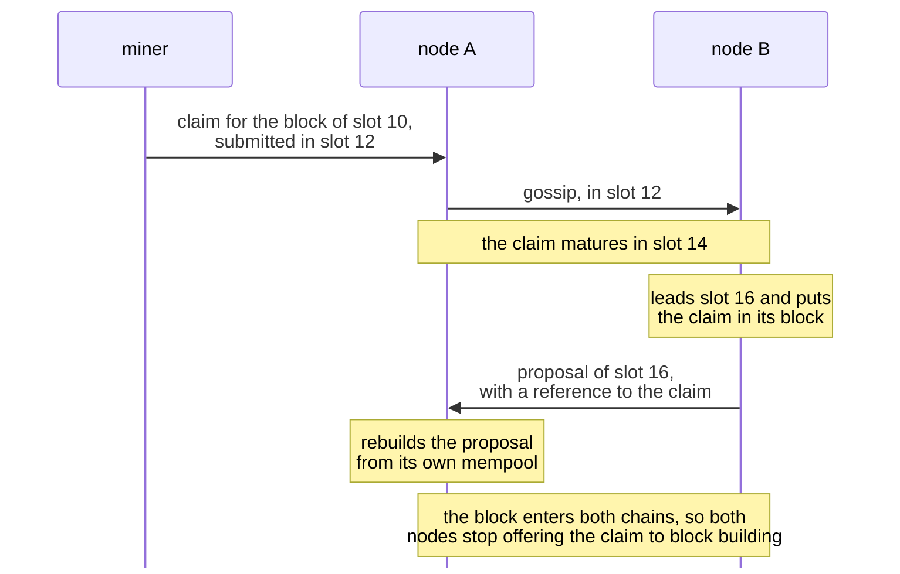
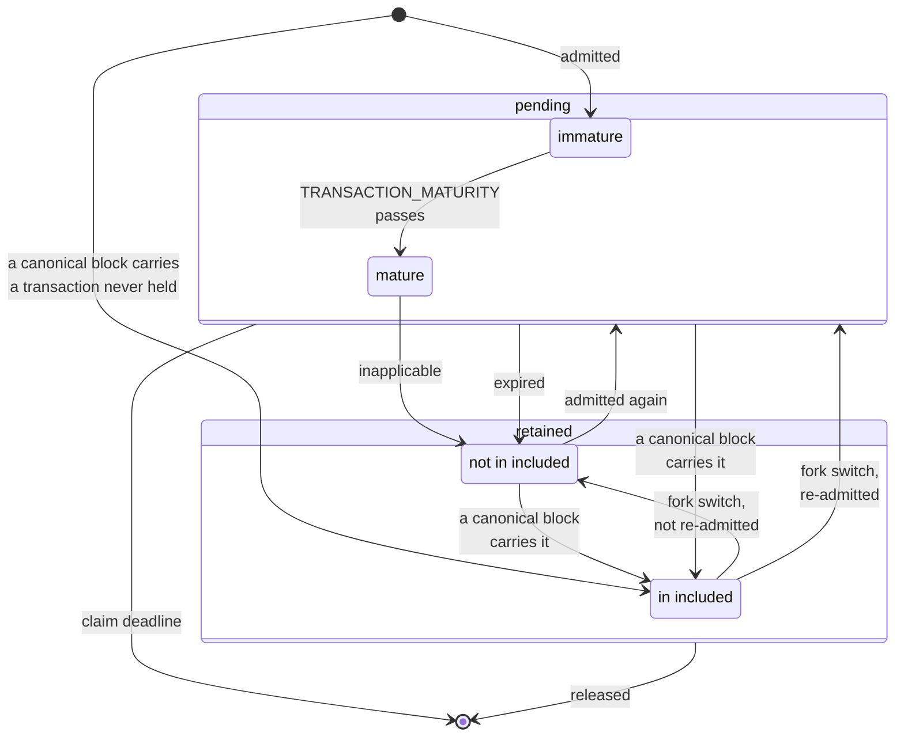
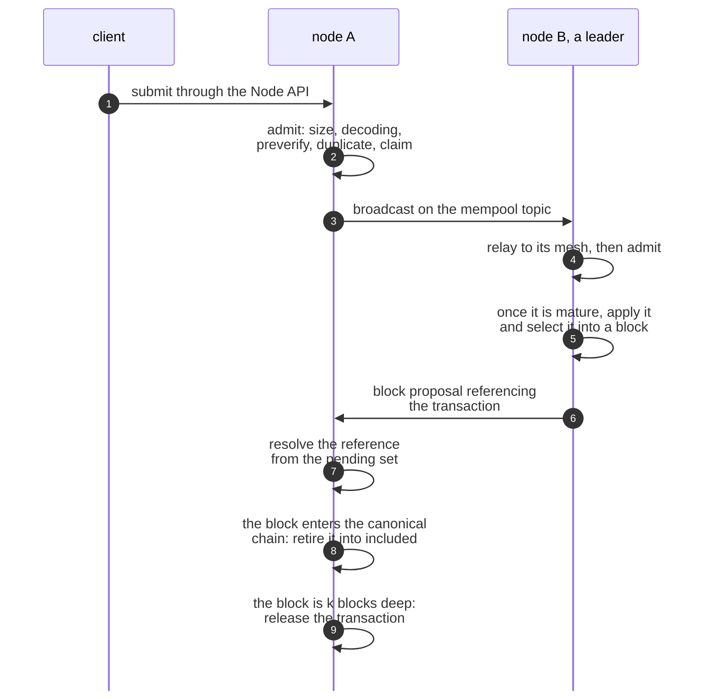

# MEMPOOL

| Field | Value |
| --- | --- |
| Name | Mempool |
| Slug | 251 |
| Status | raw |
| Category | Standards Track |
| Editor | Marcin Pawlowski <marcin@logos.co> |
| Contributors |  |

<!-- timeline:start -->

## Timeline

- **2026-09-04** — [`5de1e93`](https://github.com/logos-co/logos-lips/blob/5de1e9348b010157222d99fbac2649e5e68aa278/docs/blockchain/raw/mempool.md) — docs(blockchain): retire on joining the chain, not on becoming the tip
- **2026-09-02** — [`15e9269`](https://github.com/logos-co/logos-lips/blob/15e92695a7a5b3c23b0b1528a2dd33beb42eceb9/docs/blockchain/raw/mempool.md) — docs(blockchain): drop mempool state that nothing reads
- **2026-09-01** — [`6a9d9c9`](https://github.com/logos-co/logos-lips/blob/6a9d9c98df738c49489a1911abff1741fb5d1ae0/docs/blockchain/raw/mempool.md) — docs(blockchain): remove restated and non-normative text
- **2026-08-24** — [`8e11a5f`](https://github.com/logos-co/logos-lips/blob/8e11a5f027660e97c925c4d0fc6d645f1673d4bd/docs/blockchain/raw/mempool.md) — docs(blockchain): add the mempool specification

<!-- timeline:end -->

# Revision History

| **Version** | **Changes** | **Date** |
| --- | --- | --- |
| 1.0.0 | Initial revision. | 2026-10-20 |

# Introduction

A leader can include only transactions it holds, and a validator can rebuild a block proposal only from transactions it holds. A transaction submitted to one node is therefore of no use until the nodes that build and check blocks hold it too.

The mempool removes this obstacle. The mempool is a node's store of Mantle Transactions that have been submitted but are not yet final. Nodes pass these transactions to each other, offer them to block building, and resolve the references of block proposals against them.

This document specifies how a node admits and disseminates transactions, what it offers to block building, how it resolves references, when it stops offering a transaction to block building and when it discards it, what it persists, and what it exposes to local clients. [Mantle](bedrock-v1.1-mantle-specification.md) specifies when a transaction applies, [Block Construction, Validation and Execution](bedrock-v1.1-block-construction.md) specifies what a validator does with a resolved or unresolved reference, and [P2P Network](../draft/p2p-network.md) specifies the topic transactions travel on.

# Overview

Each node keeps its own mempool. Nodes admit and retire independently, so their pending sets differ.

A transaction reaches a node from a local client, by gossip from another node, or back from a block that a fork switch removed from the chain. The node checks only that the transaction is well formed. It does not consult the ledger, so its mempool can hold transactions that will never apply.

Take a miner who submits a reward claim to node A in slot 12. The claim names the block of slot 10, and node B leads slot 16. In this example a transaction matures two slots after a node admits it.



The claim reaches node B before B leads, so node A can rebuild B's proposal from its own copy. A proposal names each transaction by a short reference. If a reference matches nothing in a node's mempool, or matches several transactions, the node cannot rebuild the proposal from its mempool.

A leader's block building receives the transactions that have been in its mempool long enough to have reached every node, oldest first, and keeps those that apply on its chain. A transaction that applies but does not fit in the block stays for the next leader.

A transaction leaves block building when a block on the node's chain carries it, when a leader's block building cannot apply it, when it grows older than its time to live, or, for a reward claim, a set time after no block may include it any more. The node keeps it for a while after that, and can still rebuild a proposal that references it.

The node drops the transaction once the block that carries it is deep enough in the chain to be final, once that set time has passed for a reward claim, or otherwise twice its time to live after it arrived.

A block may include the example's claim up to slot 20, and a node keeps the claim for twenty slots after that.

```mermaid
---
displayMode: compact
config:
  gantt:
    useWidth: 800
---
gantt
    title The claim of the example at node A
    dateFormat X
    axisFormat slot %s
    tickInterval 10second
    todayMarker off
    section Blocks
        up to the named block : done, b0, 0, 11s
        may include the claim : b1, after b0, 10s
    section Node A
        before the claim arrives : done, a0, 0, 12s
        pending : a1, after a0, 4s
        retained, carried by a block : a3, after a1, 25s
        dropped : milestone, a4, after a3, 0s
```



Node B's block of slot 16 carries the claim, so node A stops offering it to block building once that block enters its chain. With a window of ten slots and a grace of twenty, node A drops the claim once it holds a block of slot 41 or later, whether or not a block carried it.

A transaction that a fork switch puts back keeps the time it first arrived, and comes back only if it is younger than its time to live. A node keeps its mempool across a restart. After a restart it reads its stored blocks to learn which transactions they carry.

# Protocol

## Admission Pipeline

A node accepts transactions from local clients and from any peer, so it must turn malformed ones away before it stores them. It does so without reading ledger state.

A transaction arrives by local submission through the [Node API](#node-api), by gossip, or by re-insertion after a fork switch. It becomes **pending** if it passes these checks, in this order, and stays pending until the node **retires** it:

- its encoding is no larger than `MAX_BLOCK_SIZE`;
- it decodes, and decoding consumes the whole payload;
- it passes `preverify`, the rules of Mantle's [Validation](bedrock-v1.1-mantle-specification.md#validation) that read no ledger state;
- it is not already pending, and no canonical block after the [Latest Immutable Block](cryptarchia-v1-protocol.md#latest-immutable-block) and fewer than $`k`$ blocks deep carries it;
- it carries no [Proof of Work](proof-of-work.md) reward **claim** whose **deadline** has passed.

`highest_slot` is the highest slot in the block tree that [Chain Maintenance](cryptarchia-v1-protocol.md#chain-maintenance) keeps. A claim's deadline passes when `highest_slot` is more than `CLAIM_GRACE` slots past the end of its [Acceptance Window](proof-of-work.md#acceptance-window). A claim that names a block the node does not hold has no deadline. A transaction that fails the fourth check is a duplicate: it is dropped if it came by gossip, and answered as success and broadcast again if it came from a local client. [Transaction Admission](#transaction-admission) specifies the procedure.

## Gossip

A transaction must reach every node, whichever node it was submitted to. Nodes pass transactions on by gossip.

[Dissemination](#dissemination) specifies the topic, when a node subscribes to it, the message identity, and when a node relays and broadcasts.

## Block Building Input

A leader must fill its block with transactions that apply on its chain and that every validator holds. The mempool offers it only mature transactions, and block building finds the ones that apply.

A pending transaction is **mature** once its age reaches `TRANSACTION_MATURITY`, the transaction maturity that [Block Proposal Reconstruction](bedrock-v1.1-block-construction.md#block-proposal-reconstruction) assumes. The leader passes over the mature transactions in admission order and applies each one that succeeds, repeating until a pass applies nothing new. It then fills the block in the order it applied them, up to `MAX_BLOCK_TXS` and `MAX_BLOCK_SIZE`. A transaction that applies but does not fit stays pending. [Block Building View](#block-building-view) specifies both steps.

## Proposal References

A block proposal carries a short reference to each of its transactions instead of the transaction itself. Every validator rebuilds the proposal from its own mempool.

A **reference** is a prefix of the transaction's hash. It resolves only when exactly one transaction in the mempool carries that prefix. [Block Construction, Validation and Execution](bedrock-v1.1-block-construction.md) specifies what an unresolved reference means for the proposal, and [Reference Resolution](#reference-resolution) specifies the procedure.

## Retirement Reasons

The pending set must hold only transactions that block building may still select. A node retires a transaction for one of four reasons:

- a block that carries it enters the node's canonical chain;
- a leader's block building does not apply it in any pass;
- its age exceeds `TRANSACTION_TTL`;
- it carries a claim whose deadline has passed.

[Retirement](#retirement) specifies the rules.

## Retained Transactions

A competing chain may carry a transaction that this node's chain already includes, and a late proposal may select one that this node has retired. The node keeps a retired transaction until no fork that the [Online Fork Choice Rule](fork-choice.md#online-fork-choice-rule) accepts can reference it.

A transaction that the node holds but does not offer to block building is **retained** until the node **releases** it. A retained transaction still resolves references, and keeps its admission time if it is admitted again. The node keeps in `included` the retained transactions that a block of its canonical chain carries, including ones it learned only from that block. It releases a transaction:

- when the block that carries it is $`k`$ blocks deep in the canonical chain;
- when its age exceeds `TRANSACTION_RETENTION`, if no canonical block carries it;
- when it carries a claim whose deadline has passed.

When a fork switch displaces blocks from the canonical chain, their transactions that the new canonical chain does not carry leave `included`. The node re-admits each, except one whose age exceeds `TRANSACTION_TTL`. If it holds no admission time for a transaction, it measures the age from the start of the displaced block's slot. [Release](#release) and [Reorganisation](#reorganisation) specify the rules.



A transaction moves between the pending set and the retained set until the node releases it.

## A Transaction Step by Step

A transaction passes through these steps from submission to release. The numbers in the diagram match the list below.



1. A client submits the transaction to node A through the [Node API](#node-api).
2. Node A admits it ([Transaction Admission](#transaction-admission)).
3. Node A broadcasts it, since it arrived by local submission ([Dissemination](#dissemination)).
4. Node B relays it to its mesh neighbours, then admits it ([Dissemination](#dissemination)).
5. Node B leads a slot after the transaction is mature. Node B applies the mature transactions and selects this one into its block ([Block Building View](#block-building-view)).
6. Node B's proposal references the transaction by a prefix of its hash ([References](bedrock-v1.1-block-construction.md#references)).
7. Node A resolves the reference from its pending set ([Reference Resolution](#reference-resolution)).
8. The block enters node A's canonical chain, and node A retires the transaction into `included` ([Inclusion in a Canonical Block](#inclusion-in-a-canonical-block)). Node B does the same.
9. The block is $`k`$ blocks deep in node A's canonical chain, and node A applies [Release](#release) to the transaction. Node B does the same.

## Node State

A node keeps these values for its mempool, defined in [Mempool State](#mempool-state):

- `pending`, the pending hashes in admission order, which changes on [Transaction Admission](#transaction-admission) and on [Retirement](#retirement);
- `included`, the retained hashes that a canonical block carries, which changes on [Inclusion in a Canonical Block](#inclusion-in-a-canonical-block), on [Reorganisation](#reorganisation) and on [Release](#release);
- `bodies`, the body of each pending or retained transaction, which changes on [Transaction Admission](#transaction-admission), on [Inclusion in a Canonical Block](#inclusion-in-a-canonical-block) and on [Release](#release);
- `admitted_at`, the time from which each transaction's age is measured, which changes on [Transaction Admission](#transaction-admission), on [Reorganisation](#reorganisation) and on [Release](#release);
- `by_prefix`, the pending and retained hashes keyed by their reference prefix, which changes on [Transaction Admission](#transaction-admission), on [Inclusion in a Canonical Block](#inclusion-in-a-canonical-block) and on [Release](#release);
- `highest_slot`, the highest slot in the block tree, which rises when Chain Maintenance adds a block of a higher slot.

[Persistence and Recovery](#persistence-and-recovery) specifies what the node persists and rebuilds. Local clients read the pending set through the [Node API](#node-api).

# Details

## Notation

| Symbol | Name | Description |
| --- | --- | --- |
| `WINDOW` | acceptance window | The window of [Acceptance Window](proof-of-work.md#acceptance-window), in slots. |
| `MAX_BLOCK_SIZE` | maximum block size | From [Constants](cryptarchia-v1-protocol.md#constants). |
| `MAX_BLOCK_TXS` | maximum block transactions | From [Constants](cryptarchia-v1-protocol.md#constants). |
| $`k`$ | security parameter | From [Constants](cryptarchia-v1-protocol.md#constants). |
| `SLOT_LENGTH` | slot length | The length of a slot in seconds, from [Constants](cryptarchia-v1-protocol.md#constants). |
| `genesis_time` | genesis time | The time at which slot 0 starts, from [Cryptarchia Parameters](bedrock-genesis-block.md#cryptarchia-parameters). |
| `REFERENCE_PREFIX_LENGTH` | reference prefix length | The length of a reference in bytes, from [References](bedrock-v1.1-block-construction.md#references). |
| $`T_M`$ | message traversal time | The message traversal time of [Transition Period](blend-protocol.md#transition-period), converted from rounds to seconds by the length of a round given in [Time](blend-protocol.md#time). |

## Parameters

```python
TRANSACTION_TTL: uint64 = 24 * 60 * 60                # seconds a transaction may stay pending before it is retired
TRANSACTION_RETENTION: uint64 = 2 * TRANSACTION_TTL   # seconds a transaction that no canonical block carries stays resolvable before it is released
BROADCAST_DELAY: uint64 = 5                           # seconds a block proposal takes to reach every node once it leaves the Blend network
TRANSACTION_MATURITY: uint64 = T_M + BROADCAST_DELAY  # seconds of age at which a transaction is mature
CLAIM_GRACE: uint64 = 2 * WINDOW                      # slots a node keeps a claim after its acceptance window closes
```

With `WINDOW` at 300 slots, `CLAIM_GRACE` is 600 slots. With $`T_M`$ at 15 rounds of one second and `BROADCAST_DELAY` at 5 seconds, `TRANSACTION_MATURITY` is 20 seconds.

`TRANSACTION_TTL` must not exceed the [Prolonged Bootstrap Period](cryptarchia-v1-bootstr-sync.md#prolonged-bootstrap-period). Otherwise a leader can select a transaction gossiped before a node started [Listening for New Blocks](cryptarchia-v1-bootstr-sync.md#listening-for-new-blocks), and that node cannot resolve its reference.

`TRANSACTION_RETENTION` must exceed `TRANSACTION_TTL` by more than `TRANSACTION_MATURITY`. Otherwise a proposal that selects a transaction just under `TRANSACTION_TTL` arrives after that transaction was released.

`BROADCAST_DELAY` must not be less than the time a block proposal takes to reach every node by gossip. Otherwise a mature transaction has had less time to spread than the proposal carrying it takes to arrive.

`TRANSACTION_MATURITY` must be less than `TRANSACTION_TTL`. Otherwise a transaction is retired before it is mature, and nothing is ever selected.

`TRANSACTION_MATURITY` must be shorter than `WINDOW` slots. Otherwise a claim never matures while a block may still include it, and no claim is ever selected.

`CLAIM_GRACE` slots must last longer than `TRANSACTION_MATURITY`. Otherwise a node can release a claim before a proposal that selected it in the last slot of its acceptance window arrives.

## Mempool State

```python
@dataclass
class Mempool:
    pending: TimeOrderedSet[TxHash]     # admitted, not yet retired, in admission order
    included: Set[TxHash]               # retained, carried by a canonical block after the latest immutable block and fewer than k blocks deep
    bodies: Map[TxHash, SignedMantleTx] # transaction bodies
    admitted_at: Map[TxHash, Timestamp] # admission time
    by_prefix: Map[bytes, Set[TxHash]]  # hashes keyed by reference prefix
    highest_slot: SlotNumber            # highest slot in the block tree
```

A transaction `tx` is keyed by `mantle_txhash(tx)`, the [Mantle Transaction Hash](bedrock-v1.1-mantle-specification.md#mantle-transaction-hash) of `tx.tx`.

A transaction is retained while it is in `bodies` and not in `pending`. `bodies` and `by_prefix` hold the retained transactions as well as the pending ones.

A `TimeOrderedSet` iterates in admission order, by ascending `admitted_at`, and `insert_by` places a hash at the position its admission time gives it. A `Timestamp` is a time in seconds since the Unix epoch, as an unsigned 64-bit integer, and `now()` is the node's current time as a `Timestamp`. A transaction's age is `now()` minus its `admitted_at` entry.

`by_prefix` maps `prefix(hash, REFERENCE_PREFIX_LENGTH)` to the hashes carrying that prefix, where `prefix` is defined in [References](bedrock-v1.1-block-construction.md#references). A prefix that no hash carries maps to an empty set.

`highest_slot` is the highest slot of any block that [Chain Maintenance](cryptarchia-v1-protocol.md#chain-maintenance) has added to the node's block tree.

## Transaction Admission

A transaction is admitted by local submission through the [Node API](#node-api), by gossip on the mempool topic, or by re-insertion after a [Reorganisation](#reorganisation). All three follow this procedure.

```python
def admit(mempool, encoded: bytes) -> Result:
    if len(encoded) > MAX_BLOCK_SIZE:
        return Reject(TransactionTooLarge)

    tx = decode_signed_mantle_tx(encoded)
    if tx is None:
        return Reject(Malformed)

    if not preverify(tx):
        return Reject(FailedStatelessValidation)

    key = mantle_txhash(tx)
    if key in mempool.pending or key in mempool.included:
        return Duplicate(key)

    if claim_expired(mempool, tx):
        return Reject(ExpiredClaim)

    mempool.bodies[key] = tx
    mempool.admitted_at[key] = mempool.admitted_at.get(key, now())
    mempool.pending.insert_by(key, mempool.admitted_at[key])
    mempool.by_prefix[prefix(key, REFERENCE_PREFIX_LENGTH)].add(key)
    return Accept(key)
```

Admission reads the transaction, the mempool and the node's block tree, and no other state. A node must not treat membership of the mempool as evidence that a transaction can be applied.

`decode_signed_mantle_tx` returns the transaction that [Decoding](#decoding) describes, or `None` if `encoded` does not decode. `claim_expired` is defined in [Expired Claim](#expired-claim). `admit` returns `Accept(key)` when it admits the transaction, `Duplicate(key)` when the transaction is already pending or in `included`, and `Reject` with the reason otherwise.

### Decoding

The payload is the canonical encoding defined in [Mantle Transaction Encoding](mantle-transaction-encoding.md), carried in the envelope defined in [Network Wire Format](network-wire-format.md). Decoding must consume the payload exactly.

### Stateless Validation

`preverify` applies the subset of Mantle's [Validation](bedrock-v1.1-mantle-specification.md#validation) rules that reads no ledger state:

1. Rule 1 of [Validation](bedrock-v1.1-mantle-specification.md#validation) holds.
2. Each proof bound only to the transaction hash and the operation payload verifies.

### Reorganisation

```python
def reorganise(mempool, displaced: list[Block], adopted: list[Block]) -> None:
    carried = {mantle_txhash(tx) for block in adopted for tx in block.transactions}
    for block in displaced:
        for tx in block.transactions:
            key = mantle_txhash(tx)
            if key in carried:
                continue
            mempool.included.discard(key)
            # A transaction is at least as old as the start of the slot of a block that carries it.
            admitted = mempool.admitted_at.get(key, genesis_time + block.header.slot * SLOT_LENGTH)
            # Re-insertion would broadcast a transaction past its time to live.
            if now() - admitted > TRANSACTION_TTL:
                if key in mempool.bodies:
                    # A retained copy keeps the time its release is measured from.
                    mempool.admitted_at[key] = admitted
                continue
            admit(mempool, encode_signed_mantle_tx(tx))
```

A node runs `reorganise` when a fork switch displaces blocks from the canonical chain. `displaced` holds the blocks that leave the canonical chain and `adopted` the blocks that enter it, each in chain order. `Block` is defined in [Block](bedrock-v1.1-block-construction.md#block). `encode_signed_mantle_tx` produces the payload that [Decoding](#decoding) consumes.

### Duplicates

When `admit` returns `Duplicate`:

- A duplicate received by gossip is dropped.
- A duplicate received by local submission is answered as success, and the transaction is broadcast again.

## Dissemination

Transactions are gossiped on the mempool topic defined in [Gossiping](../draft/p2p-network.md#gossiping).

A node subscribes to the topic when it starts [Listening for New Blocks](cryptarchia-v1-bootstr-sync.md#listening-for-new-blocks).

A message's identity on that topic is the Blake2b-256 digest of its payload.

A node relays a received message to its mesh neighbours on receipt, before admission.

A node broadcasts a transaction it admits by local submission or by re-insertion. It does not broadcast a transaction it received by gossip.

## Block Building View

A pending transaction is mature once its age reaches `TRANSACTION_MATURITY`.

The mempool supplies the bodies of every mature transaction in admission order.

```python
def applicability(mempool, parent_state, header) -> tuple[list[SignedMantleTx], list[TxHash]]:
    state = apply_header(parent_state, header)       # the working state
    applied = []
    remaining = [key for key in mempool.pending       # the mature ones, in admission order
                 if now() - mempool.admitted_at[key] >= TRANSACTION_MATURITY]
    progress = True
    while progress:
        # A transaction may spend what one admitted after it creates,
        # so passes repeat until a pass applies nothing.
        progress = False
        for key in list(remaining):
            after = apply_transaction(state, mempool.bodies[key])
            if after is not None:
                state = after
                applied.append(mempool.bodies[key])
                remaining.remove(key)
                progress = True
    return applied, remaining

def selection(applied: list[SignedMantleTx]) -> list[SignedMantleTx]:
    block = []
    for tx in applied:
        # Stopping, rather than skipping, keeps every transaction a later one depends on.
        if len(block) == MAX_BLOCK_TXS or encoded_size(block + [tx]) > MAX_BLOCK_SIZE:
            break
        block.append(tx)
    return block
```

`applicability` is the leader's **applicability determination**, and no block limit applies to it. `remaining` holds the transactions it never applies.

`parent_state` is the ledger state after the parent of the block being built. `apply_header(parent_state, header)` returns the state against which [Block Execution](bedrock-v1.1-block-construction.md#block-execution) executes the first transaction of a block with that header. `apply_transaction(state, tx)` returns the state after executing `tx` against `state` as [Mantle](bedrock-v1.1-mantle-specification.md) specifies, or `None` if `tx` is not valid against `state`. `encoded_size(txs)` is the size of `txs` serialized as the `transactions` of a block, which rule 2 of [Block Header Validation](cryptarchia-v1-protocol.md#block-header-validation) bounds by `MAX_BLOCK_SIZE`.

## Reference Resolution

A block proposal carries a `REFERENCE_PREFIX_LENGTH`-byte prefix of each transaction hash, as defined in [References](bedrock-v1.1-block-construction.md#references). A validator resolves each reference against the mempool.

```python
def resolve(mempool, reference) -> Optional[SignedMantleTx]:
    matches = mempool.by_prefix.get(reference, set())
    if len(matches) != 1:
        return None
    (key,) = matches
    return mempool.bodies[key]
```

A node must not choose among several matches.

Resolution reads the proposal, `by_prefix` and `bodies`, and nothing else.

How a validator uses the result, and what a failure to resolve establishes about the block, are specified in [Block Proposal Reconstruction](bedrock-v1.1-block-construction.md#block-proposal-reconstruction) and [Block Proposal Validation](bedrock-v1.1-block-construction.md#block-proposal-validation).

## Retirement

A transaction leaves `pending` for one of four reasons.

### Inclusion in a Canonical Block

```python
def include(mempool, block: Block) -> None:
    for tx in block.transactions:
        key = mantle_txhash(tx)
        if key in mempool.pending:
            mempool.pending.remove(key)
        elif key not in mempool.bodies:
            mempool.bodies[key] = tx
            mempool.by_prefix[prefix(key, REFERENCE_PREFIX_LENGTH)].add(key)
        mempool.included.add(key)
```

A node runs `include` on each block that enters its canonical chain.

### Inapplicability

A mature transaction that the applicability determination of [Block Building View](#block-building-view) never applies is retired.

### Expiry

A pending transaction whose age exceeds `TRANSACTION_TTL` is retired.

### Expired Claim

A claim is the payload of a `CLAIM_POW_REWARD` Operation, defined in [CLAIM_POW_REWARD](bedrock-v1.1-mantle-specification.md#claim_pow_reward).

```python
def claim_expired(mempool, tx) -> bool:
    slots = [block_slot(claim.block_hash) for claim in claims(tx)]
    known = [slot for slot in slots if slot is not None]
    if not known:
        return False
    # One claim the ledger rejects invalidates the whole transaction, so the
    # earliest referenced block decides. A block at slot s + WINDOW is the last
    # that can include a claim referencing a block at slot s.
    return mempool.highest_slot >= min(known) + WINDOW + 1 + CLAIM_GRACE
```

A pending transaction for which `claim_expired` holds is retired.

`claims(tx)` is the list of claims in `tx`. `block_slot(h)` is the slot of the block with hash `h` in the node's block tree, or `None` if the block tree holds no such block.

## Release

```python
def release(mempool, key: TxHash) -> None:
    mempool.included.discard(key)
    mempool.by_prefix[prefix(key, REFERENCE_PREFIX_LENGTH)].discard(key)
    mempool.admitted_at.pop(key, None)
    del mempool.bodies[key]

def release_block(mempool, block: Block) -> None:
    for tx in block.transactions:
        if mantle_txhash(tx) in mempool.included:
            release(mempool, mantle_txhash(tx))

def release_due(mempool) -> None:
    for key in list(mempool.bodies):
        retained_unincluded = key not in mempool.pending and key not in mempool.included
        if claim_expired(mempool, mempool.bodies[key]) or (
                retained_unincluded
                and now() - mempool.admitted_at[key] > TRANSACTION_RETENTION):
            # An expired claim that is still pending is retired as it is released.
            mempool.pending.discard(key)
            release(mempool, key)
```

A node runs `release_block` on each block of its canonical chain once the block is $`k`$ blocks deep, after it has run `include` on that block. It releases a transaction as soon as the condition in `release_due` holds for it.

## Persistence and Recovery

A node persists the pending hashes, the retained hashes that are not in `included`, the bodies of those transactions, and every admission timestamp.

A node does not persist `included`, `by_prefix` or `highest_slot`. It rebuilds them on recovery:

```python
def recover(saved, block_tree, recent: list[Block]) -> Mempool:
    mempool = Mempool(pending=TimeOrderedSet(), included=set(), bodies=dict(saved.bodies),
                      admitted_at=dict(saved.admitted_at), by_prefix=defaultdict(set),
                      highest_slot=max(block.header.slot for block in block_tree))
    for key in saved.pending:
        mempool.pending.insert_by(key, saved.admitted_at[key])
    for key in mempool.bodies:
        mempool.by_prefix[prefix(key, REFERENCE_PREFIX_LENGTH)].add(key)
    for block in recent:
        include(mempool, block)
    return mempool
```

`saved` holds what the node persisted, and `block_tree` holds the blocks of the node's block tree. `recent` holds the blocks of its canonical chain after the [Latest Immutable Block](cryptarchia-v1-protocol.md#latest-immutable-block) and fewer than $`k`$ blocks deep, in chain order. `include` is defined in [Inclusion in a Canonical Block](#inclusion-in-a-canonical-block).

## Node API

A node exposes the mempool to local clients through endpoints that carry no consensus meaning.

| Operation | Description |
| --- | --- |
| Submit transaction | Admit a transaction by local submission. Returns the outcome of [Transaction Admission](#transaction-admission). |
| View | The hashes of the pending transactions. |
| Status | For each queried hash, whether the transaction is pending, retained, or unknown to this node. |
| Metrics | The number of pending transactions and the time of the most recent admission. |
