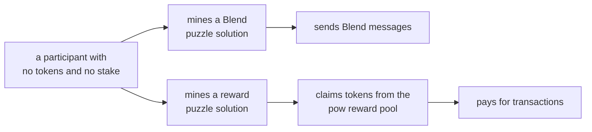
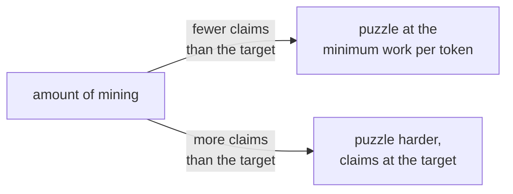
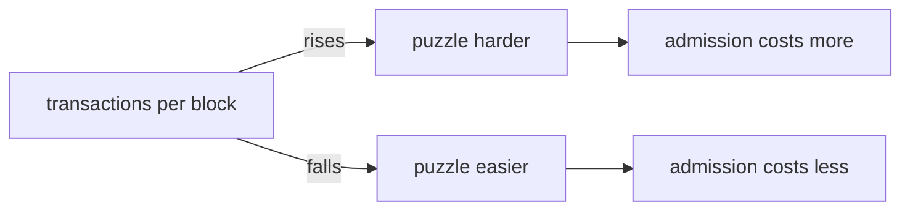
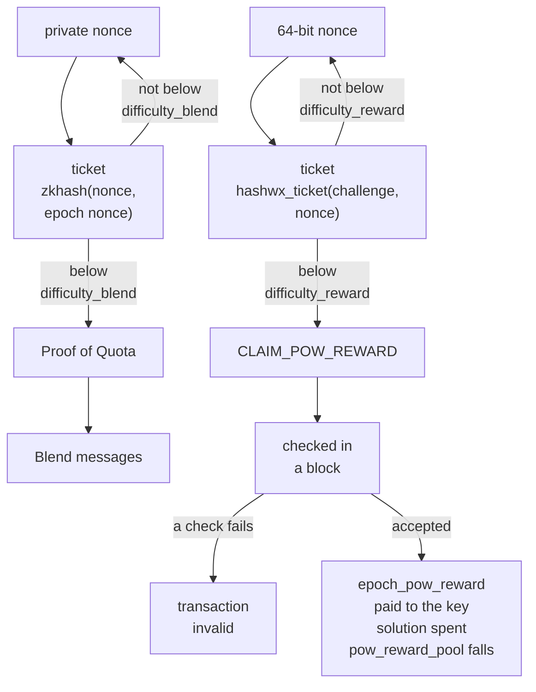

# PROOF-OF-WORK

| Field | Value |
| --- | --- |
| Name | Proof of Work |
| Slug | 245 |
| Status | raw |
| Category | Standards Track |
| Editor | Marcin Pawlowski <marcin@logos.co> |
| Contributors |  |

<!-- timeline:start -->

## Timeline

<!-- timeline:end -->

# Revision History

| **Version** | **Changes** | **Date** |
| --- | --- | --- |
| 1.0.0 | Initial revision. | 2026-09-09 |
| 1.1.0 | Set the reference load of the Blend difficulty to the transaction rate the Blend network carries, `F_T / F_D = 130` transactions per block | 2026-09-11 |
| 1.2.0 | A reward claim searches a nonce for the public key to be paid and carries no signature. Each block credits its fee share to the pool, and the reward per claim stays fixed for the epoch | 2026-10-06 |
| 1.3.0 | [RFC] A claim pays `POW_VESTED_SHARE / SHARE_DEN` of its reward as a note vesting for `VESTING_EPOCHS` epochs, and the rest as a liquid note | 2026-11-06 |
| 1.4.0 | [RFC] A reward claim solves HashWX in place of `zkhash`, against a 64-bit target | 2026-11-06 |
| 1.5.0 | [RFC] A claim's reward pays for the gas it carries and takes at least `WORK_PER_LEPTA` hashes per LEPTON. The pool pays every claim while it can, and the threshold falls once claims exceed `TARGET_CLAIMS_PER_BLOCK`, raised to 12. `VESTING_EPOCHS` follows the epoch length | 2026-11-27 |

# Introduction

Posting a transaction to the chain or sending a message through the Blend network requires tokens. A participant who arrives with nothing therefore cannot use the protocol.

Proof of work removes this obstacle. A participant who has computed a puzzle solution may use it to post transactions and to send messages through Blend. Neither use has a prerequisite beyond the computation itself. The cost is the hardware and the electricity it burns, and it cannot be faked, since a valid ticket proves the work, and a validator checks it cheaply.

A Blend solution is proven inside the [Proof of Quota](proof-of-quota.md) circuit, and its puzzle is `zkhash`. A reward claim is checked by validators in ordinary code, and its puzzle is [HashWX](common-cryptographic-components.md#hashwx).

The puzzles are measured against separate thresholds that follow separate objectives:

- the reward threshold asks a fixed amount of work per token paid, and more once claims exceed a set number per block,
- and the Blend threshold keeps admission to the network affordable when the network is quiet and dearer when it is busy.

This document specifies the two puzzles, their thresholds, the pow reward pool and the reward it pays per claim, and the window within which a reward may be claimed. The Blend side of the mechanism is specified in [Proof of Quota](proof-of-quota.md) and the claim Operation in [Mantle](bedrock-v1.1-mantle-specification.md#claim_pow_reward); this document holds what both depend on.

# Overview

A miner finds a solution only by trying values until one of them hashes below a threshold, so a solution costs electricity and nothing else: no tokens, no stake, no permission. Checking a solution costs a single hash.

Each puzzle has one use, and this is how a participant that holds nothing starts using the protocol.



The tokens come from the pow reward pool, set aside at genesis and refilled by every block from a share of the transaction fees. Nothing is minted for it, so mining does not inflate the supply.

A claim pays a reward sized to the gas it carries. Its liquid part pays for the claim's own transaction and for one more transaction. Nine tenths of the reward vest for a year. Until then the vested part cannot be spent in a Transfer, but it takes part in the leadership lottery and can be staked to declare a service.

Each puzzle has its own threshold, and a threshold sets how much work a solution costs. Every node computes both from what blocks carry, so no node trusts another for them.

The reward threshold reads the claims in a block, the only sign of mining the chain has. It never asks less than a fixed amount of work for each token a claim pays.



Here the branches end apart. Below the target every token costs the same work, so more mining pays out more. At the target more mining makes each claim harder, and blocks carry the target number of claims on average.

A claim must name a recent block, so a solution cannot be spent long after it was found.

The Blend threshold reads the transactions in a block.



Here the branches end apart. Nothing absorbs the load, so a Blend message costs more work when blocks are full and less when they are quiet.

# Protocol



A miner picks a value and hashes it into a **ticket**. A ticket satisfies a **threshold** when the ticket is below it, as [Puzzle Target](#puzzle-target) specifies. The miner keeps picking values until one ticket satisfies the threshold.

Each puzzle searches its own value against its own threshold, so a solution works for one use only.

For Blend admission the miner searches private nonces, each sampled with full entropy, against `difficulty_blend`. The ticket is `zkhash` over the nonce and the [Epoch Nonce](cryptarchia-v1-protocol.md#epoch-nonce), and it and the threshold are numbers in $`\mathbb{F}_p`$, the BN254 scalar field of [Poseidon2](common-cryptographic-components.md#poseidon2-zk-friendly-hash-function). The nonce stays secret. [Proof of Quota](proof-of-quota.md) proves the miner holds one, and that buys the quota of blending operations given in [Proof of Work Quota](blend-protocol.md#proof-of-work-quota). Nothing about it reaches the chain.

For a reward the miner picks the public key to be paid and searches a 64-bit nonce against `difficulty_reward`. The ticket is the [HashWX](common-cryptographic-components.md#hashwx) ticket of the nonce for a challenge that commits to the public key, the referenced block and the Epoch Nonce, and it and the threshold are unsigned 64-bit integers. The miner should pick a public key it has not used in another claim, since the claims paid to one key are linked, and so are the Transfers spending them. The miner then publishes a `CLAIM_POW_REWARD` Operation in a transaction.

A validator checks a claim against the `difficulty_reward` the previous block produced. A block's own claims update `difficulty_reward` after the block is processed, and that new value governs the next block. The validator accepts a claim when all of these hold:

- `pow_reward_pool` still holds `epoch_pow_reward`,
- the block holds fewer than `MAX_CLAIMS_FACTOR * TARGET_CLAIMS_PER_BLOCK` claims before this one,
- the referenced block is canonical and inside the acceptance window,
- the epoch nonce is the current one or the one before it,
- the ticket is below `difficulty_reward`,
- the solution has not been claimed before.

[Mantle](bedrock-v1.1-mantle-specification.md#claim_pow_reward) specifies these checks and the order they run in. A claim that fails any of them makes its transaction invalid. On acceptance the node pays `epoch_pow_reward` to the key, marks the solution spent, and subtracts the same amount from `pow_reward_pool`. It pays `POW_VESTED_SHARE / SHARE_DEN` of the reward as a [vested note](bedrock-v1.1-mantle-specification.md#vested-notes), whose vesting ends at the first slot of the epoch `VESTING_EPOCHS` epochs after the epoch of the referenced block, and the rest as a liquid note.

The **reward** of an epoch pays for gas. Its liquid part, the reward less its vested share, pays the storage fee of a claim transaction and of one further transaction of `POW_REFERENCE_TX_SIZE` bytes, at the storage price of the epoch. [Reward Pool](#reward-pool) computes it.

The reward threshold has a cap. `difficulty_reward` never rises above `reward_target_cap`, the threshold at which a claim takes `WORK_PER_LEPTA` hashes, in expectation, for each LEPTON of the reward. A larger reward therefore takes proportionally more work, and the least work per token stays the same.

Below the cap the threshold holds the claims to a target rate. It steers toward `TARGET_CLAIMS_PER_BLOCK` claims per block, so more mining makes a claim harder rather than the claims more frequent. [Reward Difficulty](#reward-difficulty) specifies the cap and the retarget.

A node computes five values from the chain. `pow_reward_pool` and the set of spent solutions change when a claim is accepted. `difficulty_reward` is recomputed after every block, from the number of claims in that block, the target rate and the cap. Each block credits `pow_reward_pool` with a share of its fees. At each epoch boundary `epoch_pow_reward` is set, and `difficulty_reward` is lowered to the new cap if it lies above it. `difficulty_blend` is recomputed once per epoch, from the transactions of the epoch before last, at the snapshot that fixes the epoch nonce. [Reward Difficulty](#reward-difficulty), [Reward Pool](#reward-pool) and [Blend Difficulty](#blend-difficulty) specify the three computations.

A node keeps a spent solution only while its referenced block is inside the window, so the set stays small. [Acceptance Window](#acceptance-window) gives the window in slots.

# Details

## Notation

| Symbol | Name | Description |
| --- | --- | --- |
| $`p`$ | field modulus | Modulus of the scalar field $`\mathbb{F}_p`$ of [Poseidon2](common-cryptographic-components.md#poseidon2-zk-friendly-hash-function); Blend tickets and the Blend threshold are its elements. |
| $`T`$ | target claims per block | `TARGET_CLAIMS_PER_BLOCK`, the accepted rate the reward threshold steers toward. |
| $`W_b`$ | window depth | `EXPECTED_BLOCKS_PER_WINDOW`, the acceptance window in expected blocks. |
| $`F`$, $`P`$ | smoothing factor and precision | `EMA_SMOOTHING_FACTOR` and `EMA_SMOOTHING_PRECISION`; the reward update weighs the previous estimate $`F`$ out of $`P`$. |
| $`\alpha = a / b`$ | damping exponent | `BLEND_DAMPING_NUM / BLEND_DAMPING_DEN`, the Blend update's response to the load ratio. |
| $`f`$ | slot activation coefficient | The probability that a slot has a leader, $`1/30`$, from [Constants](cryptarchia-v1-protocol.md#constants). |

## Parameters

```python
POW_REWARD_POOL_GENESIS: TokenValue             # the seed of the pool, set in the Genesis Block
WORK_PER_LEPTA: uint64 = 37                     # least expected HashWX hashes per LEPTON of a reward
POW_CLAIM_TX_SIZE: uint64 = 341                 # the bytes of a claim transaction
POW_REFERENCE_TX_SIZE: uint64 = 608             # the bytes of the further transaction a reward's liquid part pays for
POW_VESTED_SHARE: uint64 = 90                   # the share of a reward paid as a vested note, out of SHARE_DEN
EPOCH_LENGTH: uint64                            # the slots of an epoch of Epoch Schedule
VESTING_EPOCHS: uint64 = (31_536_000 + EPOCH_LENGTH - 1) // EPOCH_LENGTH  # the epochs that first reach a year of one-second slots
TARGET_CLAIMS_PER_BLOCK: uint64 = 12            # T
MAX_CLAIMS_FACTOR: uint64 = 10                  # a block's claim limit, in multiples of T
EXPECTED_BLOCKS_PER_WINDOW: uint64 = 10         # W_b
POW_SHARE: uint64 = 10                          # beta, as the fraction POW_SHARE / SHARE_DEN
SHARE_DEN: uint64 = 100                         # the denominator of POW_SHARE and of POW_VESTED_SHARE
EMA_SMOOTHING_FACTOR: uint64 = 999              # F, the weight given to the previous estimate
EMA_SMOOTHING_PRECISION: uint64 = 1000          # P, the scale F is expressed against; F < P
REWARD_TARGET_FLOOR: uint64 = max(1, (EMA_SMOOTHING_PRECISION - 1) // (EMA_SMOOTHING_PRECISION - EMA_SMOOTHING_FACTOR))  # max(1, ceil(F / (P - F))), the smallest target the retarget returns; see Reward Difficulty
BLEND_DIFFICULTY_BASE: PowTarget = p // 2**19   # difficulty_blend at the reference load
TARGET_TXS_PER_BLOCK: uint64 = 130              # Reference transactions per block, F_T / F_D
BLEND_DAMPING_NUM: uint64 = 1                   # a, where the exponent is alpha = a / b
BLEND_DAMPING_DEN: uint64 = 2                   # b, with 0 < a <= b so that alpha <= 1
BLEND_MAX_STEP: uint64 = 2                      # Max factor difficulty_blend may move per epoch
```

`WORK_PER_LEPTA` is the work of one core of the target machine in 30 days, divided by the LEPTA that the cheapest rented server's cost for the same work buys at a token price of $0.05. One core, at a quarter of the `HASHWX_MACHINE_RATE` of [HashWX](common-cryptographic-components.md#hashwx), does 242,500 × 2,592,000 = 6.29·10¹¹ hashes in 30 days. The cheapest rented server found in an October 2026 survey of plans costs $6.12 a month for 4 vCPUs. A vCPU is counted as one core of an Intel Core Ultra 9 285HX with all 24 cores busy, which does 10.34M / 24 = 430,833 hashes a second, 1.777 cores of the target machine. One core of the target machine therefore costs $6.12 / 4 / 1.777 = $0.861 a month. At $0.05 that buys 17.22 LOGOS, or 1.722·10¹⁰ LEPTA ([Token Units and Precision](overview-cryptoeconomics.md#token-units-and-precision)). 6.29·10¹¹ / 1.722·10¹⁰ = 36.5, rounded up to 37. At `WORK_PER_LEPTA` one core earns at most 16.99 LOGOS in 30 days.

`POW_CLAIM_TX_SIZE` is the size of a claim transaction in the [Mantle Transaction Encoding](mantle-transaction-encoding.md): 1 byte of operation count, 105 bytes of claim and 235 bytes of the `TRANSFER` that spends its liquid note. `POW_REFERENCE_TX_SIZE` is the size of one transaction holding a claim, that `TRANSFER` and an inscription of 100 bytes. At the initial storage price of [Storage Markets](storage-markets.md), $`8 \cdot 10^{5}`$ LEPTA per byte, the liquid part pays 949 bytes, 0.7592 LOGOS, and the reward is 7.592 LOGOS.

`POW_VESTED_SHARE` must be below `SHARE_DEN`, or a claim has no liquid part to pay its fee and `compute_epoch_pow_reward` divides by zero. The liquid part must be at least the whole fee of a claim transaction, its Execution Gas included, or a claim cannot pay its own fee.

`EPOCH_LENGTH` is the length of an epoch of [Epoch Schedule](cryptarchia-v1-protocol.md#epoch-schedule), 648,000 slots. `VESTING_EPOCHS` is the number of epochs that first reaches a year of one-second slots, $`\lceil 31{,}536{,}000 / 648{,}000 \rceil = 49`$, so a vested note vests 360 to 367.5 days after the block its claim references.

`TARGET_CLAIMS_PER_BLOCK` must be at least 1, or no claim is valid. `MAX_CLAIMS_FACTOR` must be at least 2. At 1, no block holds more than `TARGET_CLAIMS_PER_BLOCK` claims, so the retarget never lowers `difficulty_reward`. `MAX_CLAIMS_FACTOR * TARGET_CLAIMS_PER_BLOCK` claim transactions of `POW_CLAIM_TX_SIZE` bytes must take less than the `MAX_BLOCK_SIZE` of [Constants](cryptarchia-v1-protocol.md#constants), or the claim limit cannot bind and claims can fill whole blocks. `TARGET_CLAIMS_PER_BLOCK` and `EMA_SMOOTHING_PRECISION` must each be below $`2^{32}`$, or the retarget's product can exceed 128 bits.

`REWARD_TARGET_FLOOR` must stay below `reward_target_cap(epoch_pow_reward)` for every reward, or every retarget returns the cap and the target cannot move. The cap stays above the floor while the reward is at most `2**64 // (WORK_PER_LEPTA * (REWARD_TARGET_FLOOR + 1))` LEPTA, about 499,000 LOGOS.

`TARGET_TXS_PER_BLOCK` is the transaction rate the Blend network carries, $`F_T / F_D = 130`$ transactions per block ([Global Parameters](blend-protocol.md#global-parameters)).

## Puzzle Target

`PowTarget` is an element of $`\mathbb{F}_p`$, as every Blend ticket is. A Blend ticket satisfies a target when its canonical integer representative in $`[0, p-1]`$ is strictly below the target's; a smaller target is a harder puzzle. A representative is at most 254 bits, so a 256-bit unsigned integer holds any target.

`difficulty_reward` is an unsigned 64-bit integer, as every reward ticket is. A reward ticket satisfies it when the ticket is strictly below it.

The Blend update below multiplies and divides targets as integers rather than in the fixed-width types of [Arithmetic](bedrock-v1.1-mantle-specification.md#arithmetic), and caps its result at or below $`p - 1`$, so that it converts back to a field element without reduction. Every intermediate fits in **512 bits**: the radicand reaches $`2^{493}`$. `reward_target_cap` and the reward retarget compute in 128-bit unsigned integers. The storage price is at least one LEPTON per byte, so a reward is at least 9,490 LEPTA and the cap at most $`2^{46}`$. The retarget's product therefore stays below $`2^{110}`$ under the bounds of [Parameters](#parameters). Each operation is integer addition, multiplication, floor division or comparison, and `integer_nth_root` returns the exact floor, so two implementations agree exactly.

## Reward Pool

The pool is seeded once, at genesis, with `POW_REWARD_POOL_GENESIS`, as specified in [Initial Proof of Work Reward Pool](bedrock-genesis-block.md#initial-proof-of-work-reward-pool). After that it changes through the fee share each block credits and through claims.

```python
def compute_epoch_pow_reward(permanent_storage_gas_price: TokenValue) -> TokenValue:
    # Rounded up, so that the liquid part covers the storage fee of both transactions.
    fee = (POW_CLAIM_TX_SIZE + POW_REFERENCE_TX_SIZE) * permanent_storage_gas_price
    liquid_share = SHARE_DEN - POW_VESTED_SHARE
    return checked_uint64((fee * SHARE_DEN + liquid_share - 1) // liquid_share)
```

Each block, once its transactions have run, credits the pool with its share `POW_SHARE / SHARE_DEN` of the fees it collected ([Block Rewards](block-rewards.md#deterministic-implementation)), so the claims of a block draw on what the blocks before it paid. At each epoch boundary, before any block of the new epoch is processed and once [Storage Markets](storage-markets.md#price-update-algorithm) has set the storage price of that epoch, `epoch_pow_reward` is set to `compute_epoch_pow_reward(permanent_storage_gas_price)` and held for the epoch. Then `difficulty_reward` becomes `min(difficulty_reward, reward_target_cap(epoch_pow_reward))`. All arithmetic here is checked, in accordance with [Arithmetic](bedrock-v1.1-mantle-specification.md#arithmetic), except that `fee * SHARE_DEN` is computed in 128 bits.

### Exhaustion within an epoch

The reward is fixed for the epoch while every claim draws on the pool and every block credits it. The first condition of [CLAIM_POW_REWARD](bedrock-v1.1-mantle-specification.md#claim_pow_reward) validation, that the pool covers the reward, is evaluated for every claim against the pool as it stands at that point in the block, and a claim it rejects invalidates its transaction. Claiming resumes in the block after the fee shares of the blocks bring the pool back to the reward, or at the first epoch boundary that sets a reward the pool covers, whichever comes first.

## Acceptance Window

$$
\mathrm{WINDOW} = \left\lfloor \frac{W_b}{f} \right\rfloor
$$

With $`W_b = 10`$ and $`f = 1/30`$, `WINDOW` is $`300`$ slots. A claim's referenced block must be canonical and at most `WINDOW` slots older than the block including the claim; the check is step 2 of [CLAIM_POW_REWARD](bedrock-v1.1-mantle-specification.md#claim_pow_reward) validation. A nullifier may be discarded once the block its claim referenced has left the window.

## Reward Difficulty

```python
def reward_target_cap(epoch_pow_reward: TokenValue) -> uint64:
    # 128-bit integers; see Puzzle Target.
    # The target at which a claim takes WORK_PER_LEPTA hashes per LEPTON of its reward,
    # in expectation, since a target t costs 2**64 / t hashes.
    return 2**64 // (epoch_pow_reward * WORK_PER_LEPTA)

def compute_new_reward_difficulty(claims_in_block: uint64,
                                  current_target: uint64,
                                  epoch_pow_reward: TokenValue) -> uint64:
    # 128-bit integers; see Puzzle Target.
    # The demand implied by this block, reconstructed from the target that produced
    # it and smoothed against the target rate; floored at 1 so the division is defined.
    demand = max(1, (EMA_SMOOTHING_PRECISION - EMA_SMOOTHING_FACTOR) * claims_in_block
                    + EMA_SMOOTHING_FACTOR * TARGET_CLAIMS_PER_BLOCK)
    new_target = (TARGET_CLAIMS_PER_BLOCK * current_target * EMA_SMOOTHING_PRECISION) // demand
    return min(max(new_target, REWARD_TARGET_FLOOR), reward_target_cap(epoch_pow_reward))
```

`claims_in_block` counts the `CLAIM_POW_REWARD` Operations the block includes, and `epoch_pow_reward` is the reward of that block's epoch. Every claim in a block is validated against the target produced by the previous block's update, capped at an epoch boundary as [Reward Pool](#reward-pool) specifies. The update from a block's own count is applied after the block is processed and governs the next block. At genesis `difficulty_reward` is `reward_target_cap` of the reward of epoch 0.

The update is multiplicative in the current target, so a target of zero never recovers. With $`F \gt 0`$, the update from a block without claims is $`\lfloor t \cdot P/F \rfloor`$, which equals $`t`$ for every $`t \lt F/(P-F)`$. `REWARD_TARGET_FLOOR` is the smallest target that a block without claims strictly raises: 999 at the specified smoothing.

## Blend Difficulty

`difficulty_blend` for epoch $`N`$ is computed at the lottery-constants snapshot of epoch $`N-1`$ specified in [Epoch](cryptarchia-v1-protocol.md#epoch), the moment epoch $`N`$'s nonce is fixed, from the blocks of epoch $`N-2`$, and is the public input `pow_blend_difficulty` of [Proof of Quota](proof-of-quota.md) for the whole of epoch $`N`$. For epochs 0 and 1 it is `BLEND_DIFFICULTY_BASE`; the schedule begins with epoch 2, computed during epoch 1 from epoch 0's blocks.

```python
def compute_epoch_blend_difficulty(epoch_blocks: list[Block],   # the blocks of epoch N-2
                                   previous: PowTarget) -> PowTarget:  # difficulty_blend of epoch N-1
    # 512-bit integers over canonical representatives; see Puzzle Target.
    # Observed load as an exact ratio: num == den at the reference load.
    num = sum(num_transactions(b) for b in epoch_blocks)
    den = TARGET_TXS_PER_BLOCK * len(epoch_blocks)

    lo = previous // BLEND_MAX_STEP
    hi = min(previous * BLEND_MAX_STEP, p - 1)

    if num == 0:
        return hi   # No load observed: as permissive as this epoch's clamp allows.

    # A smaller target is harder, so load divides the baseline:
    #     target = BASE / load ** alpha
    # Only the final root is floored, so the result is at most one unit from exact.
    a, b = BLEND_DAMPING_NUM, BLEND_DAMPING_DEN
    radicand = (BLEND_DIFFICULTY_BASE ** b * den ** a) // num ** a
    return clamp(integer_nth_root(radicand, b), lo, hi)

def integer_nth_root(x: int, n: int) -> int:
    # The floor of the real n-th root: the largest integer r with r**n <= x.
    # Any exact method serves; this reference is a binary search.
    lo, hi = 0, 1 << (x.bit_length() // n + 1)   # hi**n > x by construction
    while lo < hi - 1:
        mid = (lo + hi) // 2
        if mid ** n <= x:
            lo = mid
        else:
            hi = mid
    return lo
```

`previous` is the value computed one snapshot earlier. `BLEND_DIFFICULTY_BASE` is calibrated against a measurement of the work itself: about 38 seconds per solution in expectation on one core of the target machine, a Raspberry Pi 5, measured on that hardware.
