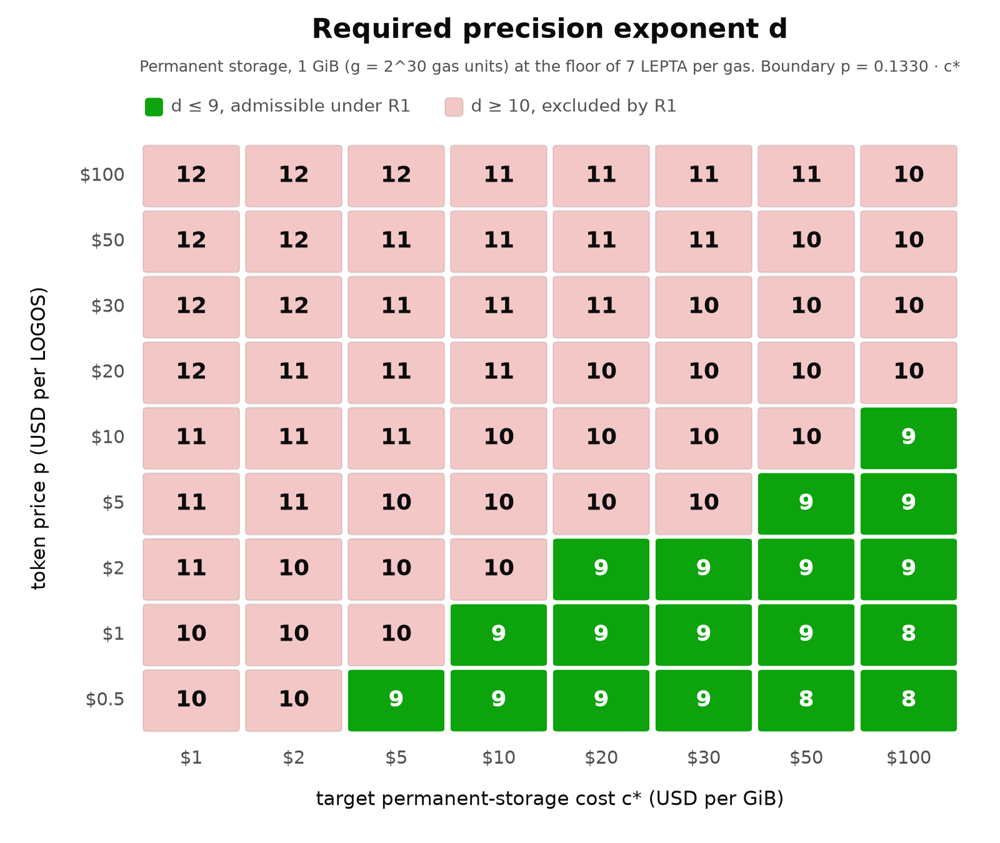

# [RFC] Cryptoeconomics: Define the LEPTON as the indivisible token unit

**Motivation and proposal:** [PR #503](https://github.com/logos-co/logos-lips/pull/503)

## Change log

| **Revision** | **Description** | **Date** |
| --- | --- | --- |
| v1 | Initial RFC | 2026-10-26 |
| v2 | Reachable price floor of 7 LEPTA per gas, with Execution Market added; yearly storage costs under the price updates; the block-reward rule fits 128 bits; the storage start is not adjusted at TGE | 2026-10-26 |
| v3 | Total Stake Inference added, with the stake estimate times `PRECISION` in 128 bits; the first band of the admissible set starts at $`d_{req}`$; Storage Markets drops Genesis State | 2026-10-27 |
| v4 | Block Rewards' reference code states the width of every value | 2026-10-29 |
## Reviewer Orientation

Read the PR's Motivation first, then the Discussion, which derives the precision of nine and the initial storage price. [Mantle](../bedrock-v1.1-mantle-specification.md) is unchanged but assumed: its amounts count LEPTA, as do the prices of [Execution Market](../execution-market.md).

| # | Priority | Document / Change | What to look for |
| --- | --- | --- | --- |
| 1 | Critical | **Start here**: [Overview Cryptoeconomics → Token Units and Precision](../overview-cryptoeconomics.md#token-units-and-precision) ([details](#1-the-lepton)) | the hard cap, $`10^{19}`$ LEPTA, fits a `TokenValue`; a parser rejects a tenth fractional digit |
| 2 | Critical | **Start here**: [Block Rewards → Float Precision for Implementation](../block-rewards.md#float-precision-for-implementation) ([details](#2-the-block-rewards-integer-rule-in-lepta)) | three constants carry $`10^{9}`$; the intermediates outgrow 64 bits, and the code types them `int128` |
| 3 | High | [Storage Markets → Parameter Justification](../storage-markets.md#parameter-justification) ([details](#3-the-initial-storage-price)) | the initial price, $`8 \cdot 10^{5}`$ LEPTA per gas, sets the level the price keeps |
| 4 | Medium | [Execution Market → Base Fee Update Rule](../execution-market.md#base-fee-update-rule), [Storage Markets → Implementation](../storage-markets.md#implementation) and [Overview Cryptoeconomics → Fee Markets](../overview-cryptoeconomics.md#fee-markets) ([details](#4-the-reachable-price-floor)) | a price of 7 LEPTA per gas unit or less is never lowered, and a higher price never falls below 7 |
| 5 | Medium | [Total Stake Inference → Algorithm](../cryptarchia-total-stake-inference.md#algorithm) ([details](#5-the-width-of-the-scaled-stake-estimate)) | `tse_p` becomes a signed 128-bit integer, as in the node, and nothing else changes |
| 6 | Low | Four documents ([chores](#chores)) | skim: LGO becomes LOGOS |

# Discussion

## Requirements

The indivisible unit is the LEPTON, plural LEPTA, with $`1 \text{ LOGOS} = 10^{d} \text{ LEPTA}`$ and $`d = 9`$. The protocol counts LEPTA as integers. Interfaces render them as decimal LOGOS amounts with at most nine fractional digits.

Three facts about the surrounding specifications constrain $`d`$:

- `Note.value` is a `TokenValue`, which is a `uint64`, and all token arithmetic is checked.
- The hard cap is $`S_{cap} = 10^{10}`$ LOGOS.
- The Execution base fee and the Permanent Storage price are integers with a reachable floor of 7 LEPTA per gas unit. An update never lowers a price of 7 or less, and never takes a higher price below 7.

The requirements are:

- **R1. Representability.** A single note holding the entire supply must be encodable in `TokenValue`. It bounds $`d`$ from above.
- **R2. Integrality.** Every fee, price, reward, and balance is an integer count of LEPTA.
- **R3. Price resolution.** The price floor of the gas markets stays below a chosen target cost $`c^{\ast}`$. It bounds $`d`$ from below. A floor above $`c^{\ast}`$ misses the target and does not stop the market from clearing.
- **R4. Unique naming.** Each named unit denotes one quantity, and each quantity has one canonical name.

## Core variables

- $`S_{cap}`$ denotes the maximum allowable token supply (hard cap).
- $`d \in \mathbb{N}`$ denotes the precision exponent: one LOGOS equals $`10^d`$ LEPTA.
- $`V_{max}`$ denotes the largest value representable by `TokenValue`.
- $`N(d) = S_{cap} \cdot 10^{d}`$ denotes the hard cap expressed in indivisible units.
- $`H(d) = V_{max} / N(d)`$ denotes the representable headroom, in multiples of $`S_{cap}`$.
- $`S^{\ast}_{cap}`$ denotes the largest admissible hard cap.
- $`g`$ denotes the gas units consumed by a reference operation.
- $`\varphi`$ denotes the reachable price floor of the gas markets, in LEPTA per gas unit.
- $`p`$ denotes the token price, in currency units per LOGOS.
- $`c^{\ast}`$ denotes the target cost of the reference operation, in the same currency units. It is a design parameter, not a calibrated market price. The tables below evaluate it at $`\$1`$ to $`\$30`$ per GiB of permanent storage and at $`\$0.01`$ per Transfer Operation.
- $`p^{\ast}(g, d)`$ denotes the saturation price: the value of $`p`$ above which the price floor $`\varphi`$ makes the operation cost more than $`c^{\ast}`$.

## Parametrization

| Symbol | Definition | Value | Source |
| --- | --- | --- | --- |
| $`d`$ | Precision exponent | $`9`$ | Derived in [Choice of precision](#choice-of-precision). |
| $`V_{max}`$ | Largest representable `TokenValue` | $`2^{64}-1 = 18{,}446{,}744{,}073{,}709{,}551{,}615`$ | `Note.value: uint64` in [Mantle](../bedrock-v1.1-mantle-specification.md#notes). |
| $`S_{cap}`$ | Maximum allowable token supply | $`10^{10}`$ LOGOS $`= 10^{19}`$ LEPTA | [Block Rewards](../block-rewards.md#parametrization). |
| $`N(9)`$ | Hard cap in LEPTA | $`10^{19}`$ | $`S_{cap} \cdot 10^9`$. |
| $`H(9)`$ | Representable headroom | $`1.8446744073709551`$ | $`V_{max}/N(9)`$. |
| $`S_{cap}^{\ast}`$ | Largest admissible hard cap | $`18{,}446{,}744{,}073`$ LOGOS | $`\lfloor V_{max}/10^9 \rfloor`$. Derived in [Headroom](#headroom). |
| `EXECUTION_TRANSFER_GAS` | Execution Gas of a Transfer Operation | $`590`$ | Appendix of [Mantle](../bedrock-v1.1-mantle-specification.md). |
| Storage gas per byte | Permanent Storage Gas per stored byte | $`1`$ | [Overview Cryptoeconomics → Gas](../overview-cryptoeconomics.md#gas). |
| $`\varphi`$ | Reachable price floor | $`7`$ LEPTA per gas unit | An update lowers a price $`P`$ by at most $`\lfloor P/8 \rfloor`$ in [Execution Market](../execution-market.md#base-fee-update-rule) and [Storage Markets](../storage-markets.md#implementation), which is $`0`$ for $`P \le 7`$. |

## Upper bound on precision

Requirement **R1** states that a single note must hold the entire supply. Assume the supply is bounded by $`S_{cap}`$. Then **R1** is the condition

$$
N(d) = S_{cap} \cdot 10^{d} \le V_{max}.
$$

Substituting $`S_{cap} = 10^{10}`$ and $`V_{max} = 2^{64}-1`$ gives

$$
10^{10+d} \le 2^{64}-1
\quad \Longleftrightarrow \quad
10 + d \le \log_{10}\left(2^{64}-1\right) = 19.26591972\ldots
$$

Since $`d`$ is an integer, this implies

$$
d \le 9 .
$$

$`N(d)`$ and $`H(d)`$ around the bound:

| $`d`$ | $`N(d)`$ (LEPTA) | Representable in `uint64` | $`H(d)`$ |
| --- | --- | --- | --- |
| $`7`$ | $`1.0000 \times 10^{17}`$ | yes | $`184.47`$ |
| $`8`$ | $`1.0000 \times 10^{18}`$ | yes | $`18.447`$ |
| $`9`$ | $`1.0000 \times 10^{19}`$ | yes | $`1.8447`$ |
| $`10`$ | $`1.0000 \times 10^{20}`$ | no | $`0.1845`$ |
| $`18`$ | $`1.0000 \times 10^{28}`$ | no | $`1.8447 \times 10^{-9}`$ |

A wei-like precision of $`10^{18}`$ is not available under the current ledger types. It exceeds $`V_{max}`$ by a factor of $`5.4 \times 10^8`$. Adopting it would require widening `TokenValue` from 64 to at least 128 bits, which changes note encoding, transaction encoding, and every checked-arithmetic bound in [Mantle](../bedrock-v1.1-mantle-specification.md) and [Mantle Transaction Encoding](../mantle-transaction-encoding.md).

Any change to the hard cap changes the admissible set, as recorded in [Headroom](#headroom).

## Lower bound on precision

Both gas markets price in integers with the reachable floor $`\varphi`$. Once a price has passed $`\varphi`$, the minimum cost of an operation consuming $`g`$ gas units is $`\varphi \cdot g`$ LEPTA, independent of demand. In currency terms,

$$
c_{min}(g, d, p) = \varphi \cdot g \cdot 10^{-d} \cdot p .
$$

Requirement **R3** is $`c_{min} \le c^{\ast}`$. Substituting $`c_{min}`$ and solving for $`d`$:

$$
\varphi \cdot g \cdot 10^{-d} \cdot p \le c^{\ast}
\quad \Longleftrightarrow \quad
10^{d} \ge \frac{\varphi \cdot g \cdot p}{c^{\ast}}
\quad \Longleftrightarrow \quad
d \ge \log_{10}\left(\frac{\varphi \cdot g \cdot p}{c^{\ast}}\right).
$$

With $`g = 2^{30}`$, the gas charged for one GiB of permanent storage, the requirement is

$$
d \ge \log_{10}\left(\frac{\varphi \cdot p \cdot 2^{30}}{c^{\ast}}\right).
$$

The requirement depends only on the ratio $`p / c^{\ast}`$, not on either value separately. Scaling the token price and the target cost by the same factor leaves the right-hand side unchanged. A $`\$1`$ token against a $`\$5`$ per GiB target imposes exactly the precision requirement of a $`\$6`$ token against a $`\$30`$ per GiB target, because both fix $`p / c^{\ast} = 0.2`$.

The ratio carries units of GiB per LOGOS, so it is how much permanent storage one LOGOS buys at the target cost.

Combining the requirement with the **R1** cap $`d_{req} \le 9`$ gives the admissibility condition in closed form:

$$
d_{req} \le 9
\quad \Longleftrightarrow \quad
\frac{p}{c^{\ast}} \le \frac{10^{9}}{\varphi \cdot 2^{30}} = 0.1330460821 .
$$

The boundary is therefore a straight line, $`p = 0.1330 \cdot c^{\ast}`$, and the admissible region is everything below it. In words, $`d = 9`$ remains admissible for as long as one LOGOS buys at most $`0.1330`$ GiB of permanent storage.

The argument generalizes to any operation as

$$
\dfrac{p}{c^{\ast}} \le \dfrac{ 10^{9} }{ \varphi \cdot g }.
$$

The bound scales with the gas charged, so it is the definition of the gas unit, and not the precision, that sets how much room the mechanism has. Charging Permanent Storage Gas per KiB rather than per byte replaces $`g = 2^{30}`$ with $`g = 2^{20}`$ and moves the boundary from $`0.1330`$ to $`136.2`$ GiB per LOGOS.



**Figure 1.** Required precision $`d`$ over a grid of token prices and storage-cost targets, with each cell holding $`d_{req} = \lceil \log_{10}(\varphi \cdot p \cdot 2^{30} / c^{\ast}) \rceil`$. Green marks $`d_{req} \le 9`$, admissible under **R1**. Red marks $`d_{req} \ge 10`$, which **R1** excludes.

Read as a price rather than a ratio, the same condition gives the saturation price

$$
p^{\ast}(g, d) = \frac{c^{\ast} \cdot 10^{d}}{\varphi \cdot g} .
$$

Above $`p^{\ast}`$ the floor binds: the market cannot clear below $`c_{min}`$, regardless of demand. Below $`p^{\ast}`$ the floor is slack, and the price update rules in [Execution Market](../execution-market.md) and [Storage Markets](../storage-markets.md) set the price.

Two reference operations bracket the range of $`g`$ in the protocol:

- A Transfer Operation, with $`g = 590`$.
- One GiB of permanent storage, with $`g = 2^{30} = 1{,}073{,}741{,}824`$, since Permanent Storage Gas is charged per byte.

The gap in $`g`$ is a factor of $`1.82 \times 10^{6}`$, so the two markets saturate at prices six orders of magnitude apart. Saturation price $`p^{\ast}`$ in USD per LOGOS:

| $`d`$ | Transfer, $`c^{\ast} = \$0.01`$ | 1 GiB, $`c^{\ast} = \$1`$ | 1 GiB, $`c^{\ast} = \$5`$ | 1 GiB, $`c^{\ast} = \$10`$ | 1 GiB, $`c^{\ast} = \$30`$ |
| --- | --- | --- | --- | --- | --- |
| $`7`$ | $`\$24.21`$ | $`\$0.0013`$ | $`\$0.0067`$ | $`\$0.0133`$ | $`\$0.0399`$ |
| $`8`$ | $`\$242.13`$ | $`\$0.0133`$ | $`\$0.0665`$ | $`\$0.1330`$ | $`\$0.3991`$ |
| $`9`$ | $`\$2{,}421.31`$ | $`\$0.1330`$ | $`\$0.6652`$ | $`\$1.3305`$ | $`\$3.9914`$ |

- Execution is not the binding market. At $`d = 8`$ a transfer stays under one cent up to $`\$242`$ per LOGOS, which is a fully diluted valuation of $`2.4`$ trillion USD at $`S_{cap} = 10^{10}`$. The execution floor does not discriminate between candidate precisions at any plausible price.
- Permanent storage is the binding market. Its boundary $`p / c^{\ast} \le 10^{9} / (\varphi \cdot 2^{30})`$ is tighter than the execution boundary $`p / c^{\ast} \le 10^{9} / (\varphi \cdot 590)`$ by the gas ratio alone, so the ordering holds whatever target costs are assigned to the two operations.
- At $`d = 8`$ and $`c^{\ast} = \$5`$ per GiB, the storage floor exceeds $`\$5`$ per GiB once LOGOS passes $`\$0.0665`$. That is inside the plausible price range, so $`d = 8`$ misses the $`\$5`$ per GiB target under **R3**.

Evaluating the requirement derived above at four prices and three targets gives the integer precision each combination demands.

| $`p`$ (USD per LOGOS) | Required $`d`$ at $`c^{\ast} = \$5`$ per GiB | Required $`d`$ at $`c^{\ast} = \$10`$ per GiB | Required $`d`$ at $`c^{\ast} = \$30`$ per GiB | Admissible under R1 |
| --- | --- | --- | --- | --- |
| $`\$1`$ | $`9.18 \rightarrow 10`$ | $`8.88 \rightarrow 9`$ | $`8.40 \rightarrow 9`$ | no / yes / yes |
| $`\$2`$ | $`9.48 \rightarrow 10`$ | $`9.18 \rightarrow 10`$ | $`8.70 \rightarrow 9`$ | no / no / yes |
| $`\$5`$ | $`9.88 \rightarrow 10`$ | $`9.57 \rightarrow 10`$ | $`9.10 \rightarrow 10`$ | no / no / no |
| $`\$10`$ | $`10.18 \rightarrow 11`$ | $`9.88 \rightarrow 10`$ | $`9.40 \rightarrow 10`$ | no / no / no |

**R3** is satisfiable under **R1** exactly when $`p / c^{\ast} \le 0.1330`$. At $`c^{\ast} = \$5`$ per GiB that is $`p \le \$0.67`$, at $`\$10`$ it is $`p \le \$1.33`$, and at $`\$30`$ it is $`p \le \$3.99`$. Outside that region the requirement is $`d \ge 10`$, which **R1** excludes.

## Choice of precision

**R1** caps precision at $`d \le 9`$. **R3** requires $`d \ge d_{req}`$, the smallest integer meeting the bound derived above:

$$
d_{req} = \left\lceil \log_{10}\left(\frac{\varphi \cdot p \cdot 2^{30}}{c^{\ast}}\right) \right\rceil .
$$

The admissible set is therefore the integer interval

$$
\mathcal{D} = \lbrace d \in \mathbb{N} : d_{req} \le d \le 9 \rbrace .
$$

Its contents depend only on the ratio $`p / c^{\ast}`$, through the equivalence $`d_{req} \le k \Leftrightarrow p / c^{\ast} \le 10^{k} / (\varphi \cdot 2^{30})`$.

| $`p / c^{\ast}`$ (GiB per LOGOS) | $`d_{req}`$ | Admissible set $`\mathcal{D}`$ |
| --- | --- | --- |
| $`\le 10^{7} / (\varphi \cdot 2^{30})`$ | $`\le 7`$ | $`\lbrace d_{req}, \dots, 9 \rbrace`$ |
| $`\left( 10^{7} / (\varphi \cdot 2^{30}), \; 10^{8} / (\varphi \cdot 2^{30}) \right]`$ | $`8`$ | $`\lbrace 8, 9 \rbrace`$ |
| $`\left( 10^{8} / (\varphi \cdot 2^{30}), \; 10^{9} / (\varphi \cdot 2^{30}) \right]`$ | $`9`$ | $`\lbrace 9 \rbrace`$ |
| $`\gt 10^{9} / (\varphi \cdot 2^{30})`$ | $`\ge 10`$ | empty |

$`\mathcal{D}`$ is an interval capped at $`9`$ by **R1**, so its upper endpoint is $`9`$ whenever it is non-empty. Therefore $`d = 9`$ **is admissible whenever any precision is admissible.**

No other value has this property. $`d = 8`$ is admissible only on $`p / c^{\ast} \le 10^{8} / (\varphi \cdot 2^{30})`$, one tenth of the range, and $`d = 7`$ on one hundredth.

Selecting $`d = 9`$ therefore does not require committing to a value of $`p / c^{\ast}`$, which is not known when the encoding is fixed and can move by an order of magnitude over its life.

$$
\boxed{\;d = 9 \qquad \Longrightarrow \qquad 1 \text{ LOGOS} = 10^{9} \text{ LEPTA}.\;}
$$

What is forced and what is not:

- On the band $`10^{8} / (\varphi \cdot 2^{30}) \lt p / c^{\ast} \le 10^{9} / (\varphi \cdot 2^{30})`$, $`d = 9`$ is the only admissible value.
- Below that band $`d = 9`$ remains admissible but is no longer unique, and $`d = 8`$ satisfies both requirements as well.
- Above the band $`\mathcal{D}`$ is empty and no precision satisfies both requirements.

Taking the top of the interval costs representable headroom, $`H(9) = 1.8447`$ against $`H(8) = 18.447`$. Under a fixed hard cap no process consumes that headroom, as shown in [Headroom](#headroom), so the cost is not realised.

Two consequences:

- The result is a function of $`S_{cap} = 10^{10}`$ LOGOS and of `TokenValue` being 64 bits wide. Changing either reopens the derivation.
- Where $`p / c^{\ast} \gt 10^{9} / (\varphi \cdot 2^{30})`$ the two requirements are jointly infeasible: **R1** caps $`d`$ before **R3** is met. The remedy lies in the Permanent Storage Gas unit $`g`$, which sets the boundary at $`10^{9} / (\varphi \cdot g)`$, and not in the precision.

## Headroom

At $`d = 9`$ the representable headroom is $`H(9) = 1.8447`$ times the hard cap. This section states where it is consumed and when it fails.

**Hard cap ceiling.** **R1** requires $`S_{cap} \cdot 10^9 \le V_{max}`$, hence

$$
S_{cap} \le \left\lfloor \frac{2^{64}-1}{10^9} \right\rfloor = 18{,}446{,}744{,}073 \text{ LOGOS}.
$$

The specified cap of $`10^{10}`$ LOGOS sits at $`54.2\%`$ of this ceiling. A cap above $`1.8446744073 \times 10^{10}`$ LOGOS is incompatible with $`d = 9`$ and forces $`d \le 8`$. By the lower bound on precision, that narrows the region where **R3** can be met by a factor of ten, from $`p / c^{\ast} \le 10^{9} / (\varphi \cdot 2^{30})`$ to $`p / c^{\ast} \le 10^{8} / (\varphi \cdot 2^{30})`$, so the failure appears at high prices rather than low ones.

**Supply growth.** [Block Rewards](../block-rewards.md) allocates the full supply at genesis and moves tokens between circulating supply, the rewards pool, the rewards reserve and the proof of work reward pool. No path in that mechanism raises the total above $`S_{cap}`$. The bound $`N(9) \le V_{max}`$ therefore holds at every step, with no growth argument required. If a later revision introduces issuance above $`S_{cap}`$, this section must be reopened.

**Aggregation.** Two notes each holding more than $`H(9)/2 = 92.23\%`$ of the hard cap would overflow `uint64` when summed. The state is unreachable while the sum of all note values is bounded by $`S_{cap}`$. The failure mode is confined to malformed or adversarial inputs, which [Mantle](../bedrock-v1.1-mantle-specification.md) excludes by requiring checked arithmetic on every addition, and by accumulating the transaction balance in a signed 128-bit integer.

## Units of account

Every protocol quantity denominated in the native token is measured in LEPTA, or in LEPTA per gas unit.

| Quantity | Symbol | Specification | Unit |
| --- | --- | --- | --- |
| Note value | `Note.value` | [Mantle](../bedrock-v1.1-mantle-specification.md) | LEPTA |
| Transaction balance | `tx_balance` | [Mantle](../bedrock-v1.1-mantle-specification.md) | LEPTA |
| Mandatory fee | `tx_mandatory_fee` | [Mantle](../bedrock-v1.1-mantle-specification.md) | LEPTA |
| Priority tip | `tx_priority_tip` | [Mantle](../bedrock-v1.1-mantle-specification.md) | LEPTA |
| Execution base fee | $`b_{\mathrm{exec}}[s]`$ | [Execution Market](../execution-market.md) | LEPTA per Execution Gas unit |
| Execution Gas price | $`c_t`$ | [Execution Market](../execution-market.md) | LEPTA per Execution Gas unit |
| Permanent Storage price | $`P_{\text{storage}}(s)`$ | [Storage Markets](../storage-markets.md) | LEPTA per Permanent Storage Gas unit |
| Block reward | $`R_t`$ | [Block Rewards](../block-rewards.md) | LEPTA |
| Inferred total stake | $`D_{0,t}`$, `total_stake_estimate` | [Block Rewards](../block-rewards.md), [Total Stake Inference](../cryptarchia-total-stake-inference.md) | LEPTA |
| Hard cap | $`S_{cap}`$ | [Block Rewards](../block-rewards.md) | $`10^{19}`$ LEPTA |

Specifications that state a constant in whole LOGOS must scale it by $`10^9`$ before evaluating it against ledger quantities. Ratios of two same-unit quantities are scale-invariant and are unaffected.

Two floor costs follow from $`\varphi`$ and the gas constants:

- A Transfer Operation costs at least $`\varphi \cdot 590 = 4{,}130`$ LEPTA in execution fees once the base fee has passed $`\varphi`$, which is $`4.13 \times 10^{-6}`$ LOGOS. The base fee starts at 1, where a transfer costs 590 LEPTA.
- Storing one GiB permanently costs at least $`\varphi \cdot 2^{30} = 7{,}516{,}192{,}768`$ LEPTA, which is $`7.5162`$ LOGOS.

The storage price starts above $`\varphi`$, as [Initial storage price](#initial-storage-price) derives.

## Rounding

Every rounding in the fee, price and reward mechanisms now rounds to a whole LEPTON, so each rounded quantity carries an error below $`10^{-9}`$ LOGOS. No direction changes. The specifications follow one convention:

| Class of quantity | Direction | Reason |
| --- | --- | --- |
| Amounts charged to a user | away from zero | Keeps every price at one LEPTON or more. Rounding down makes $`0`$ an absorbing state for the base fee, after which execution is permanently free. |
| Amounts credited to a participant | toward zero | The sum of credited shares never exceeds the exact entitlement. |
| Measurements, such as usage averages | toward zero | The usage EMA in [Storage Markets](../storage-markets.md) is additive and recovers from $`0`$ once demand resumes. Rounding up reports residual demand on an idle network. |

Block Rewards rounds the Blend and leader shares down separately, so less than two LEPTA of each block reward go to neither. No specification says which stock keeps them. This is an open question, as it was in whole tokens.

## Width of the Block Rewards integer rule

Restated in LEPTA, the Block Rewards integer rule no longer fits 64-bit integers: `657 · A_SCALE` alone is $`7.9 \times 10^{19}`$. The fee product `(A_SCALE - a_numerator) * last_pooled_fee` is non-zero only while `sum_fees` is below $`1.49 \times 10^{15}`$ LEPTA, as Block Rewards now derives. Every intermediate therefore lies between $`-2^{64}`$ and $`2^{120}`$, and the largest, `6 · reward_numerator`, peaks at $`2^{119.1}`$. A signed 128-bit integer holds the rule. The node computes it in `u128` and floors the stake expression at 0 with `saturating_sub`, so it never overflows.

## Initial storage price

Storage Markets sets the anchor weight $`w`$ and the base target $`T_{\text{base}}`$ to $`0`$, so its target is the usage average itself. The price therefore follows changes in usage, not its level. [\[Analysis\] Storage Market](../analysis-storage-market.md#price-stability-analysis) states the same: without the anchor, "the target would simply follow the demand". Run on the Storage Markets reference code, full blocks from genesis raise the price by a factor of $`1.616`$ within ten epochs. After that only the upward rounding moves it, by one LEPTON per epoch. A jump from 1% load to full blocks raises it by the same factor. The initial price is therefore the level the price keeps.

Master's start of 1 LGO per gas reads two ways in LEPTA, and neither works:

- 1 LOGOS, $`10^{9}`$ LEPTA per gas, prices one GiB at $`1.07 \times 10^{9}`$ LOGOS, $`10.7\%`$ of the hard cap.
- 1 LEPTON per gas keeps storage near its floor. Under a year of full blocks, $`2.2 \times 10^{12}`$ bytes, the price climbs by about one LEPTON per epoch to 50 LEPTA per gas, and the year costs $`54{,}751`$ LOGOS.

The proposal starts at $`8 \cdot 10^{5}`$ LEPTA per gas, $`\$0.00004`$ per byte at an assumed $`\$0.05`$ per LOGOS. This is the median of what ten chains charge to store a byte they keep. The table converts each price at $`\$0.05`$ per LOGOS and 1 gas per byte, with token prices and fees as of 23 October 2026.

| Chain and mechanism | Price per byte | How long the data is kept | LEPTA per gas |
| --- | --- | --- | --- |
| [Bitcoin](https://mempool.space/), non-witness bytes | 1 sat at 1 sat/vB | permanently | $`1.62 \times 10^{7}`$ |
| [Solana](https://solana.com/upgrades/reduced-rent), account data | 5,080 lamports deposit ([SIMD-0437 step 2](https://app.xroot.dev/upgrades/simd-0437-2-rent-cut-step-2-of-5)) | while the account exists | $`1.05 \times 10^{7}`$ |
| Bitcoin, witness bytes | 0.25 sat | permanently | $`4.06 \times 10^{6}`$ |
| [Ethereum](https://eips.ethereum.org/EIPS/eip-2200), contract storage | 625 gas | in state | $`1.68 \times 10^{6}`$ |
| [NEAR](https://docs.near.org/protocol/storage/storage-staking.md), contract storage | $`10^{-5}`$ NEAR staked | while stored | $`9.77 \times 10^{5}`$ |
| [Arweave](https://arweave.net/price/429), one 429-byte upload | 0.0035 AR per upload | permanently | $`6.27 \times 10^{5}`$ |
| [Cardano](https://docs.getblock.io/api-reference/cardano-ada/ogmios-json-rpc-api/queryledgerstate_protocolparameters-cardano), transaction bytes | 44 lovelace | permanently | $`1.86 \times 10^{5}`$ |
| [Ethereum](https://eips.ethereum.org/EIPS/eip-7623), calldata at the EIP-7623 floor | 40 gas | in block history | $`1.08 \times 10^{5}`$ |
| [Ethereum](https://etherscan.io/gastracker), calldata | 16 gas | in block history | $`4.31 \times 10^{4}`$ |
| [Arweave](https://arweave.net/price/1073741824), bulk | 13,232 winston | permanently | $`1.02 \times 10^{3}`$ |

Token prices: ETH $`\$2{,}404.72`$ at $`0.051 + 0.005`$ gwei ([Etherscan](https://etherscan.io/gastracker)); BTC $`\$81{,}221`$, ADA $`\$0.2119`$ and NEAR $`\$4.89`$ ([Investing.com](https://www.investing.com/crypto)); SOL $`\$103.70`$ ([MetaMask](https://metamask.io/price/solana)); AR $`\$3.86`$ ([CoinDesk](https://www.coindesk.com/price/arweave)).

The start meets these bounds:

| Requirement | Bound on the start, LEPTA per gas | At $`8 \cdot 10^{5}`$ |
| --- | --- | --- |
| A year of full blocks, priced by the update rule, costs at least 10% of the hard cap | at least $`2.9 \times 10^{5}`$ | $`2.79 \times 10^{9}`$ LOGOS, $`27.9\%`$ |
| No dearer than Bitcoin's non-witness bytes | at most $`1.6 \times 10^{7}`$ | 20 times below |
| Replication is paid for, at 1,000 copies and $`\$100`$ per TB | at least $`2{,}000`$ | $`\$43{,}000`$ per GiB against $`\$107`$ |
| A $`\pm 12.5\%`$ step stays far above the one-LEPTON rounding | at least about $`1{,}000`$ | steps of $`10^{5}`$ |

At the start a 429-byte claim costs $`0.34`$ LOGOS ($`\$0.017`$), a 1.75 MiB inscription $`1{,}468`$ LOGOS ($`\$73`$), and one GiB $`8.6 \times 10^{5}`$ LOGOS.

Open questions:

- The value assumes $`\$0.05`$ per LOGOS. The same price per byte is $`4 \times 10^{4}`$ divided by the USD price of one LOGOS, in LEPTA per gas: $`4 \times 10^{6}`$ at $`\$0.01`$ and $`1.6 \times 10^{5}`$ at $`\$0.25`$.
- The ten prices are not like for like. Solana and NEAR take refundable deposits, and the Ethereum and Bitcoin rows float with demand. Fixed per-transaction costs are left out.
- The price still does not respond to the level of usage. Whether Storage Markets should anchor its target with $`w \gt 0`$ is left to a separate change.

## Compatibility

The encoding does not change. `Note.value` is already a `uint64`, and this change names what the integer counts. Block Rewards scales three constants of its integer rule, and the storage start moves to $`8 \cdot 10^{5}`$ LEPTA per gas. Bedrock has no deployed network, so the change needs no migration.

## Names

LOGOS is both the token name and its ticker. ISO 4217 reserves codes beginning with X for units that are not specific to a country ([ISO 4217](https://en.wikipedia.org/wiki/ISO_4217), accessed 2026-08-11), so XLG would be the conventional code. It is not an assigned code. The lepton was the smallest denomination of Ancient Greek coinage ([Lesson of the widow’s mite](https://en.wikipedia.org/wiki/Lesson_of_the_widow%27s_mite), accessed 2026-08-11).

## Specifications that do not name the unit

[Mantle](../bedrock-v1.1-mantle-specification.md) types every amount as `TokenValue`, and [Execution Market](../execution-market.md) starts its base fee at 1. Neither names the unit. Token Units and Precision covers both, and each is a candidate for a one-line link to it.

# Details

## 1. The LEPTON

[Overview Cryptoeconomics](../overview-cryptoeconomics.md#token-units-and-precision) gains the section Token Units and Precision, first under Constructions. It states:

- the LEPTON, plural LEPTA, as the indivisible unit, with one LOGOS equal to $`10^{9}`$ LEPTA;
- that every token amount is an integer count of LEPTA, and every gas price an integer count of LEPTA per gas unit;
- that the hard cap counted in LEPTA must not exceed $`2^{64}-1`$, which bounds it at $`18{,}446{,}744{,}073`$ LOGOS;
- the denominations lepton, kilolepton, megalepton and logos, with their symbols;
- three naming rules: a symbol is never pluralized, $`\mu\text{LOGOS}`$ and mLOGOS are display aliases only, and `GLEPTON` is invalid;
- that a parser rejects a tenth fractional digit and any amount above $`2^{64}-1`$ LEPTA, and converts with integer arithmetic only.

The functions below implement the parser and the renderer.

```python
LEPTA_PER_LOGOS = 10**9          # d = 9
TOKEN_VALUE_MAX = 2**64 - 1      # TokenValue is uint64
MAX_FRACTIONAL_DIGITS = 9
DIGITS = frozenset("0123456789")

class AmountError(ValueError):
    pass

def parse_logos(s: str) -> int:
    """
    Parse a decimal LOGOS string into an integer count of LEPTA.
    Exact integer arithmetic only. Rejects rather than rounds.
    """
    integer_part, _, fractional_part = s.partition(".")

    if not integer_part or not set(integer_part) <= DIGITS:
        raise AmountError("integer part must be a non-empty digit sequence")
    if not set(fractional_part) <= DIGITS:
        raise AmountError("fractional part must be a digit sequence")
    if len(fractional_part) > MAX_FRACTIONAL_DIGITS:
        raise AmountError(
            f"at most {MAX_FRACTIONAL_DIGITS} fractional digits are representable"
        )

    padded = fractional_part.ljust(MAX_FRACTIONAL_DIGITS, "0")
    value = int(integer_part) * LEPTA_PER_LOGOS + int(padded)

    if value > TOKEN_VALUE_MAX:
        raise AmountError("amount exceeds TokenValue range")
    return value

def format_logos(value: int, trim: bool = False) -> str:
    """
    Render an integer count of LEPTA as a decimal LOGOS string.
    Inverse of parse_logos when trim is False.
    """
    if not 0 <= value <= TOKEN_VALUE_MAX:
        raise AmountError("value outside TokenValue range")

    whole, fraction = divmod(value, LEPTA_PER_LOGOS)
    digits = str(fraction).rjust(MAX_FRACTIONAL_DIGITS, "0")
    if trim:
        digits = digits.rstrip("0")
        return f"{whole}.{digits}" if digits else str(whole)
    return f"{whole}.{digits}"
```

## 2. The Block Rewards integer rule in LEPTA

[Block Rewards](../block-rewards.md#float-precision-for-implementation) counts every amount in its integer rule in LEPTA. The derivation carries $`10^{9}`$ into the stake target and the hard cap, $`D_{0,target} = 3 \cdot 10^{18}`$ and $`D_{1,target} = S_{cap} = 10^{19}`$ LEPTA, and from there into three constants of the reference code:

```diff
-A_SCALE = int64(120_000_000)
-INFLATION_NUMERATOR = int64(62_500)
-INFLATION_DENOMINATOR = int64(657)
-FEE_AVG_NUMERATOR = int64(10_512)
-STAKE_TARGET = int64(3_000_000_000)
+LEPTA_PER_LOGOS: int128 = 10**9
+A_SCALE: int128 = 120_000_000 * LEPTA_PER_LOGOS
+INFLATION_NUMERATOR: int128 = 62_500 * LEPTA_PER_LOGOS
+INFLATION_DENOMINATOR: int128 = 657
+FEE_AVG_NUMERATOR: int128 = 10_512
+STAKE_TARGET: int128 = 3_000_000_000 * LEPTA_PER_LOGOS
```

- The reference code drops numpy and states every width. The constants and intermediates are `int128`, and the stake, the pooled fees and the two rewards are `TokenValue`s. Block Rewards derives both bounds.
- The rule pays the same amounts in LOGOS, now resolved to one LEPTON. With no stake and no fees the Blend and leader shares sum to $`95{,}129{,}375{,}950`$ LEPTA, the per-block release of $`62500/657`$ LOGOS less the rounding.
- The hard cap's row in the parameter table links to Token Units and Precision for its upper bound.

## 3. The initial storage price

[Storage Markets](../storage-markets.md#parameter-justification):

- sets $`P_{\text{storage}}(0)`$ to $`8 \cdot 10^{5}`$ LEPTA per Permanent Storage Gas, which is $`8 \cdot 10^{5}`$ LEPTA per stored byte. It was 1 LGO per gas;
- replaces the claim that the price converges to the market price from any start, and the epoch counts derived from it, with the behaviour of the rule: the price follows changes in usage, so the start sets the level;
- removes the adjustment of the start by genesis governance at TGE;
- deletes Genesis State, which left the start to genesis governance and otherwise restated two rows of the Protocol Constants table.

## 4. The reachable price floor

The rounding paragraphs of [Execution Market](../execution-market.md#base-fee-update-rule), [Storage Markets](../storage-markets.md#implementation) and [Overview Cryptoeconomics](../overview-cryptoeconomics.md#fee-markets) state the floor that upward rounding leaves. A price of 7 LEPTA per gas unit or less is never lowered, and a higher price never falls below 7. All three said the floor was one unit. Execution Market records this as revision 1.2.1.

## 5. The width of the scaled stake estimate

[Total Stake Inference](../cryptarchia-total-stake-inference.md#algorithm) computes `tse_p`, the stake estimate times `PRECISION`, in a signed 128-bit integer:

```diff
-    let tse_p: u64 = total_stake_estimate * PRECISION
+    let tse_p: i128 = (total_stake_estimate as i128) * (PRECISION as i128)
```

- In LEPTA, a `u64` holds `tse_p` only while the estimate is at most $`(2^{64}-1)/10^{3}`$ LEPTA, about $`18.4`$ million LOGOS. The stake target, $`3 \cdot 10^{9}`$ LOGOS, is $`163`$ times that bound.
- The products after `tse_p` were already signed 128-bit integers. The largest, `tse_p * density_diff_p`, stays below $`2^{103}`$ for every `u64` estimate.
- The new estimate tracks the total stake, which the hard cap bounds at $`10^{19}`$ LEPTA, and its expected value exceeds the stake by at most 3%. The `u64` the function returns therefore still holds it.
- The node already computes `tse_p` in `i128` (`ledger/src/cryptarchia/stake.rs` in logos-blockchain).
- Total Stake Inference records this as revision 1.1.1.

## Chores

- LGO becomes LOGOS in [Block Rewards](../block-rewards.md), [Bedrock Genesis Block](../bedrock-genesis-block.md), [\[Analysis\] Block Rewards](../analysis-block-rewards.md), [\[Analysis\] Block Reward Parameter Calibration](../analysis-block-reward-parameter-calibration.md) and [\[Analysis\] Static Minimum Stake Estimation for the Service Declaration Protocol](../analysis-static-minimum-stake-estimation-for-service-declaration-protocol.md).
- The heading $`\text{Stake}_{LGO}`$ becomes $`\text{Stake}_{LOGOS}`$. Its anchor `minimum-stake-textstakelgo` stays, so links to it hold.

# Implementation

- [ ] Count every `TokenValue`, gas price and fee in LEPTA, with no whole-token scaling
- [ ] Scale `STAKE_TARGET`, `A_SCALE` and `INFLATION_NUMERATOR` by $`10^{9}`$ in the block-reward computation (`ledger/src/lib.rs` in logos-blockchain), and keep its `u128` arithmetic and the `saturating_sub` that floors the stake expression at 0
- [ ] Set `GENESIS_STORAGE_GAS_PRICE` to `800_000` (`core/src/mantle/transactions/gas.rs`)
- [ ] Parse and render decimal LOGOS amounts per Token Units and Precision, with no floating point
- [ ] Use the unit names and symbols of Token Units and Precision in interfaces and RPC payloads, and reject `GLEPTON`
- [ ] Add tests: parsing and rendering at 0, one LEPTON, $`10^{9}-1`$ LEPTA and 18,446,744,073.709551615 LOGOS; block rewards at the scaled constants, with fees up to $`2^{64}-1`$; total stake inference at estimates up to $`10^{19}`$ LEPTA
- [ ] Verify the implementation matches this specification

# Affected Specifications

| Specification | Status | Note |
| --- | --- | --- |
| [\[Overview\] Cryptoeconomics](../overview-cryptoeconomics.md) | Modified | Token Units and Precision added; reachable price floor |
| [Block Rewards](../block-rewards.md) | Modified | integer rule in LEPTA; LGO becomes LOGOS |
| [Storage Markets](../storage-markets.md) | Modified | initial price $`8 \cdot 10^{5}`$ LEPTA per gas, and its justification; reachable price floor; Genesis State removed |
| [Execution Market](../execution-market.md) | Modified | reachable floor of the base fee |
| [Total Stake Inference](../cryptarchia-total-stake-inference.md) | Modified | the stake estimate times `PRECISION` in a signed 128-bit integer |
| [Bedrock Genesis Block](../bedrock-genesis-block.md) | Modified | LGO becomes LOGOS |
| [\[Analysis\] Block Rewards](../analysis-block-rewards.md) | Modified | LGO becomes LOGOS |
| [\[Analysis\] Block Reward Parameter Calibration](../analysis-block-reward-parameter-calibration.md) | Modified | LGO becomes LOGOS |
| [\[Analysis\] Static Minimum Stake Estimation for the Service Declaration Protocol](../analysis-static-minimum-stake-estimation-for-service-declaration-protocol.md) | Modified | LGO becomes LOGOS |
