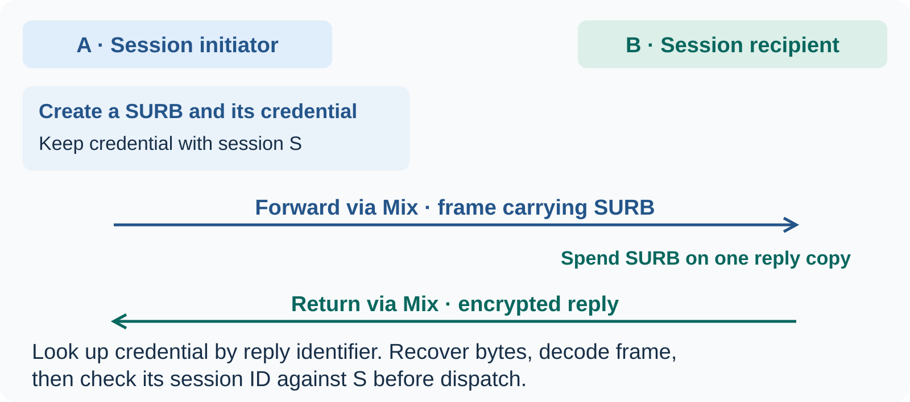
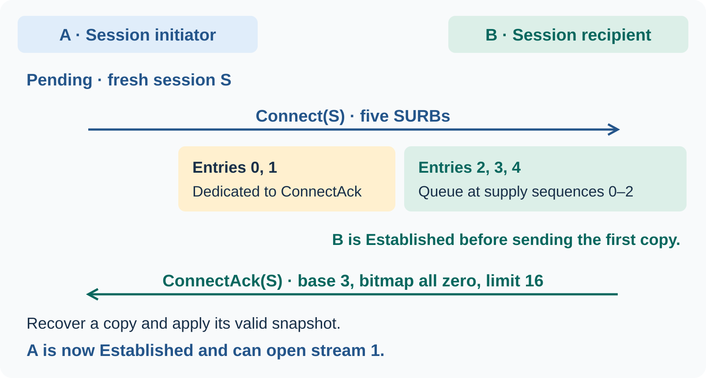
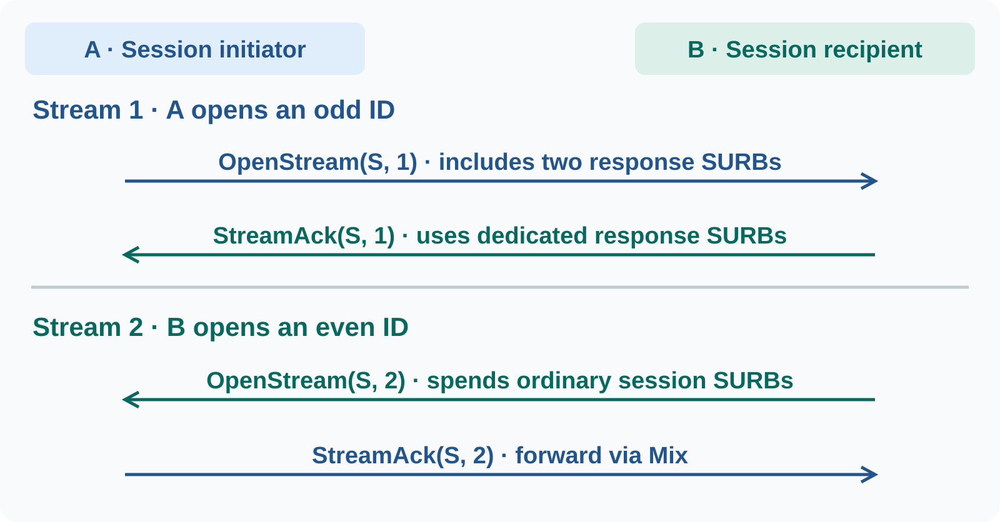
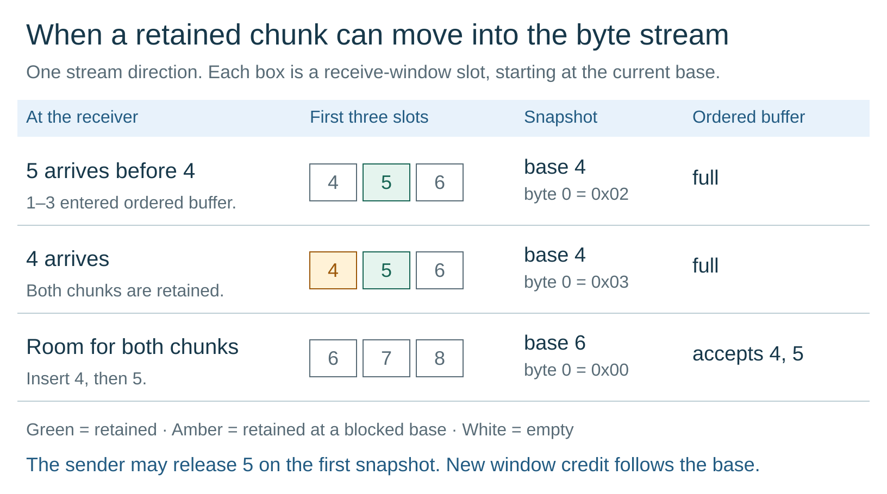
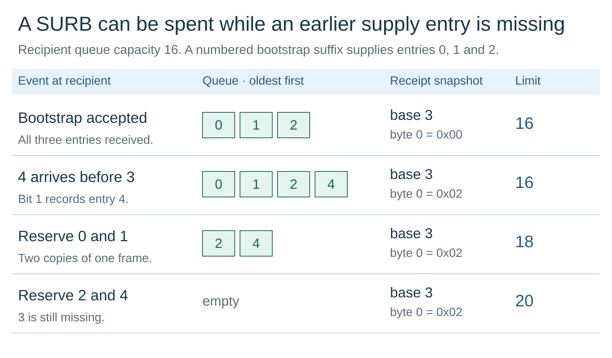
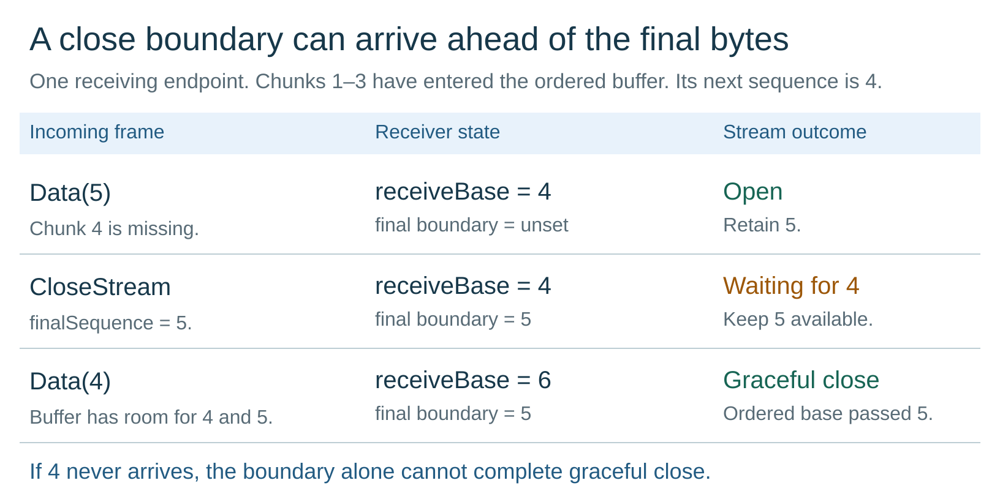

# Mix Transport Design Specification

| Field | Value |
| --- | --- |
| Name | MixTransport |
| Slug | 246 |
| Status | raw |
| Category | Standards Track |
| Editor | [Marcin Czenko](https://github.com/marcinczenko) |
| Contributors | [Marcin Czenko](https://github.com/marcinczenko) |

## Abstract

MixTransport enables applications to communicate through bidirectional streams over the anonymous packet service provided by the [Mix Protocol](https://lip.logos.co/anoncomms/raw/mix.html). It bridges the gap between individual Mix messages and the continuous, in-order delivery expected by stream-based applications. An initiator establishes a session with a known destination without disclosing its network address through the transport protocol; either endpoint can then open streams within that session.

This specification defines the message formats and endpoint behavior required for interoperable implementations. It covers session and stream establishment, data transfer and loss recovery, flow control, the supply of single-use reply blocks that enable communication back to the initiator, and connection teardown. It also describes the protocol's reliability and privacy boundaries.

## 1. Scope and Requirements Language

This specification defines the wire format and endpoint behavior needed for independently developed MixTransport implementations to communicate. It specifies how transport frames are carried by Mix, how sessions and streams are identified, and how endpoints process establishment, data transfer, acknowledgements, SURB supply, and teardown.

The key words **MUST**, **MUST NOT**, **SHOULD**, **SHOULD NOT**, and **MAY** express protocol requirements in this document. Requirements on transmitted frames apply to a conforming sender; receive-side validation and discard behavior are described separately.

MixTransport provides session establishment, stream admission, in-order delivery, duplicate suppression, acknowledgements, bounded per-stream flow control, SURB replenishment, and remote teardown notifications. Content-provider selection, application message formats, and the choice of whether to use anonymous transport are application responsibilities outside the scope of this specification.

MixTransport requires a LIBP2P-MIX endpoint that can submit and receive opaque service payloads, create a serializable SURB with a separate private reply credential, submit a reply through a supplied SURB, and recover reply bytes using the matching credential. The endpoint must report local submission success or failure. MixTransport version 3 requires Mix key rotation to be disabled. The proposed LIBP2P-MIX endpoint interface also specifies lifetime bounds for SURBs and credentials when Mix key rotation is enabled. Section 12 links the interface proposal and the separate proposal for MixTransport version 4. Sections 3.1 and 9.3 describe how version 3 uses Mix. Mix supplies Sphinx routing and packet processing, including its intentional delays.

An implementation conforms by producing the specified encodings and preserving the externally observable state and delivery rules below. It need not reproduce any particular programming language, API, concurrency model, or internal data structure. The local policy defaults in Section 10 are not negotiated protocol constants. In contrast, frame limits, identifier allocation, bitmap interpretation, and the rules governing credit are part of the interoperability contract.

## 2. Terminology

**Session initiator:** the endpoint creating a session. It knows the destination's real libp2p peer identity and Mix destination information.

**Session recipient:** the destination accepting that session. It knows the initiator by a session pseudonym, not by an address usable for a new forward connection.

**Session pseudonym (`sessionId`):** an initiator-generated random value represented as a valid libp2p `PeerId`. Both endpoints include it in transport frames to identify the session. It does not identify the initiator’s real libp2p peer identity.

**Forward frame:** a frame from initiator to recipient, delivered as a Mix service payload. **Reverse frame:** a frame from recipient to initiator, delivered through a SURB. These directions do not change when the recipient opens a stream.

**Stream opener / acceptor:** the endpoint requesting a particular stream and the endpoint admitting it. Either session role can be the opener.

**SURB:** a single-use reply block created by the initiator and given to the recipient. **Reply credential:** the corresponding private recovery material, retained only by the initiator.

**Redundancy batch:** the SURBs selected for redundant copies of one reverse frame. It exists only during transmission and has no wire identifier or persistent group representation. The reference profile uses two SURBs per batch.

**Supply sequence:** a session-wide number identifying one SURB supplied to the recipient's bounded queue. It is independent of stream Data sequences.

**Receive base:** the beginning of an acknowledgement window. For Data, it is the next sequence not yet delivered into the ordered application-facing buffer. For supply, it is the first sequence not yet received in the contiguous prefix.

## 3. Architecture and Identity

### 3.1 Mix service boundary

MixTransport carries its control messages and application data in transport frames. Each frame is encoded as specified in Section 4 and carried as the payload of one Mix message. Mix handles the Sphinx packet and routing; MixTransport interprets the recovered frame and applies the session and stream rules in this specification. Application writes larger than one frame are split into Data frames by MixTransport and sent one-by-one by the Mix delivery service.

The two session roles use different delivery mechanisms. The initiator knows the recipient's destination information and can send forward messages to it. The recipient instead uses SURBs created by the initiator to send reverse messages. This distinction applies to every stream in the session, including streams opened by the recipient.

#### 3.1.1 Forward delivery

Before establishing a session, the initiator needs the recipient's peer identity, network endpoint, and public keys required by Mix. These identify the final node of the forward route. Intermediate nodes are selected from the relay pool; the recipient need not be a member of that pool merely to be used as a destination. How this destination information is discovered and authenticated is outside this specification.

The final Mix node is also the MixTransport recipient: exit equals destination. It terminates the Mix route and processes the transport frame locally, rather than forwarding the recovered application payload to another node.

A forward Mix message MUST use `/libp2p/mix-transport/1.0.0` as its service codec and contain exactly one encoded transport frame as its payload. This service codec selects the MixTransport protocol at the destination. It is distinct from the application codec carried inside an OpenStream frame, which selects the application protocol within a session.

An application uses `connect` to establish a session, or `dial` to open an application stream. When no session exists, the initiator establishes one by sending a `Connect` frame and receiving `ConnectAck`, following the procedure in Section 5. A `dial` operation performs this establishment first if needed, then sends `OpenStream` to request a stream, as described in Section 6. If a session already exists, `connect` reuses it without another establishment exchange, while `dial` opens a new stream within it.

The initiator includes SURBs in `Connect` so the recipient can return `ConnectAck` without knowing the initiator's network address. Similarly, an initiator-sent `OpenStream` includes SURBs for `StreamAck` or `StreamReject`. In both cases, the first two SURBs are dedicated to that response; any remaining SURBs contribute to the session's shared supply for subsequent reverse communication. Further replenishment uses `SurbSupply` frames. `SurbStatusProbe` carries dedicated SURBs for its status response. All four frame kinds encode their SURBs in the same repeated `surbs` field; Section 8 defines the supply-management rules.

Each session has a `sessionId`, carried in its establishment frames and subsequent communication to identify the session. Stream-specific frames also carry a `streamId` identifying a stream within that session. After Mix recovers a forward message, the recipient decodes and validates the transport frame according to Section 4, then processes it according to its kind and the session or stream state.

#### 3.1.2 Reverse delivery and reply recovery

To make reverse delivery possible, the initiator creates a SURB together with its corresponding reply credential. The SURB describes a return path to the initiator. The initiator sends the SURB to the recipient in a transport frame, while retaining the reply credential and its association with the session. The recipient uses the SURB to send a message back to the initiator without knowing its network address. The reply credential is held by the initiator and is used to recover the reply.

For each reverse copy, the recipient encodes one transport frame and submits it through one unused SURB. The reverse Mix message uses an empty service codec. The SURB determines its return route, and the initiator identifies and recovers the reply using the corresponding reply credential, rather than dispatching it by service codec. The recovered message payload MUST contain exactly one encoded transport frame. Redundant copies use separate SURBs but contain the same encoded frame; Section 8 describes their selection and replenishment.

When the reply reaches the initiator, Mix provides an encrypted reply payload and the SURB identifier needed to select its reply credential. This identifier belongs to the Mix reply mechanism; it is distinct from the transport's `sessionId`. The initiator uses the matching credential to recover the message payload before attempting to decode a transport frame.

A reply without an available matching credential cannot be recovered as a MixTransport frame. Recovery failure or invalid frame encoding MUST NOT result in frame processing. After successful recovery and decoding, the frame's `sessionId` MUST match the session associated with the credential. A mismatch is discarded. Only then does the initiator process the frame according to its kind and the session's state. Credential consumption and expiry are specified in Section 9.



**Recovering a reverse frame.** Read down from A’s creation of a single-use reply block. Only the SURB travels to B. On return, the Mix reply identifier selects A’s credential before A can read the transport session ID.

<details>
<summary>Read the diagram as a table</summary>

| Step | Session initiator A | Session recipient B |
|---|---|---|
| Prepare | Creates the SURB and keeps its credential with session S. | |
| Forward via Mix | Sends a frame carrying the SURB. | Receives the SURB. |
| Return via Mix | Recovers the encrypted reply using the credential identified by the reply identifier. Decodes the frame and checks its session ID against S before dispatch. | Spends the SURB on one reply copy. |

</details>

#### 3.1.3 Delivery semantics

Successful local submission to Mix does not confirm receipt or processing by the other endpoint. Frames may be delayed, lost, or arrive out of order; redundant transmissions can also produce multiple deliveries of the same logical frame. MixTransport uses `ConnectAck` and `StreamAck` to confirm session and stream establishment, Data sequence numbers and acknowledgements to track transferred chunks, and SURB supply snapshots to report reply capacity. Timers determine when to retry transmissions or fail an operation. Their behavior and recovery limits are specified in Sections 5–9. In either direction, Mix delivers individual messages that may arrive out of order. MixTransport uses Data sequence numbers to deliver their payloads to the application in order.

### 3.2 Application-facing identity

| Endpoint | Application-facing peer identity |
| --- | --- |
| Initiator | Real destination `PeerId` |
| Recipient | Session pseudonym `sessionId` |

The pseudonym identifies an existing session, not a routable destination. The recipient MAY use it to open another stream in that session. It MUST NOT interpret it as the initiator's real peer identity or use it to attempt a new ordinary libp2p connection. It cannot establish a new session to the otherwise unknown initiator.

The pseudonym remains stable for the session lifetime. Stream closure does not change it. A fresh initiator session uses a fresh pseudonym. All streams within a session use the same session pseudonym and share the recipient’s supply of SURBs for reverse communication.

### 3.3 State model and dispatch

Session state is **Pending**, **Established**, or **Closed**. Pending means that an initiator has sent a `Connect` frame but has not accepted a `ConnectAck` frame. The recipient makes a new session Established before sending `ConnectAck`. Closed state is terminal; a frame other than a new `Connect` cannot create a session.

A stream has its own Pending, Established, and Closed states. Pending means that its opener is waiting for admission. An acceptor establishes a stream before acknowledging admission. Each established stream has two independent `Data` sequence spaces: one for each endpoint's outgoing data. Stream identity is scoped to the session.

| Received frame | State required for its operation |
| --- | --- |
| `Connect` | No registered session with that ID, at the recipient |
| `ConnectAck` | Pending session, at the initiator |
| `OpenStream` | Established session; a previously unaccepted remote opening ID |
| `StreamAck` / `StreamReject` | Established session; Pending stream opened locally |
| `Data` / `Ack` | Established session and Established stream |
| `SurbSupply` / `SurbStatusProbe` | Established session, at the recipient |
| `SurbStatus` | Known initiator session; updates supply information, not stream state |
| `CloseStream` | Known session and stream. A locally opened Pending stream records the boundary and awaits admission (Section 6.2). |
| `ResetStream` | Known session and stream (Section 9.1). |
| `Disconnect` / `ResetSession` | Known session; see Section 9 |

A frame that cannot perform its operation in the current state is discarded; it does not implicitly establish a session or stream. Unknown-stream `Data` is not buffered in anticipation of `OpenStream`. This is why acceptors must install usable stream state before sending their acknowledgement.

A reverse frame can contain both a message about a stream and information about the recipient's available SURBs. If the stream has already closed, the initiator ignores the stream message but can still use the SURB information for the session's other streams.

## 4. Wire Representation

To communicate with another implementation, an endpoint must encode and decode transport frames using the same wire format. This section defines that format: the fields a frame can contain, the combinations required for each operation, and the limits on its encoded size.

Each transport frame identifies the session and the operation being performed, and carries the fields needed for that operation—for example, a stream identifier and application data in a `Data` frame, or SURBs in a `SurbSupply` frame. To send a transport frame, the endpoint encodes its fields as one Protobuf message and passes that message to Mix for delivery.

Section 4.1 defines the common fields, encoding conventions, and shared SURB supply snapshot. Section 4.2 specifies which fields each frame kind uses. Section 4.3 gives the size limits, and Section 4.4 describes how the frame is encapsulated in a Mix message and how individual SURBs are serialized. The subsequent sections define how endpoints process these frames and update session and stream state.

### 4.1 Common fields and encoding

The Mix service identifier `/libp2p/mix-transport/1.0.0` selects this protocol. The `version` field inside each frame identifies its format; this specification defines value `3`. There is no version-negotiation exchange.

Each Mix message payload contains exactly one Protobuf-encoded transport frame. All frame kinds use the same Protobuf schema. Every frame MUST contain `version` (field 1), `sessionId` (field 2), and `kind` (field 3), and `version` MUST be `3`. The `kind` value identifies the operation carried by the frame and determines which additional fields it contains.

The table below lists the three fields required in every frame. Section 4.2 defines each frame kind and its operation-specific fields. Common and operation-specific fields are encoded together in one Protobuf message.

Unsupported versions, unknown frame-kind values, malformed Protobuf, oversized frames, and invalid combinations of known fields are discarded before frame handling. Discarding a malformed frame does not itself require resetting its session or sending an error response.

| Field # | Name | Protobuf type | Meaning |
| --- | --- | --- | --- |
| 1 | `version` | `uint32` (varint) | Frame format version |
| 2 | `sessionId` | `bytes` | Binary `PeerId`, nonempty, at most 39 bytes |
| 3 | `kind` | `enum` (varint) | Frame kind from Section 4.2 |

#### 4.1.1 Encoding conventions

Protobuf `fixed32` uses little-endian encoding. Optional-field presence is significant: absence is not interchangeable with an explicitly encoded zero. Both bitmaps number bits least-significant-bit first within each byte: offset `i` uses byte `i div 8` and mask `1 << (i mod 8)`.

The Protobuf wire types are `0` for `uint32` and `enum`, `5` for `fixed32`, and `2` for bytes and strings. Every `bytes` field is length-delimited: its field tag is followed by a varint specifying the byte length of the value, followed by the raw bytes. This length excludes the field tag and the length prefix itself. Strings and embedded messages use the same length-delimited framing. Each SURB is encoded as a separate occurrence of the repeated `bytes` field `surbs` (field 14). Each occurrence contains the Protobuf field tag, followed by a varint specifying the number of SURB bytes, followed by those bytes. Multiple SURBs are encoded by repeating this structure, not by concatenating their bytes into a single field value. String limits count encoded bytes, not characters. The `sessionId` bytes MUST decode as a binary libp2p `PeerId` and satisfy the length bound in Section 4.1. A receiver MUST discard a frame whose session identifier fails binary peer ID validation.

Senders MUST emit at most one occurrence of each singular field and MUST NOT use unknown fields to change version-3 semantics. Receivers apply the standard Protobuf decoding rules before validating the resulting frame. For example, if a singular `sequence` field appears twice, the last value is used. Each occurrence of the repeated `surbs` field contributes one entry in wire order. Well-formed unknown fields are skipped according to their wire type. The decoded frame still has to satisfy all required-field and operation-specific checks.

#### 4.1.2 Shared field set: SURB supply snapshot

A **SURB supply snapshot** reports the recipient's session-wide SURB supply state. It consists of the following three fields, encoded directly in the transport frame. Section 8 defines their interpretation.

| Field # | Name | Protobuf type | Meaning |
| --- | --- | --- | --- |
| 11 | `surbSupplyReceiveBase` | `fixed32` | Supply acknowledgement base |
| 12 | `surbSupplyAcknowledgementBitmap` | `bytes` | Supply acknowledgement bitmap, exactly 32 bytes |
| 13 | `surbSupplyLimit` | `fixed32` | Exclusive supply credit limit |

These fields form one indivisible report: if any is present, all three MUST be present. A partially present snapshot is invalid.

The recipient MUST include a complete supply snapshot in every reverse `OpenStream`, `StreamAck`, `StreamReject`, `Data`, `Ack`, `CloseStream`, `ResetStream`, `Disconnect`, and `ResetSession` frame. If the snapshot is missing, the initiator still processes the frame's operation, but obtains no supply information from it. A partially present snapshot invalidates the frame.

`ConnectAck` and `SurbStatus` require a complete snapshot for processing; the initiator discards either frame if its snapshot is missing or incomplete. Forward frames MUST NOT contain a supply snapshot.

### 4.2 Frame kinds and operation-specific fields

Every frame described below includes the common `version`, `sessionId`, and `kind` fields from Section 4.1. Its `kind` value selects one of the following operations. The values in this index are enum values, not Protobuf field numbers.

| Kind value | Frame kind | Purpose |
| --- | --- | --- |
| 1 | `Connect` | Establish a session |
| 2 | `ConnectAck` | Acknowledge session establishment |
| 3 | `OpenStream` | Open a stream within a session |
| 4 | `StreamAck` | Accept a stream |
| 5 | `Data` | Carry application data |
| 6 | `Ack` | Acknowledge received data |
| 7 | `CloseStream` | Close a stream gracefully |
| 8 | `ResetStream` | Abort a stream |
| 9 | `Disconnect` | Close a session |
| 10 | `ResetSession` | Abort a session |
| 11 | `StreamReject` | Reject a stream-opening request |
| 12 | `SurbSupply` | Replenish the recipient's SURBs |
| 13 | `SurbStatusProbe` | Request a SURB supply snapshot |
| 14 | `SurbStatus` | Respond with a SURB supply snapshot |

Each subsection below lists all permitted operation-specific fields. Other known fields MUST be absent. “Required” and “Optional” refer to the particular frame kind and direction, not to the common Protobuf schema. Snapshot rows refer to the three fields in Section 4.1.2, not to an additional field or nested message.

No frame may contain more than five SURB entries. Lower per-kind limits apply as specified below. Numbered SURBs in a frame receive consecutive sequence numbers starting at `firstSurbSequence`. The sequence number assigned to the last numbered SURB MUST NOT exceed `2^32 − 2`; numbering MUST NOT wrap around to zero. Section 4.5 defines the numeric limits.

#### 4.2.1 `Connect`

Sent forward by the initiator to establish a session (Section 5). The `kind` field MUST have the value `1`.

| Field # | Name | Protobuf type | Presence and constraints |
| --- | --- | --- | --- |
| 10 | `firstSurbSequence` | `fixed32` | Required if more than two SURBs are supplied; otherwise MUST be absent |
| 14 | `surbs` | Repeated `bytes` | Required; 2–5 independently serialized SURBs |

The first two SURBs are reserved for sending `ConnectAck` and have no supply sequence numbers. Any additional SURBs replenish the recipient's session-wide supply. They are assigned consecutive sequence numbers starting at `firstSurbSequence`: the third SURB receives that number, the fourth receives the next number, and so on. For `Connect`, `firstSurbSequence` is zero when these additional SURBs are present. A supply snapshot is forbidden.

> **Open design question.** Consider removing `firstSurbSequence` from `Connect`: its value is always zero, so it is redundant for this frame kind.

#### 4.2.2 `ConnectAck`

Sent in reverse by the recipient through the dedicated `Connect` response SURBs to acknowledge session establishment (Section 5). The `kind` field MUST have the value `2`.

| Field # | Name            | Protobuf type     | Presence and constraints                                    |
| ------- | --------------- | ----------------- | ----------------------------------------------------------- |
| 11–13   | Supply snapshot | See Section 4.1.2 | Required; absence or partial presence invalidates the frame |

No SURBs are carried in this frame.

#### 4.2.3 `OpenStream`

Sent by either endpoint to open a stream for the application protocol named by `codec` (Section 6). The `kind` field MUST have the value `3`.

| Field # | Name | Protobuf type | Presence and constraints |
| --- | --- | --- | --- |
| 4 | `streamId` | `fixed32` | Required; nonzero stream identifier |
| 7 | `codec` | `string` | Required; nonempty application protocol identifier, at most 255 encoded bytes |
| 10 | `firstSurbSequence` | `fixed32` | Forward: required if more than two SURBs are supplied; otherwise absent. Reverse: forbidden. |
| 14 | `surbs` | Repeated `bytes` | Forward: required, 2–4 entries. Reverse: forbidden. |
| 11–13 | Supply snapshot | See Section 4.1.2 | Required when sending reverse; absence tolerated on reception. Forbidden forward. |

**Forward:** the first two SURBs are unnumbered and dedicated to `StreamAck` or `StreamReject`. Any remaining entries are numbered consecutively from `firstSurbSequence`.

**Reverse:** the recipient sends no SURBs and includes a supply snapshot.

#### 4.2.4 `StreamAck`

Sent by the stream acceptor to the opener to accept the requested stream (Section 6). Depending on which endpoint opened the stream, this frame travels forward or reverse. The `kind` field MUST have the value `4`.

| Field # | Name | Protobuf type | Presence and constraints |
| --- | --- | --- | --- |
| 4 | `streamId` | `fixed32` | Required; nonzero stream identifier |
| 11–13 | Supply snapshot | See Section 4.1.2 | Required when sending reverse; absence tolerated on reception. Forbidden forward. |

No SURBs are carried in this frame.

#### 4.2.5 `Data`

Sent in either direction to carry a chunk of application data on a stream (Section 7). The `kind` field MUST have the value `5`.

> **Open design question.** Consider a larger payload limit for forward `Data` frames, which do not carry a supply snapshot, so that the available space can carry additional application data. The complete encoded frame must still fit within the size limit in Section 4.3.

| Field # | Name            | Protobuf type     | Presence and constraints                                                          |
| ------- | --------------- | ----------------- | --------------------------------------------------------------------------------- |
| 4       | `streamId`      | `fixed32`         | Required; nonzero stream identifier                                               |
| 5       | `sequence`      | `fixed32`         | Required; data sequence satisfying Section 4.5                                    |
| 6       | `payload`       | `bytes`           | Required; nonempty application-data chunk, at most 3,835 bytes                    |
| 11–13   | Supply snapshot | See Section 4.1.2 | Required when sending reverse; absence tolerated on reception. Forbidden forward. |

No SURBs are carried in this frame.

#### 4.2.6 `Ack`

Sent in either direction to acknowledge data received on a stream (Section 7.3). The `kind` field MUST have the value `6`.

| Field # | Name | Protobuf type | Presence and constraints |
| --- | --- | --- | --- |
| 4 | `streamId` | `fixed32` | Required; nonzero stream identifier |
| 8 | `receiveBase` | `fixed32` | Required; data acknowledgement base |
| 9 | `acknowledgementBitmap` | `bytes` | Required; exactly 32 bytes |
| 11–13 | Supply snapshot | See Section 4.1.2 | Required when sending reverse; absence tolerated on reception. Forbidden forward. |

The base and bitmap describe the acknowledged data sequences according to Section 7.3. No SURBs are carried in this frame.

#### 4.2.7 `CloseStream`

Sent in either direction to close a stream gracefully. The `kind` field MUST have the value `7`.

| Field # | Name | Protobuf type | Presence and constraints |
| --- | --- | --- | --- |
| 4 | `streamId` | `fixed32` | Required; nonzero stream identifier |
| 16 | `finalSequence` | `fixed32` | Required; final data sequence, with numeric limits defined in Section 4.5 |
| 11–13 | Supply snapshot | See Section 4.1.2 | Required when sending reverse; absence tolerated on reception. Forbidden forward. |

No SURBs are carried in this frame.

#### 4.2.8 `ResetStream`

Sent in either direction to abort a stream. The `kind` field MUST have the value `8`.

| Field # | Name | Protobuf type | Presence and constraints |
| --- | --- | --- | --- |
| 4 | `streamId` | `fixed32` | Required; nonzero stream identifier |
| 11–13 | Supply snapshot | See Section 4.1.2 | Required when sending reverse; absence tolerated on reception. Forbidden forward. |

No SURBs are carried in this frame.

#### 4.2.9 `Disconnect`

Sent in either direction to close a session. The `kind` field MUST have the value `9`.

| Field # | Name | Protobuf type | Presence and constraints |
| --- | --- | --- | --- |
| 11–13 | Supply snapshot | See Section 4.1.2 | Required when sending reverse; absence tolerated on reception. Forbidden forward. |

There are no operation-specific fields in the forward direction. In reverse, the frame carries the supply snapshot. No stream identifier or SURBs are carried.

#### 4.2.10 `ResetSession`

Sent in either direction to abort a session. The `kind` field MUST have the value `10`.

| Field # | Name | Protobuf type | Presence and constraints |
| --- | --- | --- | --- |
| 11–13 | Supply snapshot | See Section 4.1.2 | Required when sending reverse; absence tolerated on reception. Forbidden forward. |

There are no operation-specific fields in the forward direction. In reverse, the frame carries the supply snapshot. No stream identifier or SURBs are carried.

#### 4.2.11 `StreamReject`

Sent by the stream acceptor to the opener to reject a stream-opening request (Section 6). Depending on which endpoint opened the stream, this frame travels forward or reverse. The `kind` field MUST have the value `11`.

| Field # | Name | Protobuf type | Presence and constraints |
| --- | --- | --- | --- |
| 4 | `streamId` | `fixed32` | Required; nonzero stream identifier |
| 15 | `rejectionReason` | `string` | Optional; diagnostic text, at most 255 encoded bytes |
| 11–13 | Supply snapshot | See Section 4.1.2 | Required when sending reverse; absence tolerated on reception. Forbidden forward. |

An absent or empty `rejectionReason` carries no diagnostic explanation. No SURBs are carried in this frame.

#### 4.2.12 `SurbSupply`

Sent forward by the initiator to replenish the recipient's session-wide SURB supply (Section 8). The `kind` field MUST have the value `12`.

| Field # | Name | Protobuf type | Presence and constraints |
| --- | --- | --- | --- |
| 10 | `firstSurbSequence` | `fixed32` | Required; supply sequence of the first SURB entry |
| 14 | `surbs` | Repeated `bytes` | Required; 1–5 independently serialized, numbered SURBs |

Numbering starts with the first entry and increases consecutively. Unlike `Connect` and forward `OpenStream`, there are no dedicated unnumbered response entries. A supply snapshot is forbidden.

#### 4.2.13 `SurbStatusProbe`

Sent forward by the initiator to request a supply snapshot (Section 8). The `kind` field MUST have the value `13`.

| Field # | Name | Protobuf type | Presence and constraints |
| --- | --- | --- | --- |
| 14 | `surbs` | Repeated `bytes` | Required; a conforming sender supplies exactly two response SURBs |

The SURBs are unnumbered and dedicated to the `SurbStatus` response. On reception, two through five entries are permitted, and the recipient selects the first two decodable SURBs. `firstSurbSequence` and supply snapshots are forbidden.

#### 4.2.14 `SurbStatus`

Sent in reverse by the recipient through the probe's response SURBs to report its supply state (Section 8). The `kind` field MUST have the value `14`.

| Field # | Name | Protobuf type | Presence and constraints |
| --- | --- | --- | --- |
| 11–13 | Supply snapshot | See Section 4.1.2 | Required; absence or partial presence invalidates the frame |

No SURBs are carried in this frame.

### 4.3 Packet-size bounds

Version 3 of the protocol uses the following limits in both directions:

| Item                             | Maximum / exact size |
| -------------------------------- | -------------------- |
| Complete encoded transport frame | 3,937 bytes maximum  |
| Data payload                     | 3,835 bytes maximum  |
| Serialized SURB                  | 734 bytes exactly    |
| Connect SURBs                    | 5 entries maximum    |
| OpenStream SURBs                 | 4 entries maximum    |
| SurbSupply SURBs                 | 5 entries maximum    |

The Data payload limit reserves 102 bytes for the remaining fields and Protobuf framing, including a 39-byte session identifier and a complete reverse supply snapshot. A shorter identifier, absent snapshot, or empty reverse service codec MUST NOT be used to enlarge the Data payload beyond this bound. The complete frame must also satisfy its size limit independently.

These bounds use the 4,608-byte packet size recommended in the [Mix Protocol specification, Section 8.3.2](https://lip.logos.co/anoncomms/raw/mix.html#832-payload-size). The [624-byte Sphinx header](https://lip.logos.co/anoncomms/raw/mix.html#831-header-field-sizes), 16-byte payload integrity prefix, and 2-byte message-padding length leave up to 3,966 bytes for the protocol identifier, its length prefix, and the encoded transport frame. Mix fills any unused space with padding.

For forward delivery, Mix prefixes the encoded transport frame with `/libp2p/mix-transport/1.0.0`, the protocol identifier used to select the Mix Transport handler at the destination. This identifier occupies 27 bytes, preceded by a one-byte `varint` encoding its length, for a total of 28 bytes. The transport frame limit leaves one further byte unused. That byte is a conservative capacity allowance, not an extra byte to transmit. This version does not negotiate different packet sizes.

`Connect` can carry three numbered SURBs after its two response entries; forward `OpenStream` can carry two. An `OpenStream` frame can carry at most four SURBs so that the frame still fits within the size limit when its `codec` field contains 255 bytes. A shorter `codec` does not increase the permitted number of SURBs.

The decoder validates frame structure without requiring every SURB to deserialize successfully. Numbered entries are decoded independently so a bad entry does not discard valid neighbors. For `Connect` and forward `OpenStream`, both of the first two SURBs - reserved for the response - must decode successfully. Otherwise, the receiver discards the frame.

### 4.4 Encapsulation and SURB representation

After Mix removes its message padding, the message is `uvarint(codecByteLength) || codecBytes || frameBytes`. Here, `codecBytes` contains the protocol identifier described in Section 4.3, and `codecByteLength` is its length in bytes. `frameBytes` contains the Protobuf-encoded transport frame.

For forward messages, the protocol identifier is `/libp2p/mix-transport/1.0.0`: `codecByteLength` is exactly 27, encoded as the single byte hexadecimal `1b`. For reverse messages, the identifier is empty: `codecByteLength` is zero, encoded as hexadecimal `00`, and `frameBytes` follows immediately. These lengths describe this protocol's use of Mix framing, not a general maximum length for Mix protocol identifiers.

Mix uses length-prefixed protocol identifiers to support delivery to different protocols, whose identifiers can have different lengths. Mix Transport uses this framing even though its forward identifier is fixed. This identifier is distinct from the application-protocol `codec` field inside an `OpenStream` frame.

No transport-frame length follows the protocol identifier. Mix message padding and Sphinx processing are lower-layer operations, not fields in the transport frame.

A SURB in field 14 is serialized as the following concatenation, without an additional SURB count or group identifier:

| Offset | Length | Mix component                                                 |
| ------ | ------ | ------------------------------------------------------------- |
| 0      | 94     | First-hop address in Mix's fixed-width address representation |
| 94     | 32     | Sphinx header Alpha                                           |
| 126    | 576    | Sphinx header Beta                                            |
| 702    | 16     | Sphinx header Gamma                                           |
| 718    | 16     | SURB payload-encryption key                                   |

The address, header, and key are produced and interpreted by the Mix SURB mechanism. The SURB key in this serialization is not the initiator's entire reply credential.

The 734-byte SURB serialization contains no session ID, supply sequence number, or initiator reply credential. The enclosing transport frame identifies the session through `sessionId`. For numbered SURBs, sequence numbers are derived from `firstSurbSequence` and their order among the numbered entries. The initiator retains the corresponding reply credentials locally.

### 4.5 Numeric validity

Stream IDs MUST be nonzero.

`Data` frames are numbered starting at one. Their highest permitted sequence number is `2^32 − 2`, leaving `2^32 − 1` available for the receive base to indicate that every usable sequence number has been received.

In a `CloseStream` frame, `finalSequence` MUST equal the last `Data` sequence the sender assigned on that stream, or zero if it assigned none. Section 7.1 specifies when abandoning an assigned chunk requires a reset.

Numbered SURBs use a separate sequence space starting at zero. Their highest permitted sequence number is also `2^32 − 2`, leaving `2^32 − 1` available for the supply receive base to indicate that every usable supply sequence has been received. An exclusive supply limit may reach `2^32 − 1` to permit the last usable supply sequence, `2^32 − 2`.

All range arithmetic MUST avoid unsigned wraparound. For a frame carrying numbered SURBs, the last assigned sequence is `firstSurbSequence + numberedEntryCount − 1`. If this exceeds `2^32 − 2`, the receiver MUST reject the entire frame. The receiver MUST check this bound without allowing the calculation itself to wrap around to a smaller value.

Structural validity alone does not grant credit. The session or stream state determines whether a numerically valid sequence or snapshot is admissible. In particular, Data ACK bases must satisfy Section 7.3 and supply snapshots must satisfy Section 8.2.

## 5. Session Establishment

### 5.1 Initiating an attempt

The initiator creates a Pending session with a fresh, randomly generated pseudonym that does not expose its real peer identity. It records the destination and creates between two and five SURBs with retained reply credentials associated with the new session. It then sends Connect forward. Entries 0 and 1 are dedicated to ConnectAck. Any suffix is numbered consecutively beginning at supply sequence zero; firstSurbSequence is present exactly when that suffix exists.

The initiator's next supply sequence becomes the number of suffix entries allocated, including any entries lost in transit. Its initial remote supply base and limit are zero until ConnectAck grants credit. Response SURBs have no supply sequence. The initiator MUST NOT open streams or send Data before accepting ConnectAck.

One way to obtain the pseudonym is to generate a fresh temporary secp256k1 key pair and derive its libp2p PeerId. The resulting identifier fits the 39-byte bound. This construction does not add a transport identity-authentication exchange: neither proof of key possession nor the private key is sent to the recipient. A pseudonym MUST NOT be reused for a subsequent session.

### 5.2 Accepting and acknowledging

The recipient ignores `Connect` for an already registered session ID. For a new session it decodes both dedicated response SURBs, initializes its supply queue, accepts valid numbered suffix entries, and prepares `ConnectAck` with its initial supply snapshot.

The recipient MUST become operational before submitting the first acknowledgement copy. An initiator may receive that copy while another is still being submitted; subsequent frames must find an Established session. Complete failure to submit any acknowledgement copy causes local rollback. Cancellation also terminates the local attempt.

The initiator becomes Established only after recovering a matching `ConnectAck` for its Pending session and applying a valid supply snapshot. Submission of Connect is not confirmation of establishment. Later copies do not repeat the transition.

The first ConnectAck snapshot advertises initial capacity through its supply limit. Its base and bitmap acknowledge the valid bootstrap entries; using the dedicated response SURBs does not increase that limit. If either dedicated Connect SURB cannot be decoded, the recipient discards the attempt without establishing a session. Invalid numbered suffix entries leave holes at their assigned sequences; later valid entries are not renumbered.



**When each endpoint can act.** This example uses five decodable SURBs and queue capacity 16. B can receive stream traffic as soon as it submits the first acknowledgement. If that copy reaches A, A can open a stream while the second copy is still in flight.

<details>
<summary>Read the diagram as a table</summary>

| Step | Session state and frame |
|---|---|
| A starts | Session S is pending. A sends Connect(S) with five SURBs. |
| B accepts | Entries 0 and 1 are dedicated to ConnectAck. Entries 2–4 enter the queue at supply sequences 0–2. B is established before it sends the first reply copy. |
| B replies | ConnectAck(S) reports base 3, an all-zero bitmap, and limit 16. |
| A accepts | A recovers a copy and applies its valid snapshot. A is established and can open stream 1. |

</details>

### 5.3 Failure and duplicate handling

Connect is submitted once per attempt. The initiator applies a local timeout and abandons the Pending session on timeout, cancellation, or a failed local send. It releases the attempt's credentials and ignores later replies for it. A new attempt uses a fresh session ID and fresh SURBs.

Duplicate Connect frames for an existing session are discarded, not re-acknowledged. Consequently, retransmitting Connect with the same ID is not a reliable recovery procedure in this version. Loss of Connect or all acknowledgement copies can fail establishment even when both endpoints remain reachable. The recipient may have accepted a session whose initiator timed out; there is no confirmed cancellation exchange for that case.

## 6. Stream Establishment and Admission

### 6.1 Identifiers

A stream is identified by `(sessionId, streamId)`. The session initiator allocates odd IDs starting at 1; the recipient allocates even IDs starting at 2. IDs are unsigned 32-bit values. Each endpoint MUST allocate monotonically in its own parity and MUST NOT wrap or reuse IDs within a session.

### 6.2 Opening in either direction

The opener registers a Pending stream and sends `OpenStream` with the application codec. An initiator-originated opening includes two dedicated response SURBs and up to two numbered supply entries, subject to available credit. A recipient-originated opening consumes ordinary session SURBs, carries a supply snapshot, and includes no SURBs. Its response uses the forward path.

The acceptor verifies session state and remote stream-ID parity, records the opening attempt, resolves the codec in its mounted protocol registry, and applies incoming-stream admission limits. Unsupported protocols or exhausted admission return `StreamReject` when a response path is available. Rejection reasons are bounded diagnostics, not machine-readable error codes.

Before sending StreamAck, the acceptor MUST register and establish the stream and make its Data, ACK, and teardown processing operational. Receiving the first ACK copy can cause the opener to send Data before the acceptor finishes submitting other copies. Application-handler scheduling MUST NOT create a period in which that early Data is discarded because the stream is not ready.

The opener exposes the stream as established only after accepting StreamAck. If a valid `CloseStream` arrives while the open is Pending, the opener MUST retain the final sequence and continue waiting under the existing opening deadline. If it accepts `StreamAck` in time, the open succeeds and the stream follows Section 9.1 using the retained boundary. In particular, `StreamAck` and `CloseStream(0)` arriving in either order before the deadline yield a successful open whose first read reports end-of-stream. A matching `StreamReject` or `ResetStream` received while the open is Pending fails the opening. Only an accepted `StreamAck` confirms admission. OpenStream is not retransmitted; a local timeout or cancellation abandons the Pending stream. A late response does not reopen it. At the acceptor, failure of all local StreamAck submissions, or cancellation of acceptance, removes the new stream. At least one successful submission is enough to retain it; delivery is still not guaranteed.

A forward OpenStream's first two SURBs are reserved for StreamAck or StreamReject and never enter the ordinary queue. They must both decode successfully. Any numbered suffix is admitted using Section 8.2, before the protocol-admission decision; usable supply is not conditional on stream admission. Reverse OpenStream has no dedicated return SURBs because the initiator can send its response forward.



**Two openings in session S.** Arrows show logical frames. In both openings the acceptor prepares to receive Data before sending `StreamAck`. For stream 2 the acceptor is A, so the acknowledgement travels forward to B’s known destination.

<details>
<summary>Read the diagram as a table</summary>

| Stream | Opening frame | Acknowledgement |
|---|---|---|
| 1, opened by A | A sends OpenStream(S, 1) forward with two response SURBs. | B sends StreamAck(S, 1) using dedicated response SURBs. |
| 2, opened by B | B sends OpenStream(S, 2) using ordinary session SURBs. | A sends StreamAck(S, 2) forward via Mix. |

</details>

### 6.3 Duplicate and late openings

Removing a stream MUST NOT make its opening ID admissible again. Remote allocation positions are `(streamId − 1) div 2`: odd and even IDs both map to positions 0, 1, 2, and so on. The accepted-opening history covers a 1,024-position window with initial lower bound zero.

For an incoming opening at position `p`, first check remote parity and session state. If `p` is below the history lower bound, discard it. If `p` is above the window, advance the lower bound to `p − 1023`, forgetting positions below it. Discard an already recorded position; otherwise record it before any response, admission decision, or other operation that permits another frame to be processed. The history includes rejected and subsequently closed streams. Its storage representation is not prescribed.

Window advancement makes older positions permanently inadmissible, including previously unseen openings delayed beyond the window. Duplicates are discarded rather than re-acknowledged. Late `StreamAck` and `StreamReject` affect only a matching Pending outbound stream. Both session roles use these rules.

## 7. Data Transfer and Flow Control

### 7.1 Byte-stream semantics

Each stream direction has an independent Data sequence starting at 1. Valid Data sequences end at `2^32 − 2`; `2^32 − 1` is reserved as the terminal receive base. Sequences MUST NOT wrap. Application writes are divided into nonempty chunks within Section 4.3's bound. Concurrent writes on one stream are serialized; write boundaries are not preserved remotely.

For each sending direction, initialize the next sequence and the remembered remote receive base to 1. For each receiving direction, initialize receiveBase to 1 and its 256-bit bitmap to zero. These states are independent of the stream opener's role and of session SURB-supply state.

The remote receive window has 256 positions. With remote base `B`, the exclusive send limit is `min(B + 256, 2^32 − 1)`, calculated without overflow. A sender MUST NOT allocate a new sequence at or above that limit, and MUST NOT exceed the valid Data sequence space. It assigns sequences consecutively and retains each assigned payload until acknowledged or the stream is terminated. The reference sender additionally limits retained chunks to 64; that is a local memory/concurrency bound, not a smaller advertised receive window.

If a local submission fails, the sender may retry the same chunk with the same sequence. If it abandons an assigned chunk without a known successful local submission, it MUST abort the stream locally and attempt to send `ResetStream` as specified in Section 9. The sender MUST NOT signal graceful completion across that gap.

For example, at initial base 1 the window permits sequences 1–256. An ACK bitmap for many of those sequences can free retained-payload memory without granting permission to send sequence 257. That permission requires the reported base to advance.

### 7.2 Receive processing

Data is admitted only for an established session and stream. A sequence within `[receiveBase, receiveBase + 256)` is stored once and marked in the bitmap. Data below the base or already marked is a duplicate: it is not delivered twice, but triggers an ACK. Data beyond the receive window is discarded without an ACK.

Only the chunk at receiveBase may enter the ordered application-facing buffer. After insertion completes, the receiver increments the base and shifts the bitmap so old bit 1 becomes new bit 0, with zero entering at offset 255. It repeats while the next chunk is present and the buffer can accept it. While insertion is blocked, the chunk remains acknowledged at bit 0 and the base does not advance. This prevents a duplicate from being delivered during a blocked insertion.

The ordered buffer MUST provide bounded admission so application backpressure eventually stops receive-base advancement. Its exact capacity is local policy. An ACK means that the endpoint has taken responsibility for retaining or delivering bytes, not that the remote application has processed them. Once acknowledged, bytes MUST NOT be silently discarded while keeping the stream operational.

Repeated Data with the same sequence is treated as the same chunk, not a replacement: the first admitted payload is retained. A sender MUST use identical payload bytes for every transmission of a particular sequence.

### 7.3 Acknowledgements

An `Ack(B, bitmap)` is an absolute snapshot. Sequences below `B` have entered the ordered buffer; bit `i` acknowledges `B + i` as retained by the receiver. The sender removes corresponding retained chunks. It rejects a base ahead of its next allocated sequence and ignores an older base; another bitmap at the same base can acknowledge additional chunks.

Bitmap acknowledgement does not itself advance receive-window credit: the base controls that credit. Duplicate ACKs do not grant capacity twice. The receiver sends its current acknowledgement after admitting new Data, advancing its receive base, or receiving a duplicate within the rules of Section 7.2. Several changes may be coalesced into one snapshot; a change occurring during submission must remain eligible for a subsequent snapshot. The reference policy adds no intentional ACK batching delay.

For example, `receiveBase=4` and bitmap byte 0 equal to hexadecimal `02` acknowledge all allocated sequences below 4 and sequence 5. Sequence 4 remains missing or not yet admitted. The sender can release retained sequence 5 even though the receiver cannot deliver it before sequence 4. An older Data ACK is ignored in its entirety; it is not merged with the current bitmap.



**Following a gap through three snapshots.** Read each bitmap from its own base. At base 4, bit 1 acknowledges chunk 5. With the ordered buffer full, bit 0 can also become set while the base stays at 4. Only after the receiver inserts both chunks does the base advance to 6.

<details>
<summary>Read the diagram as a table</summary>

| Event | First three window slots | Base | Bitmap byte 0 | Ordered buffer |
|---|---|---:|---|---|
| 5 arrives before 4 | 4 missing, 5 retained, 6 empty | 4 | 0x02 | Full. Chunks 1–3 have entered. |
| 4 arrives | 4 and 5 retained, 6 empty | 4 | 0x03 | Full. |
| Room for both | 6, 7, 8 empty | 6 | 0x00 | Accepts 4, then 5. |

</details>

### 7.4 Retransmission and reliability limits

Data retransmission is enabled by default and can be disabled locally. Each retained chunk becomes eligible for retry after a local interval measured from completion of its previous send attempt. It is not simultaneously eligible while that attempt is in progress. A retry uses the same sequence and payload; a reverse retry uses fresh SURBs and a current supply snapshot, so the complete encoded frame need not be identical to the earlier transmission.

Before retrying, the sender checks that the chunk remains unacknowledged. ACK processing may remove it while its retry is being submitted. Completion of that submission MUST NOT restore it to the retained set. Different chunks may have different deadlines; choosing which due chunk to send is a local scheduling decision. No retransmission flag or attempt number is transmitted.

The reference retry interval is fixed, without a retry-count limit. Stream closure stops retries. Disabling retries does not disable ACK processing, in-flight bounds, or receive-window enforcement.

There is no ACK-of-ACK or independent acknowledgement-retransmission exchange. A lost ACK can be regenerated when duplicate outstanding Data elicits the receiver's current snapshot. There is no Data-window persist probe: if all outstanding Data has been bitmap-acknowledged and the final base-advancing ACK is lost, a sender can remain blocked. A SURB status probe reports supply credit, not Data-window credit. This version does not guarantee recovery from every loss pattern.

## 8. Reverse Capacity and SURB Replenishment

### 8.1 Session-wide queue and single use

The recipient stores numbered SURBs in one bounded queue shared by all streams. For an ordinary reverse frame it waits for enough entries for its redundancy batch, removes those entries without allowing another send to select the same entries, and increases supply credit for their consumption. It then takes the snapshot to attach to the frame. Thus that snapshot includes the capacity released by this transmission, not merely by earlier transmissions.

The same encoded frame is submitted through each selected SURB once. A SURB is spent when submitted even if local submission fails; it MUST NOT be put back in the queue. Success of the batch means at least one local submission succeeded, not confirmed remote receipt. Sequential versus concurrent submission is local scheduling, not wire semantics. The reference batch size is two. The dedicated first-two-entry layout for Connect and forward OpenStream is fixed regardless of ordinary-send scheduling.

There is no protected control reserve or refill-request frame. Empty ordinary capacity suspends reverse sends until supply arrives. Connect, forward OpenStream, and status-probe responses use their dedicated SURBs instead of the queue.

### 8.2 Numbering, credit, and receipt

Supply numbering starts at zero and ends at `2^32 − 2`. The recipient advertises an exclusive absolute limit `L`. The initiator MUST introduce a new sequence only below both `L` and `surbSupplyReceiveBase + 256`. The initial Connect suffix is a bootstrap exception, sent before the first credit snapshot.

The recipient's queue capacity `C` MUST accommodate the maximum three-SURB bootstrap suffix. Its initial limit is `C`. Removing a queued SURB for use grants one replacement position by increasing the limit, saturating at `2^32 − 1`. Dedicated response SURBs do not occupy the queue and do not grant numbered credit.

For each numbered entry, the recipient checks the credit limit, receipt window, duplicate state, and queue capacity. A valid new entry is queued and marked received. The base advances across the contiguous received prefix, independently of consumption. Unlike the Data bitmap, the supply bitmap records receipt rather than ordered application delivery.

Initially the supply receive base is zero and all bitmap bits are clear. When an entry at sequence `q` is admitted, set bit `q − base`. While bit 0 is set, increment the base and shift the bitmap by one position. Numbered SURBs may be consumed in arrival order; a gap does not prevent use of entries received after it. Their sequence numbers track receipt and credit, not an obligation to use them in sequence order.

A snapshot carries the base, 32-byte bitmap, and `L`. At the initiator, reject a snapshot if `L < base` or `base` exceeds the next supply sequence to allocate. Otherwise remove retained serializations for sequences below the snapshot base or explicitly marked in its bitmap. This acknowledgement MUST NOT remove the corresponding reply credentials: the recipient may still hold those SURBs.

The remembered remote base and limit are each updated to the maximum of their old value and the received value. Unlike Data ACK handling, an older supply snapshot can still acknowledge retained entries; it just cannot move the remembered base or limit backwards. Neither a duplicate snapshot nor a duplicate SURB grants credit again. A bit outside the set of locally allocated, retained supply entries has no serialization to release.

When the initiator receives a reverse frame containing a SURB supply snapshot, it validates and applies that snapshot before handling the frame's other contents. An invalid snapshot causes the entire frame to be discarded.

A valid snapshot remains useful even when the accompanying stream operation is no longer relevant. For example, a `StreamAck` may arrive after the initiator has abandoned that stream-opening attempt. The acknowledgement does not reopen the stream, but its snapshot still updates the initiator's knowledge of the recipient's SURB supply.

An accepted snapshot also resets the session's reverse-activity timer, which detects silence from the recipient as described in Section 8.5. A frame without a snapshot neither updates supply information nor resets that timer.

For example, with capacity 16 and three bootstrap entries received, ConnectAck reports base 3, an empty bitmap, and limit 16. This permits allocation of sequences 3–15, not 16 additional entries. After two queued entries are consumed, limit becomes 18; base can remain 3 until more supply arrives. Receipt and consumption are therefore distinct facts.

Accepting SurbSupply does not itself generate a dedicated acknowledgement. Receipt information travels in later reverse frames or in SurbStatus responding to a probe. An initiator MUST NOT assume a successful forward submission means the supply was received.



**Following the same gap in the supply queue.** Sequence 4 can enter the queue and be spent while sequence 3 is missing. The receipt bit for 4 stays set after use. Reserving each pair of ordinary SURBs raises the exclusive supply limit by two.

<details>
<summary>Read the diagram as a table</summary>

| Event at recipient | Queue, oldest first | Receipt base | Bitmap byte 0 | Exclusive limit |
|---|---|---:|---|---:|
| Bootstrap accepted | 0, 1, 2 | 3 | 0x00 | 16 |
| 4 arrives before 3 | 0, 1, 2, 4 | 3 | 0x02 | 16 |
| Reserve 0 and 1 for two copies of one frame | 2, 4 | 3 | 0x02 | 18 |
| Reserve 2 and 4 while 3 is still missing | Empty | 3 | 0x02 | 20 |

</details>

### 8.3 Watermark policy

The initiator coordinates all supply allocation at session scope, including suffix entries in OpenStream, so concurrent streams cannot allocate the same supply sequence. Let `N` be the next sequence to allocate, `B` the remembered supply base, and `L` the remembered supply limit. The available number of new positions is:

```text
S = max(0, min(L, B + 256, 2^32 − 1) − N)
```

All arithmetic in this expression is evaluated without wraparound. The first ConnectAck limit provides the initial capacity estimate `C`. Projected inventory is `max(0, C − S)`: allocated supply is counted as potentially in transit rather than immediately replaced. This is an estimate used for scheduling, not an exact reported queue length.

When projection is at or below the low watermark and credit is available, a replenishment cycle starts. It continues until available credit is allocated, using packets of at most five SURBs. Default capacity is 16 and watermark 11. A reverse frame consuming two SURBs therefore does not normally trigger its own two-SURB replacement packet. Batch size still depends on available credit and sequence-window space.

The watermark is local policy. An implementation may choose another replenishment schedule, but MUST honor the same absolute credit and sequence limits. Each newly allocated entry uses a fresh SURB. If a retry packet groups retained entries, firstSurbSequence still assigns consecutive sequence numbers: entries separated by a hole cannot be packed as though they were adjacent. Retry does not allocate new credit.

### 8.4 Supply retransmission and credential lifetime

Until receipt is acknowledged, the initiator retains each numbered SURB’s serialization and corresponding reply credential identifier. Retransmission sends the same SURB at the same sequence, without creating another credential. Receipt tracking prevents it entering the queue twice even if its first copy has been consumed.

Before retrying, the initiator purges expired credentials and checks the corresponding credential is active. If not, the retained SURB serialization is discarded rather than retransmitted. No replacement is assigned that old sequence. This version has no explicit supply-gap abandonment exchange; a persistent missing sequence can constrain receipt-window progress. Expiry is not equivalent to acknowledgement or guaranteed recovery of capacity.

### 8.5 Status probes

After a configured interval without a valid reverse snapshot, the initiator sends a forward `SurbStatusProbe` with two fresh dedicated response SURBs. The recipient uses them immediately for `SurbStatus`, even when its ordinary queue is empty. This provides a response path without requiring queue credit.

Unanswered probes are retried at the configured interval using fresh SURBs. Valid reverse activity resets the attempt count and inactivity deadline. After the final attempt, the initiator waits one full retry interval; continued silence removes that session, its streams, and credentials. Other sessions are unaffected. This detects lack of response at the initiator; it does not guarantee the recipient learns of local failure.

There is no probe identifier. Any accepted reverse snapshot is sufficient evidence of activity, including a delayed response to an earlier probe; it resets the silence detector rather than being matched to the latest attempt. Probe SURBs remain outside the ordinary queue and do not change numbered credit. A probe with fewer than two decodable SURBs produces no response. Local waiting for a status response MUST NOT block processing of incoming reverse frames or prevent forward replenishment when credit is available.

## 9. Teardown and Resource Lifetime

### 9.1 Stream closure

`CloseStream` announces the inclusive final sequence defined in Section 4.5. The receiver rejects a boundary smaller than `receiveBase − 1`, because data beyond it has already entered the ordered buffer. It also rejects a boundary differing from an earlier accepted close. Otherwise it records the boundary. An identical close is harmless. Data arriving above an accepted boundary is not admitted. A Pending opener applies Section 6.2 before completing the close.

On an Established stream, the receiver MUST admit every chunk through the boundary into the ordered buffer before completing a graceful close. The application can read all those bytes in order, followed by end-of-stream. If any chunk through the boundary is missing, the receiver MUST limit how long it waits for that gap. The timeout duration is local policy. If the wait expires with the gap still present, the receiver MUST abort the stream and report an incomplete-stream error to the application. It may report that error before the application drains unread buffered bytes. A duplicate close does not extend the wait. When all remaining chunks are present, application backpressure alone is no reason to report a missing chunk.

ResetStream aborts the stream immediately without waiting for missing Data. Applications must be able to distinguish reset from graceful end-of-stream; the representation of that distinction is API-specific. Stream termination releases transport state and stops further retries. After graceful closure, bytes already admitted to the ordered buffer remain available to the application until read. Its identifier remains covered by the opening-history rules and cannot be reused.

If the application closes while a chunk’s first local submission is unresolved, the sender MUST wait for successful submission of that chunk or abort the stream and attempt to send `ResetStream`. Once the sender has successfully submitted every assigned chunk to Mix at least once, it may close without waiting for Data acknowledgements. Local close stops retransmission and makes a best-effort notification. If the close arrives with a gap, the receiver follows the bounded wait above. If the close itself is lost, the receiver may never learn the boundary. Close closes the stream, rather than negotiating independent shutdown of one direction. It is not a reliable flush or half-close protocol in this version.



**When a close overtakes Data.** The final sequence is inclusive. With a boundary of 5 and chunk 4 missing, the receiver keeps chunk 5. Once it can insert 4 and 5 in order, its base becomes 6 and the stream can close gracefully.

<details>
<summary>Read the diagram as a table</summary>

| Incoming frame | Receive base | Final boundary | Stream outcome |
|---|---:|---|---|
| Data(5) | 4 | Unset | Open. Retain 5 while 4 is missing. |
| CloseStream with finalSequence 5 | 4 | 5 | Wait for 4 and keep 5. |
| Data(4), with room for both chunks | 6 | 5 | Graceful close after the ordered base passes 5. |
| Alternatively, 4 is still missing when the timeout expires | 4 | 5 | Abort with an incomplete-stream error. |

</details>

### 9.2 Session termination

Local `Disconnect` requires an idle session. A received Disconnect is remembered while streams remain and completes after their removal, allowing notifications to arrive out of order. `ResetSession` aborts all streams. Unknown-session or unknown-stream teardown frames do not create state.

Teardown notifications are not acknowledged or retransmitted. Reverse teardown does not wait for replenishment: without an immediately available batch, local cleanup proceeds without notification. Closing a session closes its streams, stops further supply and Data transmission, and releases its reply credentials. A session reset makes separate stream-reset notifications unnecessary. Receiving a teardown notification does not require echoing the same notification back.

### 9.3 Reply credentials

Successful reply recovery consumes the individual reply credential. Cryptographic recovery failure preserves an active credential; successful recovery followed by invalid payload decoding consumes it. A bounded retired-identifier set suppresses known repeats. Expiry and session removal release credentials; capacity exhaustion rejects new registration instead of evicting unrelated active credentials.

A reply credential's lifetime is not encoded in the SURB supply frame and is not negotiated with the recipient. The recipient can therefore still hold a SURB whose credential has expired at the initiator; using it cannot restore the credential. Implementations must account for this when choosing retention lifetimes and session policies. Retaining duplicate-identification metadata is local policy; accepting a successfully recovered SURB reply more than once is not permitted.

## 10. Reference Policy Defaults

These defaults are local policy, not fields negotiated in the handshake. Supply limits communicate recipient credit, not timer values. Constructor settings must satisfy their local bounds. Changing wire widths, bitmap lengths, or identifier semantics is not merely a policy adjustment.

| Policy | Default |
| --- | --- |
| Connect / stream-open timeout | 30 seconds each |
| Wait for a missing Data chunk after an accepted close on an Established stream | 2 minutes |
| Data retry interval | 30 seconds; enabled |
| Supply retry interval | 30 seconds |
| Reverse inactivity before probing | 2 minutes |
| Probe retry interval / attempts | 30 seconds / 3 |
| Recipient queue capacity | 16 SURBs |
| Replenishment low watermark | 11 SURBs |
| Reply redundancy | 2 |
| Reply credential lifetime | 30 minutes |
| Active credentials / retained retired identifiers | 100,000 each |
| Retained unacknowledged Data per sending direction | 64 chunks |

Timer values need not match between endpoints, but they affect availability: a timeout shorter than the Mix delivery delay can fail an otherwise valid exchange. The close-gap timeout should allow for the expected difference between the arrival of a close and the arrival of earlier Data over Mix. There is no wire-level promise that a response arrives within any of these defaults. Disabling Data retry locally reduces loss recovery without changing the receiver's acknowledgement obligations.

Per-stream Data state, receipt windows, recipient supply, and credential storage are bounded. The implementation has no global runtime session-count limit. Applications and deployments must account for aggregate resource use and admission limits when exposing protocols to anonymous peers.

## 11. Security and Privacy Considerations

MixTransport inherits Mix's assumptions about routing, delay, replay protection, and adversaries. It does not independently prove sender anonymity, resist arbitrary traffic correlation, or authenticate a pseudonym as a real peer. Establishment demonstrates a return path; it is not a new identity-authentication handshake.

Payloads, codecs, timing, and activity within a session can reveal relationships to the endpoints. Discovery, provider announcements, direct serving, and application identifiers can reveal content interest even when transfer uses Mix. Consumers MUST NOT treat Mix selection as automatic private discovery or private storage, and must not silently fall back to a direct application connection when anonymity is required.

The destination is the Mix exit, so no additional external exit receives the plaintext for forwarding. Nevertheless, MixTransport adds no independent end-to-end key exchange or authentication above Mix. Destination-record authenticity and freshness remain responsibilities of the surrounding discovery and identity system.

Reply credentials MUST remain at the initiator. SURBs MUST NOT be used for multiple reply submissions. Mix packet replay protection, credential consumption, stream-opening history, Data sequences, and supply sequences handle duplication at different layers. None alone provides a global denial-of-service defense; resource limits, protocol admission, and underlying Mix abuse controls remain necessary.

## 12. References

- [LIBP2P-MIX](https://lip.logos.co/anoncomms/raw/mix.html) defines the packet service, SURB construction, reply processing and security model.
- The proposed LIBP2P-MIX §5.6 defines the endpoint service used by MixTransport. [Logos LIPs #556](https://github.com/logos-co/logos-lips/pull/556)
- A separate proposal defines MixTransport version 4 for rotating Mix keys. [MixTransport #9](https://github.com/logos-storage/libp2p-mix-transport/pull/9)
- [libp2p Peer IDs and Keys](https://github.com/libp2p/specs/blob/master/peer-ids/peer-ids.md#peer-ids) defines the binary peer ID and its derivation from a public key. Sections 4.1 and 5.1 apply the transport size and pseudonym requirements.
- [Protocol Buffers encoding](https://protobuf.dev/programming-guides/encoding/) defines field tags, wire types, scalar encodings and how a decoder handles multiple occurrences of a field.

## Appendix A. Protocol Constants and Independent State

The following state spaces MUST NOT be conflated:

| State | Scope | Initial value | Progress means |
| --- | --- | --- | --- |
| Stream ID allocation | One allocator at each session endpoint | Initiator 1; recipient 2 | A new stream-opening attempt; increment by 2 |
| Data sequence | Each direction of each stream | 1 | A new payload chunk; increment by 1 |
| Data receive base / bitmap | Receiver of each stream direction | 1 / 256 zero bits | Ordered-buffer admission / retained chunks |
| Numbered SURB allocation | Session initiator | 0 | A new SURB supplied; increment by 1 |
| SURB receive base / bitmap | Session recipient | 0 / 256 zero bits | Contiguous receipt / later received entries |
| SURB supply limit | Session recipient | Local capacity C | A queued SURB consumed; increment with saturation |
| Remote opening-history lower bound | Each session endpoint | 0 | Old stream openings permanently become inadmissible |

The two acknowledgement bitmaps are both 32 bytes, but acknowledge different objects and advance for different reasons. A Data acknowledgement does not acknowledge supplied SURBs unless its separate supply snapshot is present. A SURB-supply acknowledgement does not acknowledge Data or advance a stream's receive window.

## Appendix B. Reliability Boundaries

Interoperability does not imply eventual progress under every loss pattern. Implementations and applications must account for these properties of this version:

- Connect and OpenStream have no reliable retry/duplicate-response exchange.
- Data can overtake stream admission. Suppose the opener receives `Data(1)`, then `CloseStream(1)`, then `StreamAck` before the opening deadline. While Pending, it discards the Data and retains the close boundary. The opening succeeds on `StreamAck`. If no copy of chunk 1 subsequently arrives, the close-gap timeout expires and the application receives an incomplete-stream error.
- Data retry can repair missing chunks while retained chunks and a usable delivery path remain. It cannot repair a lost final receive-window update after all chunks have been acknowledged and released.
- Supply retry requires active reply credentials. Expiry of a missing entry has no sequence-abandonment mechanism to advance the receipt window past that gap.
- Status probes repair uncertainty about reverse capacity and detect silence; they do not carry Data-window state.
- Close, reset, and disconnect notifications are best effort. A lost close can leave the peer waiting for a boundary. After receiving a close, an established receiver reports an incomplete stream if a gap through that boundary persists until its local timeout.

These boundaries are not permissions to reuse identifiers, transmit beyond credit, or reinterpret an expired credential as an acknowledgement. Changing those rules requires a protocol change, not merely different timer defaults.
