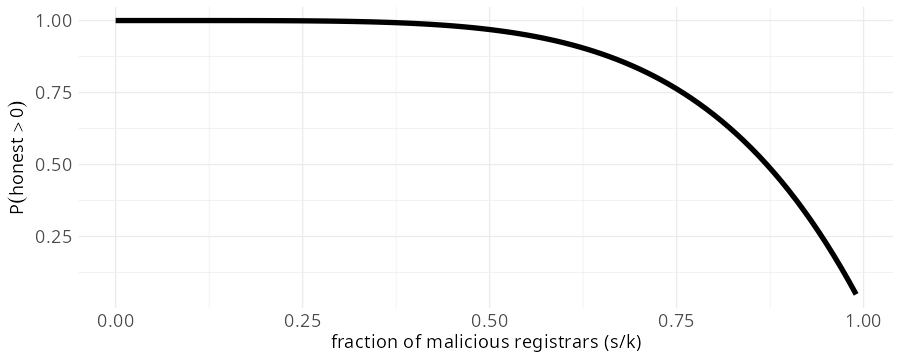

# NAME-SERVICE

| Field | Value |
| ----- | ----- |
| Name | NAME-SERVICE |
| Status | raw |
| Type | RFC |
| Category | Standards Track |
| Editor | Giuliano Mega <giuliano@logos.co> |
| Contributors | Arnaud Deville <arnaud@logos.co> |

$$
\newcommand{\cid}{c}
$$

## Abstract

TBW

## Motivation

Content-addressable systems such as Logos Storage identify the [10/DATASETS](/YOKL7w9nR6mVvtgpzBxifg) stored within the network by means of a [Content ID](https://specs.ipfs.tech/cid/) (CID). A CID is tied to the _content_ of the dataset - in the case of Logos Storage, it embeds the root of a [12/MERKLE-TREE](/IyZLgeA1TzaL8xNPKmhCYw) computed over the dataset itself[^1].

This makes the CID verifiable - once you download a dataset, just compute the Merkle root and you can be sure that the CID you have indeed refers to it - but creates an inconvenience: if we want to _modify_ the content even a tiny bit and republish it, we get a completely different CID.

This means everyone consuming a dataset needs to be notified of such CID change. Moreover, supporting such form of _dataset versioning_ requires a mechanism that allows consumers to _verify_ that this new CID actually corresponds to a new version of the old dataset they had.

This is precisely what the naming service provides - it introduces a mechanism for dataset versioning which provides: _i)_ verifiable CID versioning, and _ii)_ a stable _name_ which clients can use to refer to all of the versions, present and future, of a dataset.

## Semantic

The key words “MUST”, “MUST NOT”, “REQUIRED”, “SHALL”, “SHALL NOT”, “SHOULD”, “SHOULD NOT”, “RECOMMENDED”, “MAY”, and “OPTIONAL” in this document are to be interpreted as described in [RFC 2119][rfc2119].


### Names and Name Records

At a high level, a _name_ is a stable identifier that can be associated to one or more _name records_. A name record, in turn, is a structure containing a sequence number and a CID, and signed by a _publisher_, who owns the name.

#### Names

A name $u$ is constructed by taking a public key $pk$ and an arbitrary, UTF-8-encoded string label $l_u$ and hashing them together as follows:

$$
u = H(E(pk) \parallel l_u) \tag{1}
$$

Here, $E$ denotes the [libp2p key serialization](https://github.com/libp2p/specs/blob/master/peer-ids/peer-ids.md#keys) which will add a domain separation prefix to the serialization and avoid ambiguous encodings. Names derived from the same public key $pk$ are said to belong to the same _name family_. We refer to the private key counterpart of $pk$ as $sk$.

Labels MUST be valid UTF-8-encoded strings. Implementations MUST encode the public key $pk$ using the libp2p key serialization algorithm, and MUST support at least secp256k1. The hashing function MUST be SHA2-256.

#### Name Records

Name records are always associated to a _parent name_ $u$. Their CDDL schema is provided in Listing 1, and we discuss its fields next.

```cddl=
unix-epoch = #6.1(uint)

name-record = {
  label: tstr .size (1..256)
  seqnum: uint
  expiration: unix-epoch
  cid: bstr .size (1..128)
  version: uint
}
```

**Listing 1.** CDDL schema for a (unsigned) name record.

* `label`. For a name record having $u$ as parent, `label` MUST match the contents of $l_u$.
* `seqnum`. Orders the name records that have the same name as parent. Given two name records $a$ and $b$ for $u$, we say that $a$ is _more recent_ than $b$ iff $\text{a.seqnum} > \text{b.seqnum}$.
* `expiration`. A Unix epoch timestamp defining the expiration date for the record, in the UTC timezone. When the current Unix epoch in UTC becomes larger than the `expiration` for a record $a$, we say that $a$ is _expired_. Records SHOULD, by default, have an expiration of $8$ hours from the time they are created.
* `cid`. The `cid` to which this name record points to. It MUST contain a valid encoding of a [CIDv1](https://github.com/multiformats/cid) as a bytestring. In Logos Storage, those are usually dataset CIDs. Size is limited to prevent abuse while at the same time [being enough to represent most hash digests](https://specs.ipfs.tech/ipips/ipip-0512/).
* `version`. Defines the version of the name record implementation. Starts at $1$.

#### Serialization and Signing

Name records MUST be CBOR-serialized, and then placed in a [libp2p _signed envelope_](https://github.com/libp2p/specs/blob/master/RFC/0002-signed-envelopes.md) where they are then signed with $sk$. CBOR decoders MUST reject CBOR maps containing duplicate keys. Signed envelopes are Protobuf-serialized so the final record is a hybrid of a Protobuf-serialized envelope and a CBOR-serialized payload. We refer to this conjugate as a Signed Name Record (SNR).

With compact CBOR encoding, a compressed secp256k1 public key, and a DER-encoded signature, a version $1$ signed record is approximately $200$ bytes for a $10$-byte label and a $36$-byte CID, and approximately $600$ bytes at the maximum label and CID lengths. These estimates include about $120$ bytes of envelope overhead. Other supported key types and encoding choices may produce larger records.

#### Verification

SNRs are _verifiable_. Given a name $u$ and an SNR $a$, one can check that $u$ is $a$'s parent by taking the public key $pk_a$ from the signed envelope and the label $l_a$ from the name record, recomputing the parent name with the help of Eq. 1, and checking that it matches with $u$. If it does, then $u$ is $a$'s parent. In pseudo-python:

```python=
def verify(
  u: bytes,
  a: SignedNameRecord,
  E: KeySerializer,
  H: HashFunction
) -> ReturnCode:
  if not a.verify_signature(
    domain="logos-name-record"
  ):
    return E_INVALID_SIGNATURE
  name_record = NameRecord.from_cbor(a.payload)
  parent = H(E(a.public_key) + name_record.label) # Eq. 1
  if parent != u:
    return E_INVALID_PARENT
  if name_record.expiration < unixEpochUTC():
    return E_EXPIRED
  return E_OK
```

**Listing 2.** Pseudo-python code for verifying that a name $u$ is the parent of a signed name record $a$.

### Publishing Names

_Publishing_ is the process through which names are created by a publisher (the name's owner) and advertised to one or more _registrar nodes_. Publishing a name record for a name $u$ entails:

1. constructing a new name record with the correct, up-to-date base metadata (`label`, `expiration`, and `cid`) in it;
2. picking a suitable sequence number;
3. creating a [SNR](https://hackmd.io/WS0oY7dwQUGfVpQ8stEQzA#Serialization-and-Signing) by signing it with the private key of $u$'s name family, $sk$;
4. advertising the new record under $u$'s _name key_, $d_u$, to the appropriate _registrar nodes_.

The Python pseudocode for publishing a record is shown in Listing 3. We discuss the details of how to generate sequence numbers and encode name keys in the following sections.

```python=
DEFAULT_EXPIRATION = 8 * 60 * 60

async def publish(
  family_key: KeyPair,
  label: str,
  cid: CidV1,
  E: KeySerializer,
  H: HashFunction,
  seqnum: Optional[uint] = None,
  expiration: Optional[uint] = None,
) -> None:
  now = unixEpochUTC()
  record = NameRecord(
    version=1,
    label=label,
    seqnum=now if seqnum is None else seqnum,
    expiration=now + DEFAULT_EXPIRATION\
               if expiration is None else expiration,
    cid=cid,
  )

  snr = SignedEnvelope.create(
    private_key=family_key.private_key,
    public_key=family_key.public_key,
    payload_type=unsigned_varint(0xCD05),
    domain="logos-name-record",
    payload=record.to_cbor(),
  )

  name = H(E(family_key.public_key) + label) # Eq. 1
  name_key = CidV1(
    content_type=0xCD04,
    multihash=MultiHash(
      hash_function=0x12, # sha2-256
      digest=name,
    )
  )
  await dht.put_value(name_key, snr.to_protobuf())
```
**Listing 3.** Pseudocode for publishing a name.


#### Sequence Numbers

The sequence number for a new name record SHOULD be selected so that it is larger than the sequence number of any record ever published for that name. Different name records with different values in their fields MUST NOT have the same sequence number, except in the case of expiry extension (see [Extending Expiry](#expiry-extension)).

By default, implementations SHOULD use the current Unix epoch, transposed to UTC, as the sequence number for new name records. Implementations SHOULD keep their clocks synchronized with a public NTS server to avoid sequence number violations. Implementations MAY allow use of arbitrary, application-specific sequence numbers, so that clients can represent for instance version numbers.

Note that this limits publishing rates to 1 new record per name per second (or they would get colliding sequence numbers), but we argue this is not a meaningful limitation. Implementations MUST be aware of this, however, and either throttle calls to `publish` accordingly or return an error if calls are done too quickly.

#### Name Keys

A _name key_ MUST be constructed as a [CIDv1](https://github.com/multiformats/cid) encoding of the name itself. Implementations MUST use the `0xCD04` libp2p codec, which represents Logos Storage Names, as the content type. A CID for a name would look like:

```
<CIDv1-multicodec><0xCD04><<sha2-256><0x20><name>>
```

Where the last part (`<sha2-256><0x20><name>`) is the multihash containing the name itself (as obtained by Eq. 1) in the payload.

#### Expiry Extension

The expiry for a record $a$ can be extended by publishing a new record $a^{\prime}$ which contains the same metadata as $a$ in all fields except for the `expiration` field, which is set to a later time than `a.expiration`. This is the only circumstance in which publishing two different name records with the same sequence number for the same name is allowed.

Note that since extending the expiry of a record requires the ability to sign a new record, this can only be done by the name's publisher.

#### Registrar Nodes

The Logos Storage Name Service builds on top of Kad-DHT. While we do envision other possibilities for resolving and disseminating SNRs (e.g. using gossip), we do not cover those in this spec.

When publishing to Kad-DHT, name records MUST be sent to the $k$ nodes closest to the name key $d_u$, which is the default behavior. Implementations MUST advertise using `PUT_VALUE` with the Name CID as key, and the name record as value.

### Refreshing Names

Since DHTs are dynamic, a name record might need to be re-advertised several times before it expires so it remains available. This is different from [expiry extension](#Expiry-Extension) in that we are re-advertising an existing record and do not need to create a new one. We refer to this process of re-adverting a name as _refreshing_ it.

Since refreshing does not require knowledge of the name family's private key, _any_ node in the network can do it, not just the publisher. We refer to the set of those nodes, which might include the publisher, as _refreshers_.

Implementations MAY allow any node operator to become a refresher for a name, but for now we will not specify this any further. Future versions of the name service will most certainly include automatic record replication so that some subset of the nodes that resolve a name also become refreshers.

Refreshers SHOULD NOT refresh expired records - expiration effectively drops a record from a refresh table.

### Resolving Names

We refer to the process of obtaining the latest name record published for name $u$ as _resolving_ the name. A client can resolve a name $u$ by issuing a `GET_VALUE` against Kad-DHT with $d_u$ as key. During lookup, Kad-DHT will home into the registrar nodes closest to $d_u$ and, eventually, obtain up to $q$ replies, where $q$ is a parameter. This is shown as pseudocode in Listing 4.

```python=
async def resolve(
  d_u: bytes,
  q: uint=5
) -> Option[NameRecord]:
  assert q > 0
  cid = Cid.parse(d_u)
  if cid is None:
    raise Error(f"Name key is not a valid CIDv1")

  def validate(value: SignedNameRecord) -> bool:
    return verify(
      cid.multihash.digest,
      value,
      libp2p_key_serializer,
      sha2_256,
    ) == E_OK

  snrs = await dht.get_value(d_u, q, validate)
  if len(snrs) < q:
    return None

  records = [
    NameRecord.from_cbor(snr.payload)
    for snr in snrs
  ]

  # tie breaks equal sequence numbers with the record
  # expiring last
  return max(records, key=lambda r: (r.seqnum, r.expiration))
```

**Listing 4.** Pseudocode for resolving a name.

Here, we assume that the Kad-DHT implementation takes a validator, and that it will continue running the query until either:

1. it collects $q$ SNRs that pass validation.
2. it runs out of time;
3. it runs out of nodes to query.

Note that some registrars might be malicious but, since name records are verifiable, the best they can do is send stale records in response (or not reply at all). All the client needs to do, therefore, is to sort the replies and return the most recent one.

$q$ must be tuned in a way that we are able to query a non-malicious registrar with the desired probability. In the simplest model, we could assume $s$ out of $k$ malicious registrars and, assuming that queries sample the $k$-set at random[^2], the probability for finding at least one non-malicious registrar after $q$ draws would be $\approx 1 - (s/k)^q$. For now, we set it to $5$, which is the default (Fig. 1). Clearly we need $s < k$ or no approach we can come up with will work (see [Keyspace Eclipsing](#keyspace-eclipsing)).



**Figure 1.** Probability of sampling at least $1$ honest node out of $q$ when $s/k$ are malicious.

### Registrars

When taking a name record being advertised for a name, a registrar must assume that:

1. the publisher or refresher might be malicious;
2. it might be advertising a stale or expired record.

Registrars must therefore fully verify records, and make sure they do not allow old records to supersede new ones. This requires retaining one SNR per name. The serialized-size estimates in [Serialization and Signing](#serialization-and-signing) apply to each stored SNR.

The record validation and insertion/update code is provided as pseudo-python in Listing 5 - it uses the `verify` function from Listing 2. In addition to rejecting expired advertisements, registrars MUST ensure that expired names are evicted in a timely fashion.


```python=
async def on_advertise(
  self: Registrar,
  u: bytes,
  a: SignedNameRecord,
  advertiser: PeerId,
) -> bool:
  result = verify(u, a, libp2p_key_serializer, sha2_256)
  if result == E_INVALID_SIGNATURE or\
     result == E_INVALID_PARENT:
    # record has been tampered with, ban peer
    await ban_peer(advertiser)
    return False

  if result != E_OK:
    return False

  if u not in self.names:
    if len(self.names) + 1 <= MAX_NAMETABLE_LEN:
      self.names[u] = a
      return True
    return False

  advertised = NameRecord.from_cbor(a.payload)
  known = NameRecord.from_cbor(self.names[u].payload)

  if advertised.seqnum < known.seqnum:
    return False

  if advertised.seqnum == known.seqnum:
    if advertised.expiration < known.expiration or\
       advertised.cid != known.cid:
      return False

  self.names[u] = a
  return True
```

**Listing 5.** Validation and insertion/update algorithm that honest registrars run on receiving an advertisement for an SNR.

## Limitations and Security Issues

In this section, we discuss some of the ways malicious nodes could try to impact the system, as well what types of mitigations there are in place.

### Forged Records

If an attacker can forge records, then they can hijack a name. This means they can lead the user to download malicious or tampered content, which is particularly serious when the content is an executable application like a Logos module. This must be prevented at all costs.

Verifiable records make this type of attack difficult - unless the private key for a name family is compromised, it should not be practical to forge records.

### Stale Records

If an attacker can prevent newer records for a given name from being advertised and/or served, they could exploit this to prevent, for instance, versions of a software package with critical bug fixes from being seen and/or downloaded.

We can mitigate this in part with sequence numbers: honest registrars will not advertise records that are less recent than the current ones they know (Listing 5), and honest resolvers will only take the most recent records out of all the records returned by $q$ registrars (Listing 4).

Yet, if an attacker is able to hijack all the registrars for a given name (see [Keyspace Eclipsing](#keyspace-eclipsing)) or DoS the keyspace (see [Name Table Overflows](#name-table-overflows)) they might still be able to mount this type of attack.

### Keyspace Eclipsing

The registrars responsible for a given name are circumscribed to a region of the DHT. If that region can be eclipsed, the operating assumptions of safe name publishing and resolution are broken, and an attacker will effectively be able to control what gets returned to resolvers.

While they will not be able to forge records, serving stale records (or no records at all) is entirely possible. For now, we have no mitigations for this apart from the anti-eclipse mitigations built into the Kad-DHT implementation itself.

### Name Table Overflows

Registrar name tables have a maximum length (Listing 5). If an attacker can freely push advertisements into a registrar, they can generate enough valid records from names they control so as to tie up the entire name table.

The Kad-DHT spec does not specify for how long nodes should hold on to values inserted through `put_value`, and [our Nim implementation](https://github.com/iftech/nim-libp2p/blob/499fc1997fa9e80860847b34a6af5c48f0b7668c/libp2p/protocols/kademlia/put.nim#L36) uses a fixed configurable value that defaults to 24 hours. We will obviously need some sort of mitigation as we roll out this to mainnet.

### Clock Synchronization

An unsynchronized local clock may cause publishers, registrars, and resolvers to accept expired records. It may also cause publishers to publish records with sequence numbers that are too low, and get rejected, or too high, and prevent records with lower sequence numbers from being accepted until expiry.

## Copyright

Copyright and related rights waived via [CC0](https://creativecommons.org/publicdomain/zero/1.0/).

## References

- [RFC 2119: Key words for use in RFCs to Indicate Requirement Levels][rfc2119]

[rfc2119]: https://www.rfc-editor.org/rfc/rfc2119.html

[^1]: The CID of a dataset actually contains a hash of its CBOR-serialized manifest, which in turn contains the root of the Merkle tree and other metadata, such as the block size, that also needs to be verified.
[^2]: The $q$ are actually the nodes who reply first, so latency and processing times will also bias selection.
